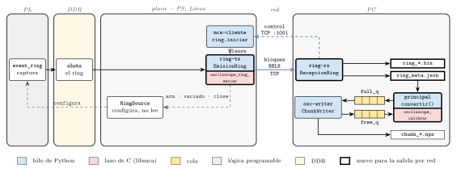
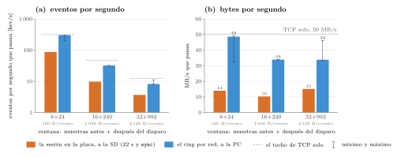

# Sacar los datos por red en vez de por la SD

> **Estado (2026-11-17):** el ring por red está implementado (libmca 0.12.0, abajo en
> «El ring por red») y **medido en la placa**: TCP solo da 50.4 MB/s, y la comparación
> con la SD está en «La SD contra la red, en la placa». Las secciones que siguen a esa
> son la nota de diseño original, de antes de la campaña por etapas: NFS sigue siendo
> el camino de la etapa C, que escribe archivos en la placa.

## El ring por red

**Por qué.** La campaña por etapas del 2026-11-12 ([`generador.md`](generador.md) §6)
separó qué frena en cada eslabón, con 32 muestras (8+24):

| etapa | qué incluye | tasa |
|---|---|---|
| A | la PL sola | 1.42 M ev/s |
| copia | el lector de C copiando cada slot | 753 k ev/s |
| B | y verificando cada slot | 300 k/s al día (439 saturado) |
| C | la sesión de Python en la placa, a `.npz` | 100 k/s al día (167 en la SD, 203 en `/dev/shm`) |

En C, `/dev/shm` da casi lo mismo que la SD: **lo que limita es la sesión de Python en
el A9, no el disco**, y por eso NFS no sube la tasa. El ring por red saca a la sesión
del camino de los datos en la placa: un lazo de C copia los slots y los manda por un
socket, sin Python por lote, y los archivos se escriben en la PC. El techo pasa a ser
la red. Con ~100 MB/s de TCP (un valor de referencia, **no medido en esta placa**):

| ventana | carga por slot | hoy, archivos en la placa (C) | techo por red |
|---|---|---|---|
| 8+24 | 160 B | 100–200 k ev/s | ~600 k ev/s (la copia, 753 k/s, no frena) |
| 32+992 | 4 128 B | 10 k ev/s | ~24 k ev/s (B ya da 23 k/s a 96 MB/s) |

**Cómo.** La Fig. `escritura_archivos_por_red` muestra el camino de los eventos, de la
lógica programable a los archivos en la PC.



*La escritura de los eventos del ring a archivos por red, con `ring.iniciar(destino='red')`. En la placa no corre la sesión: el hilo `ring-tx` llama a `osciloscope_ring_enviar`, que copia los slots y los manda en bloques `RBLK` por un socket de datos, y `RingSource` sólo configura el ring y el estímulo. En la PC, `ring-rx` guarda el stream tal cual en `ring_*.bin`, y `convertir()` lo pasa a los mismos `chunk_*.npz` con el pool y el `ChunkWriter` de la sesión. El control va por el socket del servidor (TCP :1001).*

- **En la placa**, `osciloscope_ring_enviar` (libmca 0.12.0,
  [`osciloscope_ring.h`](../../software/libmca/include/osciloscope_ring.h)) consume como
  `leer_lote`: sondea `WR_SLOT` y valida los footers, con una barrera antes de los datos
  y el crédito una vez por bloque. Copia cada slot compactado al buffer del bloque y
  **devuelve el crédito apenas copió, antes del `send()`**. `EmisionRing`
  ([`osciloscope_ring.py`](../../software/API/osciloscope_ring.py)) lo corre en un hilo
  y reusa `RingSource` para la geometría, el estímulo, `detener`, `vaciado` y `close`.
- **En la PC**, dos pasos a propósito
  ([`ring_red.py`](../../software/API/ring_red.py)):
  1. `RecepcionRing` guarda el stream tal cual llega, en `ring_NNNNNN.bin`. Por bloque
     sólo lee la cabecera, para contar y ver que los `seq` sigan: no toca los eventos.
  2. `convertir` pasa los `.bin` a los mismos `chunk_*.npz` (o `.lh5`) que escribe la
     sesión en la placa, con `ChunkWriter`, el mismo esquema y `run_summary.json`.
     Calibra con `osciloscope_calibrar`, la misma función de C del lazo de la placa,
     así que la onda sale igual, cuenta por cuenta.
- **Nada se pierde sin contarse.** Si la PC o la red se atrasan, el `send()` espera.
  Mientras tanto el ring se llena, y lo que no entra lo descarta el hardware y lo cuenta
  en `DROP_FULL`. Los descartes viajan en la cabecera de cada bloque, como el `gap` de
  su primer evento.

**El stream.** Cada bloque es una cabecera de 40 B y su carga:

| campo | tipo | qué es |
|---|---|---|
| `magic`, `version`, `flags` | u32, u16, u16 | `"RBLK"`, 1, `FIN` en el último |
| `seq0`, `n` | u32, u32 | el `seq` del primer slot y cuántos trae |
| `carga` | u32 | bytes por slot: la cabecera del slot (32 B) y las muestras crudas de los dos canales, intercaladas, redondeadas a 8 |
| `bytes` | u32 | lo que sigue: `n · carga`, o los contadores en el FIN |
| `descartados` | u64 | `DROP_BUSY + DROP_FULL` antes de este bloque |
| `t_ns` | i64 | el `CLOCK_MONOTONIC` de la placa al leer el bloque |

El último bloque es el FIN: `n = 0`, los descartes que faltaban y, como carga, los
contadores del ring (`osciloscope_ring_contadores_t`, 48 B). Con eso cierran dos cuentas,
que `RecepcionRing.cuentas()` verifica:

- `EV_CNT` = los eventos recibidos;
- la suma de los `descartados` = `DROP_BUSY + DROP_FULL`.

La geometría y la calibración no viajan en el stream: van en la respuesta de
`ring.iniciar`, y la PC las guarda en `ring_meta.json`.

**El orden.**

1. `ring.iniciar(destino='red')` abre el puerto de datos y responde con él.
2. La PC se conecta. Recién ahí la placa arma el ring, así no se pierde el principio.
   Sólo acepta la conexión que venga de la IP del cliente que la pidió.
3. Para parar, `ring.parar` repite lo de la sesión:
   1. corta el estímulo con el ring andando;
   2. espera que salga lo que quedó (`vaciado`, dos veces seguidas);
   3. manda el FIN;
   4. para el ring.

Si nadie se conecta en 10 s, la emisión termina sola con el motivo `sin_conexion`. Si la
PC se va, termina con el motivo `red`. En los dos casos `ring.parar` igual para el ring.

**Cómo se corre** (desde `software/`, con el bitstream del ring cargado):

```bash
make libmca-arm placa-sync                            # libmca 0.12.0 en la placa
make app-servidor-off-remoto app-servidor-remoto      # el servidor, con el código nuevo
make bench-tcp-placa                                  # Fase 0: TCP solo, el techo
make campana-etapas-ring-por-red OUT=datos/etapas_red_<fecha> ARGS="--ventanas 8+24,16+240,32+992"
make ring-red-recibir RED_SEG=30 ARGS="--generador 1e5 --convertir"   # una corrida suelta
```

- **D0** recibe y descarta: es el techo de la placa y la red juntas, sin el disco.
- **D** guarda, convierte y verifica con las reglas de la etapa C. Además, las cuentas del
  stream tienen que cerrar.
- El reparto entre `copia_ns` y `envio_ns` dice qué frenó: si el tiempo se va en el
  `send()`, es la red; si se va en la copia, es la placa.

**La PC tiene que estar cableada a la misma red que la placa.** Por WiFi o por un ruteo,
lo que se mide es el enlace, no la placa.

**Probado sin placa** (2026-11-14), contra el ring simulado:

- [`API/tests/test_ring_red_stream.py`](../../software/API/tests/test_ring_red_stream.py):
  el stream, las cuentas con descartes, la conexión que no llega o que se corta, la
  conversión con la verificación de C y la calibración contra la de C.
- [`app/tests/test_ring_red.py`](../../software/app/tests/test_ring_red.py): por el
  servidor `--fake`.
- [`campanas/tests/test_etapas_ring.py`](../../software/campanas/tests/test_etapas_ring.py):
  las etapas D0 y D.

## La SD contra la red, en la placa (2026-11-17)

Medimos la escritura de archivos de las dos maneras, con el generador de eventos de la
FPGA como estímulo y las mismas tres ventanas:

- **La sesión en la placa (etapa C):** `AcquisitionSession` lee el ring y guarda `.npz`
  en la SD de la placa. Un punto por ventana, con unos 22 s de estímulo, 300–400 MB
  escritos y el `sync` del final contado en el tiempo, así que mide lo que llega a la
  tarjeta. Bitstream del ring c1875919.
- **El ring por red (etapa D):** el lazo de C manda los slots a la PC, y la PC los
  guarda, los convierte a `.npz` y los verifica. Bitstream del ring c1875919, libmca
  0.12.0, y la PC cableada a la red de la placa, a 1 Gb/s.

La red recorre la tasa del generador (de 10 k/s a 3 M/s, periódico y aleatorio); la SD
usa una tasa por ventana que ya la satura (200, 40 y 10 k/s). Lo que se compara es **lo que pasa con el ring saturado**: los eventos
por segundo que llegan a un archivo cuando el ring ya está lleno y el hardware descarta
por `DROP_FULL`. Antes medimos TCP solo, de la placa a la PC y sin el ring
(`make bench-tcp-placa`): **50.4 MB/s**, la mitad de los ~100 MB/s que tomamos como
referencia arriba. Los resultados se presentan en la Fig. `bench_sd_red` y la Tabla
`sd_red`.



*Lo que llega al guardado persistente con el ring saturado, de las dos maneras: la sesión de Python en la placa, que guarda `.npz` en la SD (etapa C, puntos de 22 s con el `sync` del final contado), y el ring por red, que manda los slots a la PC y los guarda y convierte allá (etapa D). Las dos, el 2026-11-17. (a) En eventos por segundo, en escala logarítmica; la raya es el techo de TCP solo para ese tamaño de evento. (b) En MB/s. La SD es un punto por ventana; en la red, cada barra es la mediana de los puntos con `DROP_FULL`, en los dos modos del generador, y el bigote va del mínimo al máximo. A la tarjeta llegan 10–15 MB/s, y la red pasa entre 2.2 y 3.5 veces más.*

| ventana | bytes por evento | SD                | red                        | red / SD |
| ------- | ---------------- | ----------------- | -------------------------- | -------- |
| 8+24    | 160              | 87 k/s (14 MB/s)  | 304 k/s (49 MB/s), 202–308 | 3.5      |
| 16+240  | 1 056            | 9.8 k/s (10 MB/s) | 32 k/s (34 MB/s)           | 3.3      |
| 32+992  | 4 128            | 3.7 k/s (15 MB/s) | 8.2 k/s (34 MB/s)          | 2.2      |

Tabla `sd_red`: lo que llega al guardado persistente con el ring saturado. La SD, con
puntos de 22 s y el `sync` contado; la red, la mediana de los puntos con `DROP_FULL`.

- **Los puntos cortos de la SD no miden la tarjeta.** La sesión no hace `fsync`:
  `write()` vuelve cuando los datos están en el page cache, y el kernel los baja a la SD
  después. Cada punto del 2026-11-12 duraba 1–4 s y escribía a lo sumo unos 100 MB, y
  la placa tiene unos 350 MB de RAM disponible, con `dirty_ratio` en 20 %. El kernel
  empieza a frenar al que escribe recién con unos 70 MB sin bajar, así que la sesión
  nunca esperó a la tarjeta. Los 26–39 MB/s de esos puntos son lo que cuesta Python más
  `savez` escribiendo en RAM.
- **A la tarjeta llegan 10–15 MB/s.** Con puntos de 22 s, el page cache se llena a los
  pocos segundos y la sesión queda atada a la SD. Contando el `sync` del final (2–8 s),
  pasan 87 k/s con 8+24, 9.8 k/s con 16+240 y 3.7 k/s con 32+992. Para comparar,
  medimos también `dd` con `conv=fsync`, 256 MiB a la SD: 19 MB/s, y sin `fsync`,
  85 MB/s.
- **La red pasa entre 2.2 y 3.5 veces más que la SD.** Con 32 muestras, por la red pasan
  304 k/s, casi lo que da TCP solo con eventos de 160 B (315 k/s). Con las ventanas
  largas, la red se planta en unos 34 MB/s, y la SD en 10–15 MB/s.
- **La red no llega a los 50 MB/s de TCP solo, salvo con 8+24.** Con 32 muestras hay dos
  regímenes, unos 200 k/s (32 MB/s) o unos 300 k/s (48 MB/s), y en los dos el lazo pasa
  el 55–80 % del tiempo en `send()`. Con las ventanas largas se queda siempre en 34 MB/s.
  No investigamos todavía por qué: el bloque de 1 MiB de `bench-tcp-placa` es más grande
  que los que arma el lazo, y puede ser eso.
- **La SD, además, se llena.** Quedan unos 1.4 GB libres: a 15 MB/s son menos de 2
  minutos. La red escribe en el disco de la PC y no tiene ese límite.
- **Nada se perdió sin contarse.** En los 42 puntos de la etapa D y en los 39 de la
  etapa C contra la SD, la verificación de los archivos no encontró errores, y los
  eventos que faltan son los descartados por el hardware (`DROP_BUSY` y `DROP_FULL`).

Los datos están en `software/datos/etapas_red_2026-11-17{,b,c}/`, y los de la SD, en
`software/datos/placa_etapas_20261112/etapa_C_sd/` (los puntos cortos) y
`software/datos/etapas_sd_largo_2026-11-17/` (los largos). La figura se genera con
[`figuras_escritura_sd_red.py`](../API/figuras/figuras_escritura_sd_red.py).

## El problema con la SD, en concreto

La expectativa de "SD clase 10 → 100 MB/s" no se cumple, por dos razones
independientes:

1. **La clase de velocidad SD garantiza un mínimo secuencial de escritura de
   10 MB/s.** Los "100 MB/s" del rótulo son el pico de *lectura* del bus UHS-I.
   La escritura sostenida de una tarjeta común está en 10-30 MB/s y cae más
   cuando se agota el caché SLC interno.
2. **El controlador manda sobre la tarjeta.** El SDIO del Zynq-7000 en la Red
   Pitaya corre en modo 4 bits; con reloj de 50 MHz el techo de bus son ~25 MB/s,
   y el throughput real de filesystem típicamente 10-20 MB/s. Poner una tarjeta
   más rápida no mueve la aguja: el cuello está aguas arriba de la tarjeta.

Los 12.4 MB/s medidos de `savez` son sospechosamente parecidos a ese techo.
**Antes de tocar el formato de archivo, correr el diagnóstico**: repetir el
benchmark escribiendo a `/dev/shm` (tmpfs, o sea RAM). Si salta a >100 MB/s, el
formato no es el cuello y cambiarlo no compra nada; si se queda en ~12, entonces
sí el cuello es `savez`.

Por GbE el Zynq 7010 da **~90-110 MB/s reales con TCP**, o sea 5-8× la SD. Con la
ventana default (144 B/evento) eso son ~700 kev/s de techo de transporte: la red
deja de ser el límite.

## Corrección sobre "por si falla la transferencia de paquetes"

TCP ya garantiza entrega o error: la pérdida de paquetes se retransmite sola y no
se ve desde la aplicación. Contra lo que hay que protegerse no es contra paquetes
perdidos sino contra que **el servidor o el enlace se caigan** durante una
corrida. Eso cambia dónde conviene poner la red de contención.

Y la primera línea de contención **ya es el ring de DDR**: con 32 MB reservados y
144 B/evento son ~230 k eventos, es decir **~2.3 s a 100 kev/s**. Una caída de red
más corta que eso no cuesta ni un evento y no toca el disco. El ring y la
robustez ante fallas de red terminan siendo el mismo mecanismo.

## Opciones, y cuál conviene

| | throughput | costo de CPU | complejidad | veredicto |
|---|---|---|---|---|
| **NFS** | ~60-90 MB/s | bajo | monta y listo | **recomendado** |
| socket TCP crudo + daemon en la PC | ~100 MB/s | el más bajo | hay que escribir el daemon | si NFS no alcanza |
| SMB/CIFS | ~40-60 MB/s | medio | media | sin motivo entre dos Linux |
| SSHFS | ~20-40 MB/s | **alto** (AES por software) | baja | **evitar**: se come la CPU que necesita el lector |
| iSCSI / NBD | alto | medio | alta | overkill |

El A9 del 7010 no tiene aceleración de AES, así que SSHFS quema CPU que hace
falta para el lazo de adquisición. Si hace falta cifrar, conviene hacerlo en la
PC sobre el archivo ya recibido, no en vuelo.

## NFS: cómo montarlo

**En la PC** (`/etc/exports`):

```
/datos/pitaya  192.168.1.0/24(rw,async,no_subtree_check,no_root_squash)
```

`async` es lo que más mueve el throughput: el servidor confirma la escritura sin
esperar a que baje a disco. El riesgo es perder lo que estaba en vuelo si la PC
se cae de golpe — aceptable acá, porque la fuente de verdad durante la corrida es
el ring de DDR, no el archivo a medio escribir.

**En la Pitaya**:

```bash
mount -t nfs -o \
  nfsvers=4.1,proto=tcp,wsize=1048576,rsize=1048576,noatime,soft,timeo=50,retrans=2 \
  192.168.1.100:/datos/pitaya /mnt/datos
```

Las opciones que importan:

- `wsize=1048576` — escrituras de 1 MB. Con el default (a veces 32-64 KB) se
  pierde la mitad del ancho de banda en round-trips.
- `noatime` — sin esto, cada escritura arrastra una actualización de metadatos.
- **`soft,timeo=50,retrans=2` en vez de `hard`** — es la decisión menos obvia y
  la más importante. Con `hard` (el default y lo que normalmente se recomienda),
  si el servidor desaparece el `write()` **bloquea para siempre** y el hilo
  escritor queda colgado; en una adquisición eso es fatal. Con `soft`, `write()`
  devuelve `EIO` a los ~10 s y la aplicación puede pasar al respaldo local. Se
  cambia "integridad silenciosa" por "error visible y manejable", que para este
  caso es el trade correcto.

## Cómo escribir, del lado de la aplicación

Tres reglas, en orden de impacto:

1. **Nunca escribir desde el hilo lector.** Ya está resuelto en la estructura
   actual (`mca/reader.py` produce batches, `mca/storage.py` los escribe): el
   jitter de la red no puede propagarse hacia atrás y frenar la captura. Al pasar
   a NFS, mantener esa separación es más importante todavía, porque la varianza
   de latencia de una escritura de red es mucho mayor que la de la SD.
2. **Pocos archivos grandes, no muchos chicos.** Cada archivo nuevo sobre NFS
   cuesta round-trips de metadatos (CREATE, SETATTR, COMMIT). Un archivo por
   batch mata el throughput; conviene uno por bloque de N segundos, en modo
   append.
3. **Escribir binario plano, no `savez`.** El slot ya viene en un formato binario
   fijo desde el RTL (cabecera de 32 B + muestras int16 + footer): el camino más
   rápido es volcar los slots tal cual y guardar la geometría en un `.json` al
   lado. Se ahorra la serialización de numpy y la copia intermedia. Pero **esto
   sólo vale la pena si el diagnóstico de `/dev/shm` mostró que `savez` era el
   cuello** — si el cuello era la SD, cambiar de medio ya resolvió el problema.

## Patrón recomendado: red primaria, local como contención

```
ring DDR (32 MB, ~2.3 s a 100 kev/s)
    │
    ├─► escritor  ──► /mnt/datos (NFS)        camino primario
    │                     │
    │                  EIO / timeout
    │                     ▼
    └────────────► /root/spill/*.bin (SD)     sólo cuando la red falla
```

El archivo local **no** tiene que llevar todo: existe nada más para cubrir el
hueco entre que la red se cae y el ring se llena. A 15 MB/s de SD absorbe
~100 kev/s de la ventana default, que es del orden de la tasa objetivo.

Al reconectar, un proceso aparte sube los `spill` a la PC. Conviene un `sha256`
por archivo para poder verificar la transferencia sin depender de que nadie se
haya equivocado con los cortes.

## Presupuesto de DDR

Sumar la salida por red no compromete el ring: leer del ring (72 MB/s a 500 kev/s)
más copiar hacia los buffers del NIC es del orden del **7 % del ancho útil de la
DDR** (~1.4 GB/s reales sobre un bus de 16 bits). El cuello sigue estando en la
red y en la CPU, no en la memoria.
