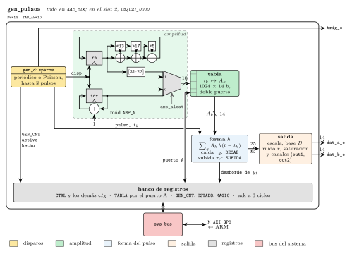
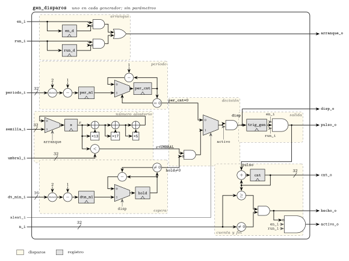
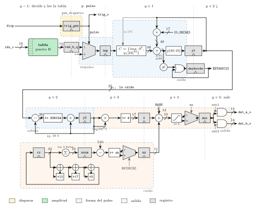

# El generador de pulsos (`gen_pulsos`)

`modulos/gen_eventos/rtl/gen_pulsos.sv` genera pulsos de preamplificador dentro de la
FPGA, en el lugar del ASG de Red Pitaya, para probar el multitrigger y el MCA sin el
Rigol. Este doc explica por qué, qué genera, cómo se configura, cómo se verificó y qué
falta para usarlo en la placa.

**Estado (2026-11-09):** RTL, modelo y testbenches hechos y en verde, instanciado en los
dos tops (`mca_red_pitaya_top` y el del ring, que se genera de ése). Lo trae el cuarto
bitstream del ring (78e26188, probado en la placa: ver §8 y `out/v3_event_ring/LEEME.md`).
El del MCA (6156e5a3) es anterior y no lo tiene; el siguiente (cce7b66b, 2026-11-12)
sí, probado en la placa por la app el 2026-11-13 (`make verificar-placa-lazo`).
**En libmca desde 0.9.0**
(`gen_pulsos.h`, `API/generadores.py`), probado contra un modelo de los registros y
contra el modelo de Python y en la placa (2026-11-09: `make verificar-placa-generadores`
hace lo de §8 con la API y da lo mismo que la réplica). En la app, la pestaña
**Generador** (`software/app/panel_generador.py`).

## 1. Por qué

Con el Rigol el estímulo pasa por el DAC del Rigol, el cable y el ADC. Sirve para medir
la resolución, pero tiene tres límites para probar la lógica:

- **No hay verdad evento por evento.** El ruido analógico deja comparar estadísticas
  contra la réplica del MCA (`software/monte-carlo/replica_mca2.py`), no cada evento.
- **No se sabe qué pulso se perdió.** Se sabe cuántos llegaron, no cuándo ni con qué
  amplitud.
- **La tasa y el apilamiento dependen de la forma de onda arbitraria** que se carga en el
  Rigol (y de su firmware, que se cuelga con ciertos largos).

Con el generador en la FPGA y el lazo digital, el MCA ve exactamente la traza que predice
el modelo, así que **la placa se puede comparar contra la réplica evento por evento**:
una diferencia sería del silicio (timing, CDC, el bus) y no del diseño.

**Lo que no prueba:** el ADC y la entrada analógica (el ruido real, la INL, la deriva de
la base con la temperatura, la variación de forma de un detector). Eso sigue siendo del
Rigol o del detector. El modo analógico (abajo) cubre una parte.

**Por qué no el ASG de Red Pitaya.** El ASG
([`red_pitaya_asg_ch.sv`](../../../../rtl/classic/red_pitaya_asg_ch.sv)) reproduce una
forma de onda: una memoria de 16 384 muestras por canal, que se lee en ciclo o en ráfagas,
con una ganancia y un offset para toda la onda. Tiene el mismo límite que el Rigol, con
menos memoria. Para el MCA hace falta generar un tren de pulsos, y el ASG no puede:

- **Lo aleatorio se repetiría.** Un tren Poisson con alturas sorteadas habría que
  calcularlo antes y cargarlo en la memoria, y 16 384 muestras son 131 µs: unas decenas de
  pulsos de τ = 2 µs, repetidos siempre iguales. El espectro serían esas pocas alturas, no
  un sorteo.
- **La amplitud es una para toda la onda** (`set_amp`). Cambiarla pulso a pulso desde el
  PS no llega: el bus no tiene ráfagas y no está sincronizado con la lectura.
- **No suma pulsos.** La salida es una muestra de la memoria, escalada: dos pulsos que se
  solapan tienen que estar ya sumados en la memoria.
- **El disparo marca la onda, no cada pulso** (`trig_out_o` es el que arranca la
  reproducción): con un tren en la memoria, la fuente ASG del multitrigger no da un
  disparo por pulso.
- **El ruido reemplaza a la onda** (un mux elige entre el LFSR y la memoria), no se suma.
- **Ocupa lo que el MCA necesita.** Sacarlo liberó ~17 RAMB36 de los 60 del 7010, sin los
  cuales el espectro y el mapa 2D no entraban juntos
  ([`decisiones_diseno_mca.md`](../mca/decisiones_diseno_mca.md) §4). `gen_pulsos` usa
  una RAMB18 (§6).

`gen_pulsos` ocupa su lugar con las mismas tres conexiones (§2): para el resto del top
sigue siendo "el ASG", pero hace otra cosa.

## 2. Dónde va: el lugar del ASG

El ASG de Red Pitaya se sacó del top del MCA (liberaba ~17 RAMB36). `gen_pulsos` toma
sus tres conexiones, así que el resto del top no cambia:

```
                         ┌─ digital_loop[0] = 1 ─► adc_dat ─► i_scope ─► OSC, multitrigger, MCA, ring
gen_pulsos ─► asg_dat ─► dac_a ─┤
     │                   └─ digital_loop[0] = 0 ─► DAC ─► OUT1 / OUT2
     └─► trig_asg_out ─► multitrigger: fuente ASG (OR_MASK bit 11 flanco +, 12 flanco −)
```

- **`asg_dat`**, la entrada del DAC. El bit 0 de `digital_loop` (housekeeping,
  `0x4000_000C`) hace que `adc_dat` tome el DAC en lugar del ADC, antes de la calibración:
  todo el datapath ve los pulsos, bit a bit. Sin el bit, salen por OUT1/OUT2; con un cable
  a IN1 es un estímulo analógico con el ruido real del ADC.
- **`trig_asg_out`**, la fuente ASG del multitrigger. Con `OR_MASK = 0x800` el multitrigger
  dispara en cada pulso generado, y el MCA abre una ventana por pulso: así se separan las
  pérdidas del disparo de las del MCA.
- **El slot 2**, que reparte con el event_ring
  ([`sys_bus_split`](../../modulos/comun/rtl/sys_bus_split.sv)): los 64 KB con
  `addr[19:16] = 1` van al generador, en **`0x4021_0000`**, y el resto al ring
  (`0x4020_0000`; en el top del MCA, un stub). La misma dirección en los dos bitstreams.
  `integration_cfg` lo anuncia: bit 6 de `MODULES` y `SLOTS[23:20]`
  ([`register_map_top.md`](../TOP/register_map_top.md)).

Como el ASG, corre en `adc_clk`. Apagado (el reset), `asg_dat` y `trig_asg_out` quedan en
cero: el DAC mudo, como antes.

## 3. Qué genera

La salida es un tren de pulsos de preamplificador: **la misma forma $h$, escalada y
corrida para cada pulso**, sobre una base, con ruido y recortada al rango del DAC:

$$v(t) = \operatorname{sat}_{14}\Big(B + \sum_k A_k\,h(t-t_k) + r(t)\Big), \qquad t = n\,T_s$$

$$h(t) = \frac{\tau_d}{\tau_d-\tau_r}\left(e^{-t/\tau_d} - e^{-t/\tau_r}\right), \qquad t \ge 0$$

$t_k$ es el instante del pulso k y $A_k$ su altura; $B$ es la base, $r$ el ruido y
$T_s$ = 8 ns el período de muestreo (125 MHz). $h$ es la salida de un preamplificador de
carga: un escalón que cae con la **constante de caída** $\tau_d$ (la del RC de
realimentación), pasado por un pasabajos RC de **constante de subida** $\tau_r$. Sin subida
($\tau_r = 0$) queda $h(t) = e^{-t/\tau_d}$ y el pico es exactamente $A_k$. La sumatoria es
una **convolución**: con el tren de impulsos $x(t) = \sum_k A_k\,\delta(t-t_k)$, es
$(h * x)(t)$.

Es la misma expresión que la respuesta al escalón de un conformador CR-RC, pero acá
cumple el papel de la señal del preamplificador, la que **entra** al MCA. El conformado lo
hace el MCA: el trapecio, con el polo-cero que cancela $\tau_d$.

La ecuación omite la latencia fija (la muestra sale 5 ciclos después del pulso) y los
redondeos, que van hacia cero y son de menos de 2 cuentas (comparada con el modelo, que es
el RTL bit a bit). Cada término lo hace un bloque:

| término | qué es | bloque (panorama) | registros (datapath) | se configura con |
|---|---|---|---|---|
| $t_k$ | cuándo sale el pulso k | `gen_disparos` | `pulso` | `CTRL.aleatorio`, `PERIODO`, `UMBRAL`, `DT_MIN`, `N` |
| $A_k$ | de qué altura: $A_k = \mathrm{TABLA}[i_k]$ | amplitud: el índice $i_k$ y la tabla | `idx_c`, `tab_b_q` | `CTRL.amp_aleat`, `AMP_N`, `TABLA` |
| $h$ | con qué forma, la misma para todos | forma: un polo por constante de tiempo | `imp`, `y1` ($\tau_d$), `y2` ($\tau_r$) | `DECAE` ($\tau_d$), `SUBIDA` ($\tau_r$) |
| $B$, $r$, sat₁₄ | la base, el ruido y el recorte | salida | `s`, `rr`, `nsum`, `nz`, `dat` | `BASE`, `RUIDO`, `CTRL.out1`, `CTRL.out2` |

`imp` es $x$ muestreado, donde se juntan los dos primeros: vale $A_k$ en el ciclo del
pulso k y 0 en los demás. La forma convoluciona $x$ con $h$.



*En estilo datapath, para una hoja A4, con los símbolos de la ecuación. Arriba,
de izquierda a derecha: `gen_disparos` decide el disparo y `disp` hace avanzar
los dos índices de la amplitud: los 10 bits altos de un xorshift32 propio (con
`amp_aleat`) o una cuenta de 0 a `AMP_N − 1`. El índice $i_k$ lee la tabla, que
da la altura $A_k$; el pulso ($t_k$) y la altura entran a la forma, que hace
$\sum_k A_k\,h(t-t_k)$ con $\tau_d$ y $\tau_r$; la salida suma la base $B$ y el ruido $r$, satura a 14 b y va
a los canales. La forma y la salida, operación por operación y ciclo por ciclo,
están en el datapath; el motor, en su propio panorama. El xorshift32 es tres XOR
de la palabra consigo misma corrida (`<<13`, `>>17`, `<<5`) y renueva los 32 bits
en cada paso. Los números sobre las flechas son anchos en bits. El color es la
función (la leyenda). `NOMBRE=valor`: parámetros de la instancia en el top
(`TAB_AW`, el de por defecto).*

([fuente](figuras/panorama_gen_pulsos.tex))

### Los disparos: $t_k$

Los decide [`gen_disparos.sv`](../../modulos/gen_eventos/rtl/gen_disparos.sv), el mismo
motor del [generador del ring](../event_ring/generador.md), hasta `N` pulsos (0 = sin fin):

- **periódicos:** $t_{k+1} - t_k$ = `PERIODO` · $T_s$;
- **aleatorios:** en cada ciclo dispara con probabilidad `UMBRAL / 2³²`, y después de cada
  disparo espera `DT_MIN − 1` ciclos. Es un Poisson discreto con tiempo muerto no
  paralizable: el intervalo medio es `(DT_MIN − 1) + 2³² / UMBRAL` ciclos.



*Cada operación con su símbolo. Decide en cada ciclo si dispara, y lo decidido
(`disp`) sale en el ciclo siguiente por `trig_gen`, sólo si `en_i` y `run_i`
siguen altos. La decisión es un mux que elige `aleat_i`: en modo periódico
dispara cuando `per_cnt` llega a 0 (cuenta de `PERIODO − 1` a 0 y recarga); en
aleatorio, cuando `x < UMBRAL` y no queda espera (`hold` carga `DT_MIN − 1` con
cada disparo y baja hasta 0). Los intervalos aleatorios son geométricos: un
Poisson discreto con tiempo muerto no paralizable. La Y con `activo` corta al
llegar a `N` pulsos. `x` es un xorshift32, tres XOR de la palabra consigo misma
corrida; un LFSR de un bit por paso daría ráfagas al compararlo con un umbral.
Los mínimos (`max` con 2, menos 1) están registrados: un cambio de `PERIODO` o
de `DT_MIN` entra un ciclo tarde. Las habilitaciones no se dibujan: `x` avanza
con `activo`, `per_cnt` con `activo` en modo periódico y `hold` con `activo` en
aleatorio. El arranque (flanco de `en_i` o de `run_i`) carga `x` con `SEMILLA`
(0 usa `0x2545F491`) y `per_cnt` con `per_m1`, y pone `hold`, `trig_gen` y
`cnt` en 0: con la misma semilla, los disparos caen siempre en el mismo ciclo.
Los nombres sin cable (`arranque`, `disp`, `activo`, `en_i`, `run_i`) son la
señal del mismo nombre. `hold_o` y `trig_gen_o`, para las assertions, no se
dibujan.*

([fuente](figuras/panorama_gen_disparos.tex))

### La amplitud: $A_k$, para qué está la tabla

**La tabla no guarda la forma del pulso**: eso hacía la del ASG, muestra por muestra. Acá
la forma la calculan los dos polos (abajo), y la tabla guarda **sólo las alturas**: es el
mapeo índice → altura, $A_k = \mathrm{TABLA}[i_k]$, con 1024 entradas de 14 bits con signo
que carga el PS (`TABLA`, `0x1000 + 4 i`).

Está para poder generar **cualquier espectro de amplitudes**, que es lo que mide el MCA. El
índice $i_k$ sale de dos maneras:

- **Con `amp_aleat`, al azar:** $i_k$ son los 10 bits altos de un xorshift32 propio, que
  avanza un paso por pulso. Cada entrada sale con probabilidad 1/1024, así que **el
  espectro generado es el histograma del contenido de la tabla**. Para un espectro dado se
  carga su CDF inversa: la entrada i es el cuantil (i + ½) / 1024. Por ejemplo,
  `tabla_cdf([1500, 4000], [0.6, 0.4])` llena 614 entradas con 1500 y 410 con 4000: dos
  líneas, con el 60 % y el 40 % de los pulsos (la probabilidad tiene 1/1024 de resolución).
  Un pico gaussiano son sus 1024 cuantiles.
- **Sin el bit, en orden:** $i_k$ = k mód `AMP_N`, de 0 a `AMP_N − 1` y vuelve a empezar.
  Es una secuencia conocida: un barrido para la linealidad, o unas pocas amplitudes para
  comparar evento por evento.

### La forma: $h$

La forma es la convolución $h * x$, pero **no se calcula como convolución**. $h$ dura miles
de muestras ($5\,\tau_d$ son ~1300 con el reset), y un FIR necesitaría un producto por
cada una. Como $h$ es una suma de dos exponenciales, la misma convolución sale
**recursiva**, con un filtro IIR de un polo por constante de tiempo:

$$H(z) = \frac{1-p_r}{\left(1 - p_d\,z^{-1}\right)\left(1 - p_r\,z^{-1}\right)}, \qquad p_d = e^{-T_s/\tau_d}, \qquad p_r = e^{-T_s/\tau_r}$$

Su respuesta al impulso es $h$ muestreada cada $T_s$: difiere en menos del 0.3 % de
$A_k$, con una muestra de corrimiento cuando hay subida, que va con la latencia fija. En
el hardware son los dos polos en cascada, uno por registro, a una muestra por ciclo; `imp`
($x$) entra a `y1` con 8 bits de fracción:

```
caída  (p_d)   y1 ← trunc0(y1 · DECAE / 2¹⁶) + imp · 2⁸     = p_d · y1 + x · 2⁸
subida (p_r)   y2 ← y2 + ((y1 − y2) >>> SUBIDA)            = p_r · y2 + (1 − p_r) · y1
```

Así, $y_2 = 2^8\,(h * x)$, salvo los redondeos: un producto y un corrimiento por muestra,
los mismos con un pulso que con cien apilados. Los registros son los polos:

$$p_d = \frac{\mathtt{DECAE}}{2^{16}}, \qquad p_r = 1 - 2^{-\mathtt{SUBIDA}}$$

Por eso la subida va en potencias de 2: su polo es un corrimiento y no necesita un segundo
multiplicador.

- **La caída**, $\tau_d = -T_s / \ln(\mathtt{DECAE} / 2^{16})$, es la del preamplificador. La
  constante del polo-cero que la cancela es exactamente **M = DECAE / (2¹⁶ − DECAE)**
  $= p_d / (1 - p_d)$ (el trapecio y el disparo con polo-cero toman Mq = round(16 M)). El
  reset, `DECAE = 65280`, da M = 255 y $\tau_d$ = 255.5 $T_s$ = 2.04 µs.
- **La subida**, $\tau_r = -T_s / \ln(1 - 2^{-\mathtt{SUBIDA}}) \approx 2^{\mathtt{SUBIDA}}\,T_s$.
  Con `SUBIDA = 0`, $p_r = 0$: `y2` copia a `y1`, $h(t) = e^{-t/\tau_d}$ y **el pico es
  exactamente $A_k$**. Con subida el pico es menor, porque mientras sube ya está cayendo.
  $\tau_r$ no es el tiempo de subida 10–90 %: con la caída encima, la relación cambia con
  `SUBIDA`. Con la $\tau_d$ del reset:

  | `SUBIDA` | $\tau_r$ | subida 10–90 % | pico / $A_k$ |
  |---|---|---|---|
  | 0 | 0 | una muestra | 1 |
  | 1 | 1.4 $T_s$ = 12 ns | 17 ns | 0.97 |
  | 2 | 3.5 $T_s$ = 28 ns | 47 ns | 0.94 |
  | 3 | 7.5 $T_s$ = 60 ns | 101 ns | 0.90 |
  | 4 | 15.5 $T_s$ = 124 ns | 187 ns | 0.84 |
  | 5 | 31.5 $T_s$ = 252 ns | 321 ns | 0.75 |
  | 6 | 63.5 $T_s$ = 508 ns | 521 ns | 0.63 |
  | 7 | 127.5 $T_s$ = 1.02 µs | 801 ns | 0.50 |

- **Es lineal**, así que el apilamiento sale exacto y sin límite de solapamiento.
- **Los redondeos van a cero:** entre pulsos la salida vuelve exacto a `BASE + ruido`, para
  pulsos de cualquier signo. `y1` tiene 25 bits (8 veces el fondo de escala); si se
  desborda, `ESTADO[2]` queda prendido hasta el próximo arranque.

### La salida: `BASE`, $r$ y la saturación

`y2 / 2⁸` (hacia cero), más `BASE` y el ruido, saturado a 14 bits con signo, va a los
canales que prenden `out1` y `out2`.

**El ruido**, si se prende, es la suma de los cuatro bytes de otro xorshift32, menos 510
(casi gaussiano), corrida `sh` bits: **σ = 147.8 / 2^sh cuentas** (`sh = 6` da 2.3).

Los tres generadores (el del motor, el de la amplitud y el del ruido) son **xorshift32**
(Marsaglia, 2003): un registro de 32 bits que en cada paso hace `x ^= x << 13`,
`x ^= x >> 17`, `x ^= x << 5`. Es lineal sobre GF(2), como un LFSR, y recorre los
2³² − 1 estados no nulos, pero **no es un LFSR de un bit por paso**: renueva la palabra
entera. Eso importa acá. Con un LFSR de Fibonacci, dos palabras seguidas son la misma
corrida un bit, así que la suma de bytes de una muestra y la siguiente saldría
correlacionada, y el comparador del motor daría ráfagas.

### Es determinista

Todo el estado se reinicia al prender `CTRL.en`, y los tres xorshift salen de una sola
`SEMILLA`. El modelo
([`gen_pulsos_model.py`](../../modulos/gen_eventos/modelos/python_model/gen_pulsos_model.py))
simula los registros ciclo a ciclo y predice cada muestra:

```python
from gen_pulsos_model import traza, decae_para, tabla_cdf
t = traza(100_000, tabla_cdf([1500, 4000], [0.6, 0.4]), aleatorio=True, umbral=...,
          amp_aleat=True, decae=decae_para(250), ruido=True, ruido_sh=6)
t['dat'], t['trig'], t['amp']      # las muestras, los pulsos y sus amplitudes
```

El pulso que sale en el ciclo g (`trig_o`) aparece en la salida en el ciclo g + 5 (con
`SUBIDA = 0`):



*Registro por registro, con el ancho de cada señal. La regla de cada fila dice
en qué ciclo está el pulso entre dos registros, con g el ciclo en que sale por
`trig_o`: en g − 1 el motor decide y la tabla se lee en `idx_c`; en g,
`tab_b_q` trae la amplitud y `pulso` la deja pasar a `imp`; la caída llega a
`y1` en g + 2, la subida a `y2` en g + 3, la escala a `s` en g + 4, y la
muestra está en `dat` en g + 5. La caída es un producto y una sola suma: la
entrada `C` lleva el impulso desde el bit 24 y, en los 16 de abajo, el signo de
`y1` repetido, que hace que tomar `p[40:16]` redondee hacia cero. Si
`p[41] ≠ p[40]`, `y1` se desbordó, y la O con su propia salida deja el aviso
prendido hasta el próximo arranque. La escala redondea igual, con el signo de
`y2` repetido 8 veces. Con `SUBIDA = 0`, `y2` copia a `y1`. El ruido corre
aparte, un paso por ciclo: el xorshift32 `rr` (tres XOR con corrimiento), la
suma de sus cuatro bytes, menos 510 y corrida `sh` bits; `nsum` y `nz` lo
registran en las mismas etapas que `y2` y `s`. Con `en = 0`, `dat` queda en 0 y
los polos y el ruido se congelan.*

([fuente](figuras/datapath_gen_pulsos.tex))

## 4. Registros

Base `0x4021_0000`.

| off | acc | nombre | qué |
|---|---|---|---|
| `0x0000` | RW | `CTRL` | `[0]` en · `[1]` aleatorio · `[2]` amp_aleat · `[3]` out1 · `[4]` out2 |
| `0x0004` | RW | `PERIODO` | ciclos entre pulsos, modo periódico (menos de 2 vale 2); reset 1000 |
| `0x0008` | RW | `UMBRAL` | probabilidad por ciclo × 2³², modo aleatorio |
| `0x000C` | RW | `DT_MIN` | ciclos mínimos entre pulsos, modo aleatorio; 16 bits, menos de 2 vale 2 |
| `0x0010` | RW | `N` | cuántos pulsos; 0 = sin fin |
| `0x0014` | RW | `SEMILLA` | de los tres xorshift; 0 usa `0x2545F491` |
| `0x0018` | R | `GEN_CNT` | pulsos que salieron desde el arranque |
| `0x001C` | R | `ESTADO` | `[0]` generando · `[1]` llegó a N · `[2]` desborde de y1 |
| `0x0020` | R | `MAGIC` | `0x50554C31` = `"PUL1"` |
| `0x0024` | RW | `DECAE` | 16 bits: el polo de caída × 2¹⁶, 2¹⁶ e^(−T_s/τ_d); reset 65280 (τ_d = 2.04 µs) |
| `0x0028` | RW | `SUBIDA` | `[2:0]`: la constante de subida, τ_r ≈ 2^SUBIDA T_s; 0 = sin subida |
| `0x002C` | RW | `AMP_N` | `[9:0]`: entradas en uso en orden; 0 = 1024 |
| `0x0030` | RW | `BASE` | 14 bits con signo, sumado a la salida |
| `0x0034` | RW | `RUIDO` | `[3:0]` sh · `[8]` prendido |
| `0x1000` + 4 i | RW | `TABLA` | i = 0..1023: la amplitud i, 14 bits con signo |

`out1` y `out2` eligen a qué canal del DAC va la salida (los dos llevan la misma). Para
el lazo digital del canal 0, `out1`.

## 5. Cómo se configura para el MCA

- **El polo-cero:** `Mq = round(16 · DECAE / (65536 − DECAE))`, en el trapecio y en el
  disparo con polo-cero. `decae_para(tau)` da el `DECAE` de una τ.
- **El disparo por el ASG:** `OR_MASK = 0x800`, y **el antirrebote del disparo externo en 0**
  (el `DEB_LEN` de `osc_cfg`: `rp_ext_trig` lo usa también para la fuente ASG, y su reset
  es de ~0.5 ms). Dos detalles medidos en `tb_pulsos_mca`:
  - el flanco de `trig_i` llega **4 ciclos** después del pulso;
  - después de cada disparo, el multitrigger no acepta otro hasta que el shield lo
    re-arma: **un pulso a menos de 3 ciclos del último aceptado se pierde**. Por pendiente
    no se nota, porque el Schmitt no dispara tan seguido. Con `DT_MIN ≥ 3` no pasa.
- **La base:** el generador suma `BASE`; con la base fija del MCA en 0, `BASE = 0`.

## 6. Cuánto cuesta

Síntesis fuera de contexto con Vivado 2021.2 (`make -C modulos/gen_eventos/work syn
TOP=gen_pulsos`): **771 LUT, 572 FF, 1 DSP48 y 1 RAMB18**, con WNS +1.63 ns a 125 MHz.
De los LUT, 263 son el motor de disparos.

Es más de lo que estimé antes de escribirlo (500 a 700). Con el generador del ring (399),
el top del ring quedaría cerca de los 14 200 LUT (81 %), lo mismo que antes del recorte del
MCA del mismo día, que cerró timing con WNS +0.151 ns.

El camino del lazo de la caída (DSP → `y1` → DSP) no es el crítico. Para llegar ahí se
registró el impulso antes del DSP (la BRAM quedaba en el camino) y se partió la suma del
ruido en dos etapas.

## 7. Cómo se verificó

- **`tb_gen_pulsos`** (el generador solo, 57 chequeos):
  - los registros con sus anchos, la tabla con signo, lo no mapeado y el ack;
  - apagado: las dos salidas y el disparo en cero;
  - cinco vectores del modelo, muestra por muestra y pulso por pulso:
    - periódico con signo;
    - Poisson a 1.9 Mcps apilado, con ruido y saturación;
    - negativos con N;
    - el desborde de y1;
    - el período mínimo recorriendo la tabla entera;
  - el mismo vector dos veces, cada canal por su bit, y apagarlo a mitad.

  Detecta las 8 mutaciones que se probaron: sin el redondeo hacia cero, el ruido corrido,
  otros bits para el índice, sin saturar abajo, el ruido sin su registro, `AMP_N` corrido,
  el impulso sin su registro y la subida corrida. Las 4 del motor de disparos las detecta
  `tb_gen_eventos`.
- **`tb_sys_bus_split`** (32 chequeos): cada dirección va a un solo esclavo, con su dato,
  su err y su ack, y el otro no ve nada.
- **`tb_pulsos_mca` + `test_pulsos_mca.py`**: el generador en RTL, por el reparto del slot,
  manejando `mt_top` y `mca_top` como en el top con el lazo digital. El test arma la traza
  con el modelo, le pasa la réplica del MCA y exige, en los cuatro bloques:
  - el mismo `GEN_CNT`;
  - los mismos flancos de `trig_i`;
  - los mismos 882 eventos campo por campo;
  - los mismos contadores.

  | bloque | disparo | ranuras | qué ejercita |
  |---|---|---|---|
  | pendiente | por pendiente | 1 | Poisson a 200 kcps, dos líneas, ruido; pierde con la ranura ocupada |
  | pz_banco | polo-cero | 3 | el banco del recorte (64/48, 32/24, 8/8) a 1 Mcps: apila |
  | asg_rampa | ASG | 2 | un barrido de amplitud de 200 pasos, un evento por pulso |
  | asg_poisson | ASG | 3 | Poisson a 600 kcps: pérdidas con los disparos exactos, y el re-armado |

  Con el modelo corrido (`DECAE + 1`) fallan los cuatro bloques, y con la latencia del
  ASG corrida, los dos que la usan.
- **Los dos tops elaboran** en Vivado 2020.1 (`synth_design -rtl`, con el block design del
  PS como caja negra), sin avisos en los módulos nuevos.

## 8. Para usarlo en la placa

**El lazo digital contra la réplica**, en este orden:

1. MCA configurado y corriendo, con la base asentada, antes de prender el generador.
2. `digital_loop[0] = 1`, la calibración de `i_scope` en identidad (o modelada) y el
   generador con `N` pulsos.
3. Al terminar, el histograma y los contadores contra la réplica sobre la traza del modelo.

Por pendiente o polo-cero la latencia del camino del dato no importa: la réplica dispara
sobre el dato. **Con el disparo del ASG sí:** en el top el dato pasa además por el
registro de `adc_dat`, que el TB no tiene. Medido en la placa: **un ciclo**. La réplica
reproduce la placa con el disparo del ASG a `LAT_ASG − 1 = 3` ciclos del pulso, contra 4
en el TB.

**En la placa (2026-11-09, bitstream del ring 78e26188).** Se corrieron los 4 bloques de
`tb_pulsos_mca` con las mismas escrituras de registros que el TB, por el lazo digital,
con el MCA y el multitrigger en el tap ADC (`ROUTE_* = 1`, la muestra antes de la
calibración):

- **GEN_CNT, los 11 contadores del MCA y `t_ocup[1:]`** dan lo mismo que la simulación,
  en los 4 bloques.
- **El espectro 1D da lo mismo canal por canal**, con `F_PEAK` y con `F_TRISE` (zoom 3,
  el canal es el valor).
- **`F_TRISE` es lo que mide la latencia.** Por pendiente y polo-cero coincide sin
  corrimiento. Con el ASG coincide con la réplica a 3 ciclos y no a 4.
- **También pasan:** los registros y la tabla, el reparto del slot 2 con el ring, el bit
  6 de `MODULES`, `SLOTS[23:20]` y la batería de placa entera.

El script y los datos están en `software/datos/placa_generadores_20261109/`. Ese día
se escribieron los registros a mano y se comparó en la PC.

**Desde la API** (libmca 0.9.0, pasó en la placa el 2026-11-09):
[`API/tests/placa/test_generadores_placa.py`](../../software/API/tests/placa/test_generadores_placa.py)
(`make verificar-placa-generadores`) corre los mismos 4 bloques con el generador por
[`API/generadores.py`](../../software/API/generadores.py). Compara solo, en la placa,
contra `monte-carlo/datos_ref/pulsos_placa_ref.json`: la réplica con la latencia del ASG
del top (`volcado_pulsos.py --placa`), porque allá no están los modelos.

- **La referencia se comprobó contra lo de hoy:** reproduce los dos JSON de la placa
  del 2026-11-09 en los 4 bloques, con los contadores, `t_ocup` y los dos espectros.
- **Se regenera sola si cambia algo:** `test_pulsos_mca.py` exige que el JSON sea la
  réplica.
- **La API escribe lo mismo que el script:** `test_libmca_generadores.py` comprueba que
  deja los registros y la tabla como las escrituras a mano.

Con la API, cada bloque es:

```python
g.configurar(**gkw)          # los nombres del modelo; salidas = OUT1
g.cargar_tabla(tabla)
g.lazo = True                # una vez
# ... el MCA y el disparo como el TB, MCA y multitrigger en TAP_ADC ...
g.arrancar()
g.esperar(timeout_s=5)
```

**En la placa (2026-11-09):** los 4 bloques, con F_PEAK y con F_TRISE, dan `GEN_CNT`,
los 11 contadores, `t_ocup` y el espectro canal por canal de la referencia. Los datos,
en `software/datos/placa_generadores_20261109/` (`libmca090_*`).

**Con el bitstream del MCA (cce7b66b, 2026-11-13):** por la app, con el lazo digital
(`app/tests/placa/e2e_lazo_app.py`, 20 de 20): la tasa de entrada del MCA a −0.18 % de
la del generador y las dos líneas donde van, ver `docs/APP/pruebas.md` §5.

## Dónde está

- RTL: [`gen_pulsos.sv`](../../modulos/gen_eventos/rtl/gen_pulsos.sv), con el motor en
  [`gen_disparos.sv`](../../modulos/gen_eventos/rtl/gen_disparos.sv); el reparto del slot en
  [`comun/rtl/sys_bus_split.sv`](../../modulos/comun/rtl/sys_bus_split.sv); la instancia,
  `i_gen_pulsos` en `rtl/mine/tops/mca_red_pitaya_top.sv`.
- Modelo: [`gen_pulsos_model.py`](../../modulos/gen_eventos/modelos/python_model/gen_pulsos_model.py);
  con `--vectores` reescribe `sim/vectores/pul_*.txt`.
- TB: `modulos/gen_eventos/sim/tb_gen_pulsos.sv` (con `sva/gen_pulsos_sva.sv`),
  `modulos/comun/sim/tb_sys_bus_split.sv` y `sim/tb_pulsos_mca.sv`, con
  `software/monte-carlo/volcado_pulsos.py` y `test_pulsos_mca.py`.
- Figuras: [`figuras/`](figuras/README.md), los dos panoramas y el datapath de §3, en
  TikZ.
- Correr:

  ```
  make -C modulos/gen_eventos/work tb_gen_pulsos
  python3 software/monte-carlo/volcado_pulsos.py && make -C sim tb_pulsos_mca
  python3 -m pytest software/monte-carlo/test_pulsos_mca.py
  ```
