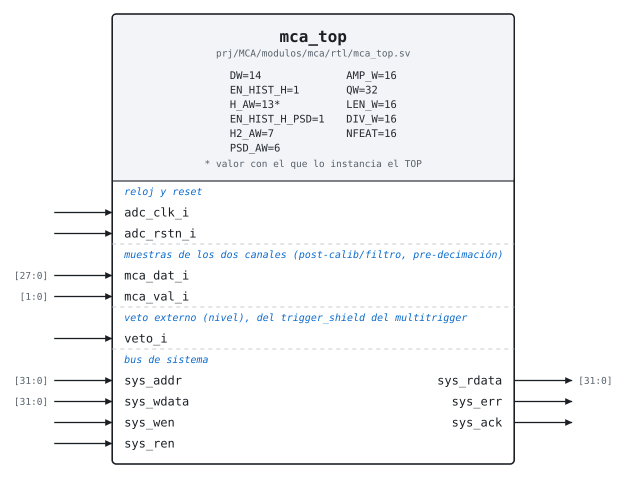

# Datasheet — `mca_top`

<!-- Generado por `modulos/mk/datasheet.py`. Lo que está entre las marcas
     AUTO:x y /AUTO:x se REESCRIBE en cada corrida: editar ahí no sirve.
     Todo el resto es prosa a mano y no se toca.
     Regenerar:  make -C modulos/mca/work datasheet              -->

## 1. Función y funcionamiento

### 1.1 Descripción breve

<!-- AUTO:resumen -->
|  |  |
|---|---|
| Módulo RTL | `mca_top` |
| Archivo | [`mca_top.sv`](../../modulos/mca/rtl/mca_top.sv) |
| Parámetros | 11 |
| Puertos | 12 (9 in / 3 out) |
| MAGIC | `32'h4D434131` — `"MCA1"` |
| Parte | `xc7z010clg400-1` |




**Cabecera del RTL** (se copia tal cual de [`mca_top.sv`](../../modulos/mca/rtl/mca_top.sv)):

> mca_top — analizador multicanal: esclavo del bus de sistema (slot 7)
>
> Base 0x4070_0000. Todo en el dominio adc_clk; el cruce a fclk[0] lo hace
> sys_bus_cdc por slot, así que acá no hace falta CDC.
>
> ACK DE LATENCIA FIJA — es lo más importante de este módulo.
>
> Un esclavo que no hace ack NO produce sólo una lectura mala: deja el CDC del
> slot DESINCRONIZADO. En sys_bus_cdc.sv, reg_done sólo avanza con bus_m.ack,
> así que sin ack queda reg_do != reg_done para siempre, el strobe de lectura
> pegado en alto, y del lado controlador ctrl_do ya no puede togglear: ese slot
> no acepta más transacciones. Al ARM lo rescata el timeout de 32 ciclos de
> rtl/axi4_slave.sv:193, que fabrica un ack por su cuenta, pero la transacción
> devuelve un valor sin sentido y SIN indicación de error.
>
> El scope tiene ese bug latente: ata bram_ack[2]/[3] = 0 para los canales no
> construidos (rp_scope_multitrigger_com.sv:572-573) y
> multitrigger_rp_scope_cfg.sv:506-507 lo usa como ack de las aperturas 3 y 4.
>
> Acá el ack sale de un shift register incondicional: NO existe ninguna ruta de
> ack por motor, así que un motor apagado por parámetro no puede colgar el bus.
> Su apertura simplemente devuelve 0. Ver docs/TOP/bus_sistema_redpitaya.md §7.1.
>
> CONTADORES DE 64 BITS. Leer lo y después hi puede partirse: a 125 MHz el
> contador avanza entre las dos lecturas. Leer la palabra BAJA congela la
> ALTA en un registro sombra, que es lo que devuelve la dirección alta.
<!-- /AUTO:resumen -->

<!-- A mano: qué problema resuelve el bloque, cómo encaja en la cadena y las
     dos o tres decisiones de diseño que explican por qué está hecho así. -->

**Qué hace.** TODO

### 1.2 Interfaces

<!-- AUTO:interfaces -->
#### Parámetros

| Parámetro | Tipo | Default | Para qué |
|---|---|---|---|
| `DW` | `integer` | `14` |  |
| `EN_HIST_H` | `integer` | `1` |  |
| `H_AW` | `integer` | `14` → **`13`** (del TOP) | 16384 canales |
| `EN_HIST_H_PSD` | `integer` | `1` |  |
| `H2_AW` | `integer` | `7` | 128 bins de amplitud |
| `PSD_AW` | `integer` | `6` | 64 bins de forma |
| `AMP_W` | `integer` | `16` |  |
| `QW` | `integer` | `32` |  |
| `LEN_W` | `integer` | `16` |  |
| `DIV_W` | `integer` | `16` | bits de cociente de los divisores de forma |
| `NFEAT` | `integer` | `16` | ranuras del bus de features |


Los marcados **(del TOP)** son los valores con los que el diseño se construye de verdad (`GENERICS` del `work/Makefile`); los anchos de esta página están resueltos con ésos, no con los defaults del RTL.


#### Puertos

##### Reloj y reset

| Puerto | Dir | Bits | Dominio |
|---|---|---|---|
| `adc_clk_i` | in | 1 | — |
| `adc_rstn_i` | in | 1 | — |


##### Muestras de los dos canales (post-calib/filtro, pre-decimación)

| Puerto | Dir | Bits | Dominio |
|---|---|---|---|
| `mca_dat_i` | in | 28 `[2*DW-1:0]` | adc_clk_i |
| `mca_val_i` | in | 2 | adc_clk_i |


##### Veto externo (nivel), del trigger_shield del multitrigger

Mientras vale 1 no se abren pulsos, el pulso en curso termina normal y el reloj de tiempo vivo se detiene: el tiempo va a `vetotime`. Atar a 0 si el top no lo usa.

| Puerto | Dir | Bits | Dominio |
|---|---|---|---|
| `veto_i` | in | 1 | adc_clk_i |


##### Bus de sistema

| Puerto | Dir | Bits | Dominio |
|---|---|---|---|
| `sys_addr` | in | 32 | adc_clk_i |
| `sys_wdata` | in | 32 | adc_clk_i |
| `sys_wen` | in | 1 | adc_clk_i |
| `sys_ren` | in | 1 | adc_clk_i |
| `sys_rdata` | out | 32 | adc_clk_i |
| `sys_err` | out | 1 | adc_clk_i |
| `sys_ack` | out | 1 | adc_clk_i |
<!-- /AUTO:interfaces -->

### 1.3 Mapa de registros

<!-- AUTO:regmap -->
`mca_top` es esclavo del bus de sistema (`sys_addr`, `sys_wdata`, `sys_wen`, `sys_ren`, `sys_rdata`, `sys_err`, `sys_ack`). El mapa completo está en:

- [`register_map_mca.md`](register_map_mca.md)

Contrato del bus: [`../TOP/bus_sistema_redpitaya.md`](../TOP/bus_sistema_redpitaya.md) · Mapa de slots: [`../TOP/register_map_top.md`](../TOP/register_map_top.md)
<!-- /AUTO:regmap -->

### 1.4 Clock domains

<!-- AUTO:clocks -->
| Puerto | Qué es | Polaridad |
|---|---|---|
| `adc_clk_i` | reloj |  |
| `adc_rstn_i` | reset | activo-bajo |


**Un solo dominio.** Todos los puertos de datos y de control son síncronos a `adc_clk_i`: no hay cruce de dominio dentro de este módulo.
<!-- /AUTO:clocks -->

<!-- A mano: si hay más de un reloj, cuál es el cruce, con qué se sincroniza y
     qué se asume de la relación de frecuencias. Si hay uno solo, borrar. -->

### 1.5 Frecuencia máxima de trabajo

<!-- AUTO:timing -->
**Punto de síntesis** — Vivado out-of-context, `xc7z010clg400-1`.

| Métrica | Valor |
|---|---|
| Período de la restricción | 8.00 ns (125.0 MHz) |
| WNS | 0.438 ns |
| Camino crítico | 7.562 ns |
| **Fmax** | **132.2 MHz** |
| Niveles de lógica | 7 |


**Camino crítico**

|  |  |
|---|---|
| startpoint | `cfg_amp_max_reg[4]/C` |
| endpoint | `i_feat/max_q_reg[0]/S` |


**Recursos**

| LUT | FF | BRAM | DSP | CARRY | MUXF |
|---|---|---|---|---|---|
| 3200 | 2310 | 16 | 0 | 386 | 18 |


`lut` cuenta **primitivas** LUT, no los _Slice LUTs_ del `report_utilization` (dos LUT5 que comparten O5/O6 ocupan un solo sitio).

_Barrido no corrido_: `make -C modulos/mca/work sweep-all` y regenerar.
<!-- /AUTO:timing -->

<!-- A mano: qué hay en el camino crítico y qué se haría para romperlo si
     hubiera que subir la frecuencia. -->

### 1.6 Waveforms

<!-- A mano. Las ondas salen de los testbenches del módulo:
       make -C modulos/mca/work wave TB=<tb>   # ver en Questa
       make -C modulos/mca/work vcd  TB=<tb>   # VCD exportable
     Para dibujarlas acá, WaveDrom en un bloque ```wavedrom. -->

#### Handshakes

TODO — una onda por protocolo de la interfaz (bus, valid/ack, pulso de
comando) con los ciclos de latencia marcados.

#### Flujo de utilización

TODO — la secuencia completa de uso, de la configuración al dato leído, en el
orden en que la hace el software.

### 1.7 Verificación realizada

<!-- AUTO:verificacion -->
Todo corre en batch y se chequea el `RESULT: PASS` del testbench; las ondas quedan en `work/waves/<tb>.wlf`.

```bash
make -C modulos/mca/work            # los 6 testbenches
make -C modulos/mca/work cov        # + cobertura
make -C modulos/mca/work lint
```

| Testbench | DUT | Es el de este módulo |
|---|---|---|
| [`tb_mca_div_restore`](../../modulos/mca/sim/tb_mca_div_restore.sv) | `mca_div_restore` |  |
| [`tb_mca_hist`](../../modulos/mca/sim/tb_mca_hist.sv) | `mca_hist` |  |
| [`tb_mca_zoom`](../../modulos/mca/sim/tb_mca_zoom.sv) | `mca_zoom` |  |
| [`tb_mca_discriminator`](../../modulos/mca/sim/tb_mca_discriminator.sv) | `mca_discriminator` |  |
| [`tb_mca_pulse_feature`](../../modulos/mca/sim/tb_mca_pulse_feature.sv) | `mca_pulse_feature` |  |
| [`tb_mca_top`](../../modulos/mca/sim/tb_mca_top.sv) | `mca_top` | sí |


**Assertions** — en `sim/sva/`, enganchadas por `bind` (no tocan el RTL sintetizable).

- [`bind_mca.sv`](../../modulos/mca/sim/sva/bind_mca.sv)
- [`mca_top_sva.sv`](../../modulos/mca/sim/sva/mca_top_sva.sv)

Plan de verificación, casos cubiertos y deuda: [`mca/sim/VERIFICACION.md`](../../modulos/mca/sim/VERIFICACION.md).
<!-- /AUTO:verificacion -->

#### Esquema de laboratorio

TODO — qué instrumento, cómo se conecta, qué se mide y contra qué se compara.
