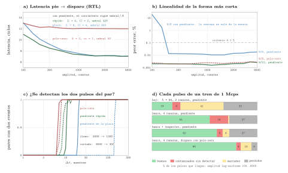
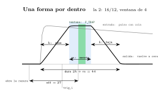
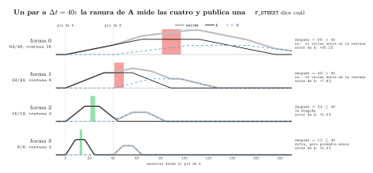
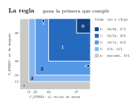
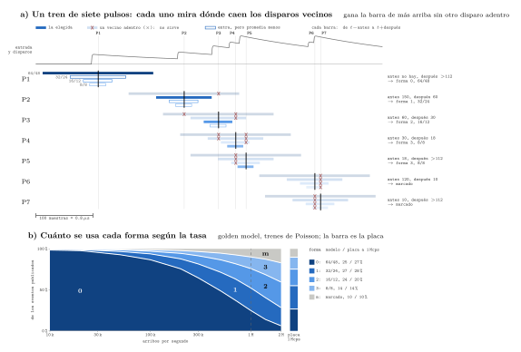
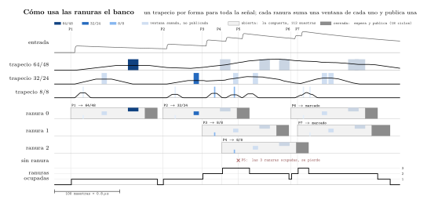

# El banco de trapecios: las pruebas y el RTL

[`ranuras_y_recuperacion.md`](ranuras_y_recuperacion.md) recomienda un banco de
trapecios (k = 64, 32, 16 y 8) para recuperar pulsos que se pisan. Esa cuenta usa
un pulso ideal:

- sube en una muestra y el pie cae justo en la apertura de la ranura;
- el ruido es blanco, de 4 cuentas;
- M es exacto;
- cada pulso tiene su disparo.

Este documento reemplaza cada supuesto por algo medido o simulado y vuelve a hacer
las cuentas. Las pruebas de §1 a §4 se hicieron **sin la placa**, con datos crudos
de campañas anteriores, el RTL del multitrigger y de `mca_trap` en Questa, y el
modelo. Lo que salió de ellas ya está en el RTL, se verificó en simulación contra
el mismo modelo (§5) y **se midió en la placa** (§6). El criterio es el de siempre:
un pulso mide bien si su error es menor que 1 %. Para la linealidad contra la
amplitud el criterio es 0.1 %.

**En la placa, en corto (§6):** a 1 Mcps el banco da 665 k/s buenos contra 200 k/s
de antes, y el RTL coincide con el golden model sobre la señal capturada. Hizo falta
ajustar tres cosas que la simulación no veía: el M (la cola real no es una sola
exponencial), la base (tiene que estar fija) y el sobrepaso de los flancos muy rápidos.

**Sin la placa, en corto:**

- **Con la señal, el ruido y el polo-cero reales, el banco anda.** El ruido real
  se comporta como blanco, con σ = 4.57 cuentas. Los umbrales de separación
  empeoran hasta 8 muestras contra el modelo ideal.
- **M tiene que estar dentro de ~0.1 %.** Con 0.5 % de error, un pulso de 300
  después de uno de 8000 no se recupera con k = 64 ni con k = 32 en las 200
  muestras probadas. Esto le pasa también al trapecio de hoy. En la placa, M se
  programa en dieciseisavos (0.03 % de 242.8) y el ajuste ya dejó el par en
  −0.001 %.
- **El límite es el disparo por pendiente.** No separa dos pulsos a menos de ~20
  muestras, y no ve un pulso chico sobre la cola de uno grande hasta ~150 muestras
  después. Lo que no dispara queda como **apilamiento sin detectar**: la ranura no
  sabe que tiene un vecino. Con el banco y este disparo, a 1 Mcps, el 17.8 % de
  los pulsos se acepta contaminado.
- **La solución es una fuente de disparo nueva en el multitrigger, con
  polo-cero.** Es un `mca_trap` con k = 2, m = 1 y un Schmitt. Se simuló con el
  `mca_trap` del RTL:
  - separa pares desde 7–8 muestras;
  - la cola de un pulso grande no tapa a uno chico;
  - el instante corre 1 muestra con la amplitud, contra 6 de la pendiente.
- **Con ese disparo, el banco cumple.** A 1 Mcps da **805 kcps** buenos, 4.3 %
  contaminados sin detectar y 5 % perdidos. Hoy son 194 kcps, 7.8 % y 32 %.
- **Y la forma corta vuelve a ser 8/8.** Con la pendiente hacía falta 8/12,
  porque el corrimiento sacaba la ventana de la meseta en los pulsos chicos.
- **Si no se toca el multitrigger, hay una alternativa**: el mismo detector
  dentro del MCA como inspector, que solo marca vecinos. Rinde menos: 620 kcps y
  5.6 %.
- **`mca_trap` da bit a bit lo mismo que el modelo** con todas las formas, sin
  errores. La simulación encontró además un **bug latente** del reset, que ya
  está arreglado (§5).
- **El disparo y el banco ya están en el RTL** (§5). De punta a punta, sobre el
  mismo tren, el RTL mide `F_TRAP` bit a bit igual que el modelo y clasifica
  igual el 99.95–100 % de los pulsos.
- **Con `pre_dly` = 16, la compuerta tiene que ser 112, no 104.** La ranura abre
  antes del disparo y el trapecio llega tarde. Cuesta 1 kcps.
- **A 1 Mcps, lo que baja la tasa es la saturación del ADC, no el banco.** Con
  esta señal de prueba, el 7 % de las muestras satura, y los buenos bajan de 805
  a 744 kcps.

El barrido de apilamiento completo, con espectros y contra las otras configuraciones,
está en [`apilamiento.md`](apilamiento.md); su réplica del banco se compara bit a bit
contra el RTL. Desde la API, el banco se carga con `mca_banco_config`
([`../API/referencia_api.md`](../API/referencia_api.md) §1.2).



*a) La latencia del disparo contra la amplitud, en el RTL: la pendiente de la
placa, una pendiente más rápida y el disparo con polo-cero. b) El peor error de
la forma más corta contra la amplitud, con cada disparo. c) La fracción de pares
en los que se detectan los dos pulsos. d) Qué pasa con cada pulso de un tren de
1 Mcps.*

---

## 1. Lo que se reemplazó, y de dónde sale

| Supuesto del modelo | Lo real | De dónde |
|---|---|---|
| ruido blanco de 4 cuentas | **σ = 4.57**, casi blanco: autocorrelación de 0.04 en todos los retardos, una componente lenta de ~1 cuenta | canal 2, sin señal, de las capturas e2e (`software/datos/e2e_*`): 45 220 tramos de 512 muestras |
| subida instantánea | **~1 muestra** de 10 a 90 %. El escalón medio, en muestras, es 0, 0.22, 0.91, 1.02 | los escalones de la forma arbitraria del Rigol (un punto cada ~4 muestras) en el canal 1 de esas capturas: 17 648 escalones |
| el pie cae en la apertura | con la pendiente, **latencia de 7 a 13 ciclos según la amplitud** (el corrimiento sigue umbral/A); con el polo-cero, de 12 a 13, las dos hasta `trig_i` | `tb_banco_disparo.sv` en Questa: `mt_top` del RTL con la configuración de la placa (L = 8, G = 4, umbral 600) y, sobre la misma muestra, otro `mt_top` con el disparo con polo-cero (k = 2, m = 1) |
| M exacto | error residual de 0.1 y 0.5 % | — (en la placa se ajustó a 242.8, con −0.001 % de error residual) |
| cada pulso dispara | la pendiente **no** separa pares a menos de 20 muestras, y un pulso chico sobre la cola de uno grande no dispara | `tb_banco_disparo.sv`, pares de pulsos a Δt = 1..300 |

En las simulaciones del disparo, los pulsos son de preamplificador: subida
1 − e^(−t/t_r) y cola de 250 muestras. El pie cae en cualquier fase dentro de la
muestra, y el ruido es gaussiano de 4.5 cuentas. Para la subida se probaron 1.2
muestras (la de la cadena) y además 2, 4, 8 y 16, por si un detector real es más
lento.

## 2. Cada forma, con el corrimiento del disparo

La ranura abre con el disparo, y la ventana de cada forma está a una distancia
fija de ese disparo. Si el disparo de un pulso chico llega más tarde, en esos
pulsos la ventana cae más adelante en la meseta. Para cada forma y cada disparo
se buscó el inicio de ventana (contado desde el disparo) que deja el peor error
≤ 0.1 % en el rango de amplitud más ancho, y de esos se tomó el del medio. Las
amplitudes probadas van de 100 cuentas a 8000.

La comparación se hace contra la meseta del trapecio largo sobre el mismo pulso.
Así no cuenta la fase del pie dentro de la muestra, que mueve todas las formas por
igual (hasta e^(1/τ) − 1 = 0.4 % con subida instantánea) y ya le pasa al trapecio
de hoy.

| forma (k/m/ventana) | A mínima, pendiente (subida 1.2 / 4 / 8) | A mínima, polo-cero | umbrales ideales (antes / después) | reales, pendiente | reales, polo-cero | polo-cero, M errado 0.5 % |
|---|---|---|---|---|---|---|
| **64/48/16** | 100 / 100 / 100 | 100 / 100 / 100 | 92 / 91 | 100 / 93 | 97 / 96 | > 200 / 96 |
| **32/24/8** | 100 / 100 / 300 | 100 / 100 / 100 | 48 / 45 | 52 / 45 | 49 / 48 | > 200 / 48 |
| 32/28/8 | 100 / 100 / 150 | 100 / 100 / 100 | 52 / 45 | 54 / 47 | 51 / 50 | > 200 / 50 |
| **16/12/4** | 100 / 500 / — | 100 / 100 / 6000 | 25 / 22 | 28 / 23 | 26 / 24 | 102 / 24 |
| 16/16/4 | 100 / 200 / 3000 | 100 / 100 / 800 | 29 / 22 | 31 / 24 | 28 / 26 | 136 / 26 |
| 16/20/4 | 100 / 100 / 800 | 100 / 100 / 300 | 33 / 22 | 33 / 26 | 30 / 28 | 165 / 28 |
| **8/8/2** | **200** / — / — | **100** / 8000 / — | 14 / 11 | 17 / 13 | 15 / 13 | 16 / 13 |
| 8/12/2 | 100 / 800 / — | 100 / 100 / — | 18 / 11 | 19 / 14 | 18 / 15 | 20 / 15 |
| 8/16/2 | 100 / 200 / — | 100 / 100 / 3000 | 22 / 11 | 21 / 16 | 20 / 17 | 64 / 17 |

*A mínima: la amplitud desde la que el peor error queda ≤ 0.1 %; «—» si no se
llega en ninguna. Umbrales: muestras libres que necesita el pulso antes y
después para medir con error < 1 %. Los reales están en Δt **de disparo**, que es
lo que ve el RTL en `F_DTPREV` y `F_DTNEXT`. Se tomaron con M errado 0.1 % y con
pares de 2000 y 2000, de 8000 y 300, y de 300 y 8000.*

Lo que sale de la tabla:

- **Con la subida de la cadena (1.2 muestras), 64, 32 y 16 andan con los dos
  disparos.** Sus umbrales reales están hasta 8 muestras por encima de los
  ideales. Esa diferencia viene de que el Δt de disparo no es el del pie.
- **8/8 depende del disparo.** Con la pendiente, la latencia cambia 6 ciclos
  entre 8000 y 100 cuentas. La meseta de 8, menos la ventana de 2 y la subida,
  deja ~4 de margen. A 100 cuentas mide −13 % y a 150, 1.7 % (panel b). Con el
  polo-cero, la latencia cambia 1 ciclo y 8/8 anda desde 100. Si se queda la
  pendiente, va 8/12, que cuesta 2 muestras de umbral.
- **Con un detector más lento el polo-cero también ayuda.** Con 4 muestras de
  subida, la pendiente obliga a A ≥ 500 en 16/12 y A ≥ 800 en 8/12; con el
  polo-cero las dos andan desde 100. Con 8 muestras de subida, las formas cortas
  necesitan más meseta con cualquiera de los dos. La regla es meseta ≥
  corrimiento + subida + ventana + margen.
- **Las cuatro formas tienen la misma ganancia.** Con k potencia de 2, sh baja de
  a uno y la altura de la meseta es la misma: 7.79 por cuenta, con subida rápida.
  Alcanza con una calibración para todo el banco. Con una subida de 4 u 8
  muestras las mesetas cortas ya no son planas y cada forma necesita su ganancia.
- **M:** con 0.1 % de error los umbrales casi no cambian. Con 0.5 %, A deja una
  cola chica que dura lo que la cola de la señal, y un pulso 27 veces más chico
  que el anterior no baja de 1 % en 200 muestras con k = 64 o 32. La cola que
  queda crece con k + m, así que las formas cortas aguantan mucho más: 8/8 llega
  a 16 muestras.

### El ruido real

| forma | ruido blanco, σ = 4.57 | ruido real |
|---|---|---|
| 64/48 | 0.081 % | 0.087 % |
| 32/24 | 0.113 % | 0.114 % |
| 16/12 | 0.157 % | 0.157 % |
| 8/8 | 0.223 % | 0.219 % |
| 8/12 | 0.225 % | 0.219 % |

*σ de `F_TRAP` para A = 1000, en % de A.*

La componente lenta del ruido real suma un 8 % al trapecio largo y nada a los
cortos. **El ruido blanco es un buen modelo**: lo que estaba mal era σ (4.57,
no 4).

Si lo que importa es la tasa y los pulsos son grandes, una sola forma corta alcanza
y ahorra recursos. Si importa la resolución del espectro, conviene el banco.

## 3. El banco completo sobre pares

Cada ranura elige la forma por el Δt de disparo, como lo haría el RTL. Las
condiciones son reales: subida de 1.2, corrimiento del disparo, ruido real y M
errado 0.1 %. Para un par de 2000 y 1200, con el banco que se recomienda (64/48,
32/24, 16/12 y 8/8) y el disparo con polo-cero:

| | A mide bien desde | B mide bien desde | error a Δt = 20 (A / B) | a Δt = 100 |
|---|---|---|---|---|
| modelo ideal | Δt = 12 | 14 | 0.10 / 0.15 % | 0.04 / 0.06 % |
| real | 14 | 14 | 0.10 / 0.19 % | 0.05 / 0.10 % |
| real, 8000 → 300 | 10 | 16 | 0.03 / 0.76 % | 0.01 / 0.94 % |
| real, 300 → 8000 | 14 | 12 | 0.72 / 0.03 % | 0.34 / 0.01 % |

El banco real da casi lo mismo que el ideal. En el par 8000 → 300, B queda cerca
del 1 %: es su propio ruido (0.3 % para 300 cuentas con k = 64), más la cola que
deja A con M errado 0.1 %. Con la pendiente y 8/12, B recién mide bien desde
Δt = 18.

Si cada pulso tuviera su disparo, a 1 Mcps y con la compuerta de 104, el banco
daría 685 kcps buenos con dos ranuras y 803 con cuatro (el ideal da 699 y 822).
Con el disparo por pendiente, eso no pasa.

## 4. El disparo es el límite

El disparo por pendiente suma L muestras y les resta L muestras de L + G atrás.
Sobre esa suma s corre un Schmitt, que da un disparo cada vez que s sube del
umbral. Tiene dos puntos ciegos (panel c):

- **Dos pulsos a menos de ~20 muestras dan un solo disparo.** El Schmitt recién
  re-arma cuando s baja de umbral − histéresis, y para eso hace falta que el pulso
  entero pase por el filtro (2L + G = 20 muestras). Si el segundo llega antes, s
  nunca bajó y no hay un cruce nuevo. El segundo pulso no abre ranura, y el
  primero no sabe que lo tiene encima: `F_DTNEXT` no lo ve.
- **Un pulso chico sobre la cola de uno grande no dispara.** El filtro no tiene
  polo-cero: sobre una cola, s no vuelve a cero sino a un valor proporcional a la
  pendiente. Un pulso de 8000 cae 32 cuentas por muestra al principio de la cola,
  y eso da s ≈ 8 × 12 × (−32) ≈ −3070. Un pulso de 300 suma +2400 y no llega al
  umbral de 600. Recién dispara a ~150 muestras, cuando la cola se aplanó.

No es una falla del multitrigger: es la resolución de pares de un filtro de
2L + G muestras, y para el osciloscopio está bien. Para el banco, que separa
pulsos desde 14 muestras, no alcanza.

### Cómo pesa en un tren de Poisson

Para medirlo, cada disparo se reescribió en Python (`Disparo` y `DisparoPZ` en
el script) y se validó contra el RTL:

| disparo | latencia media, A = 100 / 300 / 8000 (RTL / modelo) | dos disparos desde Δt, 2000 → 1200 (RTL / modelo) | 8000 → 300 (RTL / modelo) |
|---|---|---|---|
| pendiente de la placa (L = 8, G = 4) | 13.1 / 9.2 / 7.1 — 13.1 / 9.2 / 7.0 | 21 / 21 | 152 / 152 |
| pendiente rápida (L = 4, G = 2, umbral 420) | 11.0 / 8.5 / 7.0 — 12.0 / 8.4 / 7.0 | 11 / 11 | 14 / 11 |
| **polo-cero (k = 2, m = 1, umbral 50)** | 13.0 / 12.3 / 12.0 — 12.9 / 12.2 / 12.0 | **8 / 8** | **8 / 8** |

*Las latencias son hasta `trig_i` en las tres; la del polo-cero tiene adentro los
8 ciclos de `mca_trap`.*

Con eso se corre un **tren de Poisson entero**, con amplitud log-uniforme de 100
a 8000 (muchos pulsos chicos: es el caso difícil para el disparo), ruido de 4.57
y compuerta de 104. Cada pulso pasa por el disparo, las ranuras y la elección de
forma. Después se compara lo que mide la forma elegida con la amplitud real del
pulso.

| configuración | tasa | buenos | contaminados sin detectar | marcados | perdidos |
|---|---|---|---|---|---|
| hoy: k = 64, 2 ranuras, pendiente | 100 kcps | 86 % (84 kcps) | 1.9 % | 9.0 % | 3 % |
| banco, 4 ranuras, pendiente | 100 kcps | 94 % (92 kcps) | 2.5 % | 0.1 % | 3 % |
| banco + inspector, pendiente | 100 kcps | 95 % (93 kcps) | 1.0 % | 0.6 % | 3 % |
| **banco, 4 ranuras, polo-cero** | 100 kcps | **97 % (96 kcps)** | **0.7 %** | 1.2 % | 1 % |
| hoy: k = 64, 2 ranuras, pendiente | 300 kcps | 61 % (184 kcps) | 4.6 % | 23.8 % | 10 % |
| banco, 4 ranuras, pendiente | 300 kcps | 84 % (252 kcps) | 6.3 % | 0.3 % | 9 % |
| banco + inspector, pendiente | 300 kcps | 87 % (260 kcps) | 2.0 % | 1.9 % | 9 % |
| **banco, 4 ranuras, polo-cero** | 300 kcps | **94 % (280 kcps)** | **1.6 %** | 3.2 % | 2 % |
| hoy: k = 64, 2 ranuras, pendiente | 1 Mcps | 19 % (194 kcps) | 7.8 % | 40.8 % | 32 % |
| banco, 4 ranuras, pendiente | 1 Mcps | 55 % (551 kcps) | **17.8 %** | 0.8 % | 27 % |
| banco + inspector, pendiente | 1 Mcps | 62 % (620 kcps) | 5.6 % | 6.3 % | 27 % |
| **banco, 4 ranuras, polo-cero** | 1 Mcps | **80 % (805 kcps)** | **4.3 %** | 10.1 % | 5 % |

*Las categorías:*

- *Buenos: aceptados y con error < 1 %.*
- *Contaminados sin detectar: aceptados y con error > 1 %; terminan en el espectro como pulsos apilados.*
- *Marcados: un vecino está más cerca que lo que tolera la forma más corta, y el discriminador los saca.*
- *Perdidos: no dispararon, o no encontraron ranura libre.*

Dos configuraciones más ayudan a separar qué aporta cada cosa, a 1 Mcps:

| configuración | buenos | contaminados sin detectar | marcados | perdidos |
|---|---|---|---|---|
| k = 64, 2 ranuras, polo-cero (solo cambia el disparo) | 208 kcps | 1.1 % | 57.3 % | 21 % |
| banco, 2 ranuras, polo-cero | 691 kcps | 3.7 % | 6.6 % | 21 % |

- **El disparo solo limpia el espectro.** Con el trapecio de hoy, los
  contaminados sin detectar bajan de 7.8 a 1.1 %. Ahora se ven, y pasan a
  marcados.
- **El banco convierte esos marcados en buenos.** Las ranuras vuelven a servir:
  con el disparo nuevo cada pulso abre la suya, y cuatro rinden 805 kcps contra
  691 de dos.
- **El banco con la pendiente empeora el espectro** (17.8 %). Acepta pulsos que
  tienen un vecino que nunca disparó. De esos contaminados:
  - el 70 % tiene un vecino a menos de 25 muestras que se fundió en su disparo;
  - el 28 % tiene encima un pulso chico tapado por su cola;
  - el 2 % viene de elegir mal la forma por el corrimiento.

### El disparo con polo-cero

Es un trapecio muy corto con polo-cero, con un Schmitt sobre su salida:

```
x (ADC) ─► trapecio k = 2, m = 1, con el mismo M que el MCA ─► Schmitt (umbral 50, re-arma bajo 25) ─► disparo
```

- **Vuelve a cero rápido.** El trapecio de un pulso termina a las 2k + m = 5
  muestras, así que dos pulsos a 7–8 muestras dan dos disparos.
- **La cola no tapa nada.** Con el polo-cero no queda pendiente: un pulso de 300
  después de uno de 8000 aparece sobre cero, y dispara desde Δt = 8.
- **El instante casi no corre con la amplitud.** La salida sube en 2 muestras y
  el umbral (50) es chico frente a los pulsos, así que la latencia va de 12 a 13
  ciclos entre A = 8000 y 100. Con la pendiente va de 7 a 13. No hace falta un CFD.
- **No da falsos.** Con el ruido real de la placa (22.8 millones de muestras del
  canal 2), su salida tiene σ = 4.9 cuentas y un máximo de 28. Con umbral 50 no
  hubo ningún falso, y tampoco con 30.
- **No necesita la base, aunque no cancela del todo la continua.** Puede ir en
  el multitrigger sobre la muestra del ADC, sin la base del MCA. La continua se
  atenúa por l/(1 + M), unas 80 veces:
  - con la base de la placa (~5 cuentas) no se nota;
  - con 500 cuentas de offset, el umbral efectivo corre ~6 cuentas;
  - con más de ~+1880 cuentas, el Schmitt (umbral 50, re-armado 25) ya no
    re-arma.

Tiene tres límites:

- **Pares a menos de ~7 muestras siguen dando un solo disparo.** Eso es
  apilamiento de verdad, y ninguna forma lo separa.
- **Supone subida rápida.** Con 8–16 muestras de subida, la salida de k = 2 no
  llega a la altura del pulso, y los pulsos de 100–150 cuentas no disparan. Para
  un detector lento, k y m tienen que ir por registro.
- **Depende de M**, igual que el banco. Con una forma tan corta casi no pesa: es
  la que mejor aguanta un M errado.

### La alternativa sin tocar el multitrigger: el inspector

Es el mismo detector, pero dentro del MCA. No abre ranuras: sus eventos se suman a
los del disparo en `F_DTPREV` y `F_DTNEXT`, y de cada lado se toma el vecino más
cercano. Las ranuras se siguen abriendo con la pendiente.

Así la ranura sabe que tiene un vecino aunque no haya disparado, y elige una
forma que no lo incluya. Pero ese vecino **no se mide**, porque nadie le abrió
ranura. Por eso rinde menos que cambiar el disparo: a 1 Mcps da 620 kcps y 5.6 %
de contaminados, contra 805 y 4.3 %. Y los perdidos siguen en 27 %.

## 5. El RTL

Lo del §4 está en el RTL desde el 2026-11-03 y se verificó en simulación. Falta
la placa (§6).

### El disparo con polo-cero en el multitrigger

`mt_pz_trig` es una fuente nueva, por canal, al lado de la pendiente. Tiene un
`mca_trap` con líneas de 32 muestras en LUT (k + m ≤ 31) y un Schmitt solo
positivo, que da un pulso por cruce en los bits 25..28 de `OR_MASK`. Los
registros son `PZ_CFG`, `PZ_MQ`, `PZ_THR` y `PZ_HYST` (0x090/0x0A0/0x0B0/0x0C0
+ 4·ch, `CAPS[17]`); ver [`../mt/disparo_polo_cero.md`](../mt/disparo_polo_cero.md).
La API lo arma con `multitrigger_armar_mca(fuente='pz', mq=...)`: pone el umbral
en 50 cuentas con `pz_ganancia`, que con el M nominal da 353/177.

- **Es el del modelo.** Coincide bit a bit con un modelo entero en
  `tb_mt_pz_trig` (248 903 ciclos). En `tb_banco_disparo.sv`, con la misma
  muestra, da los mismos disparos que el Schmitt suelto con el que se validó en
  los 3600 pulsos y los 6320 pares, un ciclo más tarde: el registro de
  `mt_trig_src`.
- **La latencia hasta `trig_i` va de 12 a 14 ciclos** (A = 8000 a 100), y la de
  la pendiente de 7 a 14. El `cfg_pre_dly` = 16 de la placa sirve para las dos
  (`tb_mca_mt_latencia`).
- **OOC de `mt_top`:** WNS +1.46 ns a 125 MHz. Cada canal cuesta 457 LUT, 380 FF
  y 1 DSP, sin BRAM.

### El banco en el MCA



*Una forma, la 16/12: el pulso entra con su cola y sale un trapecio que sube en k, se
queda m y baja en k, y `F_TRAP` es el promedio de la salida en la ventana. `off` se
cuenta desde que abre la ranura, que es antes del disparo.*



*Dos pulsos a 40 muestras: los cuatro trapecios corren a la vez y la ranura de A suma las
cuatro ventanas. Las dos formas largas están contaminadas por B; gana la más larga que
queda limpia.*



*La regla, con los pulsos del ejemplo: A tiene un vecino después y B uno antes, y a los
dos les toca la forma 2. El uso es el medido en la placa. Las tres figuras son del banco
de 4 formas con que se midió en §6 (desde §7 la 16/12 no está), y las genera
[`figuras_banco.py`](figuras/trapecio/figuras_banco.py) con el golden model.*

`mca_window` corre `N_FORMAS` = 4 trapecios sobre la misma muestra, con el M y el
`clr` en común. Cada ranura suma la meseta de las cuatro (`mca_slot`), y la forma
se elige al publicar (`mca_publish`), cuando `F_DTNEXT` ya es definitivo: gana la
primera con antes ≤ `F_DTPREV` y después ≤ `F_DTNEXT`. Si ninguna cumple, el
pulso queda **marcado**: `F_TRAP` = 0 y `F_FORMA` (feature 10) = 0xFFFF. Si
cumple, `F_FORMA` es el índice de la forma.



*a) Un tren de siete pulsos por el golden model. Cada fila es la ranura de un pulso, y sus
cuatro barras van de t − antes a t + después, con t su disparo: arriba la 64/48, abajo la
8/8. Una barra no sirve si tiene otro disparo adentro (×). Gana la de más arriba que
queda limpia; las de abajo también entran, pero promedian menos muestras. `F_DTNEXT` sólo
ve los disparos de adentro de la compuerta (> 112). P4 y P5, a 18 muestras, se limitan
uno al otro y los dos usan la 8/8; P6 y P7, a 10, quedan marcados. b) Qué parte de los
eventos publicados usa cada forma, con el golden model sobre trenes de Poisson como los
del §4. La barra es la placa a 1 Mcps (§6), con otro tren, el del Rigol: 27 / 28 / 20 /
14 % y 10 % marcados, contra 25 / 27 / 24 / 14 y 10 del modelo. Lo genera
[`figuras_banco.py`](figuras/trapecio/figuras_banco.py).*

**"La primera" es la primera de la tabla, no la que termina antes.** La tabla va de la
forma más larga a la más corta, y no hay carrera entre ellas: la ranura suma las cuatro
en paralelo y elige recién al cerrar la compuerta. Por eso cada pulso ocupa su ranura las
112 muestras aunque termine usando la 8/8. A 100 kcps, el 87 % de los pulsos usa la
64/48; la 8/8 la supera recién entre 1 y 1.4 Mcps.



*Un tren de siete pulsos por el golden model, con el banco de hoy: 3 formas y 3 ranuras
(§7). Hay un trapecio por forma para toda la señal, no uno por ranura: las tres curvas
son la salida de los tres `mca_trap`, y los rectángulos, las ventanas que leen las
ranuras (en oscuro, la que se publicó). Cada ranura suma las tres ventanas mientras su
compuerta está abierta (112 muestras), y queda ocupada hasta que el publicador elige la
forma y termina con ella: 18 ciclos, más la espera si está con otra (P7 espera a P6).
Por eso un pulso ocupa lo mismo si usa la 64/48, la 8/8 o queda marcado. P5 llega con las
tres ocupadas y se pierde, pero su trapecio sigue en la salida y sus vecinos lo ven en
`F_DTPREV` y `F_DTNEXT`: las marcas cuentan disparos, no ranuras. Lo genera
[`figuras_banco.py`](figuras/trapecio/figuras_banco.py).*

**La idea no es nueva.** Elegir el largo del filtro pulso a pulso, según la distancia a
los vecinos, aparece en la bibliografía desde Lakatos (1990) con el nombre de
procesamiento adaptativo. Lo más parecido a esto es Saxena y Hawari (2017): en una FPGA,
eligen la subida y la meseta del trapecio de cada pulso según la separación entre pulsos
sucesivos. Ver la *Bibliografía* al final.

Los registros son `0x134` (`n_formas`, `N_FORMAS`, `umbr_ok`) y un bloque por
forma desde `0x180`; la forma 0 es la misma de `0x128`/`0x130`. Al reset quedan
`n_formas` = 1 y los umbrales en cero, que es el MCA de un trapecio: la réplica
del Monte Carlo y `tb_mca_top` dan lo mismo que antes.

Lo que se programa, con `pre_dly` = 16:

| forma | k/m | 2^lw | off = c + `pre_dly` + 2 | antes / después | sh |
|---|---|---|---|---|---|
| 0 | 64/48 | 16 | 69 + 18 = 87 | 97 / 96 | 15 |
| 1 | 32/24 | 8 | 29 + 18 = 47 | 49 / 48 | 14 |
| 2 | 16/12 | 4 | 9 + 18 = 27 | 26 / 24 | 13 |
| 3 | 8/8 | 2 | 0 + 18 = 18 | 15 / 13 | 12 |

*c es el inicio de la ventana contado desde `trig_i`. Es un ciclo menos que en
la primera versión de este documento, que lo contaba desde la salida del
Schmitt.*

**La compuerta tiene que ser 112, no 104.** Con `pre_dly` = 16, la ranura abre
18 muestras antes del disparo y el trapecio llega 8 tarde. Así, la ventana de
64/48 termina a 87 + 8 + 16 = 111 desde la apertura. Con 104, esa forma sale
siempre incompleta (`F_TRAP` = 0): lo encontró la prueba de punta a punta, y el
bit 31 de `FORMA_MED` lo avisa. Con cuatro ranuras, la compuerta de 112 cuesta
1 kcps a 1 Mcps. Un `pre_dly` menor permite una compuerta menor, pero entonces
la ventana abre después del pie, y el pico y la integral pierden la subida.

### Cómo se verificó

- **`tb_mca_multi`.** El modelo tiene las N formas y la regla de elección, y
  corre con cuatro DUT: 4, 1, 2 y 0 formas. La cobertura incluye cada forma, el
  marcado y la forma elegida justo en sus dos umbrales, con seis semillas. Se
  probaron 13 mutaciones del banco y se detectaron 12; la que queda es
  equivalente (saturar `n_formas`, que el lazo ya acota).
- **`tb_mca_top`.** Prueba los registros, el alias, el `clr` y `umbr_ok`, y el
  banco por el bus: a Δt = 60 se elige la forma 0, a 30 la 1 (que mide limpio) y
  a 5 los dos quedan marcados. Las SVA exigen que `F_FORMA` sea válida y que un
  marcado tenga `F_TRAP` = 0.
- **De punta a punta** (`tb_banco_e2e.sv` y `banco_e2e.py`). `mt_top` con el
  polo-cero y `mca_top` con el banco sobre el mismo tren de Poisson del §4, con
  la muestra saturada a 14 bits:

  | tasa | `F_TRAP` bit a bit | `F_FORMA` = la regla | buenos, RTL / modelo | misma clase |
  |---|---|---|---|---|
  | 300 kcps | 9111 de 9111 | 100 % | 279 / 279 kcps | 100 % |
  | 1 Mcps | 12 855 de 12 855 | 100 % | 744 / 744 kcps | 99.95 % |

  El RTL toma las mismas decisiones que el modelo. Lo único distinto son 4 de
  14 285 disparos, corridos una muestra: el modelo pone el umbral en flotante
  (353.5) y el RTL en 353.
- **A 1 Mcps el ADC satura.** Con amplitudes de hasta 8000 y colas de 250, el
  apilamiento a 1 Mcps levanta la base ~3600 cuentas, y el 7 % de las muestras
  pasa de 8191. Solo eso baja los buenos de 805 a 745 kcps y sube los perdidos de
  5.5 a 11.6 %, con el modelo saturando y sin saturar. A 300 kcps casi no pesa
  (280 → 279 kcps). Es la señal de prueba, no el banco: en la placa la amplitud
  se elige para no saturar.

### Recursos y timing

OOC de `mca_top` con N_ACC = 4 y N_FORMAS = 4: WNS +0.037 ns (el mismo peor
camino que antes del banco), 7737 LUT (+1824), 6463 FF, 12 RAMB18 y 4 DSP. Para
cerrar hicieron falta dos cambios:

- **La feature de cada eje se registra antes del zoom.** Con `F_FORMA` el mux de
  features suma una entrada, y el camino `ev_feat` → bin del 2D daba −0.345 ns.
- **`mca_delay` pasó a la plantilla SRL de UG901**: de 510 LUT y 1920 FF a 83 LUT
  y 15 FF.

Proyectado a la placa, la suma daba ~15 000 de 17 600 LUT (85 %). El bitstream
(2026-11-03, Vivado 2020.1) lo confirmó y mostró que es el techo:

- **Con el flujo de upstream no se pudo empacar.** La síntesis da 15 309 LUT
  (87 %), 15 452 FF y 990 control sets. Con `opt_design` y `power_opt_design` el
  placer falló por 31 slices.
- **Con `opt_design -directive ExploreArea` y sin `power_opt_design`** cierra:
  - 14 257 LUT (81 %), 15 073 FF, 31 BRAM y 10 DSP;
  - **4394 de 4400 slices (99.86 %)**;
  - WNS +0.007 ns y WHS +0.008 ns, después del `phys_opt` post-route; sin él,
    −0.079;
  - 1.81 W en total (antes 1.82).
- **El peor camino es el de siempre:** el contador de 64 bits `t_ocup_cnt` de
  las ranuras, no algo del banco.
- **`clk_fpga_3` ya no aparece** desde que el XADC va en FCLK0, y `clk_fpga_0`
  queda en +1.32 ns.

**El margen se lee en LUT, no en slices.** El placer reparte: el build anterior ya usaba
96 % de los slices con 69 % de LUT. El dato duro es que no empaca con el flujo de upstream
y que lo más alto que ruteó son 14 702 LUT, así que hoy quedan unos 450. Lo más barato
para ganar espacio es bajar `N_ACC` de 4 a 3, unos 800 LUT (§6), y el camino AXI del
osciloscopio, ~1100 LUT que el software no usa.

### El bug de `kl`, arreglado

`kl` (k + l) se reseteaba a 0. En el primer flanco después del reset,
`fkl1 <= (cnt >= kl)` daba verdadero y entraba a `p` la BRAM sin escribir.
Ahora arranca en todo unos. `tb_mca_trap` tiene el caso de un reset sin `clr`,
que falla con el reset viejo y pasa con el nuevo, con las líneas en BRAM y en
LUT.

## 6. En la placa

Medido el 2026-11-05 con el bitstream de `out/` (md5 `c1be6d6d…`) y el Rigol DG4162 en
IN1. El bitstream anterior, con un solo trapecio, quedó en `out/pre_banco/`; el MCA2
validado sin trapecio, en `out/mca2_validado/`.

### El resultado: un tren de Poisson

Tres amplitudes (1500, 750 y 225 cuentas), M = 237.5, base fija y subida de 1.6
muestras. "Bueno" es un `F_TRAP` a menos de ±2 % de su línea:

| Arribos | Disparos | **Banco, RTL** | Banco, golden model | Un trapecio, polo-cero | Un trapecio, pendiente |
|---|---|---|---|---|---|
| 290 k/s | 287 | **261** | 259 | 165 | 168 |
| 601 k/s | 593 | **456** | 461 | 209 | 200 |
| 1004 k/s | 957 | **665** | 665 | 218 | 200 |

- **El RTL y el modelo coinciden.** Cada período de la señal se capturó con el
  osciloscopio y se le pasó a `replica_mca2.py`. A 1 Mcps, en k/s, la forma elegida da
  254 / 271 / 193 / 138 y 98 marcados en el RTL, contra 256 / 266 / 192 / 140 y 101.
- **No es el mismo número que el 805 de §4.** Allá "bueno" es error < 1 % contra la
  señal sin ruido, con amplitudes de hasta 8000; acá es ±2 % con ruido real, y la línea
  de 225 cuentas pesa un tercio.
- **Se configuró con la API de alto nivel** (`multitrigger_armar_banco`, libmca en C).
  También se probó por red desde la PC, con `MCARemote` y `mca.disparo`.

Cómo cambia a 1 Mcps con cada cosa (buenos, k/s):

| Configuración | Buenos |
|---|---|
| M = 237.5, base fija, subida 1.6 muestras | **665** |
| M = 242.8 (el de la etapa `trapecio`) | 514 |
| Subida 2.6–3.1 muestras (sube_s = 10 ns) | 651 |
| Flanco de 1 ns, con sobrepaso | 565 |
| Flanco de 1 ns, con holdoff de 6 ciclos | 665 |
| Subida 1.6 muestras, con holdoff de 6 ciclos | 645 |
| Seguidor de base con holdoff de 1500 | **7** |

### Lo que la simulación no había visto

**1. La cola no es una sola exponencial, y M manda.** Es lo que temía esta sección antes
de medir. En un pulso aislado, τ da 243 muestras hasta las 400 y 213 entre 600 y 1000, y
después hay un rebote de −1.4 cuentas (0.1 % del alto). El M de la etapa `trapecio`
(242.8) es el de un par a 1 µs, así que cancela la cola cercana; a tasa alta se acumulan
colas lejanas, y conviene ~237. El barrido se hizo con el golden model sobre las señales
capturadas (de 3500 a 4150), y el hardware confirmó el óptimo: el modelo predijo 665 k/s
y el RTL dio 665. **M hay que ajustarlo con un tren a la tasa de trabajo**, no con un par.

**2. El disparo separa desde 9–10, no desde 7–8.** Depende de la subida, que en la placa
no baja de ~1.5 muestras (la simulación usó 1.2):

| `sube_s` | Subida, 10–90 % | Disparos por pulso aislado | 1 → 0.6, dos disparos desde | 1 → 0.04, desde |
|---|---|---|---|---|
| 1 ns | ~1.4 | **1.65** | — | — |
| 3 ns | ~1.5 | 1.000 | 10 | 9 |
| 5 ns | 1.6 | 1.000 | 10 | 9–10 |
| 7 ns | 2.1 | 1.000 | 11 | 10 |
| 10 ns | 2.6–3.1 | 1.000 | 13 | 12 |
| 10 ns, con la pendiente | 2.6–3.1 | 1.000 | 24 | 400 |

Sigue siendo mucho mejor que la pendiente. El modelo del disparo sobre las señales
capturadas da lo mismo que el hardware.

**3. Un flanco abrupto dispara dos veces.** Con 1 ns de subida la entrada sobrepasa ~8 %
y rebota. La salida del trapecio k = 2, m = 1 cae por debajo del re-armado y vuelve a
cruzar el umbral 6 muestras después. Pasa desde ~1500 cuentas. Es la señal, no el RTL: el
modelo hace lo mismo. **El holdoff del shield (`dur` ≥ 5) lo tapa sin tocar el RTL**, y con
6 no cambia la separación de pares (10). A tasa alta cuesta 3 % de buenos con una subida
limpia, así que hoy no está en el default: depende de si el detector tiene sobrepaso.

**4. El banco necesita la base bien, y a tasa alta tiene que ser fija.** El trapecio deja
pasar la continua con una ganancia que va con k·l: 3.5, 1.75, 0.875 y 0.5 en unidades de
`F_TRAP`, de la forma 0 a la 3. Una base errada corre cada forma distinto. Sin configurarla
la línea alta se corre 26 canales.

- **Fija:** es lo que da los números de arriba. Se mide con el generador encendido y casi
  sin pulsos, porque depende de la amplitud del generador (−54 apagado, −59 a 0.2 Vpp).
- **El seguidor sin holdoff** mide dentro de las colas: un pulso de 0.04 sale en 0.0388 con
  la forma 0 y en 0.0396 con la 2.
- **El seguidor con holdoff de 1500** anda a baja tasa (0.04003, 0.04000 y 0.03991), pero a
  tasa alta no le queda dónde medir: buenos, 87 k/s a 300 kcps y 7 k/s a 1 Mcps.

**5. La forma 8/8 pierde 3 % en pulsos de ~140 cuentas** (unas 4 cuentas), con la subida de
2.6–3.1 muestras: su ventana de 2 muestras cae en el borde de una meseta corta y a esa
amplitud el disparo se corre. Las otras tres quedan dentro de 0.3 %.

### Adónde va cada pulso

De cada 100 arribos a 1 Mcps (329 arribos en 5 ciclos capturados, con el golden model y
los arribos conocidos; el hardware da el mismo 4.7 % sin disparo):

| Qué le pasa | % | Por qué |
|---|---|---|
| Bueno, a ±2 % | 64.4 | |
| Fuera de ±2 %, sin vecino oculto | 16.4 | el resto de la cola y la base; ruido en la línea chica |
| Marcado | 10.0 | un vecino más cerca que la forma más corta; se sabe y se descarta |
| **Sin disparo** | 4.6 | a menos de ~9 muestras del anterior: el Schmitt no llegó a re-armar |
| Contaminado por un vecino oculto | 4.3 | el de arriba: no hay disparo, así que `F_DTPREV` y `F_DTNEXT` no lo ven |
| Sin ranura libre | 0.3 | |

Los sin disparo, por la distancia al anterior: 5 de 5 entre 0 y 3 muestras, 4 de 4 entre 3
y 5, 5 de 6 entre 5 y 7, 1 de 6 entre 8 y 9, y ninguno de los 300 restantes desde 9.

Desde el 2026-11-13 el hardware mide esa ceguera: el tiempo con el disparo sin re-armar y
alguna ranura libre es `t_rearm` (0x0D8). A 1 Mcps da 4.3 % del tiempo vivo, igual que el
golden model sobre la misma señal (`figuras/trapecio/trearm_placa.py`; ver
[`tiempo_muerto.md`](tiempo_muerto.md)).

### Cuántas ranuras hacen falta

La elección de la forma no mira las ranuras: sólo `F_DTPREV` y `F_DTNEXT`. Hacen falta
porque cada pulso ocupa la suya durante la compuerta. A 1 Mcps, el RTL pasa 33 % del tiempo
con 0 ranuras ocupadas, 40 % con 1, 21 % con 2, 6 % con 3 y 0.6 % con 4. El golden model,
que da esa misma ocupación, sobre las señales capturadas:

| `n_acc` | Buenos a 300 kcps | A 600 kcps | A 1 Mcps |
|---|---|---|---|
| 1 | 198 k/s | 272 | 330 |
| 2 | 244 | 415 | 537 |
| 3 | 253 | 446 | 641 |
| 4 | 253 | 449 | 650 |

### El resto de lo que se midió

| Prueba | Resultado |
|---|---|
| Falsos, sin señal (σ = 4.46) | **ninguno** en 37 G muestras con umbral 50, ni en 7.5 G con 40; con 30, uno en 7.5 G; con 20, miles por segundo |
| Un disparo por pulso, subida ≥ 3 ns | 1.000 de ~90 a ~7600 cuentas; 50 % de eficiencia en ~55 |
| Umbrales del modelo (97/96, 49/48, 26/24, 15/13) | A y B a menos de 1 % desde el umbral + 4 en las cuatro formas |
| Offsets del modelo | caen en la meseta (±2) en las cuatro formas |
| `banco_rtl`: la forma elegida | la de la regla en todos los Δt; error máximo entre 0.74 y 1.15 % según la corrida: el criterio de 1 % queda justo |
| Regresión del MCA2 con el banco en reset | `regs` 42 PASS; `periodico`, `par` y `poisson` 310 PASS |
| `test_mca_hw`, `test_rw_dev_mem` | 37 PASS; PASS |
| API por red (`call_red.py`) y la app contra el Rigol (`e2e_rigol_app.py`) | PASS; 22 PASS |
| XADC en FCLK0 (el arreglo de `clk_fpga_3`) | lee bien: 40.8 °C, Vccint 1.00 V |

**Lo que no se probó:** un detector real. La cola, el sobrepaso y la subida de todo esto son
los del Rigol y su cable, y esos tres cambian los ajustes de arriba.

## 7. Tres ranuras y tres formas (2026-11-09)

El bitstream del MCA estaba al 99.86 % de los slices y el del ring al 100 %. Para dejar
margen, los tops instancian ahora `mca_top` con **`N_ACC = 3`** y **`N_FORMAS = 3`**:
el banco queda en **64/48, 32/24 y 8/8**. El default del módulo sigue en 4 y 4.

**Lo que se pierde.** Es el golden model sobre las trazas del tren de Poisson capturadas
en la placa el 2026-11-07 (las de §6). «Bueno» es a ±2 % de una línea, como en §6:

| variante | LUT (OOC) | buenos a 300 k / 600 k / 1 Mcps (k/s) |
|---|---|---|
| 4 ranuras, 4 formas (antes) | 7737 | 262 / 452 / 650 |
| 3 ranuras, 4 formas | 7030 | 262 / 449 / 641 |
| 4 ranuras, sin la 16/12 | 7106 | 262 / 458 / 656 |
| **3 ranuras, sin la 16/12 (ahora)** | **6506** | **262 / 455 / 647** |
| 4 ranuras, sin la 8/8 | 7106 | 238 / 400 / 519 |
| 3 ranuras, 64/48 + 16/12 | 5767 | 238 / 409 / 555 |
| 2 ranuras, 4 formas | — | 253 / 418 / 531 |

- **Sacar una forma del medio no cuesta cuentas: cuesta ruido.** Los pulsos que la
  usaban pasan a la siguiente, más corta, y siguen cayendo a ±2 %. Para A = 1000 la 16/12
  da σ = 0.157 % y la 8/8, 0.223 % (§2): esos pulsos quedan con ×1.4 de ruido. A 1 Mcps
  son el 20 % de los pulsos; a menos tasa, menos. Con el Rigol no se nota, pero con un
  detector de buena resolución sí.
- **Se sacó la 16/12 y no la 32/24** porque la 32/24 cubre vecinos más lejanos (de 49 a
  96 muestras) y la usa más gente (28 % a 1 Mcps, contra 20 %).
- **Sin la 32/24 daría +6.6 % de buenos, pero eso no es una mejora.** A 1 Mcps la 32/24
  deja la línea chica en −2.4 % por la cola del pulso anterior, fuera de ±2 %, y la
  16/12 la deja en −1.4 %. Es el criterio de ±2 %. Además, las trazas son unos cientos
  de pulsos distintos por forma, repetidos 40 veces, y no alcanzan para comparar
  resolución.
- **La 8/8 no se puede sacar:** −20 % a 1 Mcps y −9 % a 300 kcps.

**Los bitstreams** (Vivado 2020.1; los anteriores, respaldados en
`out/banco_4x4_c1be6d6d/` y `out/v3_event_ring/build2_726da451/`):

| | MCA antes | MCA ahora | ring antes | ring ahora |
|---|---|---|---|---|
| md5 | c1be6d6d | 6156e5a3 | 726da451 | e58f7888 |
| LUT | 14 257 (81.0 %) | 12 910 (73.4 %) | 14 404 (81.8 %) | 13 051 (74.2 %) |
| FF | 15 073 | 14 285 | 15 369 | 14 377 |
| slices | 4394 | 4326 | 4400 | 4370 |
| BRAM / DSP | 31 / 10 | 29.5 / 9 | 34 / 10 | 32.5 / 9 |
| WNS / WHS (ns) | +0.007 / +0.008 | +0.029 / +0.031 | +0.151 / +0.015 | +0.163 / +0.018 |

- **Los slices siguen en 98-99 %** porque el placer reparte la lógica en todos los que
  haya; la medida de cuánto entra es la de LUT.
- **El MCA nuevo trae además el arreglo del bus** (`docs/TOP/bus_sistema_redpitaya.md`
  §6.1): su build ya no da el CRITICAL WARNING del `false_path` de `reg_rdata`.

**En la placa (2026-11-09).** Datos y logs en `software/datos/placa_recorte_20261109/`.

- **El MCA (6156e5a3).** Pasan la batería sin generador y las etapas `regs`, `par`,
  `poisson`, `trapecio`, `disparo`, `banco_rtl` y `falsos` de `test_mca2_placa.py`, con
  `--disparo pz` para las del banco. `periodico` falló la primera vez, con 114 kHz de
  disparos y la base 226 cuentas arriba: el Rigol venía con otra forma cargada. Corrida de
  nuevo, pasa entera. `verificar-placa-bus` dio una lectura rota en 14 millones (ver
  `docs/TOP/bus_sistema_redpitaya.md` §6.1).
- **El ring (e58f7888).** Pasan `verificar-placa-bus` y `verificar-placa-ring`.
  `run_poisson_loss.py --fuente ring` da las mismas pérdidas que el segundo build, sin
  descartes del ring ni a 100 kHz.
- **El tren de Poisson** (`test_banco_poisson.py`, M = 237.5). Se midió el mismo día el
  bitstream viejo y el nuevo, porque el viejo dio 665 el 2026-11-05 y 651 hoy. Buenos a
  1 Mcps, en k/s:

  | bitstream | ranuras y formas | placa | modelo sobre la captura |
  |---|---|---|---|
  | c1be6d6d | 4 y 4 | 651 | 644 |
  | c1be6d6d | 3 y 3, configuradas | 646 | 659 |
  | **6156e5a3** | **3 y 3** | **644** | 659 |

  - **El recorte cuesta ~1 % en la placa**, lo que predecía el golden model.
  - **El bitstream nuevo cuenta lo mismo que el viejo configurado con 3 y 3**, forma por
    forma.
  - **El modelo sobre una sola captura se aleja ±2 % para los dos lados.** Repite 40
    veces la misma realización del ruido, y la placa ve ruido nuevo en cada período.
    Que el RTL con 3 y 3 es el modelo lo prueba `tb_pulsos_mca` con
    `-gN_ACC=3 -gN_FORMAS=3`: da el mismo volcado que con 4 y 4.

**Lo que cambió en el resto.**

- **Software.** `API.mca.BANCO_PZ` tiene las 3 formas. `BANCO_PZ_4` es el de antes, y
  lo usan los scripts que reproducen mediciones viejas: `banco_placa.py`,
  `figuras_banco.py`, el Monte Carlo y el volcado de `test_replica_mca2.py`.
- **`multitrigger_armar_banco`** usa las ranuras del bitstream (`n_acc=None`), y
  `test_mca2_placa.py` las lee de la placa en vez de suponer 4. libmca ya validaba
  `n_acc` y `n_formas` contra lo que dice la placa.
- **Tests de RTL.** `tb_mca_top` corre con 3 y 3 por default (151 PASS; con
  `-gN_ACC=4 -gN_FORMAS=4`, los 153 de antes), y `tb_mca_multi` suma la configuración
  3/3, con cobertura 25 de 25.

## Cómo se rehace

- `python3 figuras/trapecio/pruebas_banco.py` (~40 s): imprime todas las tablas
  y escribe `banco_pruebas.json` y `banco_pruebas.{tex,pdf,svg}`.
- El RTL de los disparos se simula con
  [`tb_banco_disparo.sv`](figuras/trapecio/tb_banco_disparo.sv). Tiene dos
  `mt_top`, uno con la pendiente y otro con el polo-cero, sobre la misma muestra.
  Escribe `banco_latencias*.txt` y `banco_pares*.txt`, y el docstring del script
  tiene los comandos.
- De punta a punta:
  [`banco_e2e.py`](figuras/trapecio/banco_e2e.py) (~2 min) escribe el tren y
  corre [`tb_banco_e2e.sv`](figuras/trapecio/tb_banco_e2e.sv) en Questa (con
  `--gate` y `--pre`, por defecto 112 y 16). Después compara el volcado contra el
  modelo y deja el resumen en `banco_e2e_g112_p16.json`.
- En la placa:
  `python3 API/tests/placa/test_mca2_placa.py --etapas trapecio disparo banco_rtl falsos --disparo pz`,
  y `--etapas banco --disparo pz` para cada forma sola. El tren de Poisson
  es [`test_banco_poisson.py`](../../software/API/tests/placa/test_banco_poisson.py), y
  [`banco_placa.py`](figuras/trapecio/banco_placa.py) compara lo que deja contra el golden
  model.
- `mca_trap` bit a bit con las formas del banco:
  [`banco_vectores_trap.py`](figuras/trapecio/banco_vectores_trap.py) escribe los
  vectores y `tb_mca_trap` los compara (`+VEC=` y `+NCASOS=10`).

**Relacionados →** [`ranuras_y_recuperacion.md`](ranuras_y_recuperacion.md) (el
banco y por qué), [`separacion_trapezoidal.md`](separacion_trapezoidal.md) (cómo
separa un trapecio), [`../mt/trigger_pendiente.md`](../mt/trigger_pendiente.md)
(el disparo por pendiente) y [`register_map_mca.md`](register_map_mca.md) (los
registros del trapecio y el ajuste de M en la placa).

## Bibliografía

De los trabajos sobre filtros adaptativos se leyeron sólo los resúmenes y los registros
bibliográficos, no el texto completo. Antes de comparar el banco contra ellos en detalle
hay que leerlos.

- **T. Lakatos**, *Adaptive digital signal processing for X-ray spectrometry*, Nucl.
  Instrum. Methods B **47** (1990) 307 — el antecedente más viejo encontrado.
  Según el resumen, el modo adaptativo da una tasa de salida unas 20 veces la del
  conformado semigaussiano, con poca pérdida de resolución.
- **V. T. Jordanov, G. F. Knoll**, *Digital synthesis of pulse shapes in real time for
  high resolution radiation spectroscopy*, Nucl. Instrum. Methods A **345** (1994) 337
  — el trapecio digital y la cancelación polo-cero, la base de cada forma del banco.
- **A. Abba, A. Geraci**, *Dynamic maximization of filter length in digital
  spectroscopy*, IEEE Trans. Nucl. Sci. **59**(5) (2012) — el largo del filtro,
  maximizado evento por evento: la misma idea que el banco. Un trabajo posterior del
  mismo grupo reporta hasta 30 % más de tasa máxima que con filtros fijos.
- **A. Regadío, S. Sánchez-Prieto, M. Prieto, J. Tabero**, *Implementation of a
  real-time adaptive digital shaping for nuclear spectroscopy*, Nucl. Instrum. Methods
  A **735** (2014) 297 — un conformador adaptativo en FPGA que ajusta sus coeficientes
  en tiempo real. El resumen no dice con qué criterio.
- **S. Saxena, A. I. Hawari**, *Investigation of FPGA-based real-time adaptive digital
  pulse shaping for high-count-rate applications*, IEEE Trans. Nucl. Sci. (2017) — lo
  más parecido: la subida y la meseta del trapecio de cada pulso salen de la separación
  entre pulsos sucesivos, en una FPGA.
- **S. Saxena, A. I. Hawari**, *Digital pulse deconvolution with adaptive shaping for
  real-time high-resolution high-throughput gamma spectroscopy*, Nucl. Instrum. Methods
  A **954** (2020; OSTI lo fecha en 2018) — la continuación, con una deconvolución
  antes del trapecio. Lo mismo está patentado: US 11,029,416.

Lo que habría que comparar contra ellos: un banco fijo de cuatro formas calculadas en
paralelo en vez de un filtro de largo variable; la elección por los dos vecinos, con el
pulso marcado en vez de descartado si ninguna forma alcanza; y las ranuras, que dejan
solapar las ventanas.
