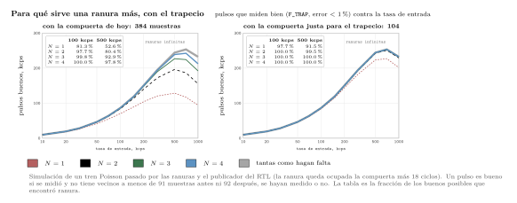
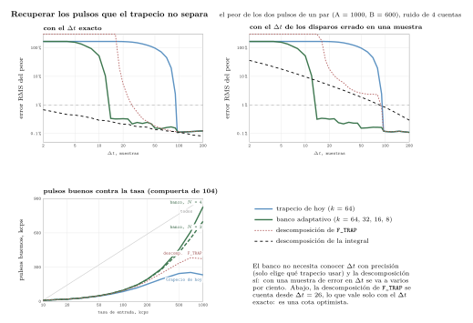

# Ranuras y recuperación de pulsos solapados

Si el trapecio separa dos pulsos recién desde unas 92 muestras (0.74 µs con
k = 64 y m = 48), ¿de qué sirve tener cuatro ranuras para medir pulsos que se
pisan? Y para los que el trapecio no separa, ¿hay otra manera de recuperarlos?
Este documento lo mide con un modelo del RTL y parámetros de la placa: cola de
2 µs (τ = 250 muestras a 125 MS/s), ruido blanco de 4 cuentas por muestra,
arribos Poisson. El criterio de «mide bien» es un error RMS menor que 1 %.

**En corto:**

- **Ranuras, con el trapecio de hoy: más de dos sirven solo porque la compuerta
  es larga.** Una ranura queda ocupada la compuerta más 18 ciclos, 402 en total,
  y el trapecio necesita 104. Con la compuerta en 104, **una** ranura ya captura
  el 97.7 % de los pulsos buenos a 100 kcps, y **dos** el 99.5 % a 500 kcps. La
  tercera y la cuarta solo miden pulsos que el trapecio no puede usar.
- **Opción 1, una versión compensada de cada pulso: sí, con un banco de
  trapecios.** Cada ranura usa el k más largo que sus vecinos permiten. Separa
  los dos pulsos desde Δt ≈ 13 y no necesita conocer Δt con precisión, solo
  elegir qué trapecio usar. Con él las ranuras vuelven a servir: a 1 Mcps da 815
  kcps de pulsos buenos con cuatro, contra 231 hoy.
- **Opción 2, descomponer los estimadores: posible, pero frágil.** Con el Δt de
  cada par, un sistema 2×2 recupera las dos amplitudes, y con un modelo exacto la
  integral lo hace hasta con Δt = 2. Pero un error de **una muestra** en Δt la
  lleva al 3–18 %, y hace falta procesar los dos eventos del par juntos.

Tu intuición es la correcta: **conviene la opción 1.** Las pruebas con la
señal, el ruido y el disparo reales están en
[`pruebas_banco_trapecios.md`](pruebas_banco_trapecios.md). Agregan una condición:
el banco necesita un disparo que vea todos los pulsos, y para eso el multitrigger
necesita una fuente nueva con polo-cero. **Las dos cosas ya están en el RTL**
(2026-11-03) y se verificaron en simulación contra el modelo; ver el §5 de ese
documento.

---

## 1. Para qué sirve una ranura más, con el trapecio

*Fuente: [`figuras_recuperacion.py`](figuras/trapecio/figuras_recuperacion.py),
sobre el modelo de [`recuperacion_modelo.py`](figuras/trapecio/recuperacion_modelo.py):
un tren Poisson pasado por las ranuras y el publicador como los tiene el RTL (la
ranura abre con el disparo, cierra a la compuerta, y el publicador la libera 18
ciclos después, o 19 después de la anterior si estaba ocupado).*

Un pulso es **bueno** para el trapecio si se midió y no tiene vecinos a menos de
91 muestras antes ni 92 después, se hayan medido o no (§2 de
[`separacion_trapezoidal.md`](separacion_trapezoidal.md)). Una ranura extra solo
agrega pulsos buenos en un caso: **un pulso limpio que llega con la ranura
anterior todavía ocupada.** Eso pasa si llega entre 91 y 402 muestras después de
otro: limpio para el trapecio, pero con la compuerta de la ranura anterior
abierta o esperando al publicador.

| Pulsos buenos que encuentran ranura | N = 1 | N = 2 | N = 3 | N = 4 |
|---|---|---|---|---|
| compuerta de 384, a 100 kcps | 81.3 % | 97.7 % | 99.8 % | 100 % |
| compuerta de 384, a 500 kcps | 52.6 % | 80.4 % | 92.9 % | 97.8 % |
| compuerta de 104, a 100 kcps | 97.7 % | 100 % | 100 % | 100 % |
| compuerta de 104, a 500 kcps | 91.5 % | 99.5 % | 100 % | 100 % |

Con la compuerta de 384 las ranuras sirven, y la razón es que la ranura queda
ocupada **cuatro veces más** de lo que el trapecio necesita. Con la compuerta
justa para la ventana del trapecio (`off + 8 + 2^lw = 104`, el bit `ok` de
`0x130`), la ventana entre «limpio» y «ranura libre» casi desaparece: dos
ranuras alcanzan a cualquier tasa razonable.

Dos cosas más que dice la figura:

- **El techo no lo ponen las ranuras.** Con ranuras infinitas, los pulsos buenos
  son `ρ·e^(−ρ·183)` y no pasan de ~250 kcps (ρ/e, a ~680 kcps de entrada). Arriba de
  eso hay más pulsos pero menos buenos, con cualquier número de ranuras.
- **Acortar la compuerta cambia las otras features**: `F_INT`, `F_PSD` y
  `F_INVW` se integran sobre la compuerta, y con 104 muestras miden otra cosa.
  Si el eje es `F_TRAP`, no importa. (Y si se aplicara el registro de resultado
  que discutimos para `t_div`, la ranura quedaría libre 17 ciclos antes.)

---

## 2. Opción 1: una versión compensada de cada pulso

### La idea: un banco de trapecios

La distancia que el trapecio necesita es, con la ventana centrada en la meseta,
**≈ k + (m + 2^lw)/2**: crece con k. Un trapecio corto separa pulsos más
cercanos, a cambio de promediar menos ruido. En vez de elegir un k para todos,
el banco tiene **varios**, y cada ranura usa, evento por evento, **el más largo
que sus vecinos permiten**: los pulsos aislados se miden con k = 64, y los que
tienen vecinos cerca con uno más corto en vez de perderse. Es lo que en la
literatura se llama conformado adaptativo.

| k | m | ventana | libres antes | libres después | ruido, pulso solo (600) |
|---|---|---|---|---|---|
| 64 | 48 | [80, 96) | 91 | 92 | 0.12 % |
| 32 | 24 | [39, 47) | 47 | 46 | 0.16 % |
| 16 | 12 | [19, 23) | 24 | 23 | 0.23 % |
| 8 | 8 | [10, 12) | 13 | 12 | 0.32 % |

*Arriba, el error del peor de los dos pulsos de un par contra Δt: a la izquierda
con el Δt exacto, a la derecha con el Δt de los disparos errado en una muestra.
Abajo, los pulsos buenos contra la tasa, con la compuerta de 104.*

El banco separa los dos pulsos desde **Δt ≈ 13–15**, con un error de 0.2 a
0.3 % (el ruido del trapecio que le tocó), contra 92 del trapecio solo. Y no
necesita conocer Δt con precisión: solo lo usa para **elegir** qué trapecio usar,
con los umbrales de la tabla, que llevan margen. En el panel de la derecha, con Δt
errado, la curva del banco es la misma.

**A una tasa dada**, con cuatro ranuras y la compuerta de 104:

| Entrada | Trapecio de hoy | Banco, N = 2 | Banco, N = 4 |
|---|---|---|---|
| 100 kcps | 86 kcps | 98 kcps | 98 kcps |
| 500 kcps | 241 kcps | 429 kcps | 455 kcps |
| 1 Mcps | 231 kcps | 695 kcps | 815 kcps |

Y acá **las ranuras vuelven a servir**: con el banco hay pulsos buenos a 13
muestras de otro, y cada uno necesita su ranura mientras la del anterior todavía
mide. A 1 Mcps, una ranura da 457 kcps, dos 695 y cuatro 815.

### Cómo sería en el RTL

Encaja en lo que hay, porque cada ranura ya conoce sus dos Δt:

- **Los trapecios**: tres `mca_trap` más sobre la misma `x_q`, con el mismo
  `Mq` (el polo-cero es de la señal, no del trapecio). Uno cuesta 373 LUT,
  239 FF, 3 RAMB18 y un DSP (síntesis OOC de `mca_trap`); el xc7z010 tiene
  120 RAMB18 y 80 DSP. Los cortos podrían ir en SRL en vez de BRAM.
- **En cada ranura**, un acumulador de meseta por trapecio (`trap_sum`,
  `trap_n`), con su ventana corrida por la latencia como hoy: unos 35 FF y 40
  LUT por trapecio y por ranura.
- **Al publicar**, el publicador elige el primero (el más largo) con
  `F_DTPREV ≥ antes(k)` y `F_DTNEXT ≥ después(k)` (umbrales en registros, que
  calcula el software con k, m y off), publica su promedio en `F_TRAP` y **qué
  k usó**, por ejemplo en los bits libres de `F_SOLAPE`.
- **La compuerta** tiene que cubrir la ventana del trapecio más largo (104).

En total, con cuatro ranuras: unas 1600 LUT, 1100 FF, 9 RAMB18 y 3 DSP. Es lo
que cuestan dos ranuras y media, y con el banco dos ranuras rinden más que cuatro
sin él (695 contra 231 kcps a 1 Mcps).

Dos cosas a tener en cuenta:

- **Las mesetas cortas suponen subida rápida.** La meseta tiene que ser mayor
  que el tiempo de subida t_c del pulso. Con los pulsos del generador alcanza;
  con un detector de colección lenta, m crece y los umbrales con él.
- **El espectro mezcla resoluciones.** A tasa alta más eventos usan un k corto y
  el pico se ensancha en la base. Publicar qué k usó cada uno permite separarlos
  (con el discriminador, o como segundo eje del 2D).

La resta de la cola por ranura de
[`separacion_trapezoidal.md`](separacion_trapezoidal.md) §8 es una versión
parcial de esta opción: compensa al segundo pulso desde Δt = 16, pero no al
primero.

---

## 3. Opción 2: descomponer los estimadores

### La idea: un sistema 2×2 por par

Un estimador **lineal** de la ranura de A mide A más la parte de B que cae en su
ventana, y el de B al revés:

    M_A = c_AA·A + c_AB(Δt)·B
    M_B = c_BA(Δt)·A + c_BB·B

Los cuatro coeficientes son lo que el estimador mide de un pulso unitario
corrido Δt, y salen de τ y de la ventana. Con el Δt que ya publican `F_DTPREV`
y `F_DTNEXT`, se despejan A y B. Sirve para `F_TRAP`, `F_INT` y `Q_cola`, que
son lineales; **no** para el pico (un máximo no es lineal) ni para `F_PSD`
(un cociente).

### Lo que da, y por qué es frágil

| Δt | Integral, Δt exacto | Integral, Δt + 1 | `F_TRAP`, Δt exacto | `F_TRAP`, Δt + 1 |
|---|---|---|---|---|
| 5 | 0.43 % | 18 % | — | — |
| 10 | 0.30 % | 9.7 % | — | — |
| 30 | 0.18 % | 3.2 % | 0.50 % | 6.0 % |
| 60 | 0.14 % | 1.5 % | 0.16 % | 2.4 % |
| 90 | 0.10 % | 0.93 % | 0.10 % | 0.83 % |

(el peor de los dos pulsos; «—» es que el sistema es singular: por debajo de
Δt ≈ 26 las dos ventanas de `F_TRAP` ven la misma meseta)

Con el Δt exacto, la descomposición de la integral es la mejor de todas: separa
hasta Δt = 2. Pero los coeficientes cambian rápido con Δt justo donde los
pulsos se pisan, y la inversión del 2×2 amplifica ese error. **Una muestra de
error en Δt** la deja peor que el banco en todo el rango. Y una muestra es
optimista: el disparo por pendiente cambia su latencia con la amplitud (6 a 9
ciclos con L = 8), y el pie cae entre dos muestras.

Además necesita:

- **Δt con precisión de fracción de muestra**: un disparo con interpolación
  (ver [`timestamp_cfd.md`](timestamp_cfd.md)), no el del multitrigger.
- **Los dos pulsos medidos**: con una ranura no recupera nada (B no tiene
  ranura), así que también pide N ≥ 2.
- **Procesar los dos eventos juntos.** El histograma se llena evento por evento
  y A se publica antes de que B cierre. Habría que retener a A en el publicador
  hasta que cierre B (un «resolvedor de pares»: cuatro productos y una división
  por par; el divisor ya está) o sacar los eventos como lista. El `event_ring`
  del otro bitstream saca formas de onda, no features.
- **Tríos y cadenas** piden sistemas más grandes; acá se cuentan como perdidos.

Aun con el Δt exacto, a una tasa dada gana menos que el banco porque solo
resuelve pares: a 1 Mcps, 390 kcps buenos contra 815.

---

## 4. Las tres, lado a lado

| | Trapecio de hoy | Banco adaptativo (opción 1) | Descomposición (opción 2) |
|---|---|---|---|
| separa desde | Δt ≈ 92 | Δt ≈ 13 | Δt ≈ 26 (`F_TRAP`), 2 (integral) |
| necesita Δt preciso | no | no | **sí**, mejor que una muestra |
| pulsos buenos a 500 kcps (N = 4, compuerta de 104) | 241 kcps | 455 kcps | 344 kcps (cota, con Δt exacto) |
| a 1 Mcps | 231 kcps | 815 kcps | 390 kcps (cota) |
| ranuras que valen la pena | 2 | 3–4 a tasa alta | ≥ 2 |
| qué agrega al RTL | — | trapecios, un acumulador por trapecio y ranura, la elección al publicar | un resolvedor de pares en el publicador, o una lista de eventos |

**La recomendación es la opción 1.** Usa las ranuras como están (cada una ya
mide su pulso y conoce sus dos Δt), no depende de saber Δt con precisión, y
convierte en buenos a los pulsos que hoy se marcan y se descartan.

**Las pruebas antes del RTL** ([`pruebas_banco_trapecios.md`](pruebas_banco_trapecios.md))
reemplazan los supuestos de este modelo por la subida, el ruido y el disparo
reales. El banco anda, pero **el disparo por pendiente no alcanza**:

- No separa pares a menos de ~20 muestras, y no ve un pulso chico en la cola de
  uno grande hasta ~150 muestras después.
- Con el banco y ese disparo, a 1 Mcps el 17.8 % de los pulsos se acepta
  contaminado.

La solución es una **fuente de disparo nueva en el multitrigger, con
polo-cero**: un trapecio k = 2, m = 1 con un Schmitt. Separa pares desde 7–8
muestras y casi no corre con la amplitud. Con ella, el banco da 805 kcps buenos a
1 Mcps, con 4.3 % de contaminados, y la forma corta puede ser 8/8. Con la
pendiente tendría que ser 8/12.

**Relacionados →** [`separacion_trapezoidal.md`](separacion_trapezoidal.md) (cómo
separa el trapecio, y la resta de la cola por ranura),
[`vista_general_mca.md`](vista_general_mca.md) §2.3 (las ranuras y lo que
cuestan) y [`tiempo_muerto.md`](tiempo_muerto.md).
