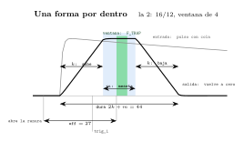
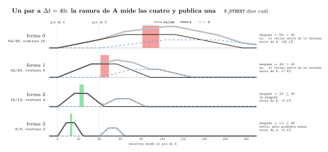
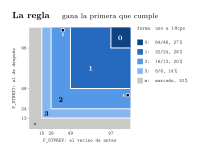

# Mapa de registros — `mca_top` (Analizador Multicanal)

**Base:** `0x4070_0000` (slot 7 del bus de sistema) · **Tamaño de mmap:** `0x30000`
**RTL:** [`prj/MCA/modulos/mca/rtl/mca_top.sv`](../../modulos/mca/rtl/mca_top.sv)
**Driver:** [`prj/MCA/software/API/mca.py`](../../software/API/mca.py)
**API:** [referencia de `API.mca`](../API/referencia_api.md#1-apimca--analizador-multicanal) — qué función toca cada registro
**Bitstream:** `mca_red_pitaya.bit` (top `mca_red_pitaya_top`) — **no** el del scope

Todos los registros son de 32 bits y viven en el dominio `adc_clk` (125 MHz).
El cruce a `clk_fpga_0` lo hace `sys_bus_cdc` por slot, igual que el scope.

> **El slot 7 en el bitstream del scope es un `sys_bus_stub`**, que responde con
> `err=1`. Por eso el registro `0x000` tiene un valor mágico: permite distinguir
> "bitstream sin MCA" de "MCA presente" sin adivinar.

> **El magic distingue el mapa.** Con las ranuras de medición el mapa cambió de
> propósito (se fueron el Schmitt interno, la histéresis, el re-armado y el modo
> de publicación) y el magic pasó de `"MCA1"` a **`"MCA2"`**. El software tiene
> que mirarlo antes de configurar: el decodificador **ignora en silencio las
> escrituras a direcciones no mapeadas o reservadas** (devuelve `32'h0` y no
> levanta `sys_err`), así que un software para `"MCA1"` contra este bitstream no
> falla, escribe al vacío. Para verificar el bloque de features sigue valiendo
> escribir y releer (`MCA.tiene_features()` sobre `0x09C`; ver
> [`sesion_placa_deriva.md`](sesion_placa_deriva.md) §0).

---

## Identificación

| Offset | R/W | Campo | Descripción |
|---|---|---|---|
| `0x000` | R | `MAGIC` | `0x4D434132` (`"MCA2"`, el mapa de las ranuras). Con `"MCA1"` es el bitstream anterior. |
| `0x004` | R | `CAPS` | bit0 `EN_HIST_H` (espectro 1D), bit1 `EN_HIST_H_PSD` (mapa 2D), bit2 `N_FORMAS > 0` (conformado trapezoidal, `F_TRAP` y `F_FORMA`) |
| `0x008` | R | `WIDTHS` | `{PSD_AW[23:16], H2_AW[15:8], H_AW[7:0]}` |

`WIDTHS` existe para que el software **derive** los tamaños de apertura en vez de
hardcodearlos: los motores se instancian por parámetro, así que un bitstream
puede traer 4096 canales y otro 16384.

Valores del build por defecto: **`H_AW=13` (8192 canales)**, `H2_AW=7` × `PSD_AW=6`
(mapa de 128 × 64).

> **El eje pasó de 16384 a 8192 canales.** La resolución medida da 9.2–10.3 bits
> efectivos, y el criterio de 4–10 canales por FWHM justifica 3800–9500 canales:
> 16384 estaba por encima del rango útil y los 4 bits de más no compraban nada
> medible. Libera **8 RAMB36 de 16**, que es lo que habilita un segundo MCA.
> Consecuencia práctica: **todo FWHM en canales se divide por dos** respecto de
> las campañas anteriores; las resoluciones en % no cambian. Ver
> [`limites_resolucion_y_deriva.md`](limites_resolucion_y_deriva.md) §2.

---

## Control y estado

| Offset | R/W | Bits | Campo | Reset | Descripción |
|---|---|---|---|---|---|
| `0x00C` | RW | 0 | `run` | `0` | Habilita la adquisición y los relojes |
| | W | 1 | `clear` | — | **Autolimpiante.** Borra histogramas, contadores y relojes |
| | RW | 8 | `chan_sel` | `0` (IN1) | 0 = IN1, 1 = IN2 |
| `0x010` | R | 0 | `clear_busy` |   | Barrido de borrado en curso |
| | R | 1 | `busy` |   | Alguna ranura ocupada (midiendo o esperando publicar) |
| | R | 2 | `baseline_stale` |   | El seguidor de línea de base lleva demasiado congelado |
| | R | 3 | `vetoed` |   | Veto externo activo: el `trigger_shield` del multitrigger con `DST_MCA` |
| | R | 4 | `rearm_pend` |   | El disparo del multitrigger espera re-armar (`trig_arm_i = 0`): un pulso que llegue ahora no genera flanco |
| | R | 5 | `puede_abrir` |   | Hay alguna ranura habilitada libre: el próximo disparo abre |
| | R | 10:8 | `n_ocup` |   | Ranuras ocupadas ahora |
| `0x0A8` | R | 0 | `full_1d` |   | Algún bin del espectro llegó al tope. **Pegajoso**: sólo lo limpia `clear` |
| | R | 1 | `full_2d` |   | Ídem para el mapa 2D |

> **Corrección de este documento.** Los bits `busy`, `baseline_stale` y `vetoed`
> estaban listados bajo `0x0A8`, y `0x0A8` tenía el bit 1 repetido. Viven en
> `0x010` (`mca_top.sv`, el `case` de lectura); `0x0A8` sólo trae las dos
> banderas de histograma lleno. El RTL nunca cambió: era un error del mapa.

**`busy` no es la condición de bloqueo del módulo**: con varias ranuras pueden
valer `busy = 1` y `puede_abrir = 1` a la vez (hay ranuras midiendo y alguna
libre). El módulo está muerto exactamente cuando `puede_abrir = 0`. Ver
*Relojes*.

El barrido de borrado recorre `2^H_AW` bins: **131 µs** con 16384 canales. Durante
ese lapso el puerto de lectura sigue vivo (el bus **no** se cuelga), pero los
eventos que lleguen se descartan y se cuentan en `cnt_dropped`.

---

## Configuración

| Offset | R/W | Campo | Reset | Descripción |
|---|---|---|---|---|
| `0x01C` | RW | `cfg_baseline` | `0` | Línea de base fija (si `bl_auto = 0`) |
| `0x020` | RW | `cfg_bl_ctrl` | `0x60` (k=6, base fija; API: k=12) | `{holdoff[31:16], k[7:4], auto[0]}` |
| `0x024` | R | `baseline_now` |   | Línea de base seguida, para calibrar |
| `0x030` | RW | `cfg_amp_min` | `0` | Ventana de aceptación en amplitud |
| `0x034` | RW | `cfg_amp_max` | `0xFFFF` | |
| `0x038` | RW | `cfg_amp_src` | `0` (pico) | bit0: 0 = muestra de pico, 1 = integral. `q_shift` en `[12:8]`. **Escribirlo también mueve `cfg_hist_sel`** (compatibilidad: toda la campaña existente sigue andando sin tocarla) |
| `0x03C` | RW | `cfg_h_shift` | `0` | **DEPRECADO** — lo subsume `cfg_zoom_1d`. Se sigue leyendo y escribiendo, pero **ya no afecta al datapath** |
| `0x040` | RW | `cfg_h2_shift` | `0` | **DEPRECADO** — lo subsume `cfg_zoom_2dx`, ídem |
| `0x044` | RW | `cfg_dec` | `1` | Decimación propia del MCA (1 = sin decimar) |
| `0x04C` | RW | `cfg_gate_len` | `0x0180_0020` (384/32) | `{larga[31:16], corta[15:0]}` en muestras, desde el disparo. La ventana cierra en la larga y la cola arranca en la corta. Cada ranura las **retiene al abrir** |
| `0x120` | RW | `cfg_n_acc` | `1` | Ranuras habilitadas, 1..`N_ACC` (`0` se toma como 1; más que `N_ACC` satura). Ver *Las ranuras* |
| `0x124` | RW | `cfg_pre_dly` | `11` | Retardo de la muestra respecto de `trig_i`, en **ciclos** (0..127). Ver *La línea de retardo* |
| `0x128` | RW | `cfg_trap_km` | `0x0020_0040` (k = 64, m = 32) | `{m[25:16], k[9:0]}` del trapecio, en muestras. **Escribirlo reinicia su estado**. Ver *El conformado trapezoidal* |
| `0x12C` | RW | `cfg_trap_mq` | `0` | Constante polo-cero `M·16` (20 b: M hasta 65535.94 muestras). **Escribirlo reinicia su estado** |
| `0x130` | RW | `cfg_trap_med` | `0x8704_0048` | `{ok[31] (R), sh[29:24], lw[18:16], off[15:0]}`: la ventana de 2^lw muestras sobre la meseta, desde `off`, y la escala de `F_TRAP`. `ok` dice si la ventana entra en la compuerta larga |
| `0x134` | RW | `cfg_n_formas` | `0x8000_0401` | `{umbr_ok[31] (R), N_FORMAS[10:8] (R), n_formas[2:0]}`: cuántas formas del banco se usan (0 = 1, satura en `N_FORMAS`). Ver *El banco de trapecios* |
| `0x180`+16·f | RW | `FORMA_KM` f | forma 0: el de `0x128`; f > 0: la mitad de la anterior | Como `0x128`, para la forma f; la forma 0 **es** `0x128`. Escribirlo reinicia el estado |
| `0x184`+16·f | RW | `FORMA_MED` f | ídem | Como `0x130`, para la forma f; la forma 0 **es** `0x130` |
| `0x188`+16·f | RW | `FORMA_UMBR` f | `0` | `{despues[31:16], antes[15:0]}`: la forma f se elige si `antes ≤ F_DTPREV` y `despues ≤ F_DTNEXT` |
| `0x090` | RW | `cfg_hist_sel` | `0x200` (PEAK, PEAK, PSD) | `{sel_2dy[11:8], sel_2dx[7:4], sel_1d[3:0]}` — qué feature alimenta cada eje |
| `0x094` | RW | `cfg_zoom_1d` | `0` | `{k[15:8], z[3:0]}` del eje 1D. `z = 0` = fondo de escala |
| `0x0B8` | RW | `cfg_zoom_2dx` | `0` | ídem, eje de amplitud del mapa 2D |
| `0x0BC` | RW | `cfg_zoom_2dy` | `0` | ídem, segundo eje del mapa 2D |
| `0x098` | RW | `cfg_discr_ctrl` | `0` (apagado) | `{sel[7:4], externo[1], enable[0]}` del discriminador |
| `0x09C` | RW | `cfg_discr_min` | `0` | 16 b |
| `0x0A0` | RW | `cfg_discr_max` | `0xFFFF` | 16 b |
| `0x0A4` | RW | `cfg_hist_ctrl` | **`0`** (la API escribe `1`: con `0` el histograma deja de contar al llenarse un bin) | bit0 `keep_counter_if_full` |

**Reservados**: `0x014`, `0x018`, `0x028`, `0x02C`, `0x048`, `0x104`, `0x108`
(eran el umbral, la histéresis, `maxlen`, `tail_dly`, el modo de ventana y las
políticas de apertura, re-armado y publicación). Se escriben sin efecto y se leen
en cero; lo fija `tb_mca_top`.

### El bus de features y el selector de eje

El extractor emite un **bus de 16 ranuras de 16 bits**, todas del mismo evento.
Es **interno a la FPGA**: no sale al software. El ARM sigue leyendo las mismas
aperturas `0x10000` y `0x20000`; lo único que cambia es `cfg_hist_sel`, que dice
qué ranura alimenta cada eje.

| Índice | Nombre | Qué es | Normalizada |
|---|---|---|---|
| 0 | `F_PEAK` | amplitud de pico | **sí**, alineada a la izquierda |
| 1 | `F_INT` | integral `Q_total >> q_shift` | sí (ya satura a 16 b) |
| 2 | `F_PSD` | `Q_cola/Q_total` — *dónde* está la carga | **sí** |
| 3 | `F_INVW` | `Pico/Q_total` — ancho inverso | **no** (ver abajo) |
| 4 | `F_LEN` | largo de la ventana, en muestras | no |
| 5 | `F_TRISE` | muestras del disparo al pico | no |
| 6 | `F_DTPREV` | muestras desde el disparo anterior (haya abierto o no); `0xFFFF` = ninguno o saturado | no |
| 7 | `F_DTNEXT` | muestras hasta el siguiente disparo **dentro** de la ventana; `0xFFFF` = ninguno | no |
| 8 | `F_SOLAPE` | `{perdido[5], adentro[4], otras[3:0]}`: ranuras abiertas al abrir, si llegó otro disparo adentro y si alguno se perdió | campo de bits |
| 9 | `F_TRAP` | altura de la meseta del trapecio: el promedio sobre la ventana de `cfg_trap_med`, `>> sh`; **0** si la ventana no se completó | **sí**, con `sh` elegido para eso |
| 10 | `F_FORMA` | la forma del banco que publicó la ranura (0..3), o `0xFFFF` si ninguna alcanzó: **marcado**, y entonces `F_TRAP` = 0 | no |
| 11–15 | — | reservadas; valen **cero** | — |

El contrato del bus es *uint16 con fondo de escala `0xFFFF`*, así que las
features acotadas se **alinean a la izquierda**: extenderlas con cero dejaría la
fracción en los bits bajos y cada eje necesitaría un corrimiento distinto para
decir lo mismo.

**Las marcas de solape** (6–8) dicen si lo que midió la ventana estaba montado
sobre otro pulso. La ranura no lo corrige: el discriminador puede cortar por
`F_DTPREV`/`F_DTNEXT` (por ejemplo, aceptar solo eventos aislados por más de una
ventana) o por `F_SOLAPE`, y el software decide si corregir o rechazar.

**Tres no se normalizan, y conviene saberlo**: `F_LEN` y `F_TRISE` son contadores
sin fondo de escala natural (depende de `cfg_gate_long`); `F_INVW` es una
fracción pero vive **cerca de cero** (`P/Q ≈ 0.001` para un pulso de 250
muestras), así que alinearla a la izquierda la mandaría entera al bin 0, y su
escala depende del ancho del pulso — que es justo lo que mide. Las tres se
ajustan con el zoom de su eje.

> **Por qué existe `F_INVW`.** Medido por Monte-Carlo sobre el espectro de una
> línea a 100 kcps, un corte por ancho rechaza el **99.1 %** de los apilados y
> baja el continuo sobre el fotopico de 32.4 % a **0.8 %** sin perder un evento
> limpio. El eje de forma que ya estaba (`Q_cola/Q_total`) rechaza el 29.6 % en
> modo histéresis y **exactamente nada** en modo compuerta. Ver
> [`software/monte-carlo/`](../../software/monte-carlo/).

### El zoom, alineado a potencias de 2

La ventana es `[k·2^(16−z), (k+1)·2^(16−z))`. Sobre la feature de 16 bits eso es
puro rebanado: dentro de la ventana ⇔ los `z` bits altos valen `k`, y el bin son
los `AW` bits siguientes. Ni restador ni multiplicador.

**La alineación es lo que lo hace utilizable**: los bins de cada nivel son
subdivisiones *exactamente anidadas* de los del anterior, así que dos espectros
de niveles distintos se combinan con aritmética entera, sin resamplear y sin
introducir DNL. Con offsets arbitrarios los bordes no coincidirían.

- `z_max = 16 − AW` = **3** con 8192 canales (zoom hasta 8×).
- Fuera de la ventana **satura**, no envuelve: los bins de los extremos hacen de
  indicadores de desborde.
- `z` se satura a `z_max` y `k` se enmascara a `2^z − 1`, para que `z = 0` fuerce
  `k = 0` en vez de mandar todo el espectro al canal 0 en silencio.
- **El zoom no mejora la resolución**: a 8.6 canales/FWHM la pérdida por binning
  ya es 0.31 % de σ. Sirve para *ubicar* el eje y para poder usar un histograma
  más chico. Ver [`limites_resolucion_y_deriva.md`](limites_resolucion_y_deriva.md) §5.

### El discriminador

Una condición `{sel, min, max, tipo}` sobre la feature elegida, con el intervalo
interno `[min,max]` o su complemento. Va **después de los divisores**, que es lo
que permite cortar por las features de forma — el corte que de verdad importa.

**`min > max` es el conjunto vacío**: el modo interno rechaza todo y el externo
acepta todo. No es un error, es la respuesta correcta a lo que se pidió, y está
fijado por un test. `configure()` levanta `ValueError` si se pide interno con
`min > max`, porque ahí casi siempre es un error de tipeo.

> **El corte hay que calibrarlo contra la amplitud.** `Pico/Q_total` **no** es
> constante: en modo histéresis el largo de la ventana crece con el logaritmo de
> la amplitud y el cociente deriva ~21 % de punta a punta. Y la calibración se
> hace con un **pulser deslizante**, no con el espectro fuente: con una línea
> monoenergética el lugar geométrico queda definido en un puñado de canales y el
> corte terminaría rechazando por caer fuera del rango calibrado y no por tener
> la forma mal — un corte en amplitud disfrazado de corte en forma, que da un
> resultado espectacular y falso.

### La ventana: la abre el disparo, la cierra la compuerta

La ventana la abre **solo** el trigger externo (`trig_i`, el `trigger_event` del
multitrigger), por **flanco**, y la cierra la compuerta larga: `gate_larga`
muestras desde el disparo, pase lo que pase con la señal. La cola arranca en la
compuerta corta, también desde el disparo. Es el método de comparación de carga
(Brooks 1959; Knoll cap. 17), y el que mejor resolución dio: medido offline
sobre 7054 pulsos reales, la integral con compuerta fija da **0.149 %** contra
0.528 % de la ventana por histéresis y 0.272 % de la muestra de pico.

Ya no hay Schmitt interno, histéresis ni re-armado: no pueden ver un pulso
montado sobre la cola de otro (la señal nunca baja del umbral entre los dos), y
esos son los pulsos para los que existen las ranuras. El disparo lo hace el
multitrigger, con su disparo por pendiente, y su Schmitt es el que re-arma. Ver
*Cómo configurar el multitrigger para el MCA*.

> **Una ventana ocupa su ranura `gate_larga + 1` ciclos midiendo.** La muestra se
> registra antes de repartirse a las ranuras, así que la ranura elegida queda
> reservada el ciclo siguiente a la decisión y procesa cada muestra un ciclo
> después de recibirla. Con la ventana única de antes eran `gate_larga`.

### El estimador de amplitud (`cfg_amp_src`) es el parámetro más importante

- **`0` — muestra de pico**: la amplitud sale de *una* muestra, así que arrastra
  el ruido completo del ADC. Peor: el muestreo casi nunca cae en el máximo
  verdadero, y esa subestimación variable **ensancha el fotopico** por razones
  puramente instrumentales. A 125 MSPS con subida de 100 ns hay ~12 muestras en
  el flanco y el error es chico; con subida de 20 ns hay 2.5 y es severo.
- **`1` — integral de carga** (`Q_total >> q_shift`): el ruido blanco promedia
  como σ/√N y desaparece el jitter de muestreo. Es lo que hace cualquier MCA
  digital serio, y lo único que justifica un eje de 16384 canales: con N = 256
  muestras `Q_total` tiene ~21 bits significativos.

Poder alternar entre los dos sobre el mismo estímulo **es** el experimento que
mide la contribución de jitter de muestreo (`compare_estimators()` en
`testbench_mca.py`).

### La cola con `gate_corta = 0`

Con `gate_corta = 0` la cola integra todo menos la muestra del disparo, así que
`Q_cola = Q_total` cuando esa muestra cae en la base. El RTL lo rechaza y lo
cuenta en `cnt_rej_psd` (el evento entra al 1D pero no al 2D): sin esa guarda el
cociente daría `2^PSD_AW`, que no entra en `PSD_AW` bits y **envolvería a 0**,
mandando el evento al extremo *opuesto* del eje de forma.

---

## Contadores de eventos

| Offset | Campo | Descripción |
|---|---|---|
| `0x050` | `cnt_total` | Ventanas cerradas (aceptadas + rechazadas) |
| `0x054` | `cnt_accepted` | Entraron al espectro 1D |
| `0x058` | `cnt_rej_amp` | Amplitud fuera de `[amp_min, amp_max]` |
| `0x05C` | `cnt_rej_psd` | `Q_total = 0` o `Q_cola ≥ Q_total`: entran al 1D pero **no** al 2D |
| `0x060` | `cnt_pileup` | Ventanas cerradas **con marca de solape** (`F_SOLAPE` distinto de cero). **Sí** se histogramean: el corte lo hace el discriminador |
| `0x064` | `cnt_dropped` | `cnt_lost_busy` (disparos sin ranura libre con alguna esperando publicar) + colisiones de lectura + borrado |
| `0x0AC` | `cnt_rej_discr` | Rechazados por el **discriminador** (aparte de `cnt_rej_amp`: son criterios distintos y hay que poder atribuir la pérdida a cada uno) |
| `0x0B0` | `cnt_full_supp` | Eventos **no contados** por histograma lleno con `keep = 0` |

Todos se ponen a cero con `clear` (`0x00C` bit 1).

## Relojes (64 bits)

| Offset | Campo |
|---|---|
| `0x068` / `0x06C` | `realtime` lo / hi |
| `0x070` / `0x074` | `livetime` lo / hi — hay alguna ranura libre **y el disparo está armado** |
| `0x078` / `0x07C` | `deadtime` lo / hi — **ocupación**: alguna ranura ocupada (ver abajo) |
| `0x0C0` / `0x0C4` | `vetotime` lo / hi |
| `0x0C8` / `0x0CC` | `t_win` lo / hi — sin ranura libre, **todas midiendo** |
| `0x0D0` / `0x0D4` | `t_div` lo / hi — sin ranura libre, **alguna esperando publicar** |
| `0x0D8` / `0x0DC` | `t_rearm` lo / hi — hay ranura libre pero **el disparo espera re-armar** |
| `0x0FC` / `0x100` | `t_clear` lo / hi — barrido de borrado del histograma |
| `0x140 + 8j` / `0x144 + 8j` | `t_ocup[j]` lo / hi — ciclos con **exactamente j** ranuras ocupadas, j = 0..`N_ACC` |

Cuentan ciclos de `adc_clk` mientras `run = 1`. Dividir por 125e6 para segundos.

### El teselado

Con `run = 1`, **cada ciclo se atribuye a exactamente un casillero**:

```
realtime = vetotime + t_win + t_div + t_rearm + livetime
```

Es una identidad exacta en todo ciclo, y está verificada como assertion del RTL
(`modulos/mca/sim/sva/mca_top_sva.sv::ap_suma_relojes`), no sólo medida. El
tiempo muerto del MCA es **no hay ranura libre**, `t_win + t_div`, partido por la
causa: todas midiendo, o el publicador que no da abasto. El veto va primero: la
cola de una ventana que termina bajo veto cuenta como vetada, no como muerta.

**El re-armado del disparo**, `t_rearm`, va después de los dos del MCA: son los
ciclos en que el MCA podía abrir pero el multitrigger no podía disparar
(`trig_arm_i = 0`: ningún Schmitt habilitado en la máscara re-armó, o el canal
está deshabilitado). Un pulso que llega ahí no genera flanco y **no llega a
`cnt_cross`**: lo único que se puede medir de él es el tiempo. Ir después de
`t_win` y `t_div` deja intactos el período muerto y la ocupación, y deja a
`livetime` como lo que un pulso ve de verdad: ranura libre y disparo armado. Con
arribos Poisson, la fracción que se pierde en el disparo es `t_rearm /
(realtime − vetotime)`, y el tiempo muerto entero que corrige la tasa es
`t_win + t_div + t_rearm` (`deadtime_real_s` en la API).

El nivel `trig_arm` lo da `mt_event_logic` (bit 18 de `SHIELD_STAT` en el
multitrigger): algún canal tiene en su máscara una fuente que puede disparar ya
y no está deshabilitado. Las fuentes por pendiente y con polo-cero dan el estado
de su Schmitt; el disparo **por nivel** (`rp_adc_trig`, de Red Pitaya) no lo
expone y cuenta como siempre armado, igual que SW, externo, ASG y cadena. Baja un
ciclo antes de que el flanco llegue al MCA. Un top sin multitrigger lo ata a 1, y
entonces `t_rearm` queda en cero como antes.

### La ocupación

```
t_ocup[0] + t_ocup[1] + … + t_ocup[N_ACC] = realtime − vetotime
```

también en todo ciclo (`ap_suma_ocupacion`). Es la medición **directa** del
modelo M/D/N/N: con arribos Poisson la fracción de tiempo con j ranuras ocupadas
sigue la distribución de Erlang, y la de todas ocupadas es la pérdida B(N, ρ).
Con N = 1 es la columna `K=1` de [`tiempo_muerto.md`](tiempo_muerto.md), con
pérdida de primer orden en ρ; con N ranuras la pérdida es ~ρ^N/N!.

La ocupación no mira el disparo: un ciclo con alguna ranura libre es `livetime` o
`t_rearm`, así que `livetime + t_rearm = t_ocup[0] + … + t_ocup[n_acc − 1]` (con
`cfg_n_acc` sin cambiar desde el último `clear`).

`deadtime` (`0x078`) es la **ocupación de alguna ranura**, `realtime − vetotime −
t_ocup[0]` (`ap_deadtime_es_ocupacion`). Con una ranura coincide con el tiempo
muerto (`deadtime = t_win + t_div`, `ap_una_ranura`, siempre que `cfg_n_acc` no
haya cambiado desde el último `clear`). Con varias **no es tiempo muerto**: hay
ciclos con ranuras midiendo en que el módulo igual puede abrir.

> **Verificar las identidades exige frenar.** Valen ciclo a ciclo en el hardware,
> pero cada acceso al bus se lleva ~6 ciclos y los contadores avanzan entre uno y
> otro, así que la suma **leída con `run = 1` no cierra**. Para comprobarla hay
> que `stop()` primero.

`t_clear` va **aparte del teselado**: durante el barrido de borrado las ranuras
siguen midiendo y lo que se pierde son los incrementos al histograma, que se
cuentan como eventos en `cnt_dropped`.

## Distribución del período muerto

| Offset | Campo |
|---|---|
| `0x0E0` | `cnt_dead_periods` — cantidad de períodos muertos |
| `0x0E4` | `max_dead_len` — el más largo, en ciclos |
| `0x0E8` | `cnt_dead_ext` — períodos **con arribo** adentro |

Un período muerto es un tramo contiguo de ciclos **sin ranura libre**, los mismos
que suman a `t_win + t_div`. De ahí sale `E[L] = (t_win + t_div) /
cnt_dead_periods`.

- **Con una ranura** cada período dura exactamente τ = `gate_larga + 1 + 18`
  ciclos (la ventana y la publicación): sin dispersión, `max_dead_len = E[L]`.
- **Con varias**, un período arranca cuando se ocupa la última ranura libre y
  termina cuando se libera alguna: su largo es variable, y su distribución es la
  del modelo M/D/N/N.

`cnt_dead_ext` cuenta **períodos** con al menos un disparo adentro, uno por
período como máximo, no disparos. Cada uno es un pulso que se perdió por falta de
ranura. Un veto en medio de un bloqueo lo **parte** en dos períodos, porque el
criterio excluye el veto para que la suma de los largos cierre con los relojes.

## Atribución de arribos

| Offset | Campo |
|---|---|
| `0x0EC` | `cnt_cross` — todos los **disparos** (flancos de `trig_i` en una muestra válida, con `run`) |
| `0x0B4` | `cnt_open` — ...que abrieron una ranura |
| `0x0F4` | `cnt_lost_active` — ...sin ranura libre, todas midiendo |
| `0x064` (parte) | `cnt_lost_busy` — ...sin ranura libre, alguna esperando publicar (sumado en `cnt_dropped`) |
| `0x0F8` | `cnt_lost_veto` — ...bajo veto |
| `0x110` | `cnt_win` — ventanas abiertas (igual a `cnt_open`: cada ventana viene de un disparo) |
| `0x118` | `cnt_trig` — flancos **crudos** de `trig_i`, haya `run` o no |
| `0x0F0`, `0x114` | reservados (eran `cnt_lost_rearm` y `cnt_lost_notrig`) |

La versión por eventos del teselado, también exacta en todo ciclo y también como
assertion (`ap_atribucion_arribos`):

```
cnt_cross = cnt_open + cnt_lost_active + cnt_lost_busy + cnt_lost_veto
```

con el mismo orden que los relojes: veto primero, después la causa del bloqueo.
`cnt_trig` puede superar a `cnt_cross` con decimación: dos flancos que caen entre
dos muestras válidas son un solo disparo.

## Las ranuras

| Offset | R/W | Campo | Reset | Descripción |
|---|---|---|---|---|
| `0x120` | RW | `cfg_n_acc` | `1` | Ranuras habilitadas, 1..`N_ACC` |
| `0x124` | RW | `cfg_pre_dly` | `11` | Retardo de la muestra respecto de `trig_i`, en ciclos |
| `0x10C` | R | `{last_win_id[31:16], occ_max[15:8], occ[7:0]}` |   | La cola de publicación: ranuras cerradas ahora, su máximo y el id de la última ventana publicada |
| `0x11C` | R | `N_ACC` |   | Ranuras con que se sintetizó (3 en los tops desde el 2026-11-09; 4 antes) |

Una **ranura** es un juego entero de acumuladores. Un disparo abre la ranura
habilitada libre de menor índice; la ranura mide durante la compuerta larga y,
si la amplitud cae en `[amp_min, amp_max]`, se queda con el resultado hasta que
el publicador (los dos divisores de forma, 18 ciclos) lo toma. O sea que las
ranuras **son** la cola de publicación: con `cfg_n_acc = 1` la ranura no puede
reabrir hasta publicar, que es la publicación bloqueante de antes; con más, un
disparo que llega con una ventana abierta abre otra.

Lo que compran: la pérdida de eventos pasa de ser de **primer orden** en la tasa
(~ρ con una ranura) a ~ρ^N/N!. Lo que cuestan: lo medido sobre otro pulso viene
**contaminado** (su carga incluye la cola del anterior, y la primera ventana
incluye la cabeza del segundo). El RTL no lo corrige, lo **marca** en el bus de
features (`F_DTPREV`, `F_DTNEXT`, `F_SOLAPE`) y cuenta las ventanas marcadas en
`cnt_pileup`. La corrección es `F_TRAP`: ver *El conformado trapezoidal*.

La **cola** cuenta las ranuras cerradas, incluida la que se está publicando:
`occ_max = N_ACC` quiere decir que llegó a haber todas esperando. Lo que se
perdió por eso está en `cnt_lost_busy`. El `last_win_id` ata el evento publicado
a la ventana que lo produjo: un salto en la secuencia de ids delata un resultado
perdido.

`cfg_n_acc` se puede cambiar en caliente: se usa desde el próximo disparo, y las
ranuras que quedaron afuera terminan lo que estaban midiendo. La compuerta
también, porque cada ranura la retiene al abrir. La ventana de amplitud y
`q_shift`, **no**: se evalúan un ciclo antes del cierre, contra umbrales
pre-desplazados, y un cambio a mitad de una ventana la evalúa mal. Se cambian con
todo publicado.

### La línea de retardo

El trigger del multitrigger llega **tarde** respecto de la muestra que lo causó:
el disparo por pendiente necesita del orden de L muestras para cruzar su umbral,
más los registros de `mt_trig_src` y `mt_event_logic`. `cfg_pre_dly` retrasa la
muestra esa cantidad de ciclos, así la ventana abre en el pie del pulso. Lo que
hace falta lo mide `sim/tb_mca_mt_latencia.sv`, con `mt_top` y `mca_top`
conectados como en el top y la misma muestra en los dos:

| Disparo por pendiente | Pulso | Latencia pie → `trig_i` | `cfg_pre_dly` |
|---|---|---|---|
| L = 4, G = 2 | subida rápida | 6–7 ciclos | 9 |
| L = 8, G = 4 | subida rápida | 6–9 ciclos | **11** (el reset) |
| L = 16, G = 8 | subida rápida | 7–12 ciclos | 14 |
| L = 4, G = 2 | semi-gaussiana (pico a 1 µs) | 20–34 ciclos | 36 |
| L = 8, G = 4 | semi-gaussiana | 24–40 ciclos | 42 |
| L = 16, G = 8 | semi-gaussiana | 31–50 ciclos | 52 |
| L = 8, G = 4 | el pulso de la campaña (FWHM 2 µs), **medido en placa** | ~14 ciclos | 16 |

La regla es `cfg_pre_dly = latencia_máx − 2 + margen`, donde 2 son los registros
del camino de la muestra adentro de `mca_top` y el margen (4 en la tabla) son
muestras de base antes del pie. La latencia **depende de la amplitud**: es el
*walk* de un disparo por umbral, y por eso el rango. La tabla supone que el
multitrigger y el MCA toman la muestra del mismo punto de la cadena DSP; si los
taps son distintos, la diferencia se suma.

### Cómo configurar el multitrigger para el MCA

El MCA necesita un disparo por pulso, sin intervención del software entre uno y
otro. En el multitrigger ([`register_map_mt.md`](../mt/register_map_mt.md)) eso es:

1. **Modo continuo** (`we_keep` = bit 3 de `0x00` del scope): la máscara sobrevive
   al disparo.
2. **Re-armado por el shield**: `SHIELD_CFG` con la fuente y el destino en el
   canal del MCA (`src[k]`, `dst[8+k]`). Al vencer el holdoff le limpia el disable
   al canal; con `dur = 0`, enseguida.
3. **Disparo por pendiente**: `SLOPE_CFG/THR/HYST` del canal y su bit en
   `OR_MASK` (`slope_p`, bits 17–20). Su Schmitt es el que re-arma de verdad:
   vuelve a disparar cuando la pendiente baja de `thr − hyst` y sube otra vez, o
   sea con un pulso montado sobre la cola de otro.

El nivel `trig_arm`, que alimenta `t_rearm`, no se configura: sale del mismo
Schmitt que dispara. Con el disparo con polo-cero (bits 25–28) es igual, con su
propio umbral y su histéresis.

`tb_mca_mt_latencia` arma exactamente esto. El umbral se elige sobre la
**pendiente**: para un escalón de alto A, `s = L·A`; para una rampa de m cuentas
por muestra, `s = L·(L+G)·m` ([`trigger_pendiente.md`](../mt/trigger_pendiente.md)).

## El conformado trapezoidal

| Offset | R/W | Campo | Reset | Descripción |
|---|---|---|---|---|
| `0x128` | RW | `{m[25:16], k[9:0]}` | k = 64, m = 32 | Subida y meseta, en muestras. `k = 0` se toma como 1 y `k + m` satura en 1023 |
| `0x12C` | RW | `Mq` | `0` | `M·16`, con M la constante polo-cero en muestras |
| `0x130` | RW | `{ok[31], sh[29:24], lw[18:16], off[15:0]}` | off = 72, lw = 4, sh = 7 | La ventana sobre la meseta y la escala; `ok` es de solo lectura |

`mca_trap` conforma la muestra relativa a la base, `x = dat − base`, con la forma
recursiva de Jordanov y Knoll (NIM A 345, 1994):

    d[n] = x[n] − x[n−k] − x[n−l] + x[n−k−l]        l = k + m
    p[n] = p[n−1] + d[n]
    s[n] = s[n−1] + 16·p[n] + Mq·d[n]

Un pulso exponencial `A·e^(−n/τ)` sale como un trapecio de subida k, meseta m y
bajada k, de altura `16·A·k·(1+M)`, si `M = 1/(e^(1/τ) − 1) ≈ τ − 0.5`: el
término `M·d` cancela el polo de la cola. **La salida vuelve a cero 2k+m
muestras después del pie, aunque la cola de la entrada dure mucho más.** Con
`M = 0` el trapecio es el de un impulso, y su altura es el área del pulso.

Cada ranura promedia la salida sobre las muestras `[off, off + 2^lw)` contadas
desde la que abrió la ventana, y eso es `F_TRAP` (`>> sh`, saturado a 16 bits;
lo negativo va a 0). La latencia del trapecio (8 muestras) la descuenta el RTL:
`off` se cuenta como si no la hubiera.

**Qué separa dos pulsos.** El trapecio de un pulso termina 2k+m muestras después
de su pie, y el promedio de la meseta del siguiente empieza k muestras después
del suyo. Los dos miden limpio si están separados **`Δt ≥ k + m`**, aunque en la
entrada el segundo monte sobre la cola del primero. `F_DTPREV` y `F_DTNEXT` dan
Δt por evento, así que el discriminador puede quedarse solo con los limpios.
Las condiciones exactas, una por pulso, en
[`separacion_trapezoidal.md`](separacion_trapezoidal.md).
`tb_mca_top` lo verifica con pulsos de τ = 50, k = 32 y m = 16:

| | `F_TRAP` | pico |
|---|---|---|
| pulso solo, A = 1000 | 6313 (teoría 6312.5) | 1000 |
| par a Δt = 60: el primero, A = 1000 | **6313** | 1000 |
| par a Δt = 60: el segundo, A = 600, sobre 30 % de cola | **3787** = 0.6 × 6313 | 901 |
| par a Δt = 30 < k + m: el primero | contaminado | 1000 |

**Cómo elegir los parámetros**, para pulsos de cola τ y subida (tiempo de
colección) t_c, con la ventana abriendo `j` muestras antes del pie (lo fija
`cfg_pre_dly`, ver *La línea de retardo*):

- `Mq = round(16 / (e^(1/τ) − 1))` como punto de partida, **y después se
  ajusta en el hardware**: la τ que importa es la de la cola que llega al ADC,
  no la de la fuente. En la placa, con pulsos de 2 µs del Rigol, la cancelación
  exacta quedó en M = 242.8 (τ efectiva 1.946 µs, −2.7 %); con el M nominal, un
  pulso a 1 µs de otro medía 1.26 % de menos. El ajuste es un barrido de M
  mirando que un pulso sobre la cola de otro mida lo mismo que aislado (la etapa
  `trapecio` de `test_mca2_placa.py` lo hace, separando las dos poblaciones con
  el discriminador por `F_DTPREV`). La cuantización de 1/16 de muestra es
  despreciable.
- `m > t_c`: la meseta va de `j + k + t_c` a `j + k + m`. Si `m ≤ t_c` **no hay
  meseta** y lo que se promedia es el flanco, que depende de la forma de cada
  pulso: es un error silencioso, `F_TRAP` da un número y es malo.
- `off` y `lw` con la ventana adentro de la meseta, con margen a los dos lados:
  `j + k + t_c < off` y `off + 2^lw < j + k + m`.
- `off + 8 + 2^lw ≤ gate_larga`, o ninguna ranura completa la ventana y `F_TRAP`
  sale en **cero**: cae en el canal 0, donde se ve, en vez de un promedio parcial
  en cualquier lugar del espectro. El bit `ok` de `0x130` lo dice de antemano.
- `sh = round(log2(16·k·(1+M)/8))` deja una amplitud A en `F_TRAP ≈ 8A`: los 13
  bits de una amplitud positiva alineados a la izquierda de los 16 del bus.
- k largo promedia más ruido blanco (σ baja como 1/√k) pero alarga el trapecio y
  con él la separación mínima k + m: es el compromiso de siempre entre resolución
  y tasa.

### El banco de trapecios



*Qué son k, m, `off` y la ventana en una forma (la 16/12).*



*La ranura de A suma las ventanas de todas las formas y publica la más larga que B no
alcanza.*



*La regla de abajo, en el plano `F_DTPREV` × `F_DTNEXT`. Las tres figuras son del banco
de 4 formas; la explicación entera está en
[`pruebas_banco_trapecios.md`](pruebas_banco_trapecios.md) §5.*

El MCA corre `N_FORMAS` trapecios sobre la misma muestra, con el M de
`0x12C` en común. Los tops usan 3 desde el 2026-11-09 (64/48, 32/24, 8/8; el default del módulo
es 4), y `N_ACC` = 3 ranuras: ver `pruebas_banco_trapecios.md` §7. Las formas que
no están leen 0 e ignoran las escrituras. Cada ranura suma la meseta de todos, y al publicar se elige
cuál sale en `F_TRAP`: **la primera forma f < `n_formas` con
`antes[f] ≤ F_DTPREV` y `despues[f] ≤ F_DTNEXT`**, o sea la más larga (la de
menos ruido) cuya ventana no alcanza al vecino. Si ninguna cumple, el pulso queda
**marcado**: `F_TRAP` = 0 y `F_FORMA` = `0xFFFF`. El discriminador sobre
`F_FORMA` en [0, 3] lo saca del espectro, y el histograma 1D de `F_FORMA` (zoom
3: el bin es el valor) dice cuántas veces se eligió cada forma. Para un espectro
de `F_TRAP` no hace falta gastar el discriminador: los marcados están en el canal
0, y basta leerlo sin ese canal.

Con `n_formas` = 1 y los umbrales en cero, que es lo del reset, gana siempre la
forma 0: es el MCA de un solo trapecio, con los registros de siempre en `0x128`
y `0x130`.

**Para el pulso del Rigol**, con el disparo con polo-cero del multitrigger
([`../mt/disparo_polo_cero.md`](../mt/disparo_polo_cero.md)), `pre_dly` = 16 y la
compuerta larga en **112**:

| forma | k / m | 2^lw | off | antes / después | sh |
|---|---|---|---|---|---|
| 0 | 64 / 48 | 16 | 87 | 97 / 96 | 15 |
| 1 | 32 / 24 | 8 | 47 | 49 / 48 | 14 |
| 2 | 16 / 12 | 4 | 27 | 26 / 24 | 13 |
| 3 | 8 / 8 | 2 | 18 | 15 / 13 | 12 |

- **off = c + `pre_dly` + 2**, con c el inicio de la ventana contado desde el
  disparo que da el modelo (69, 29, 9 y 0). Si la meseta cae corrida en la
  placa, se barre como en la etapa `banco`.
- **Los umbrales** son las muestras de disparo a disparo que cada forma necesita
  libres de cada lado para medir con error < 1 %
  ([`pruebas_banco_trapecios.md`](pruebas_banco_trapecios.md) §2).
- **La compuerta tiene que cubrir la ventana de la forma 0**: off + 8 + 16 = 111
  ≤ `gate_larga`. Con 104 esa forma sale siempre incompleta. El bit 31 de cada
  `FORMA_MED` lo dice, y el bit 31 de `0x134` dice si los `despues` de las formas
  habilitadas entran en la compuerta (si no, `F_DTNEXT` no ve al vecino).
- **El mismo sh por k deja la misma ganancia** en las cuatro: 7.79 por cuenta con
  subida rápida, una sola calibración para el banco.

Desde Python, `mca_configure(h, n_acc=4, sel_1d='trapecio',
**mca_banco_config(mq))` escribe esta tabla y valida el banco junto con la
compuerta. Cada campo tiene además su get y su set (`mca_set_forma1_k`,
`mca_set_trap_antes`, `mca_set_n_formas`…), y `mca_get_formas_ok`,
`mca_get_umbr_ok` y `mca_get_n_formas_max` leen los avisos. Ver
[`referencia_api.md`](../API/referencia_api.md) §1.2.

**Reconfigurar reinicia.** La forma recursiva es un FIR solo si el estado (los
dos integradores) es consistente con lo que hay en las líneas de retardo. Por eso
escribir `0x128` o `0x12C`, y el `clear` del MCA, ponen el estado en cero, y hasta
que cada línea se llena (k, l y k+l muestras) su salida cuenta como cero. Sin
eso, a `p` le quedaría un escalón permanente y `s`, que lo integra, derivaría sin
fin. `0x130` no toca el estado: es post-proceso.

**La línea de base importa.** La ganancia del trapecio en continua es `16·k·l`
(contra `16·k·(1+M)` para un pulso), así que un error de base ε corre `F_TRAP`
en `l·ε/((1+M)·A)` relativo: 0.04 % por cuenta de error con l = 96, M = 250 y
A = 1000. La base la sigue `mca_baseline` como para las demás features.

Lo verifican `tb_mca_trap` (bit a bit contra `estimadores.trapecio`, el modelo de
Python, 28 413 muestras en cuatro formas), `tb_mca_multi` (el modelo del
trapecio dentro del de las ranuras, con `clr` a mitad de ventana) y `tb_mca_top`
(la tabla de arriba).

## Último evento (depuración)

| Offset  | Campo              |
| ------- | ------------------ |
| `0x080` | `amp` (16 b)       |
| `0x084` | `psd` (`PSD_AW` b) |
| `0x088` | `Q_total`          |
| `0x08C` | `Q_cola`           |

Sirve para ajustar umbrales: si `cnt_total` no sube, mirar `baseline_now` y
`Q_total` dice enseguida si el problema es la base o el umbral.

---

## Aperturas de histograma

| Offset | Contenido | Tamaño |
|---|---|---|
| `0x10000` | Espectro 1D de amplitud | `2^H_AW` palabras (64 KB con `H_AW=14`) |
| `0x20000` | Mapa 2D: el par de features que elige `cfg_hist_sel` (por defecto amplitud × forma) | `2^(H2_AW+PSD_AW)` palabras |

Bins **uint32 sin signo**, saturantes (se quedan en `0xFFFFFFFF`, no envuelven).
A diferencia del buffer del scope, acá **no** hay que extender el signo.

El mapa 2D se lee como un bloque y se hace `reshape(2^H2_AW, 2^PSD_AW)`: filas =
eje X (`sel_2dx`), columnas = eje Y (`sel_2dy`).

Las aperturas decodifican `sys_addr[19:16]`, o sea 64 KB cada una, mientras que
el histograma ocupa menos: los offsets de más **aliasan** sobre el mismo
contenido. Fijar `count = 2**AW` al armar la vista numpy para no caminar sobre el
espejo.

---

## Notas de implementación

**Una etapa de pipeline entre el zoom y los motores.** No es opcional y el motivo
se midió: sin ella el camino `ev_feat_o → mem` de `mca_hist` tiene **diez niveles
de lógica** (mux 16:1 + barrel shifter del zoom + comparador + mux de saturación
+ decodificación de dirección) y la síntesis pasó de WNS −0.294 ns / 49 endpoints
a **−0.571 / 166**, con los 166 en ese camino. Cuesta un ciclo más de latencia
entre el evento y su escritura, y nada depende de cuándo ocurre esa escritura.

> El razonamiento que falló, por si vuelve a tentar: *"el mux sale de un
> registro, así que arranca un camino nuevo"*. Es cierto y es irrelevante — lo
> que importa no es de dónde arranca sino cuánta lógica hay **hasta el próximo
> registro**, y el destino es la dirección de una BRAM.

**Ack de latencia fija.** El esclavo hace ack a los 4 ciclos para *cualquier*
dirección, desde un shift register incondicional. No existe ninguna ruta de ack
por motor, así que un motor apagado por parámetro no puede colgar el bus: su
apertura simplemente devuelve 0. Es deliberado — el scope tuvo un bug
justo de esa clase (el viejo `mt_rp_scope_cfg.sv:506-507` no hacía ack
para los canales no construidos y el bus se colgaba hasta el timeout de 32
ciclos de `rtl/axi4_slave.sv:193`); `osc_cfg.sv` lo arregló copiando este mismo
patrón. `tb_mca_top.sv` es la regresión contra eso.

**Escritura.** `sys_bus_cdc` sostiene `wen` hasta el ack (~5 ciclos), así que el
RTL usa un estrobo de un ciclo: sin él cada transacción ejecutaría la escritura
5 veces y `clear` quedaría activo 5 ciclos en vez de uno.

**Lectura del histograma.** El puerto B de la BRAM se comparte entre el bus y el
pipeline de incremento; el dato del bus se retiene en un registro con enable. Sin
ese enable el valor vivía un solo ciclo y, como el ack llega 4 ciclos después,
toda lectura devolvía el bin del **último evento** en vez del pedido.

**Sin ecualizador.** `mca_red_pitaya_top` instancia el scope con `EN_FILT(0)`: el
lazo IIR de `osc_filter` no cierra timing a 125 MHz en el `-1` (9.421 ns contra
8 ns) y aportaba 137 de los 221 endpoints en falla. Para espectroscopía no hace
falta, y con los coeficientes de reset era un pass-through de todos modos. El
bitstream del scope conserva el filtro (`EN_FILT` default = 1).
