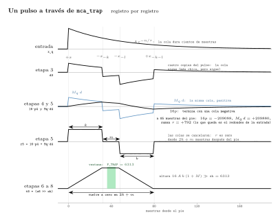
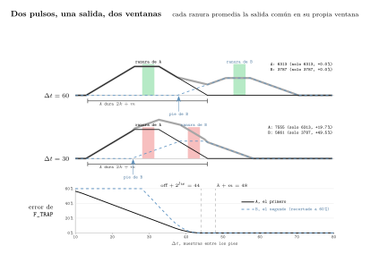
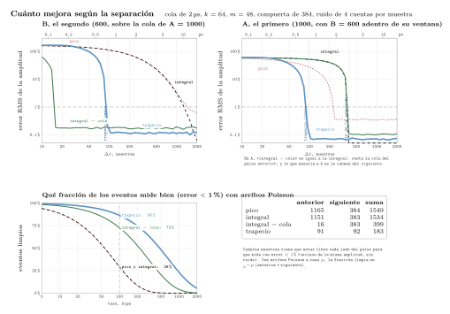
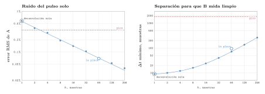

# Separar pulsos con el conformado trapezoidal

Cuando un pulso B llega sobre la cola de otro A, todo lo que la ranura de B
mide en la entrada viene sumado a esa cola. Con τ = 50 muestras y Δt = 60, B
tiene una amplitud de 600 y su pico se lee 901. El trapecio lo resuelve, y la
idea entera cabe en una frase:

> **No hay un trapecio por pulso: hay uno solo para toda la señal.** Cada pulso,
> al pasar por él, deja una huella de largo **finito** (2k+m muestras), y cada
> ranura lee esa salida común **solo en su propia ventana**. Si en la ventana de
> B ya no queda nada de la huella de A, B mide como si estuviera solo.

Este documento explica las dos mitades de esa frase: por qué la huella es
finita, con una cuenta en z (§1), cuándo las ventanas no se pisan (§2), dónde
está cada cosa en el código (§3) y cómo sabe el sistema, evento por evento, si
la medición salió limpia (§4). Del §1 al §6 los números son los de `tb_mca_top`
y de las figuras D13: pulsos exponenciales de τ = 50 muestras, k = 32, m = 16,
`Mq` = 792, ventana [36, 44) y sh = 12. El §7 mide **cuánto mejora** contra el
pico y la integral en función de la separación, con parámetros de la placa. El
§8 compara el trapecio con la otra manera de hacerlo: restar en cada ranura la
cola del pulso anterior. El §9 lo compara con la deconvolución sola (Jordanov,
MWD), que es el trapecio con k = 1.

---

## En resumen

**Lo que gana.** Los números son los de la placa (§7: τ = 250, k = 64, m = 48),
salvo donde se dice otra cosa.

| Beneficio | Por qué | Cuánto |
|---|---|---|
| **separa pulsos apilados** | la huella de cada pulso dura 2k+m−1 muestras, por larga que sea la cola: el cero de M se come el polo (§1) | el segundo de un par mide limpio desde Δt ≈ 95 (0.76 µs); el pico y la integral, desde ≈ 1280 (10 µs) (§7). En la placa, a 1 µs de otro y sobre el 61 % de su cola: 2409.05 ± 0.98, contra 2409.08 ± 1.02 aislado |
| **cuida a los dos pulsos del par** | al primero lo cuida la huella finita; al segundo, la ventana corta al principio del pulso (96 muestras) en vez de toda la compuerta (384) | a 100 kcps, 86 % de pulsos limpios, contra 29 % del pico o la integral y 73 % de la integral menos la cola (§7) |
| **promedia el ruido** | el trapecio promedia del orden de k muestras de entrada: σ baja como 1/√k | 0.12 % para un pulso solo, contra 0.6 % del pico. La integral sola da 0.07 %, pero se contamina con cualquier vecino |
| **tolera el disparo y la subida** | la meseta es plana: da lo mismo dónde cae la ventana mientras esté adentro | la latencia del disparo varía de 6 a 9 ciclos (§3); la subida, mientras m > t_c |
| **sabe si midió limpio** | es lineal y exacto en enteros, y `F_DTPREV` y `F_DTNEXT` dan el Δt de cada evento | el discriminador corta evento por evento (§4) |
| **es barato** | uno solo sirve a todas las ranuras, y la forma recursiva cuesta lo mismo con cualquier k y m | tres BRAM18 y una multiplicación por forma |

**Los parámetros.** El detalle está en
[`register_map_mca.md`](register_map_mca.md) §El conformado trapezoidal.

| Parámetro | Registro (reset) | Qué fija | Cómo se elige |
|---|---|---|---|
| **k** | `0x128[9:0]` (64) | la subida: cuánto se promedia | más largo, menos ruido (1/√k), pero hace falta más separación. k = 1 es la deconvolución sola (§9) |
| **m** | `0x128[25:16]` (32) | la meseta, m+1 muestras planas | **m > t_c**, con margen para el jitter del disparo; k + m ≤ 1023 |
| **`Mq`** = 16·M | `0x12C` (0) | el cero del polo-cero | M = 1/(e^(1/τ) − 1) ≈ τ − ½ para empezar, y **después se ajusta en la placa**, porque cuenta la τ que llega al ADC (§5). Con 0 mide el área |
| **off, lw** | `0x130[15:0]`, `[18:16]` (72, 4) | la ventana [off, off + 2^lw) | adentro de la meseta, con margen a los dos lados, y off + 8 + 2^lw ≤ `gate_larga` (bit `ok`). Correrla más tarde ayuda al segundo pulso y perjudica al primero (§2) |
| **sh** | `0x130[29:24]` (7) | la escala de la salida | round(log2(16·k·(1+M)/8)) deja `F_TRAP` ≈ 8·A |

Fuera del trapecio también intervienen:

- `cfg_pre_dly`, que alinea la ventana con el pie del pulso;
- al menos dos ranuras (`n_acc` ≥ 2), porque el segundo pulso necesita una propia;
- el discriminador sobre `F_DTPREV`, o los umbrales `antes`/`despues` de cada
  forma del banco.

Escribir k, m o `Mq` reinicia el filtro; escribir `0x130` no.

**Las cuentas para diseñar:**

- altura: 16·A·k·(1+M) (§1);
- huella: 2k+m−1 muestras, que pasan a ≈ 2k+m+t_c con subida lenta (§1);
- medición limpia: el segundo pulso, si Δt ≥ 2k+m−1−off; el primero, si
  Δt ≥ off + 2^lw. Con la ventana centrada, los dos umbrales valen
  ≈ k + (m + 2^lw)/2 (§2);
- ganancia en continua: 16·k·l. Cada cuenta de error de base corre `F_TRAP`
  ≈ 0.04 %, con l = 96, M = 250 y A = 1000 (§1, §5).

**Lo que lo rompe** (§5):

- **M mal ajustado** deja una cola con la misma τ, de ≈ (ΔM/M)·(l/τ) de la
  altura. Con M un 5 % bajo, el segundo pulso mide +2.6 %.
- **m ≤ t_c** deja sin meseta, y `F_TRAP` da un número equivocado sin aviso.
- **El ADC saturado** rompe la linealidad.
- **Un pulso por debajo del umbral de disparo** contamina la medición sin
  aparecer en `F_DTPREV` ni en `F_DTNEXT`.

---

## 1. Un pulso: por qué la huella es finita

El conformado entero cabe en una función de transferencia. Casi todo lo que
importa del trapecio se lee de ella sin simular nada.

### El filtro, en una línea

[`mca_trap.sv`](../../modulos/comun/rtl/mca_trap.sv) calcula, con l = k + m:

    d[n] = x[n] − x[n−k] − x[n−l] + x[n−k−l]
    p[n] = p[n−1] + d[n]
    r[n] = 16·p[n] + Mq·d[n]
    s[n] = s[n−1] + r[n]

En z, cada línea es un factor. La primera es $(1-z^{-k})(1-z^{-l})$, cada
acumulador es $1/(1-z^{-1})$, y la tercera suma 16 veces lo acumulado y `Mq`
veces lo que entra. Juntas:

$$H(z) = \frac{S(z)}{X(z)} = \frac{(1-z^{-k})\,(1-z^{-l})}{(1-z^{-1})^2}\,\bigl[\,16 + M_q\,(1-z^{-1})\,\bigr]$$

Para reagrupar se usa la suma geométrica

$$B_k(z) \equiv \frac{1-z^{-k}}{1-z^{-1}} = 1 + z^{-1} + \dots + z^{-(k-1)},$$

que es la **suma de las últimas k muestras**. Con $M = M_q/16$ queda:

$$H(z) = 16\,(1+M)\;\underbrace{\bigl(1 - a_M\,z^{-1}\bigr)}_{\text{polo-cero}}\;B_k(z)\;B_l(z), \qquad a_M = \frac{M}{1+M}$$

Son tres factores, y **los tres tienen largo finito**:

- $B_k$ y $B_l$ son dos sumas móviles, una de k muestras y otra de l;
- $1 - a_M z^{-1}$ es un cero en $z = a_M$. Es lo que agrega el término `Mq·d`.

O sea que **H es un FIR de largo k + l = 2k + m**. Los ceros de
$1-z^{-k}$ y de $1-z^{-l}$ en z = 1 cancelan los polos de los dos
integradores. La forma recursiva es solo una manera barata de calcularlo: dos
acumuladores y una multiplicación, sean cuales sean k y m, en vez de 2k+m
coeficientes. Pero esa cancelación es exacta solo si la cuenta es entera y el
estado coincide con las líneas de retardo. Por eso `mca_trap` no redondea nada
y se reinicia (`clr`) cuando cambian k, m o `Mq`.

### Un pulso exponencial

Sea $x[n] = A\,a^n$ para n ≥ 0, con $a = e^{-1/\tau}$. Entonces
$X(z) = A/(1 - a\,z^{-1})$: **un polo en z = a**, que es la cola. La salida es

$$S(z) = 16\,A\,(1+M)\;\frac{1 - a_M\,z^{-1}}{1 - a\,z^{-1}}\;B_k(z)\,B_l(z)$$

Si el cero cae sobre el polo ($a_M = a$), la fracción vale 1 y la cola
desaparece de la cuenta. Despejando M:

$$\frac{M}{1+M} = e^{-1/\tau} \quad\Longleftrightarrow\quad M = \frac{1}{e^{1/\tau}-1} \approx \tau - \tfrac12$$

Eso es todo lo que significa «cancelación polo-cero». Lo que queda es

$$s[n] = 16\,A\,(1+M)\;(b_k * b_l)[n]$$

y la convolución de dos rectángulos de ancho k ≤ l es un trapecio:

$$(b_k * b_l)[n] = \begin{cases} n+1 & 0 \le n \le k-1 \quad \text{(sube)} \\ k & k-1 \le n \le l-1 \quad \text{(meseta, } m+1 \text{ muestras)} \\ k+l-1-n & l-1 \le n \le k+l-1 \quad \text{(baja)} \\ 0 & n \ge 2k+m-1 \end{cases}$$

La altura es $16\,A\,k\,(1+M)$. Con τ = 50, `Mq` = 792 (M = 49.5), k = 32,
A = 1000 y sh = 12 da 16·1000·32·50.5 / 2¹² = 6312.5, y el testbench mide
6313 (la diferencia es el redondeo de la entrada a enteros). **La salida es
cero desde la muestra 2k+m−1 en adelante, aunque la cola de la entrada siga
cientos de muestras más.** En una frase: el polo-cero convierte la exponencial
en un impulso de altura A, y las dos sumas móviles convierten el impulso en el
trapecio. En el texto, «2k+m» redondea ese 2k+m−1.

**La misma cuenta, leída en el tiempo.** Los factores se pueden agrupar de otra
manera, porque todo es lineal y el orden no cambia el resultado. Si se aplica
primero $\bigl[\tfrac{1}{1-z^{-1}} + M\bigr]$, la exponencial se convierte en un
**escalón** de altura A(1+M):

    Σ x[j] (j ≤ n)  +  M·x[n]  =  A·(1 + M)      para todo n ≥ 0

Después, $(1-z^{-k})(1-z^{-l})/(1-z^{-1})$ convierte el escalón en el
trapecio. Es el panel «polo-cero» de
[`d13_recuperacion`](figuras/decisiones/d13_recuperacion.svg). El RTL no lo
calcula en ese orden porque el escalón `16·Σx + Mq·x` crece sin límite con cada
pulso. Por eso diferencia primero: con $(1-z^{-k})(1-z^{-l})$ adelante, `p` y
`s` quedan acotados ($|p| \le 2k\cdot\max|x|$).

### Lo que sale de la misma cuenta

| Caso | Qué dice H(z) | Con los números de acá |
|---|---|---|
| **dos pulsos** | H es lineal: la salida es la suma de dos trapecios, $16(1+M)\,[A\,T(n) + B\,T(n-\Delta t)]$ con $T = b_k * b_l$, y cada uno es cero fuera de [pie, pie + 2k+m−1) | las condiciones de §2 |
| **M = 0** | sin el cero queda $H = 16\,B_k B_l$. Un pulso más corto que m deja una meseta de altura 16·k·Σx: **el área** | — |
| **M mal ajustado** | $\frac{1-a_M z^{-1}}{1-a z^{-1}} = 1 + \frac{(a-a_M)\,z^{-1}}{1-a z^{-1}}$: el trapecio **más una exponencial con la misma τ**, que dura lo que la cola de la entrada. Pasado el trapecio, relativa a su altura, vale $\approx \frac{\Delta M}{M}\cdot\frac{l}{\tau}\cdot e^{-(n-(k+l)/2)/\tau}$, con ΔM lo que le falta a M | M 5 % bajo, a 85 muestras del pie: 0.05 · 0.96 · e^(−0.9) = 2.0 %, las 127 cuentas de §5 |
| **error de base** ε | es un escalón constante en la entrada, y la ganancia en continua es $H(1) = 16\,(1+M)(1-a_M)\,k\,l = 16\,k\,l$. Relativo a la altura: $\varepsilon\,l\,/\,[A\,(1+M)]$ | 0.04 % por cuenta con l = 96, M = 250 y A = 1000 (§5) |
| **subida lenta** | un pulso real es la exponencial convolucionada con su corriente r, de t_c muestras y área 1. Entonces $X = A\,R(z)/(1-a\,z^{-1})$, y la salida es el trapecio convolucionado con r: las esquinas se redondean, la huella dura 2k+m+t_c−2 muestras y la meseta plana se achica a m−t_c+2 | §2 y §5: si m ≤ t_c no hay meseta |

### Dónde está cada factor en el RTL

*Fuente: [`figuras_separacion.py`](figuras/trapecio/figuras_separacion.py), con
la misma recursión entera que el RTL (comprueba que coincide con
`estimadores.trapecio`, el modelo contra el que `tb_mca_trap` compara bit a
bit).*

`mca_trap` es una cadena de ocho registros, uno por muestra válida. Esto tiene
cada uno cuando entra un pulso exponencial, con M bien elegido:

| Etapa | Registro | En z | Qué queda del pulso |
|---|---|---|---|
| entrada | `x_q` | $X = A/(1-a z^{-1})$ | la exponencial, con su cola de cientos de muestras |
| 3 | `d3` | $(1-z^{-k})(1-z^{-l})\,X$ | cuatro copias del pulso, corridas y con signo. **La cola sigue**: copias de una exponencial no se anulan |
| 4 | `p4` | $B_k\,(1-z^{-l})\,X$ | una suma móvil de k menos su copia corrida l: termina con una cola **negativa** |
| 5 | `r5` = `16·p4 + Mq·d4` | $16(1+M)\,(1-a_M z^{-1})\,B_k\,(1-z^{-l})\,X$ | **acá el cero se come el polo**: queda $16A(1+M)\,B_k(1-z^{-l})$, dos bloques: +H durante k muestras, cero durante m, −H durante k. Después, **cero** |
| 6 | `s6` | $H(z)\,X$ | el trapecio: sube k, meseta m, baja k |
| 7 y 8 | `q7`, `t8` | — | `s6 >>> sh` saturado a 18 b: lo mismo, en la escala de la salida |

En la figura, a 85 muestras del pie, `16·p = −209 088` y `Mq·d = +209 880`.
Suman `r = +792`, que es solo el redondeo de la entrada a enteros: 0.1 % de la
altura de `r`. En la salida queda en menos de 5 cuentas de 6313.

---

## 2. Dos pulsos: cuándo las ventanas no se pisan

*En gris grueso, la salida real; en negro y en azul punteado, el trapecio que
cada pulso daría solo. Abajo, el error de `F_TRAP` de cada uno contra el valor
aislado, en función de Δt.*

`mca_trap` es **lineal**, y en enteros exactos: la salida para A + B es la
salida para A más la salida para B, sin redondeo de por medio. Cada una de las
dos es cero fuera de `[pie, pie + 2k+m−1)`. Cada ranura promedia la salida común
en su ventana, `[pie + off, pie + off + 2^lw)` desde su propio pie. Entonces hay
**dos condiciones**, una por pulso:

| Pulso | Se contamina si… | Mide limpio si… | Con off = 36, lw = 3 |
|---|---|---|---|
| **B**, el segundo | la huella de A todavía no terminó cuando abre su ventana | Δt + off ≥ 2k+m−1, o sea **Δt ≥ 2k+m−1−off** | Δt ≥ 43 |
| **A**, el primero | la huella de B ya empezó antes de que cierre su ventana | **Δt ≥ off + 2^lw** | Δt ≥ 44 |

Medido con el modelo del RTL:

| Δt | Error de A | Error de B |
|---|---|---|
| 20 | +38.4 % | +101.6 % |
| 30 | +19.7 % | +49.5 % |
| 40 | +2.3 % | +3.9 % |
| 43 | +0.2 % | 0 |
| **≥ 44** | **0** (exacto) | **0** (±2 cuentas de redondeo en 3787) |

Para comparar: en la **entrada**, B a Δt = 60 tiene su pico 50 % arriba, y para
que la cola de A baje al 1 % hacen falta unas 230 muestras (4.6 τ).

**La regla corta, Δt ≥ k+m, es una cota que alcanza siempre.** Si la ventana está
adentro de la meseta (empieza en k−1 o después y termina en k+m o antes), los
dos umbrales de la tabla son ≤ k+m. Los umbrales exactos dependen de dónde está
la ventana, y mueven en sentidos contrarios: correrla más tarde ayuda a B (la
huella de A ya terminó) y perjudica a A (la de B ya empezó). Centrada en la
meseta, como acá, los dos quedan en k + (m + 2^lw)/2 ≈ 44.

Con pulsos reales hay que sumar el **tiempo de subida** t_c. El escalón después
del polo-cero ya no es instantáneo sino una rampa de t_c muestras, y la huella
de cada pulso dura 2k+m+t_c. El umbral de B crece t_c. El de A no, porque la
huella de B igual empieza en su pie, pero la meseta útil se achica a m − t_c y la
ventana tiene que empezar t_c más tarde (si m ≤ t_c no hay meseta: ver
[`register_map_mca.md`](register_map_mca.md) §El conformado trapezoidal).

Y una condición que no es del trapecio: **B tiene que tener ranura.** Con
`cfg_n_acc = 1`, B llega con la ranura de A midiendo y se pierde
(`cnt_lost_active`). La separación necesita al menos dos ranuras.

---

## 3. Dónde está cada cosa en el RTL

| Qué | Dónde | Cómo |
|---|---|---|
| **un solo trapecio**, sobre la muestra registrada | [`mca_window.sv:317`](../../modulos/mca/rtl/mca_window.sv#L317) | `mca_trap` sobre `x_q`, la muestra menos la base, con signo (las ranuras usan la saturada a ≥ 0; el trapecio necesita el signo para que el FIR sea exacto) |
| la ventana, **corrida por la latencia** | [`mca_window.sv:331-341`](../../modulos/mca/rtl/mca_window.sv#L331-L341) | el trapecio entrega la salida de la muestra j cuando entra la j+8 (`TRAP_LAT`), así que la ventana `[off, off + 2^lw)` del trapecio es `[off + 8, off + 8 + 2^lw)` en la cuenta de la ranura: `trap_ini` y `trap_fin`, registrados una vez para todas |
| la **suma** de cada ranura | [`mca_slot.sv:182-187`](../../modulos/mca/rtl/mca_slot.sv#L182-L187) | `en_meseta = acumula && len ∈ [trap_ini, trap_fin)`: suma la salida en `trap_sum` y cuenta cuántas en `trap_n`. `len` cuenta muestras desde la apertura, que es el disparo |
| el **promedio** y sus reglas | [`mca_publish.sv:118-130`](../../modulos/mca/rtl/mca_publish.sv#L118-L130) | `F_TRAP = trap_sum >>> lw`. Vale **0** si la ranura no sumó las 2^lw muestras (la compuerta cerró antes) o si el promedio es negativo, y satura en `0xFFFF` |
| la **configuración** | [`mca_top.sv`](../../modulos/mca/rtl/mca_top.sv) | `0x128` k y m, `0x12C` Mq: escribirlos **reinicia** el estado (`trap_clr`), porque la recursión es un FIR solo si los integradores son consistentes con las líneas de retardo. `0x130` off, lw y sh, y el bit `ok` = la ventana entra en la compuerta (`off + 8 + 2^lw ≤ gate_long`) |

Hay un supuesto escondido en la tercera fila: **la ventana se cuenta desde el
disparo, no desde el pie verdadero.** Que coincidan es trabajo de `cfg_pre_dly`
(la línea de retardo), y no es exacto: la latencia del disparo por pendiente
varía unas muestras con la amplitud (6 a 9 ciclos con L = 8, ver
[`register_map_mca.md`](register_map_mca.md) §La línea de retardo). Por eso la
ventana va con margen a los dos lados de la meseta, y los umbrales de §2 con
unas muestras de más.

---

## 4. Cómo se sabe, evento por evento, si salió limpio

El trapecio no lo sabe: entrega el mismo número esté limpio o no. Lo que lo dice
son las **marcas de solape** que la ranura publica junto con `F_TRAP`, que
miden justamente el Δt de §2:

| Feature | Qué cuenta | Dónde | Para quién es Δt |
|---|---|---|---|
| `F_DTPREV` (6) | muestras desde el disparo **anterior**, haya abierto ranura o no; `0xFFFF` si no hubo o satura | [`mca_window.sv:263-270`](../../modulos/mca/rtl/mca_window.sv#L263-L270) | para **B**: su Δt con A |
| `F_DTNEXT` (7) | muestras desde la apertura hasta el **siguiente** disparo dentro de la compuerta; `0xFFFF` si no hubo | [`mca_slot.sv:315-316`](../../modulos/mca/rtl/mca_slot.sv#L315-L316) | para **A**: su Δt con B |

Con las dos, la condición de §2 se escribe evento por evento:

    limpio  ⇔  F_DTPREV ≥ 2k+m−1−off    y    F_DTNEXT ≥ off + 2^lw

(más t_c en la de B, y unas muestras de margen por el disparo). En la
configuración de ejemplo, las dos ≥ 44.
Un `F_DTNEXT = 0xFFFF` pasa siempre, y está bien: si el siguiente disparo cayó
fuera de la compuerta, cayó fuera de la ventana, porque la ventana entra en la
compuerta (bit `ok`).

**Cómo cortar en el hardware.** El discriminador (D10) aplica **una** condición
sobre **una** feature: `[min, max]`.

- Con `sel = F_DTPREV`, `min` = el umbral de B y `max = 0xFFFF`, el espectro de
  `F_TRAP` se queda con los pulsos aislados y con los segundos que midieron
  limpio, y descarta los segundos contaminados. Es lo que hace la etapa
  `trapecio` de `test_mca2_placa.py` para separar las dos poblaciones.
- Los **primeros** contaminados (un pulso que llega antes de que cierre su
  ventana) pasan ese corte. Para descartarlos hace falta la otra condición, con
  `sel = F_DTNEXT`, y con un solo discriminador no se pueden pedir las dos a la
  vez. Si hace falta, se elige la que más pesa a esa tasa, o se histograma
  `F_TRAP` contra `F_DTPREV` en el mapa 2D (D9) y se corta después en software.
- `F_SOLAPE` (bit `adentro`) es una versión más gruesa de `F_DTNEXT`: dice si
  hubo algún disparo en toda la compuerta, no si cayó antes del fin de la
  ventana.

**Lo que las marcas no ven.** Un pulso que no disparó (por debajo del umbral
del multitrigger) no aparece en `F_DTPREV` ni en `F_DTNEXT`, pero su huella sí
está en la salida del trapecio. Tres pulsos o más no cambian nada: cada evento
mira a su vecino anterior y a su siguiente, y lo que está a más de 2k+m no
importa, por grande que sea su cola.

---

## 5. Qué rompe la separación

| Qué | Qué pasa | Cuánto |
|---|---|---|
| **M mal ajustado** | el cero no cae sobre el polo (§1): las colas de `16·p` y `Mq·d` no se cancelan, el trapecio no vuelve a cero y deja una cola chica que dura lo que la de la entrada. B se mide sobre ella | con M un 5 % bajo, A deja 127 cuentas (2 % de su altura) y B mide **+2.6 %**. En la placa, con el M nominal, −1.26 %; con el M ajustado (242.8 contra 249.5), −0.001 % |
| **subida lenta**, t_c ≥ m | no hay meseta: lo que se promedia es el flanco, y depende de la forma de cada pulso | error silencioso: `F_TRAP` da un número y es malo |
| **algo no lineal** | el ADC saturado o un pulso recortado rompen la suma de §2 | — |
| **error de base** | `x = dat − base` con un error ε es un escalón constante, y el trapecio tiene ganancia en continua `16·k·l` (§1) | 0.04 % por cuenta de error con l = 96, M = 250 y A = 1000 |

La primera fila es la que más importa en la práctica. La τ que cuenta es la de
la cola que **llega al ADC**, no la de la fuente, y por eso M se ajusta en el
hardware: se barre M mirando que un pulso sobre la cola de otro mida lo mismo
que aislado. Es el panel de abajo de
[`d13_recuperacion`](figuras/decisiones/d13_recuperacion.svg).

---

## 6. Cómo leer `d13_recuperacion`

Esa figura cuenta lo mismo que §1 y §2 juntos, con los dos pulsos desde el
principio:

1. **entrada**: A y B, cada uno solo en punteado y la suma en negro. B se lee
   901 y no 600.
2. **polo-cero `16·Σx + Mq·x`**: el escalón de §1. **No es una señal del RTL**:
   es la lectura equivalente de `r`. Lo que muestra es que, después del
   polo-cero, cada pulso es un escalón y B suma el suyo encima del de A, sin
   cola.
3. **`r`**: la doble diferencia de ese escalón, igual a `r5`. Los bloques de A
   y de B se superponen en `r`, y eso no importa: lo que cuenta es la salida
   en cada ventana.
4. **trapecio**: la salida y las dos ventanas. `F_TRAP` da 6313 y 3787, lo
   mismo que cada uno solo.
5. **M un 5 % bajo**: la fila 1 de §5.

Si el panel 2 confunde, [`trap_etapas`](figuras/trapecio/trap_etapas.svg)
muestra lo mismo con las señales que el RTL tiene de verdad.

---

## 7. Cuánto mejora, según la separación

*Fuente: [`figuras_mejora.py`](figuras/trapecio/figuras_mejora.py). Monte Carlo
con la misma recursión entera que el RTL, 300 realizaciones por punto.*

Con parámetros de la placa: cola de 2 µs (τ = 250 muestras a 125 MS/s), k = 64,
m = 48, compuerta de 384 muestras, ventana de la meseta [80, 96) y ruido blanco
de 4 cuentas por muestra. A vale 1000 y B 600. El eje vertical es el **error
RMS** de la amplitud, que junta el sesgo que deja el otro pulso y el ruido.
Compara cuatro estimadores; los tres primeros son features del bus:

| Estimador       | Qué es                                                                                                                                       | Error del pulso solo |
| --------------- | -------------------------------------------------------------------------------------------------------------------------------------------- | -------------------- |
| pico            | `F_PEAK`: el máximo de la ventana                                                                                                            | ≈ 0.6 %              |
| integral        | `F_INT`: la suma de la ventana                                                                                                               | ≈ 0.07 %             |
| trapecio        | `F_TRAP`: el promedio de la meseta                                                                                                           | ≈ 0.12 %             |
| integral − cola | la integral menos la cola del pulso anterior, extrapolada desde las 16 muestras antes del pie. **No está en el RTL**: es la propuesta del §8 | ≈ 0.18 %             |

**B, el segundo.** El pico y la integral de B arrastran la cola de A con la
misma forma, así que su error es el mismo: `(A/B)·e^(−Δt/τ)`. Para bajar del
1 % hacen falta Δt ≈ τ·ln(100·A/B) = 1280 muestras, **10 µs**. El trapecio cae a
su piso de ruido en **Δt = 95 (0.76 µs)**, el umbral de §2: trece veces antes.
La integral menos la cola cae ya en Δt = 16, porque solo necesita esas 16
muestras sobre la cola de A.

**A, el primero.** Lo que ensucia a A es la *cabeza* de B, que cae dentro de su
ventana. La integral de A está contaminada hasta que B queda **fuera de la
compuerta** (Δt ≥ 384). El pico, hasta que la cola de A más B deja de superar
a A; acá pasa en Δt ≈ 230, y con amplitudes iguales no pasa nunca dentro de la
compuerta. El trapecio, desde **Δt = 96**. Restar la cola del pulso *anterior* no
hace nada por A, y por eso esa curva es la de la integral.

**Lo que significa a una tasa dada.** En un tren de pulsos, cada pulso es a la
vez un B (para el anterior) y un A (para el siguiente). Mide bien si no tiene
vecinos ni antes ni después dentro de sus umbrales. Con arribos Poisson a tasa
ρ, la fracción limpia es `e^(−ρ·(anterior + siguiente))`. Con vecinos de la
misma amplitud y el criterio de error < 1 %:

| Estimador | Libre antes | Libre después | Suma | Limpios a 100 kcps |
|---|---|---|---|---|
| pico | 1165 | 384 | 1549 | 29 % |
| integral | 1151 | 383 | 1534 | 29 % |
| integral − cola | 16 | 383 | 399 | 73 % |
| **trapecio** | **91** | **92** | **183** | **86 %** |

El trapecio es el único que achica **los dos lados**: el anterior, porque su
huella es finita, y el siguiente, porque mide en una ventana corta al principio
del pulso (96 muestras) en vez de en toda la compuerta (384). Si `F_TRAP` es el
eje, la compuerta podría incluso acortarse hasta `off + 8 + 2^lw` (104
muestras): las ranuras se liberan antes y hacen falta menos.

Lo que esta cuenta no incluye: si hay ranura libre para cada pulso (con 4
ranuras y la compuerta de 384, a 100 kcps se pierde ~0.03 % por eso: B(4, 0.32)),
el ruido en los umbrales, y amplitudes distintas (un vecino más chico
contamina menos al pico y a la integral; al trapecio, lo mismo: nada pasado el
umbral).

---

## 8. La línea de base, y la resta de la cola por ranura

**Hay seguimiento de línea de base, pero sigue otra cosa.**
[`mca_baseline`](../../modulos/mca/rtl/mca_baseline.sv) (D3) es un IIR que
sigue el **nivel de continua**: el offset del detector y del ADC, y su deriva
lenta. Solo se alimenta de muestras que no son de ninguna ventana, y se congela
mientras alguna ranura está abierta y un *holdoff* después de cada cierre. Es
uno solo porque la continua es la misma para todas las ranuras. Lo que **no**
hace es restar la cola de los pulsos anteriores: con la cola de A encima, la
base sigue en el valor que tenía antes de A, y B se mide relativo a eso.

**Lo que proponés es otra cosa: compensar la cola.** Restarle a la medición de
cada ranura lo que queda de los pulsos anteriores (en la literatura, corrección
por extrapolación de la cola, o restauración de base por pulso). Hay un hecho que
la hace barata: **todas las colas tienen el mismo τ**, así que la suma de las
colas de todos los pulsos anteriores, vista desde el pie de B, es **una sola**
exponencial, `y0·e^(−j/τ)`. Hay que conocer un solo número por ranura, el nivel
`y0` justo antes de su pie, haya habido uno o diez pulsos antes. Por eso sí hace
falta «un detector por ranura», pero cada uno es un registro:

- un estimador **compartido** del nivel de la cola, que corre siempre: el
  promedio de las últimas P muestras, corregido por la caída (con P = 16,
  `y0 = Σ x[−j]·e^(j/τ) / Σ e^(2j/τ)`);
- un registro **por ranura** que lo engancha al abrir: ~20 FF, contra 460 LUT
  y 302 FF que cuesta la ranura;
- **una** multiplicación compartida al publicar: `Q − y0·S_G`, con
  `S_G = Σ e^(−j/τ)` sobre la compuerta, una constante que escribe el software
  (como `Mq`). Para el pico hace falta `e^(−t_pico/τ)`, que ya no es constante:
  una tabla o una aproximación.

**El trapecio ya hace esta resta, sobre la señal y para todas las ranuras a la
vez.** El término `Mq·d` del §1 es exactamente la cola de cada pulso predicha con
τ: es la misma compensación, continua, antes de que la señal llegue a las
ranuras. La diferencia está en **de dónde toma la referencia**:

| | Referencia | Libre antes | Costo en ruido | El pulso siguiente |
|---|---|---|---|---|
| integral − cola | las P muestras antes del pie | P (16) | el ruido de `y0` se multiplica por `S_G` (~197): 0.07 % → 0.18 % | no lo arregla: queda toda la compuerta |
| trapecio | k muestras, a 2k+m de la ventana | 2k+m−1−off (95) | el de un promedio de k: 0.12 % | lo arregla: ventana corta |

Es el mismo compromiso visto desde dos lados: **más muestras de referencia,
menos ruido, más separación hace falta.** Y los dos dependen igual de τ: un
error en τ es, en el compensador, lo que un M mal ajustado es en el trapecio
(§5).

**Si conviene agregarlo.** Lo que compraría es medir el B de pares más cercanos
que 95 muestras (0.76 µs). A 100 kcps eso es el 7 % de los pulsos, y la mayoría
igual tiene el lado A sucio, porque la integral necesita 384 libres después. Con
el trapecio en el bus, la palanca para pares más cercanos es **k**: centrada la
ventana, los dos umbrales valen ≈ k + (m + 2^lw)/2, a cambio del ruido de
promediar menos.

---

## 9. La deconvolución sola (Jordanov, MWD)

Si deconvolucionar la cola ya convierte cada pulso en un pico angosto, ¿por qué
no medir la suma de ese pico y listo? La deconvolución de un pulso exponencial
es

$$x_d[n] = y[n] - a\,y[n-1], \qquad a = e^{-1/\tau}$$

Convierte cada exponencial en un impulso de área A (en la práctica, un pulso
del ancho de la subida), y la amplitud se estima sumando $x_d$ en una ventana
de W muestras desde el pie. Sin ruido, la suma da A exacto aunque haya otro
pulso a pocas muestras.

*Fuente de los números: [`deconvolucion.py`](figuras/trapecio/deconvolucion.py).
Los parámetros son los del §7: τ = 250 muestras, ruido blanco de 4 cuentas,
A = 1000 y B = 600.*

### Ya está en el trapecio

El primer factor de H(z) (§1) es esa deconvolución, con $a_M = a$:

$$H(z) = 16\,(1+M)\;\underbrace{(1 - a_M z^{-1})}_{\text{deconvolución}}\;B_k(z)\;B_l(z)$$

En el RTL es el término `Mq·d`. Agrupado de otra manera,
$(1 - a\,z^{-1})\,B_l$ es la *moving window deconvolution* (MWD, Georgiev y
Gast, 1993), y $B_k$ el promedio móvil que se le pone después. Jordanov-Knoll,
MWD más promedio móvil y «deconvolución seguida de un conformador trapezoidal»
son el mismo filtro, escrito de tres maneras.

La deconvolución sola, sumada en W muestras, es $(1 - a\,z^{-1})\,B_W$: **el
trapecio con k = 1 y m = W − 1**, porque $B_1 = 1$. El script lo comprueba sobre
una señal con ruido y otro pulso encima: las dos cuentas dan 991.893881. Y
`0x128` acepta k = 1 (k = 0 se toma como 1). En la placa, entonces, la pregunta
no es deconvolución o trapecio, sino **qué k**.

### La falla: la ventana no promedia

La suma es telescópica:

$$\sum_{n=n_0}^{n_1} x_d[n] = y[n_1] - a\,y[n_0-1] + (1-a)\sum_{n=n_0}^{n_1-1} y[n]$$

Con W ≪ τ el último término pesa poco, y lo que queda es **una muestra después
del pie menos una antes**. Con ruido blanco σ por muestra,
$\sigma_{\hat A}^2 = \sigma^2\,[\,1 + a^2 + (W-1)(1-a)^2\,] \approx 2\sigma^2$,
sea cual sea W. En frecuencia es lo mismo: $|1 - a\,e^{-j\omega}|$ va de $1-a$
en continua a $1+a$ en Nyquist, un cociente de ≈ 2τ. Son 500 con τ = 250
muestras, y 12 500 con una cola de 50 µs a 125 MS/s. Eso es lo que significa
«amplifica el ruido de alta frecuencia».

| Estimador | Error del pulso solo, A | Ídem, B |
|---|---|---|
| pico (`F_PEAK`) | 0.37 % | 0.59 % |
| deconvolución, W = 4 | 0.55 % | 0.97 % |
| trapecio de la placa (k = 64, m = 48) | 0.070 % | 0.114 % |

Ensanchar la ventana no ayuda: con W = 2, 4, 16 y 64, el error de A es 0.60,
0.57, 0.56 y 0.55 % (√2·σ/A = 0.57 %). La deconvolución sola mide **peor que
el pico**. El pico se mide contra la base de `mca_baseline`, promediada sobre
miles de muestras; la deconvolución, contra una sola muestra antes del pie.
Contra el trapecio pierde un factor 8.

### k es la perilla entre las dos

*Fuente: [`deconvolucion.py`](figuras/trapecio/deconvolucion.py). Los puntos
son el Monte Carlo, con m = 16 y una muestra en el centro de la meseta; el
anillo es la configuración de la placa (k = 64, m = 48, ventana [80, 96)). La
línea azul es σ·√(2/k) a la izquierda y 2k+m−1−off a la derecha. Con k cerca de
τ, el ruido queda arriba de la línea, porque la cuenta supone k ≪ τ. En rojo,
el pico de la compuerta: 0.35 % de ruido, y B limpio recién desde
Δt = τ·ln(1000·A/B) = 1855.*

El trapecio normalizado pesa la entrada con ≈ +1/k en las k muestras después
del pie, ≈ −1/k en las k de antes y ≈ 1/τ en el medio. Es una diferencia de
dos promedios de k muestras, y su ruido es

$$\sigma_{\hat A} \approx \sigma\,\sqrt{2/k}$$

La deconvolución sola es k = 1. Con m = 16 y una muestra en el centro de la
meseta (off = k + 7):

| k | Error de A | σ·√(2/k) / A | Δt mínimo de B | 2k+m−1−off |
|---|---|---|---|---|
| **1 (la deconvolución sola)** | 0.58 % | 0.57 % | 9 | 9 |
| 4 | 0.30 % | 0.28 % | 12 | 12 |
| 16 | 0.14 % | 0.14 % | 24 | 24 |
| 64 | 0.069 % | 0.071 % | 72 | 72 |
| 256 | 0.040 % | 0.035 % | 264 | 264 |
| 64, m = 48, ventana [80, 96) (la placa) | 0.069 % | 0.071 % | 95 | 95 |

El Δt mínimo es el primero en que B mide con sesgo < 0.1 %, sin ruido: el
umbral de §2. Cuadruplicar k divide el ruido por dos, y cada muestra que se
agrega a k se agrega también a la separación.

### Lo que la deconvolución hace mejor

**Separa pares mucho más cercanos.** Con W = 4, el error RMS de B queda en su
piso de ruido desde Δt = 5:

| Δt | 5 | 20 | 60 | 95 | 120 |
|---|---|---|---|---|---|
| pico | 163 % | 154 % | 131 % | 114 % | 103 % |
| deconvolución, W = 4 | 0.87 % | 1.04 % | 0.92 % | 0.84 % | 0.96 % |
| trapecio de la placa | 167 % | 165 % | 72 % | 0.11 % | 0.12 % |

Es su única ventaja real, y se paga con el ruido de arriba.

**Es menos sensible a τ, pero porque es corta.** Con τ un 5 % corta, la
deconvolución con W = 4 deja menos de 0.1 % de sesgo en B a cualquier Δt. El
trapecio con M un 5 % bajo deja 2.4 % a Δt = 120 y 1.2 % a Δt = 300. El
residuo es ≈ (ΔM/M)·(largo/τ) (§1, tabla de casos), y el largo es lo que se
integra: 4 muestras contra l = 112. No es un mérito de la deconvolución sino el
precio de promediar: un trapecio de k chico es igual de insensible.

### Lo que la deconvolución hace peor, además del ruido

**La subida y el disparo.** Después de deconvolucionar, el pulso no es un
impulso sino su corriente, que dura t_c muestras. Una ventana más angosta que
t_c más el jitter del disparo pierde parte del área, y no avisa. Esto mide cada
uno, relativo a A, con la ventana fija y el pie dj muestras más tarde de donde
la ventana lo espera:

| t_c | dj | deconvolución, W = 6 | deconvolución, W = 24 | trapecio, k = 64, m = 48 |
|---|---|---|---|---|
| 1 | 3 | 1.000 | 1.000 | 1.000 |
| 8 | 0 | 0.750 | 1.000 | 1.000 |
| 8 | 3 | 0.375 | 1.000 | 1.000 |
| 16 | 3 | 0.188 | 1.000 | 1.000 |
| 32 | 0 | 0.188 | 0.750 | 0.983 |
| 32 | 3 | 0.094 | 0.656 | 0.971 |

Ensanchar W lo arregla sin costo en ruido, porque la suma no promedia pero
tampoco agrega ruido. Lo paga en separación, muestra por muestra: W es la
meseta de un trapecio con k = 1. La meseta del trapecio cumple el mismo papel
(m > t_c más el jitter), y la latencia del disparo ya varía de 6 a 9 ciclos
(§3). Con t_c = 32, la ventana [80, 96) cae en la esquina redondeada (§1,
subida lenta) y mide 0.98.

**La aritmética.** a = e^(−1/τ) no es exacto en punto fijo. Un error δa
equivale a errar τ en δτ/τ ≈ τ·δa, así que fijar τ al 1 % pide δa ≈ 0.01/τ:
15 bits de fracción con τ = 250, y 20 con τ = 6250 (50 µs a 125 MS/s).
Jordanov-Knoll multiplica todo por 1+M:

$$(1+M)\,x_d[n] = y[n] + M\,\bigl(y[n] - y[n-1]\bigr)$$

Con M entero en dieciseisavos (`Mq` = 16·M), la cuenta es entera y la recursión
es un FIR exacto (§1); τ queda con una resolución de 1/16 de muestra, 0.025 %
con τ = 250. Es una falla de la forma ingenua, no de la idea.

**El modelo de un polo.** Los dos lo suponen. El undershoot medido en
[`polo_cero.md`](polo_cero.md) (η = 4 %, τ = 5.1 µs) queda sin cancelar en
los dos por igual.

### Por qué se usa el trapecio

1. **Arregla el ruido de la deconvolución sin perder el largo finito.** Promedia
   k muestras de cada lado del pie, y la huella sigue durando 2k+m−1. Con ruido
   blanco y k muestras de cada lado, la diferencia de promedios es el estimador
   lineal de mínima varianza para la altura de un escalón: σ·√(2/k) es lo mejor
   que se puede hacer con ese largo.
2. **La meseta tolera** la subida (el déficit balístico) y el jitter del
   disparo, sin agregar ruido.
3. **Un solo parámetro mueve el compromiso.** k va de la deconvolución sola
   (k = 1) al promedio largo, sin cambiar el hardware.
4. **Es barato y exacto.** Dos acumuladores y una multiplicación para
   cualquier k y m, en enteros, y uno solo sirve a todas las ranuras.

### Cuándo conviene un k chico

Cuando el ruido electrónico no pesa frente a la resolución propia del
detector, por ejemplo un centelleador, con varios % por la estadística de
fotoelectrones: un 0.5 % sumado en cuadratura no se nota, y un k chico compra
tasa. También para contar o para medir tiempos a tasa muy alta.

No hace falta otro bloque: es k en `0x128`. Y el banco de trapecios
([`register_map_mca.md`](register_map_mca.md) §El banco de trapecios) ya hace
esa elección pulso por pulso: publica la forma más larga cuya ventana no
alcanza al vecino. Con k = 1 en la última forma (hoy la 8/8), los pares más
cercanos que su umbral se medirían con ≈ √2·σ de ruido en vez de quedar
marcados. A cambio, los que hoy toma la 8/8 se medirían con ese mismo ruido. La
otra opción es agregarla como cuarta forma: el módulo admite 4, y los tops
usan 3.

---

## Verificación

- [`tb_mca_trap`](../../modulos/mca/sim/tb_mca_trap.sv): la salida de
  `mca_trap`, bit a bit contra `estimadores.trapecio` (28 413 comparaciones, con
  huecos en `val` y `clr` en medio).
- [`tb_mca_top`](../../modulos/mca/sim/tb_mca_top.sv) §10: los números de este
  documento (6313, el par a Δt = 60 con 6313 y 3787, el par a Δt = 30
  contaminado, la ventana incompleta en 0).
- En la placa: un pulso a 1 µs de otro, sobre el 61 % de su cola, mide 2409.05 ±
  0.98 contra 2409.08 ± 1.02 aislado
  ([`VERIFICACION.md`](../../modulos/mca/sim/VERIFICACION.md) §La validación en
  placa).

**Sigue en →** [`ranuras_y_recuperacion.md`](ranuras_y_recuperacion.md): para
qué sirven las ranuras si el trapecio separa recién desde Δt ≈ 92, y cómo
recuperar los pulsos más cercanos (un banco de trapecios, o descomponer los
estimadores).

**Relacionados →** [`vista_general_mca.md`](vista_general_mca.md) §2.5 (D13),
[`register_map_mca.md`](register_map_mca.md) §El conformado trapezoidal (cómo
elegir k, m, M y la ventana), y el datasheet de
[`mca_trap`](../datasheet/datasheet_mca_trap.md).
