# Vista general del MCA

El analizador multicanal (`mca_top`, slot 7 del bus de sistema) toma la muestra
acondicionada del scope y, por cada pulso, publica **un** registro de evento que
alimenta a dos histogramas en BRAM. Todo corre en `adc_clk` (125 MHz).

El RTL está hecho para que **las alternativas convivan en el mismo bitstream** y
se elijan por registro: es lo que permite comparar dos métodos sobre los mismos
pulsos, en vez de comparar dos bitstreams. Por eso cada punto en que hay que
elegir un método es, literalmente, un mux con su `cfg_*`. Este documento recorre
la cadena etapa por etapa y, en cada decisión **Dn**:

1. muestra la figura de opciones (las alternativas en paralelo, el mux y el
   registro que elige),
2. resume en una tabla qué hace cada opción y cuál trae el reset,
3. apunta al documento donde está el **análisis fino**.

Los bloques que no se eligen (los acumuladores, los divisores, los motores de
histograma, la contabilidad) van descriptos sin mux.


*El MCA por etapas. Los círculos **Dn** son las decisiones de abajo. Fuente
TikZ en [`figuras/panorama_mca_top.tex`](figuras/panorama_mca_top.tex); las
figuras de opciones, en [`figuras/decisiones/`](figuras/decisiones/).*

## Las decisiones, de un vistazo

| | Decisión | Registro | Reset | Vive en | Análisis fino |
|---|---|---|---|---|---|
| D1 | canal | `cfg_chan` 0x00C[8] | IN1 | `mca_top` | — |
| D2 | decimación | `cfg_dec` 0x044 | 1 (todas) | `mca_top` | — |
| D3 | línea de base | `cfg_bl_auto` 0x020[0] | fija | `mca_baseline` | [`polo_cero.md`](polo_cero.md), [`apilamiento.md`](apilamiento.md) §El seguidor |
| D7 | estimador de la ventana de amplitud | `cfg_amp_src` 0x038[0] | pico | `mca_slot` | [`decisiones_diseno_mca.md`](decisiones_diseno_mca.md) §5, [`conformado_y_ruido.md`](conformado_y_ruido.md) |
| D8 | cuántas ranuras miden a la vez | `cfg_n_acc` 0x120 | 1 | `mca_window` + `mca_publish` | [`register_map_mca.md`](register_map_mca.md) §Las ranuras, [`tiempo_muerto.md`](tiempo_muerto.md) |
| D9 | qué feature va a cada eje | `cfg_sel_*` 0x090 | 1D y 2D-x: pico; 2D-y: PSD | `mca_top` | [`decisiones_diseno_mca.md`](decisiones_diseno_mca.md) §2.5 |
| D10 | discriminador | `cfg_discr_*` 0x098–0x0A0 | apagado | `mca_discriminator` | [`apilamiento.md`](apilamiento.md) |
| D11 | zoom de cada eje | `cfg_z_*`, `cfg_k_*` 0x094, 0x0B8, 0x0BC | z = 0 | `mca_zoom` ×3 | [`limites_resolucion_y_deriva.md`](limites_resolucion_y_deriva.md) §5 |
| D12 | histograma lleno | `cfg_keep_full` 0x0A4[0] | congelar | `mca_hist` ×2 | — |
| D13 | forma del trapecio (`F_TRAP`) y el banco | `cfg_trap_*` 0x128–0x130, `0x134`, `0x180`–`0x1BF` | k = 64, m = 32, M = 0; una forma en uso | `mca_trap` ×`N_FORMAS` + `mca_slot` + `mca_publish` | [`register_map_mca.md`](register_map_mca.md) §El conformado trapezoidal, §El banco de trapecios, [`pruebas_banco_trapecios.md`](pruebas_banco_trapecios.md) |

**D4, D5 y D6 ya no existen.** Quién abre, quién cierra y cómo se re-arma
dejaron de ser elecciones cuando el MCA pasó a medir varios pulsos a la vez: abre
**solo** el disparo externo, cierra **solo** la compuerta fija, y el re-armado lo
hace el multitrigger. Por qué, y qué había, en la sección *Decisiones retiradas*
al final. Los números se conservan para que las figuras y los docs viejos sigan
siendo citables.

Con las ranuras el mapa de registros cambió de propósito (`MAGIC = "MCA2"`): ya
no hay un reset que reproduzca el comportamiento de antes, porque el disparo
interno no existe.

---

## 1. Entrada — D1 y D2

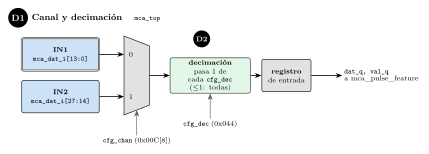

| | Opción | Qué hace |
|---|---|---|
| **D1** | **IN1** (reset) / IN2 | elige uno de los dos canales que entrega `rp_scope_mt_com`, ya calibrados y filtrados |
| **D2** | `cfg_dec` = N | deja pasar una muestra válida de cada N; con N ≤ 1 pasan todas. Es propia del MCA e independiente del `set_dec` del scope |

La decimación no toca el dato: lo que hace es bajar `val` en las muestras que
saltea. Después de los dos hay un **registro de entrada** (`dat_q`, `val_q`). No
es una decisión, pero es el cambio que más timing compró en toda la historia del
MCA: cortaba un camino que venía desde la calibración del scope y atravesaba el
mux de canal, el decimador y toda la lógica de umbral (34 de los 60 endpoints en
falla de aquel build).

Y después, la **línea de retardo** (`mca_delay`, `cfg_pre_dly` en 0x124): retrasa
la muestra de 0 a 127 ciclos. Hace falta porque la ventana la abre el disparo del
multitrigger, y ese disparo llega **tarde** respecto del pie del pulso (el
disparo por pendiente tarda unas L muestras en cruzar su umbral, más sus
registros). Con la muestra retrasada lo justo, el disparo llega cuando el pie
está entrando a la ventana. Cuánto hace falta lo mide
[`tb_mca_mt_latencia`](../../sim/tb_mca_mt_latencia.sv): de 9 a 14 ciclos con
pulsos de subida rápida, de 36 a 52 con la semi-gaussiana de la campaña. La
tabla está en [`register_map_mca.md`](register_map_mca.md) §La línea de retardo.

---

## 2. La ventana — `mca_pulse_feature`

Es el extractor: por cada disparo abre una ventana, acumula las características
del pulso y publica un evento. Mide **varios pulsos a la vez**: tiene `N_ACC = 4`
ranuras, cada una un juego entero de acumuladores, y `cfg_n_acc` elige cuántas se
usan. Está partido en submódulos, y **las fronteras las puso el timing, no la
prolijidad**:

- `mca_baseline` — la línea de base (D3).
- `mca_window` — el núcleo: la resta de la base, el disparo, el asignador de
  ranuras, las N ranuras (`mca_slot`, con los acumuladores y la ventana de
  amplitud de D7) y la contabilidad del tiempo muerto.
- `mca_publish` — la cola de ranuras cerradas, los dos `mca_div_restore` y el
  armado del bus de features.
- `mca_pulse_feature` queda como cableado.

El bitstream se sintetiza con `-flatten_hierarchy none`, así que cada puerto es
una barrera de optimización, y las fronteras están donde lo que cruza sale de un
registro. La muestra relativa a la base se **registra** antes de repartirse a las
ranuras (`xc_q`), y lo que el asignador decide para cada muestra viaja registrado
con ella. Ese ciclo lo absorbe la línea de retardo. Sin el Schmitt interno, el
camino que era el crítico (muestra → umbrales → abrir/cerrar → acumuladores) ya
no existe: la apertura es un flanco de `trig_i`.

### 2.1 Línea de base — D3


| Opción           | Qué hace                                                                                                      | Cuándo                            |
| ---------------- | ------------------------------------------------------------------------------------------------------------- | --------------------------------- |
| **fija** (reset) | resta `cfg_baseline` (0x01C)                                                                                  | señal con base estable y conocida |
| seguidor IIR     | `bl_acc += x − (bl_acc ≫ k)`, con $\alpha = 2^{-k}$; se congela durante el pulso y `holdoff` muestras después | base que deriva                   |

La base que sale es un **registro**, y la resta `x = dat − base` está en
`mca_window`. La base **no** llega a los acumuladores como una señal aparte, sino
adentro de `x`: esa resta es lo primero que hace el núcleo, se satura a
`xc = máx(x, 0)`, se registra y se reparte a las ranuras. El seguidor solo sigue
muestras que no son de ninguna ventana: ninguna ranura midiendo, ninguna
reservada y nadie abriendo con esa muestra.

El acumulador del seguidor es ancho a propósito (con la forma ingenua el
incremento se cuantiza a cero), y el holdoff evita que la base se coma el
undershoot de la cola. **Análisis fino →** [`polo_cero.md`](polo_cero.md) (el
undershoot) y [`apilamiento.md`](apilamiento.md) §El seguidor de línea de base
(qué compra y qué no).

### 2.2 Quién abre y quién cierra — ya no se elige

La ventana la **abre el disparo externo** (`trig_i`, el `trigger_event` del
multitrigger), por **flanco**: un trigger que dura varios ciclos abre una sola
ventana, y si cae entre dos muestras válidas espera a la siguiente. La **cierra
la compuerta larga**, `gate_larga` muestras desde el disparo, y la cola arranca en
la compuerta corta. Cada ranura **retiene las dos compuertas al abrir**, así que
cambiarlas en caliente no mezcla nada.

La compuerta fija es además la de mejor resolución: medido offline sobre 7054
pulsos reales, la integral da 0.149 % contra 0.528 % con la ventana por
histéresis. **Análisis fino →** [`ventana_de_medicion.md`](ventana_de_medicion.md)
§2–4 y [`register_map_mca.md`](register_map_mca.md) §La ventana.

### 2.3 Cuántas ranuras miden a la vez — D8


| `cfg_n_acc` | Qué pasa con un disparo que llega con una ventana abierta |
|---|---|
| **1** (reset) | se pierde (`cnt_lost_active`); y la ranura no reabre hasta que el publicador la toma: la publicación bloqueante de antes |
| 2..4 | abre la siguiente ranura libre; se pierde solo si están todas ocupadas |

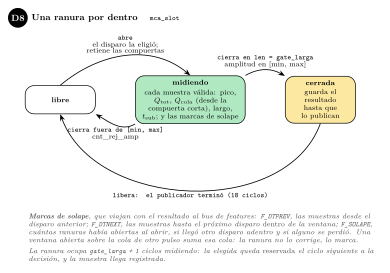

*Fuente: [`d08_ranuras.tex`](figuras/decisiones/d08_ranuras.tex).*

Cada **ranura** es un juego entero de acumuladores, con estado
**libre → midiendo → cerrada → libre**. Un disparo abre la libre de menor índice.
Al cerrar, si la amplitud está en `[amp_min, amp_max]`, la ranura se queda con el
resultado hasta que el publicador la toma: las ranuras **son** la cola de
publicación. Si no, vuelve a libre y cuenta en `cnt_rej_amp`.

Lo que compra: con N ranuras un pulso se pierde solo si llega con las N
ocupadas, así que la pérdida pasa de ser de **primer orden** en la tasa (~ρ) a
~ρ^N/N!, el modelo M/D/N/N. Lo que cuesta, en el FPGA: cada ranura agrega unas
650 LUT y 410 FF (la tabla, abajo). Y en la física: **lo
que se mide sobre otro pulso viene contaminado**. Una ventana abierta sobre la
cola de otro pulso suma esa cola, y la primera ventana suma la cabeza del
segundo. La ranura no lo corrige, lo **marca**:

| Marca | Dónde | Qué dice |
|---|---|---|
| `F_DTPREV` | ranura 6 del bus | muestras desde el disparo anterior, haya abierto o no |
| `F_DTNEXT` | ranura 7 | muestras hasta el siguiente disparo **dentro** de la ventana |
| `F_SOLAPE` | ranura 8 | `{perdido, adentro, otras}`: cuántas había abiertas al abrir, si llegó otro adentro, si alguno se perdió |
| `cnt_pileup` | 0x060 | ventanas cerradas con alguna marca |

El discriminador (D10) puede quedarse solo con los aislados (`F_DTPREV` y
`F_DTNEXT` mayores que la ventana), y el software decide el resto. La corrección
es el **conformado trapezoidal** (D13, §2.5): cada pulso queda como un trapecio
que vuelve a cero en 2k+m muestras, y dos pulsos separados por al menos k+m
tienen mesetas limpias.

**Cuánto cuesta cada ranura.** `mca_top` sintetizado fuera de contexto con
`N_ACC` = 1..7 (los parámetros del top; Vivado 2021.2, 125 MHz):

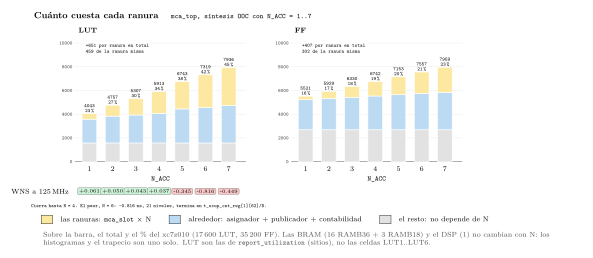

*Fuente: [`recursos_ranuras.py`](figuras/recursos/recursos_ranuras.py), que corre
las siete síntesis con `--sintetizar` y dibuja del CSV que escriben.*

| `N_ACC` | LUT | FF | LUT del xc7z010 | WNS a 125 MHz |
|---|---|---|---|---|
| 1 | 4043 | 5521 | 23 % | +0.061 ns |
| 2 | 4757 | 5929 | 27 % | +0.050 ns |
| 3 | 5307 | 6330 | 30 % | +0.043 ns |
| **4** (el build) | **5913** | **6742** | **34 %** | **+0.037 ns** |
| 5 | 6743 | 7153 | 38 % | −0.345 ns |
| 6 | 7319 | 7557 | 42 % | −0.816 ns |
| 7 | 7936 | 7959 | 45 % | −0.449 ns |

- **Crece lineal**: +651 LUT y +407 FF por ranura. La ranura misma
  (`mca_slot`) son 460 LUT y 302 FF; el resto (~190 LUT, ~105 FF) es lo que la
  rodea: el asignador y la cuenta de ocupadas, el mux N:1 del publicador y un
  contador `t_ocup` de 64 b más su sombra por ranura.
- **Las BRAM y el DSP no cambian** (16 RAMB36 + 3 RAMB18, 1 DSP): los
  histogramas y el trapecio son uno solo para todas las ranuras.
- **Cierra hasta 4.** Con 6 y 7 el camino crítico es la ocupación: `n_ocup` (la
  suma de las ranuras ocupadas) indexa los `t_ocup` y habilita un incremento de
  64 b, 21–22 niveles. Registrar `n_ocup` lo cortaría, con un ciclo de demora
  en la ocupación. Con 5 falla otro camino, que termina en el registro del eje Y
  del 2D (11 niveles). Esa lógica está después del bus y no crece con N, así que
  probablemente es la variación de la síntesis, pero no está confirmado.
- `cfg_n_acc` tiene 3 bits, así que `N_ACC` no pasa de 7 sin ensancharlo.

**Cuántas ranuras convienen →** [`ranuras_y_recuperacion.md`](ranuras_y_recuperacion.md):
con el trapecio y la compuerta justa para su ventana alcanzan dos; más sirven si
se recuperan los pulsos que el trapecio no separa.

### 2.4 Los acumuladores — bloque fijo

Mientras la ventana está abierta, cada muestra válida actualiza **versiones
secuenciales** de los estimadores de su ranura: no se guarda ninguna muestra,
todo es un máximo y unas sumas que corren. Cada ranura tiene los suyos.

| Acumulador | Regla |
|---|---|
| pico | máximo de `xc`, con comparación **estricta**: en un techo plano gana la primera ocurrencia |
| $t_\mathrm{sub}$ | índice de la muestra de pico |
| $Q_\mathrm{tot}$ | suma de `xc` en toda la ventana |
| $Q_\mathrm{cola}$ | suma de `xc` desde la compuerta corta |
| largo | muestras desde el disparo |

`xc` es la muestra relativa a la base, **saturada a ≥ 0**: sin eso, una cola con
undershoot resta de $Q_\mathrm{tot}$ mientras $Q_\mathrm{cola}$ sigue sumando, y se
llega a $Q_\mathrm{cola} > Q_\mathrm{tot}$, que rompe la premisa del divisor.

### 2.5 El conformado trapezoidal — D13

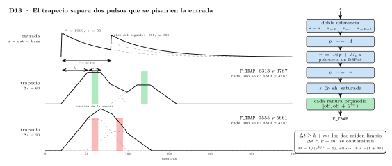

*Fuente: [`d13_trapecio.py`](figuras/decisiones/d13_trapecio.py), que calcula
las curvas con el modelo de referencia (`estimadores.trapecio`) y escribe el
`.tex`.*

`mca_trap` conforma `x = dat − base` con la forma recursiva de Jordanov y Knoll:
una doble diferencia con retardos k y l = k+m, dos integradores, y el término
`M·d` que cancela el polo de la cola. Un pulso exponencial sale como un trapecio
de subida k, meseta m y bajada k, y **vuelve a cero en 2k+m muestras** aunque la
cola de la entrada dure mucho más. Hay uno por forma del **banco** (`N_FORMAS` =
4), común a las ranuras: cada una promedia la salida de cada forma sobre su
`[off, off + 2^lw)` desde la apertura. Al publicar, se queda con la forma más
larga que el vecino permite, por `F_DTPREV` y `F_DTNEXT` contra los umbrales de
cada forma: es `F_TRAP` (ranura 9 del bus), y su índice sale en `F_FORMA`
(ranura 10). Si ninguna alcanza, el pulso queda marcado (`F_TRAP` = 0,
`F_FORMA` = 0xFFFF). Con `n_formas` = 1 y los umbrales en cero, que es el reset,
es el trapecio único de antes. El banco necesita el disparo con polo-cero del
multitrigger ([`../mt/disparo_polo_cero.md`](../mt/disparo_polo_cero.md)): con
la pendiente, los vecinos que no disparan no se ven
([`pruebas_banco_trapecios.md`](pruebas_banco_trapecios.md)).

| Parámetro | Qué fija | Cómo se elige |
|---|---|---|
| k | subida: cuánto ruido promedia (σ ∝ 1/√k) | resolución contra tasa |
| m | meseta | mayor que el tiempo de colección del pulso, o no hay meseta |
| M | polo-cero | `1/(e^(1/τ) − 1)` para una cola τ; con 0, el trapecio de un impulso |
| off, lw | la ventana sobre la meseta | adentro de `[pie + k + t_c, pie + k + m]`, y antes del cierre de la compuerta |
| sh | la escala de `F_TRAP` | `log2(16·k·(1+M)/8)` deja una amplitud A en 8A |

**Elegir entre conformar o no es D9**: `F_TRAP` es una feature más, y el eje
elige entre ella, el pico (`F_PEAK`) y la integral (`F_INT`) sobre los mismos
pulsos. Lo que el trapecio compra es que **dos pulsos a Δt ≥ k+m miden limpio**
aunque el segundo monte sobre la cola del primero; `F_DTPREV` y `F_DTNEXT` dicen
cuáles son. En `tb_mca_top`, con τ = 50, k = 32 y m = 16:

| | `F_TRAP` | pico |
|---|---|---|
| pulso solo, A = 1000 | 6313 | 1000 |
| par a Δt = 60, el segundo (A = 600, sobre 30 % de cola) | **3787 = 0.6 × 6313** | 901 |

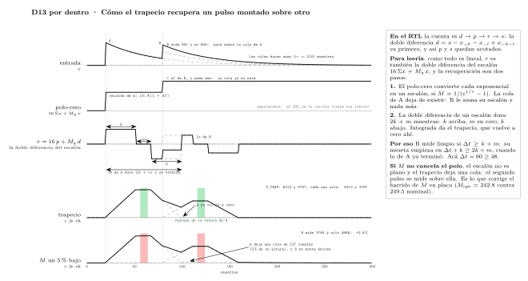

*Fuente: [`d13_recuperacion.py`](figuras/decisiones/d13_recuperacion.py), con la
misma recursión que el RTL (comprueba que coincide con `estimadores.trapecio`).*

Por qué recupera. Como todo es lineal, `r = 16p + Mq·d` es también la doble
diferencia de `16·Σx + Mq·x`, y eso se lee en dos pasos. Primero, **el polo-cero
convierte cada exponencial en un escalón**: la cola de A deja de existir, y B le
suma su escalón y nada más. Después, la doble diferencia de un escalón dura
**2k+m muestras** (k arriba, m en cero, k abajo), e integrada da el trapecio. Por
eso B mide limpio si Δt ≥ k+m: su meseta empieza en Δt + k ≥ 2k+m, cuando lo de A
ya terminó. El RTL no calcula el escalón, que crece sin límite: diferencia
primero, y así `p` y `s` quedan acotados. **Si M no cancela el polo**, el escalón
no es plano y el trapecio deja una cola sobre la que se mide el segundo: con M un
5 % bajo, A deja 127 cuentas (2 % de su altura) y B mide +2.6 %. Es lo que corrige
el barrido de M en la placa.

**Análisis fino →** [`separacion_trapezoidal.md`](separacion_trapezoidal.md):
el trapecio registro por registro, las condiciones exactas para que cada uno de
los dos pulsos mida limpio, y cómo lo dicen `F_DTPREV` y `F_DTNEXT`.

**En la placa**, con pulsos de preamplificador del Rigol (cola de 2 µs) y k = 64,
m = 48, un pulso que llega a 1 µs de otro, sobre el 61 % de su cola, mide
**2409.05 ± 0.98** contra **2409.08 ± 1.02** aislado; su pico da el doble. Hace
falta **ajustar M en el hardware**: la cola que llega al ADC es 2.7 % más corta
que la programada, y con el M nominal el error era de −1.26 %
([`VERIFICACION.md`](../../modulos/mca/sim/VERIFICACION.md) §La validación en placa).

Dos detalles de la implementación cambian lo que se puede hacer con él:

- **Escribir la forma reinicia el estado.** La recursión es un FIR solo si los
  integradores son consistentes con las líneas de retardo; al cambiar k, m o M
  (o con el `clear`) se ponen en cero y las líneas cuentan como vacías hasta
  llenarse. Sin eso, `s` derivaría sin fin.
- **Si la ventana no entra en la compuerta, `F_TRAP` vale 0**, y el bit `ok` de
  0x130 lo dice antes de medir: un promedio parcial caería en cualquier lugar del
  espectro, el cero cae en el canal 0.

Las líneas de retardo van en BRAM (tres RAMB18 de 1024 muestras) y el polo-cero
en un DSP48. Todo avanza por muestra válida, así que la forma está en muestras
sea cual sea la decimación.

### 2.6 La ventana de amplitud — D7


| Opción | Amplitud |
|---|---|
| **pico** (reset) | el máximo de la ventana: el ruido de **una** muestra |
| integral | $Q_\mathrm{tot} \gg$ `q_shift`, saturada a 16 b: el ruido blanco promedia |

Al cerrar, la amplitud elegida tiene que caer en `[amp_min, amp_max]`; si no, el
evento se cuenta en `cnt_rej_amp` y **no paga los divisores**. Es el primero de
los rechazos (ver 2.8).

Dos aclaraciones, porque esta decisión cambió de alcance. `cfg_amp_src` **ya no
elige el eje del histograma**: eso lo hace D9. Por compatibilidad, escribir 0x038
mueve también `cfg_sel_1d` y `cfg_sel_2dx`, así que el software viejo sigue
andando. Y la comparación con la ventana se evalúa **un ciclo antes del cierre**,
con registros sombra (`d_min`, `d_max`) que llevan la resta hecha: era el camino
crítico del bitstream. **Análisis fino →**
[`decisiones_diseno_mca.md`](decisiones_diseno_mca.md) §5 (el estimador) y §11.1
(la optimización), y [`conformado_y_ruido.md`](conformado_y_ruido.md).

### 2.7 La publicación y `mca_div_restore`

El publicador atiende las ranuras cerradas **en orden de cierre**: guarda una cola
de índices, carga los operandos de la más vieja en los dos divisores, arma el bus
de features cuando terminan y libera la ranura. Si la cola está vacía, los
divisores arrancan en el mismo flanco del cierre, así que una ranura espera
exactamente **18 ciclos** por evento (arranque, carga, 16 iteraciones y `valid`).
Ese tiempo, con todas las ranuras ocupadas y alguna esperando, es `t_div`.

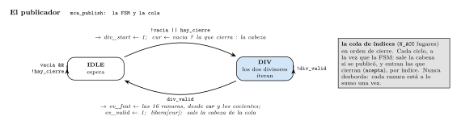

*Arriba, la FSM de [`mca_publish.sv`](../../modulos/mca/rtl/mca_publish.sv);
abajo, el cronograma que vuelca
[`tb_fsm_publicador.sv`](figuras/publicacion/tb_fsm_publicador.sv). Para
regenerarlo: `python3 figuras/publicacion/fsm_publicador.py --sim`.*

La FSM tiene dos estados. En **IDLE**, si hay algo en la cola o alguna ranura
cierra, dispara los divisores y registra en `cur` qué ranura publica: la que
cierra si la cola está vacía, la cabeza si no. En **DIV** espera `div_valid` y
entonces arma las 16 ranuras del bus desde `cur` y los cocientes, pulsa
`ev_valid` y libera la ranura. Entre dos eventos encolados pasa un ciclo en
IDLE, así que el publicador saca uno cada 19 ciclos. En el ejemplo, la ranura 1
cierra con el publicador ocupado y queda cerrada 29 ciclos: 11 en la cola y 18
publicando.

**`mca_div_restore`** (bloque fijo, dos instancias en paralelo) es un divisor
restaurador: calcula $\lfloor \text{num} \cdot 2^{16} / \text{den} \rfloor$ con
num < den, un bit de cociente por ciclo, **16 ciclos fijos y cero DSP**. Los dos
comparten denominador y arranque:

- **PSD** = $Q_\mathrm{cola}/Q_\mathrm{tot}$: dónde está la carga. Va a `F_PSD`, y sus
  6 bits altos al eje Y del mapa 2D.
- **INVW** = pico$/Q_\mathrm{tot}$: el ancho inverso. Va a `F_INVW` y es el que
  separa los apilados.

Los casos borde están tratados: $Q_\mathrm{tot} = 0$ da error y
$Q_\mathrm{cola} \ge Q_\mathrm{tot}$ satura, en vez de mandar el evento al extremo
opuesto del eje. La latencia fija es deliberada: hace predecible el tiempo muerto
por evento. **Análisis fino →** [`decisiones_diseno_mca.md`](decisiones_diseno_mca.md)
§2.5 y §6, y [`register_map_mca.md`](register_map_mca.md) §Las ranuras.

### 2.8 Dónde se pierde un evento

No hay un solo rechazo sino varios, y cada uno tiene su contador:

| Dónde | Por qué | Contador |
|---|---|---|
| una ranura, al cerrar | fuera de `[amp_min, amp_max]` (D7) | `cnt_rej_amp` |
| `mca_publish` | forma inválida: sigue en el 1D, **no** entra al 2D | `cnt_rej_psd` |
| discriminador (D10) | fuera de la condición sobre una feature | `cnt_rej_discr` |
| `mca_hist` | colisión con una lectura del bus o con el barrido de borrado | `dropped` |
| `mca_hist` | histograma lleno, con D12 en *congelar* | `suppressed` |

Las ventanas con marca de solape **no** se rechazan: se cuentan en `cnt_pileup` y
el corte, si se quiere, lo hace el discriminador. Y antes de abrir, los disparos
que no encuentran ranura van a la atribución de arribos (sección 5).

---

## 3. Del evento al índice

Por cada evento, esta etapa entrega una **dirección por histograma y un `inc`**,
y conviene leerla como un solo bloque, el **cálculo de índices**: mux de eje
(D9), zoom (D11) y registro de pipeline. En el RTL no es un módulo. El mux y el
registro están escritos en `mca_top`, y el zoom son tres instancias de
`mca_zoom`. El panorama los agrupa porque juntos son la función
*feature → dirección*. Gracias a eso, del otro lado la memoria es un bloque fijo
que solo recibe dirección e `inc` (sección 4). El discriminador (D10) no
calcula ningún índice: decide si hay `inc`.

### 3.1 El bus de features — bloque fijo

El evento sale de `mca_publish` como un bus interno de **16 ranuras × 16 b**,
todas del mismo pulso. Es interno: el ARM no lo ve, sigue leyendo las mismas
aperturas de histograma.

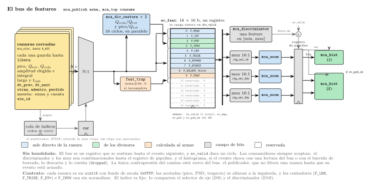

*Fuente: [`bus_features.tex`](figuras/publicacion/bus_features.tex).*

El bus es **un registro** que se carga entero en `div_valid` y se sostiene hasta
el evento siguiente; `ev_valid` dura un ciclo. No tiene handshake porque no le
hace falta: los consumidores (el discriminador y los tres mux de eje) son
combinacionales hasta el registro de pipeline, y el histograma siempre acepta (si
el evento choca con una lectura o con el borrado, lo descarta y lo cuenta). La
única contrapresión del camino está **antes** del bus, en el publicador.

| Ranura | Feature | Normalización |
|---|---|---|
| 0 `F_PEAK` | pico | alineada a la izquierda |
| 1 `F_INT` | $Q_\mathrm{tot} \gg$ `q_shift` | saturada a 16 b |
| 2 `F_PSD` | $Q_\mathrm{cola}/Q_\mathrm{tot}$ | alineada a la izquierda |
| 3 `F_INVW` | pico$/Q_\mathrm{tot}$ | **sin** normalizar: vive cerca de cero |
| 4 `F_LEN` | largo de la ventana | sin normalizar (contador) |
| 5 `F_TRISE` | disparo → pico | sin normalizar (contador) |
| 6 `F_DTPREV` | muestras desde el disparo anterior | sin normalizar (contador) |
| 7 `F_DTNEXT` | muestras hasta el siguiente disparo adentro | sin normalizar (contador) |
| 8 `F_SOLAPE` | marcas de solape | campo de bits |
| 9 `F_TRAP` | altura de la meseta del trapecio elegido (D13) | con `sh`, 8A para una amplitud A; 0 si la ventana no se completó o si quedó marcado |
| 10 `F_FORMA` | la forma del banco que se publicó (D13) | 0..3; `0xFFFF` = marcado |
| 11–15 | reservadas | en cero |

### 3.2 Qué feature va a cada eje — D9

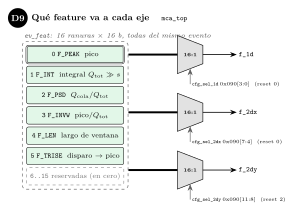

Tres mux 16:1, uno por eje (`cfg_sel_1d`, `cfg_sel_2dx`, `cfg_sel_2dy` en 0x090).
El reset deja el comportamiento histórico: 1D y eje X del 2D con el pico, eje Y
con PSD. Los mux están en `mca_top`, **después** del registro del bus.

**El mapa 2D no está atado a amplitud × forma.** Cada eje elige cualquiera de las
16 ranuras, independiente del otro: (`F_INT`, `F_LEN`), (`F_TRISE`, `F_INVW`) o
el par que haga falta. Amplitud × forma es solo el reset. Quedan dos restos de
cuando el 2D sí era eso:

- **La condición de forma válida va por histograma, no por feature.** El `inc`
  del 2D exige `ev_psd_ok` sea cual sea el par elegido, y el del 1D no lo exige
  nunca. Con un par que no usa `F_PSD`, el 2D descarta igual los eventos con
  forma inválida. Al revés, con el 1D en `F_PSD`, esos eventos caen en el bin 0,
  porque su ranura de forma vale cero. En la práctica casi no pasa con apertura
  interna (`Q_tot = 0` o `Q_cola ≥ Q_tot`), pero sí con trigger externo, que
  puede abrir ventanas vacías.
- **Los tamaños son fijos por parámetro**: X tiene 128 bins (`H2_AW = 7`) e Y
  tiene 64 (`PSD_AW = 6`). Los nombres vienen de cuando Y era la forma. Con el
  zoom cualquier feature llena los dos ejes, pero el eje Y sigue teniendo la
  mitad de bins.

**Análisis fino →** [`decisiones_diseno_mca.md`](decisiones_diseno_mca.md) §2.5
(las dos features de forma miden cosas distintas).

### 3.3 El discriminador — D10


| Opción | Acepta |
|---|---|
| **apagado** (reset) | todo |
| adentro | `min` ≤ f ≤ `max` |
| afuera | f < `min` o f > `max` |

Mira una feature cualquiera del bus (`cfg_discr_sel`). Va después de los
divisores justamente para poder cortar por **forma**: un corte por ancho inverso
rechaza el 99.1 % de los apilados, mientras que PSD rechaza el 29.6 % en modo
histéresis y nada en modo compuerta. El corte hay que calibrarlo contra la
amplitud con un pulser deslizante. Un evento rechazado no entra a ningún motor.
**Análisis fino →** [`apilamiento.md`](apilamiento.md).

### 3.4 El zoom — D11


`mca_zoom` convierte una feature de 16 b en el bin de un eje de AW bits. Con
**z = 0** (el reset) es un cuantizador puro: el bin son los AW bits altos de la
feature. Con z > 0 el eje cubre la ventana $[k\,2^{16-z},\,(k+1)\,2^{16-z})$,
alineada a potencias de 2. Lo que cae afuera **satura** en el extremo
correspondiente y nunca aparece del otro lado.

Con los parámetros de los tops (AW = 13 / 7 / 6), el 1D llega solo a z = 3 y el
2D a z = 9 y 10. O sea que en el 1D el zoom casi no rinde y en el mapa 2D sí. El
zoom **no mejora la resolución**: recupera la pérdida por binning, que con 8.6
canales por FWHM ya es despreciable. Sirve para ubicar el eje sobre dos picos
juntos o para usar un histograma más chico. **Análisis fino →**
[`limites_resolucion_y_deriva.md`](limites_resolucion_y_deriva.md) §5.

Entre el zoom y los motores hay un **registro de pipeline**, que es obligatorio:
sin él, el camino del bus a la dirección de la BRAM tenía diez niveles de lógica.

---

## 4. El histograma — `mca_hist`, bloque fijo

Del lado de la memoria no se elige nada salvo D12. Qué se cuenta y en qué bin ya
lo resolvió el cálculo de índices: el motor solo recibe una dirección y un
`inc`, y siempre es el mismo. Se instancia dos veces, **cada una con su propia
BRAM**. No es una memoria indexada de dos maneras, y las dos instancias acumulan
**a la vez**, con el mismo evento:

| Instancia | Dirección | Tamaño en los tops | Entra si |
|---|---|---|---|
| espectro 1D | `bin_1d` | 8192 canales × 32 b = 8 RAMB36 | el evento pasó el discriminador |
| mapa 2D | `{bin_x, bin_y}`, concatenados | 128 × 64 × 32 b = 8 RAMB36 | ídem, **y** `ev_psd_ok` (ver 3.2) |

Cada motor es una BRAM simple dual port: lectura por un puerto y write-back por
el otro, con forwarding de dos etapas, así que acepta **un incremento por
ciclo**. El barrido de borrado usa solo el puerto de escritura, para que la
lectura del bus siga viva (si no, el bus se colgaría). Se leen por las aperturas
0x1xxxx (1D) y 0x2xxxx (2D).

### Histograma lleno — D12

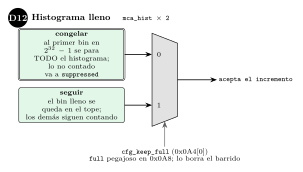

| Opción | Cuando un bin llega a $2^{32}-1$ |
|---|---|
| **congelar** (reset) | se para **todo** el histograma; lo no contado va a `suppressed` |
| seguir | ese bin se queda en el tope y el resto sigue |

Congelar todo y no solo el bin saturado es lo que mantiene el espectro coherente:
con unos canales congelados y otros no, las áreas relativas dejan de corresponder
al mismo live time. `full` (0x0A8) es pegajoso hasta el próximo borrado.

---

## 5. La contabilidad — transversal

No elige nada, pero es lo que permite afirmar que no se pierde nada sin dejar
rastro. Son cuatro mediciones, todas con assertions en
[`mca_top_sva.sv`](../../modulos/mca/sim/sva/mca_top_sva.sv):

- **Relojes** (64 b). Cada ciclo con `run` cae en **exactamente un** casillero:
  `realtime = vetotime + t_win + t_div + livetime`. El tiempo muerto es
  `t_win + t_div`: no hay ranura libre.
- **Ocupación** (64 b, 0x140–0x17F). `t_ocup[j]` cuenta los ciclos con
  exactamente j ranuras ocupadas, y su suma es `realtime − vetotime`. Es la
  distribución de Erlang del modelo M/D/N/N, medida directo.
- **Atribución de arribos.** Cada disparo va a un solo destino: abrió, se perdió
  con todas las ranuras midiendo, se perdió con alguna esperando publicar, o
  llegó bajo veto.
- **Distribución del período muerto** (0x0E0–0x0E8). **No es un histograma**:
  son tres escalares sobre los tramos sin ranura libre: cuántos, el más largo y
  cuántos tuvieron un disparo adentro.

### 5.1 A qué casillero va cada ciclo

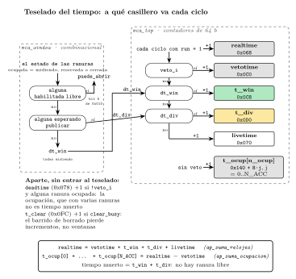

Son dos pasos en serie. **En `mca_window`**, a partir del estado de las ranuras,
salen los casilleros:

| Condición | Casillero | Qué significa |
|---|---|---|
| hay alguna ranura habilitada libre | `puede_abrir` | el próximo disparo abre |
| ninguna libre, ninguna esperando publicar | `dt_win` | todas midiendo |
| ninguna libre, alguna esperando publicar | `dt_div` | el publicador no da abasto |

Una ranura reservada (elegida en el ciclo anterior, que todavía no abrió) cuenta
como ocupada. Los tres son disjuntos y cubren todo (`ap_puede_abrir_complemento`),
así que no hay un estado en que el módulo no pueda abrir y nadie lo cuente.

**En `mca_top`** cada ciclo con `run = 1` suma uno a `realtime` y uno a
exactamente un reloj de 64 b, con el **veto primero**: la cola de una ventana que
termina bajo veto cuenta como vetada, no como muerta. Aparte, y sin veto, suma
uno a `t_ocup[n]`, con n las ranuras ocupadas. Dos contadores más van fuera del
teselado. `deadtime` (0x078) es la ocupación de **alguna** ranura: con una sola
coincide con `t_win + t_div`, y con varias no es tiempo muerto. `t_clear` es
ortogonal: durante el barrido de borrado las ranuras siguen midiendo y lo que se
pierde son incrementos, que van a `dropped`.

### 5.2 A qué contador va cada arribo

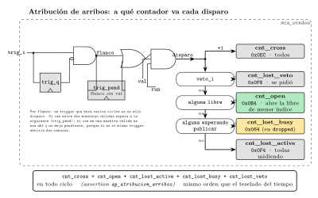

El **arribo** es el disparo: un flanco de `trig_i`, tomado en una muestra válida
y con `run`. Si el flanco cae entre dos muestras válidas, espera a la siguiente;
si cae en una muestra válida se usa ahí mismo y no deja pendiente, porque si no
el mismo trigger abriría dos ranuras. Cada arribo suma a `cnt_cross` y a **un**
contador más, con el mismo orden que el teselado (veto, después la causa del
bloqueo). La última rama, la que suma a `cnt_open`, es exactamente la apertura.
Por eso `cnt_cross` es igual a la suma de los otros cuatro en todo ciclo
(`ap_atribucion_arribos`).

### 5.3 Cómo se mide el período muerto

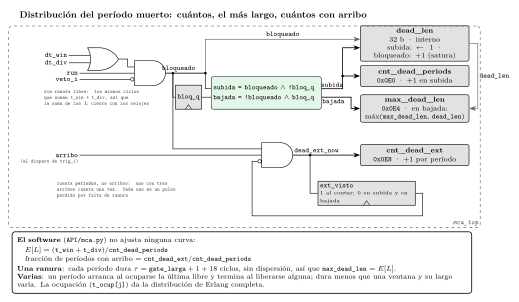

Un **período muerto** es un tramo contiguo de ciclos con

```
bloqueado = run ∧ !veto ∧ (dt_win ∨ dt_div)
```

o sea sin ranura libre: los mismos ciclos que suman a `t_win + t_div`. Por eso la
suma de los largos cierra con los relojes y $E[L]$ sale sin correcciones. Un
registro `bloq_q` da los flancos:

- **subida**: `dead_len ← 1` y `cnt_dead_periods + 1`. Mientras dura el bloqueo,
  `dead_len` suma uno por ciclo (satura en $2^{32} - 1$);
- **bajada**: `max_dead_len ← máx(max_dead_len, dead_len)`. `dead_len` queda
  congelado hasta el período siguiente (`ap_dead_len_congelado`);
- un **arribo** con `bloqueado` suma a `cnt_dead_ext` solo si es el primero del
  período. Cada uno es un pulso perdido por falta de ranura.

Con **una** ranura todos los períodos duran lo mismo, τ = `gate_larga + 1 + 18`
ciclos, y `max_dead_len` coincide con $E[L]$. Con **varias**, un período arranca
cuando se ocupa la última libre y termina cuando se libera alguna: dura menos que
una ventana y su largo es variable. Un veto en medio de un bloqueo lo **parte**
en dos períodos, porque `bloqueado` excluye el veto.

### 5.4 Un ejemplo, ciclo a ciclo

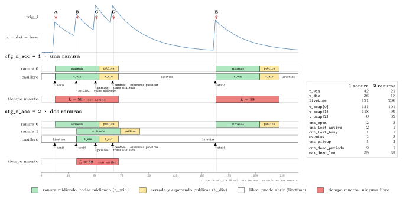

*Dos `mca_top` simulados con la misma entrada y los mismos disparos: compuertas
8/40 y pulsos con cola de 30 muestras. La figura se dibuja del CSV que vuelca
[`tb_tm_cronograma.sv`](figuras/contabilidad/tb_tm_cronograma.sv): las ranuras,
los casilleros, los tramos de tiempo muerto (en rojo, con su largo $L$) y la
tabla son los del RTL. Para regenerarla:
`python3 figuras/contabilidad/tm_cronograma.py --sim`.*

Con **una** ranura:

1. A dispara y abre la ranura 0, que mide 41 ciclos (la compuerta más uno) y
   espera 18 a que el publicador la tome.
2. B y C disparan con la ranura midiendo: se pierden en `t_win`
   (`cnt_lost_active = 2`).
3. D dispara con la ventana de A ya cerrada, mientras la ranura espera a los
   divisores: se pierde en `t_div` (`cnt_lost_busy = 1`). Lo pierde solo la
   publicación.
4. E está aislado y repite el período de A: L = 59 ciclos, siempre igual.

Con **dos**, B abre la ranura 1. El período muerto arranca ahí, cuando se ocupa
la última libre, y termina cuando el publicador libera la ranura 0: L = 39
ciclos, 21 con las dos midiendo (`t_win`) y 18 con la 0 esperando publicar
(`t_div`). C cae en la primera parte y D en la segunda, así que se pierden igual
que con una. E encuentra la 0 libre y no hay período muerto. Se publican tres
eventos y dos salen marcados (`cnt_pileup = 2`): A tuvo disparos adentro y B
abrió con A midiendo. La ocupación lo cuenta: `t_ocup[2] = 39` ciclos.

**Análisis fino →** [`tiempo_muerto.md`](tiempo_muerto.md) y
[`register_map_mca.md`](register_map_mca.md) §Relojes, §Distribución del período
muerto y §Atribución de arribos.

---

## Decisiones retiradas

Hasta la arquitectura de ranuras el MCA tenía tres decisiones más. Se fueron
juntas, por una razón: con varias ventanas a la vez, el disparo tiene que poder
ver un pulso **montado sobre la cola de otro**, y el Schmitt interno no puede (la
señal nunca baja del umbral entre los dos pulsos).

| | Era | Por qué se fue | Lo que la reemplaza |
|---|---|---|---|
| D4 | quién abre: Schmitt interno, trigger externo o cualquiera (`cfg_trig_src`) | el Schmitt no ve pulsos apilados | abre **solo** `trig_i`, el disparo por pendiente del multitrigger, con la línea de retardo |
| D5 | quién cierra: histéresis o compuertas fijas (`cfg_gate_mode`) | con ventanas solapadas el cruce de bajada es de la señal sumada y cerraría todas juntas | cierra **solo** la compuerta fija, que además era la de mejor resolución |
| D6 | cómo se re-arma: por nivel o por contador (`cfg_rearm_mode`) | con la apertura externa, el re-armado es del disparo | el Schmitt del disparo por pendiente y el `trigger_shield` del multitrigger |

D8 cambió de contenido: era bloqueante o FIFO (`cfg_pub_mode`), y ahora es
cuántas ranuras (`cfg_n_acc`). Con una ranura es el bloqueante; el FIFO de antes
no tiene equivalente exacto, porque su ventaja (reabrir sin esperar al divisor)
la dan ahora las demás ranuras.

Las figuras de las decisiones retiradas siguen en
[`figuras/decisiones/`](figuras/decisiones/) (`d04_apertura`, `d05_cierre`,
`d06_rearmado`, `d06_rearmado_logica`) como registro de lo que había, y
[`tiempo_muerto.md`](tiempo_muerto.md) conserva el análisis de paralizable contra
no paralizable, que vale para cualquier disparo. El RTL de antes está en git
(el último commit antes de las ranuras) y congelado en
[`sim/mca_pulse_feature_ref.v`](../../modulos/mca/sim/mca_pulse_feature_ref.v),
que `tb_mca_pulse_feature_evt` usa como referencia: para pulsos aislados, una
ranura mide exactamente lo mismo que la ventana única con disparo externo y
compuerta fija.

---

## Dónde está cada cosa

| Archivo | Contiene |
|---|---|
| [`mca_top.sv`](../../modulos/mca/rtl/mca_top.sv) | D1, D2, D9, la línea de retardo, el registro de pipeline, la contabilidad, el banco de registros |
| [`mca_pulse_feature.sv`](../../modulos/mca/rtl/mca_pulse_feature.sv) | cableado de los tres submódulos de abajo |
| [`mca_baseline.sv`](../../modulos/mca/rtl/mca_baseline.sv) | D3 |
| [`mca_delay.sv`](../../modulos/mca/rtl/mca_delay.sv) | la línea de retardo de muestras |
| [`mca_window.sv`](../../modulos/mca/rtl/mca_window.sv) | el disparo, el asignador de ranuras, los casilleros `dt_*`, la atribución |
| [`mca_slot.sv`](../../modulos/mca/rtl/mca_slot.sv) | una ranura: los acumuladores, D7, las marcas de solape y la suma de la meseta |
| [`mca_trap.sv`](../../modulos/comun/rtl/mca_trap.sv) | D13: el conformado trapezoidal |
| [`mca_publish.sv`](../../modulos/mca/rtl/mca_publish.sv) | la cola de ranuras cerradas, los divisores, el bus de features |
| [`mca_div_restore.sv`](../../modulos/mca/rtl/mca_div_restore.sv) | el divisor restaurador |
| [`mca_discriminator.sv`](../../modulos/mca/rtl/mca_discriminator.sv) | D10 |
| [`mca_zoom.sv`](../../modulos/mca/rtl/mca_zoom.sv) | D11 |
| [`mca_hist.sv`](../../modulos/mca/rtl/mca_hist.sv) | los motores de histograma, D12 |
| [`register_map_mca.md`](register_map_mca.md) | todos los registros, bit por bit |
| [`decisiones_diseno_mca.md`](decisiones_diseno_mca.md) | por qué el MCA es como es |
