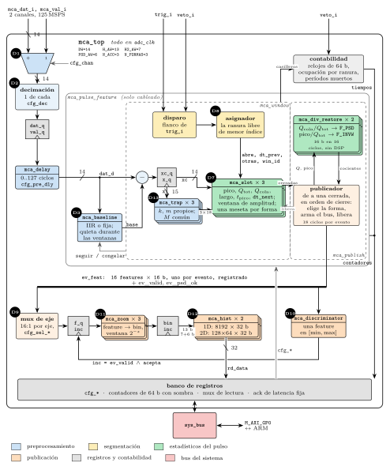
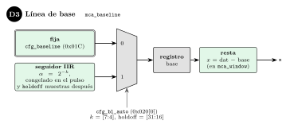
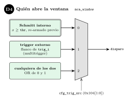
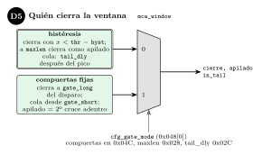
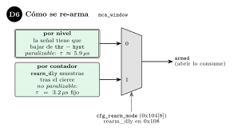
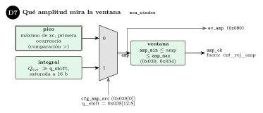
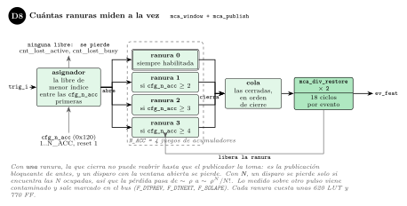
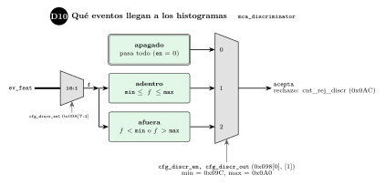
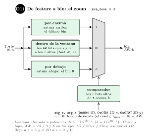

# Vista general del MCA

El analizador multicanal (`mca_top`, slot 7 del bus de sistema) toma la muestra
acondicionada del scope y, por cada pulso, publica **un** registro de evento que
alimenta a dos histogramas en BRAM. Todo corre en `adc_clk` (125 MHz).

El RTL está hecho para que **las alternativas convivan en el mismo bitstream** y
se elijan por registro: es lo que permite comparar dos métodos sobre los mismos
pulsos, en vez de comparar dos bitstreams. Por eso cada punto en que hay que
elegir un método es, literalmente, un mux con su `cfg_*`. Este documento recorre
la cadena etapa por etapa y, en cada decisión **Dn**:

1. muestra la figura de opciones (las alternativas en paralelo, el mux y el
   registro que elige),
2. resume en una tabla qué hace cada opción y cuál trae el reset,
3. apunta al documento donde está el **análisis fino**.

Los bloques que no se eligen (los acumuladores, los divisores, los motores de
histograma, la contabilidad) van descriptos sin mux.

*El MCA por etapas. Los círculos **Dn** son las decisiones de abajo. Fuente
TikZ en [`figuras/panorama_mca_top.tex`](figuras/panorama_mca_top.tex); las
figuras de opciones, en [`figuras/decisiones/`](figuras/decisiones/).*

## Las decisiones, de un vistazo

| | Decisión | Registro | Reset | Vive en | Análisis fino |
|---|---|---|---|---|---|
| D1 | canal | `cfg_chan` 0x00C[8] | IN1 | `mca_top` | — |
| D2 | decimación | `cfg_dec` 0x044 | 1 (todas) | `mca_top` | — |
| D3 | línea de base | `cfg_bl_auto` 0x020[0] | fija | `mca_baseline` | [`polo_cero.md`](polo_cero.md), [`apilamiento.md`](apilamiento.md) §El seguidor |
| D4 | quién abre | `cfg_trig_src` 0x104[1:0] | Schmitt interno | `mca_window` | [`ventana_de_medicion.md`](ventana_de_medicion.md) §1 |
| D5 | quién cierra | `cfg_gate_mode` 0x048[0] | histéresis | `mca_window` | [`ventana_de_medicion.md`](ventana_de_medicion.md) §2–4 |
| D6 | cómo se re-arma | `cfg_rearm_mode` 0x104[8] | por nivel | `mca_window` | [`tiempo_muerto.md`](tiempo_muerto.md) |
| D7 | estimador de la ventana de amplitud | `cfg_amp_src` 0x038[0] | pico | `mca_window` | [`decisiones_diseno_mca.md`](decisiones_diseno_mca.md) §5, [`conformado_y_ruido.md`](conformado_y_ruido.md) |
| D8 | cómo se publica | `cfg_pub_mode` 0x104[16] | bloqueante | `mca_window` + `mca_publish` | [`register_map_mca.md`](register_map_mca.md) §pub_mode |
| D9 | qué feature va a cada eje | `cfg_sel_*` 0x090 | 1D y 2D-x: pico; 2D-y: PSD | `mca_top` | [`decisiones_diseno_mca.md`](decisiones_diseno_mca.md) §2.5 |
| D10 | discriminador | `cfg_discr_*` 0x098–0x0A0 | apagado | `mca_discriminator` | [`apilamiento.md`](apilamiento.md) |
| D11 | zoom de cada eje | `cfg_z_*`, `cfg_k_*` 0x094, 0x0B8, 0x0BC | z = 0 | `mca_zoom` ×3 | [`limites_resolucion_y_deriva.md`](limites_resolucion_y_deriva.md) §5 |
| D12 | histograma lleno | `cfg_keep_full` 0x0A4[0] | congelar | `mca_hist` ×2 | — |

Con todos los registros en su reset, el MCA se comporta exactamente como antes
de que existieran las alternativas: un bitstream nuevo con software viejo da los
mismos números.

---

## 1. Entrada — D1 y D2

| | Opción | Qué hace |
|---|---|---|
| **D1** | **IN1** (reset) / IN2 | elige uno de los dos canales que entrega `rp_scope_mt_com`, ya calibrados y filtrados |
| **D2** | `cfg_dec` = N | deja pasar una muestra válida de cada N; con N ≤ 1 pasan todas. Es propia del MCA e independiente del `set_dec` del scope |

Después de los dos hay un **registro de entrada**. No es una decisión, pero es
el cambio que más timing compró en toda la historia del MCA: cortaba un camino
que venía desde la calibración del scope y atravesaba el mux de canal, el
decimador y toda la lógica de umbral (34 de los 60 endpoints en falla de aquel
build).

---

## 2. La ventana — `mca_pulse_feature`

Es el extractor: segmenta los pulsos, acumula sus características y publica un
evento por pulso. Está partido en submódulos, y **las fronteras las puso el
timing, no la prolijidad**:

- `mca_baseline` — la línea de base (D3).
- `mca_window` — el núcleo: la resta de la base, quién abre (D4), quién cierra
  (D5), el re-armado (D6), los acumuladores, la ventana de amplitud (D7) y la
  contabilidad de tiempo muerto.
- `mca_publish` — la FIFO, el árbitro, los dos `mca_div_restore` y el armado del
  bus de features (D8).
- `mca_pulse_feature` queda como cableado, con los mismos puertos de siempre.

El bitstream se sintetiza con `-flatten_hierarchy none`, así que cada puerto es
una barrera de optimización. El camino crítico de todo el diseño es
`dat → x = dat − base → umbrales → abrir/cerrar → acumuladores`, y una frontera
en medio de ese cono le suma un nivel de LUT. Por eso segmentación y
acumuladores comparten módulo, aunque en el esquema sean dos etapas. El re-armado
se probó como módulo propio y **volvió al núcleo**: abrir consume el armado en el
mismo flanco, así que el módulo de afuera necesita el flanco de apertura como
puerto, y eso solo costó 576 ps en todo el cono. La partición es bit-idéntica al
módulo original; lo verifica `tb_mca_pulse_feature_eq` contra una copia congelada,
en todas las salidas y en todos los ciclos.

### 2.1 Línea de base — D3

| Opción | Qué hace | Cuándo |
|---|---|---|
| **fija** (reset) | resta `cfg_baseline` (0x01C) | señal con base estable y conocida |
| seguidor IIR | `bl_acc += x − (bl_acc ≫ k)`, con $\alpha = 2^{-k}$; se congela durante el pulso y `holdoff` muestras después | base que deriva |

La base que sale es un **registro**, y la resta `x = dat − base` está en
`mca_window`: es el primer eslabón del camino crítico. Los umbrales del MCA son
siempre relativos a la base, así que esta etapa va **antes** de la segmentación.

El acumulador del seguidor es ancho a propósito (con la forma ingenua el
incremento se cuantiza a cero), y el holdoff evita que la base se coma el
undershoot de la cola. **Análisis fino →** [`polo_cero.md`](polo_cero.md) (el
undershoot) y [`apilamiento.md`](apilamiento.md) §El seguidor de línea de base
(qué compra y qué no).

### 2.2 Quién abre la ventana — D4

| Opción | Qué hace | Cuándo |
|---|---|---|
| **0 · Schmitt interno** (reset) | abre al cruzar `thr` hacia arriba, si antes se re-armó | espectrometría |
| 1 · trigger externo | abre con el **flanco** de `trig_i` (el `trigger_event` del multitrigger) | coincidencias, base de tiempo común |
| 2 · cualquiera | OR de los dos | — |

El trigger externo se toma por flanco y se sostiene hasta la muestra válida
siguiente, para que la decimación no se lo coma. **No sirve para medir energía**
tal como está: el trigger llega con latencia, la ventana abre unas muestras tarde
y se pierde el flanco de subida. Haría falta la línea de retardo de muestras que
el plan dejó para la Fase 3. **Análisis fino →**
[`ventana_de_medicion.md`](ventana_de_medicion.md) §1.

### 2.3 Quién cierra la ventana — D5

| Opción | Cierra | Cola | Apilamiento |
|---|---|---|---|
| **histéresis** (reset) | al bajar de `thr − hyst` | desde `tail_dly` muestras después del pico | si la ventana llega a `maxlen` |
| compuertas fijas | a `gate_long` muestras del disparo | desde `gate_short` | un segundo cruce de `thr` dentro de la compuerta |

Con histéresis el largo de la ventana lo decide dónde cruza la cola, o sea el
ruido. Medido offline sobre 7054 pulsos reales, la resolución de la integral pasa
de 0.528 % (histéresis) a 0.149 % (compuerta fija). **Análisis fino →**
[`ventana_de_medicion.md`](ventana_de_medicion.md) §2–4, incluido por qué la regla
obvia de apilamiento en modo compuerta es incorrecta.

### 2.4 Cómo se re-arma — D6

| Opción | Re-arma | Modelo de tiempo muerto |
|---|---|---|
| **por nivel** (reset) | cuando la señal baja de `thr − hyst` | **paralizable**: cada pulso sobre la cola extiende el bloqueo (τ ≈ 5.9 µs) |
| por contador | `rearm_dly` (0x108) muestras después del cierre | **no paralizable**: τ = 3.2 µs determinista |

Es **la palanca grande del tiempo muerto**: con arribos Poisson a 100 kcps la
pérdida pasa de 45.9 % a 24.2 %. Lo que cuesta: el re-armado por contador
sobre-cuenta, porque trocea un apilamiento en pedazos del largo de la compuerta.
La mitigación es rechazar por forma (D10 con `F_INVW` o `F_LEN`). **Análisis
fino →** [`tiempo_muerto.md`](tiempo_muerto.md).

### 2.5 Los acumuladores — bloque fijo

Mientras la ventana está abierta, cada muestra válida actualiza **versiones
secuenciales** de los estimadores: no se guarda ninguna muestra, todo es un
máximo y unas sumas que corren.

| Acumulador | Regla |
|---|---|
| pico | máximo de `xc`, con comparación **estricta**: en un techo plano gana la primera ocurrencia |
| $t_\mathrm{sub}$ | índice de la muestra de pico |
| $Q_\mathrm{tot}$ | suma de `xc` en toda la ventana |
| $Q_\mathrm{cola}$ | suma de `xc` desde el comienzo de la cola (D5) |
| largo | muestras desde el disparo |

`xc` es la muestra relativa a la base, **saturada a ≥ 0**: sin eso, una cola con
undershoot resta de $Q_\mathrm{tot}$ mientras $Q_\mathrm{cola}$ sigue sumando, y se
llega a $Q_\mathrm{cola} > Q_\mathrm{tot}$, que rompe la premisa del divisor.

### 2.6 La ventana de amplitud — D7

| Opción | Amplitud |
|---|---|
| **pico** (reset) | el máximo de la ventana: el ruido de **una** muestra |
| integral | $Q_\mathrm{tot} \gg$ `q_shift`, saturada a 16 b: el ruido blanco promedia |

Al cerrar, la amplitud elegida tiene que caer en `[amp_min, amp_max]`; si no, el
evento se cuenta en `cnt_rej_amp` y **no paga los divisores**. Es el primero de
los rechazos (ver 2.8).

Dos aclaraciones, porque esta decisión cambió de alcance. `cfg_amp_src` **ya no
elige el eje del histograma**: eso lo hace D9. Por compatibilidad, escribir 0x038
mueve también `cfg_sel_1d` y `cfg_sel_2dx`, así que el software viejo sigue
andando. Y la comparación con la ventana se evalúa **un ciclo antes del cierre**,
con registros sombra (`d_min`, `d_max`) que llevan la resta hecha: era el camino
crítico del bitstream. **Análisis fino →**
[`decisiones_diseno_mca.md`](decisiones_diseno_mca.md) §5 (el estimador) y §11.1
(la optimización), y [`conformado_y_ruido.md`](conformado_y_ruido.md).

### 2.7 La publicación — D8, y `mca_div_restore`

| Opción | Qué hace la ventana al aceptar |
|---|---|
| **bloqueante** (reset) | espera en `S_DIV` los 17 ciclos de los divisores |
| FIFO de `PUB_K` lugares | vuelve a reposo y puede reabrir enseguida; el bloqueo es la FIFO llena |

En los dos modos el resultado entra a la misma FIFO, y si el publicador está
libre los divisores arrancan en ese mismo flanco: lo único que cambia es cuándo
puede reabrir la ventana. Lo bloqueado cae en el mismo casillero de tiempo
(`t_div`, 0x0D0), así que los dos modos se comparan con la misma vara. Con un
solo juego de acumuladores, `PUB_K = 2` alcanza.

**`mca_div_restore`** (bloque fijo, dos instancias en paralelo) es un divisor
restaurador: calcula $\lfloor \text{num} \cdot 2^{16} / \text{den} \rfloor$ con
num < den, un bit de cociente por ciclo, **16 ciclos fijos y cero DSP**. Los dos
comparten denominador y arranque:

- **PSD** = $Q_\mathrm{cola}/Q_\mathrm{tot}$: dónde está la carga. Va a `F_PSD`, y sus
  6 bits altos al eje Y del mapa 2D.
- **INVW** = pico$/Q_\mathrm{tot}$: el ancho inverso. Va a `F_INVW` y es el que
  separa los apilados.

Los casos borde están tratados: $Q_\mathrm{tot} = 0$ da error y
$Q_\mathrm{cola} \ge Q_\mathrm{tot}$ satura, en vez de mandar el evento al extremo
opuesto del eje. La latencia fija es deliberada: hace predecible el tiempo muerto
por evento. **Análisis fino →** [`decisiones_diseno_mca.md`](decisiones_diseno_mca.md)
§2.5 y §6, y [`register_map_mca.md`](register_map_mca.md) §pub_mode.

### 2.8 Dónde se pierde un evento

No hay un solo rechazo sino varios, y cada uno tiene su contador:

| Dónde | Por qué | Contador |
|---|---|---|
| `mca_window`, al cerrar | apilamiento (D5) | `cnt_pileup` |
| `mca_window`, al cerrar | fuera de `[amp_min, amp_max]` (D7) | `cnt_rej_amp` |
| `mca_publish` | forma inválida: sigue en el 1D, **no** entra al 2D | `cnt_rej_psd` |
| discriminador (D10) | fuera de la condición sobre una feature | `cnt_rej_discr` |
| `mca_hist` | colisión con una lectura del bus o con el barrido de borrado | `dropped` |
| `mca_hist` | histograma lleno, con D12 en *congelar* | `suppressed` |

Y antes de abrir, los pulsos que no llegan a tener ventana van a la atribución de
arribos (sección 5).

---

## 3. Del evento al bin

### 3.1 El bus de features — bloque fijo

El evento sale de `mca_publish` como un bus interno de **16 ranuras × 16 b**,
todas del mismo pulso. Es interno: el ARM no lo ve, sigue leyendo las mismas
aperturas de histograma.

| Ranura | Feature | Normalización |
|---|---|---|
| 0 `F_PEAK` | pico | alineada a la izquierda |
| 1 `F_INT` | $Q_\mathrm{tot} \gg$ `q_shift` | saturada a 16 b |
| 2 `F_PSD` | $Q_\mathrm{cola}/Q_\mathrm{tot}$ | alineada a la izquierda |
| 3 `F_INVW` | pico$/Q_\mathrm{tot}$ | **sin** normalizar: vive cerca de cero |
| 4 `F_LEN` | largo de la ventana | sin normalizar (contador) |
| 5 `F_TRISE` | disparo → pico | sin normalizar (contador) |
| 6–15 | reservadas | en cero |

### 3.2 Qué feature va a cada eje — D9

Tres mux 16:1, uno por eje (`cfg_sel_1d`, `cfg_sel_2dx`, `cfg_sel_2dy` en 0x090).
El reset deja el comportamiento histórico: 1D y eje X del 2D con el pico, eje Y
con PSD. Los mux están en `mca_top`, **después** del registro del bus. **Análisis
fino →** [`decisiones_diseno_mca.md`](decisiones_diseno_mca.md) §2.5 (las dos
features de forma miden cosas distintas).

### 3.3 El discriminador — D10

| Opción | Acepta |
|---|---|
| **apagado** (reset) | todo |
| adentro | `min` ≤ f ≤ `max` |
| afuera | f < `min` o f > `max` |

Mira una feature cualquiera del bus (`cfg_discr_sel`). Va después de los
divisores justamente para poder cortar por **forma**: un corte por ancho inverso
rechaza el 99.1 % de los apilados, mientras que PSD rechaza el 29.6 % en modo
histéresis y nada en modo compuerta. El corte hay que calibrarlo contra la
amplitud con un pulser deslizante. Un evento rechazado no entra a ningún motor.
**Análisis fino →** [`apilamiento.md`](apilamiento.md).

### 3.4 El zoom — D11

`mca_zoom` convierte una feature de 16 b en el bin de un eje de AW bits. Con
**z = 0** (el reset) es un cuantizador puro: el bin son los AW bits altos de la
feature. Con z > 0 el eje cubre la ventana $[k\,2^{16-z},\,(k+1)\,2^{16-z})$,
alineada a potencias de 2. Lo que cae afuera **satura** en el extremo
correspondiente y nunca aparece del otro lado.

Con los parámetros de los tops (AW = 13 / 7 / 6), el 1D llega solo a z = 3 y el
2D a z = 9 y 10. O sea que en el 1D el zoom casi no rinde y en el mapa 2D sí. El
zoom **no mejora la resolución**: recupera la pérdida por binning, que con 8.6
canales por FWHM ya es despreciable. Sirve para ubicar el eje sobre dos picos
juntos o para usar un histograma más chico. **Análisis fino →**
[`limites_resolucion_y_deriva.md`](limites_resolucion_y_deriva.md) §5.

Entre el zoom y los motores hay un **registro de pipeline**, que es obligatorio:
sin él, el camino del bus a la dirección de la BRAM tenía diez niveles de lógica.

---

## 4. Los histogramas — `mca_hist` ×2

Es un solo módulo instanciado dos veces, **cada una con su propia BRAM**. No es
una memoria indexada de dos maneras, y los dos acumulan **a la vez**, con el
mismo evento:

| Motor | Dirección | Tamaño en los tops | Entra si |
|---|---|---|---|
| espectro 1D | `bin_1d` | 8192 canales × 32 b = 8 RAMB36 | el evento pasó el discriminador |
| mapa 2D | `{bin_x, bin_y}`, concatenados | 128 × 64 × 32 b = 8 RAMB36 | ídem, **y** la forma es válida |

Cada motor es una BRAM simple dual port: lectura por un puerto y write-back por
el otro, con forwarding de dos etapas, así que acepta **un incremento por
ciclo**. El barrido de borrado usa solo el puerto de escritura, para que la
lectura del bus siga viva (si no, el bus se colgaría). Se leen por las aperturas
0x1xxxx (1D) y 0x2xxxx (2D).

### Histograma lleno — D12

| Opción | Cuando un bin llega a $2^{32}-1$ |
|---|---|
| **congelar** (reset) | se para **todo** el histograma; lo no contado va a `suppressed` |
| seguir | ese bin se queda en el tope y el resto sigue |

Congelar todo y no solo el bin saturado es lo que mantiene el espectro coherente:
con unos canales congelados y otros no, las áreas relativas dejan de corresponder
al mismo live time. `full` (0x0A8) es pegajoso hasta el próximo borrado.

---

## 5. La contabilidad — transversal

No elige nada, pero es lo que permite afirmar que no se pierde nada sin dejar
rastro. Hay tres teselados, los tres con assertion en
[`mca_top_sva.sv`](../../modulos/mca/sim/sva/mca_top_sva.sv):

- **Relojes** (64 b, 0x068–0x0DC). Cada ciclo con `run` cae en **exactamente un**
  casillero: `realtime = vetotime + t_win + t_div + t_rearm + livetime`. El
  tiempo muerto honesto es `t_win + t_div + t_rearm`. El registro viejo
  `deadtime` (0x078) se conserva por compatibilidad y no incluye `t_rearm`, que
  es justamente el casillero grande.
- **Atribución de arribos.** Cada cruce de `thr` hacia arriba va a un solo
  destino: abrió, se perdió esperando el re-armado, cayó dentro de una ventana,
  encontró la publicación ocupada, llegó bajo veto o no tuvo trigger.
- **Distribución del período muerto** (0x0E0–0x0E8). **No es un histograma**:
  son tres escalares. `cnt_dead_periods` cuenta los tramos bloqueados,
  `max_dead_len` guarda el más largo y `cnt_dead_ext` cuenta los tramos
  extendidos por un arribo. El software saca de ahí
  $E[L] = (t_\mathrm{win} + t_\mathrm{div} + t_\mathrm{rearm}) / \text{períodos}$
  y la fracción apilada $P(L > \tau) = \text{ext}/\text{períodos} = 1 - e^{-\rho}$
  ([`API/mca.py`](../../software/API/mca.py)). Con eso alcanza para distinguir
  paralizable de no paralizable sin barrer la tasa.

**Análisis fino →** [`tiempo_muerto.md`](tiempo_muerto.md) y
[`register_map_mca.md`](register_map_mca.md) §Relojes, §Distribución del período
muerto y §Atribución de arribos.

---

## Dónde está cada cosa

| Archivo | Contiene |
|---|---|
| [`mca_top.sv`](../../modulos/mca/rtl/mca_top.sv) | D1, D2, D9, el registro de pipeline, la contabilidad, el banco de registros |
| [`mca_pulse_feature.sv`](../../modulos/mca/rtl/mca_pulse_feature.sv) | cableado de los tres submódulos de abajo |
| [`mca_baseline.sv`](../../modulos/mca/rtl/mca_baseline.sv) | D3 |
| [`mca_window.sv`](../../modulos/mca/rtl/mca_window.sv) | D4–D7, los acumuladores, los casilleros `dt_*`, la atribución |
| [`mca_publish.sv`](../../modulos/mca/rtl/mca_publish.sv) | D8, la FIFO, el árbitro, el bus de features |
| [`mca_div_restore.sv`](../../modulos/mca/rtl/mca_div_restore.sv) | el divisor restaurador |
| [`mca_discriminator.sv`](../../modulos/mca/rtl/mca_discriminator.sv) | D10 |
| [`mca_zoom.sv`](../../modulos/mca/rtl/mca_zoom.sv) | D11 |
| [`mca_hist.sv`](../../modulos/mca/rtl/mca_hist.sv) | los motores de histograma, D12 |
| [`register_map_mca.md`](register_map_mca.md) | todos los registros, bit por bit |
| [`decisiones_diseno_mca.md`](decisiones_diseno_mca.md) | por qué el MCA es como es |
