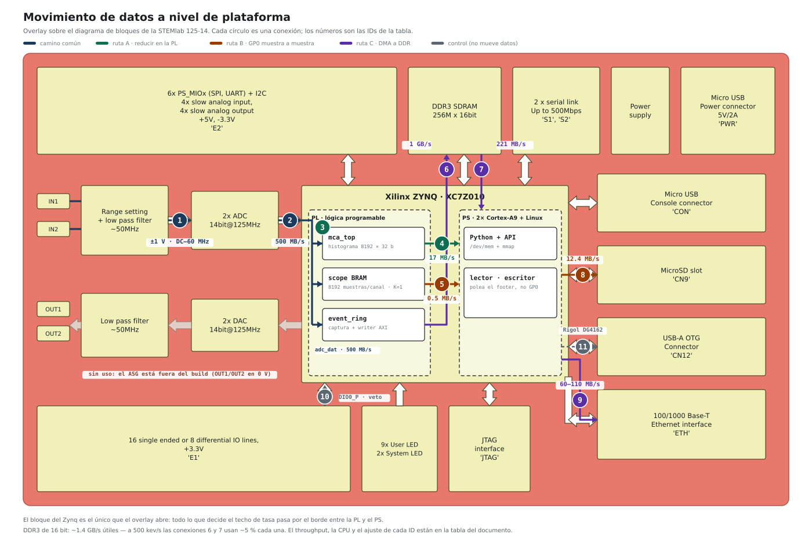
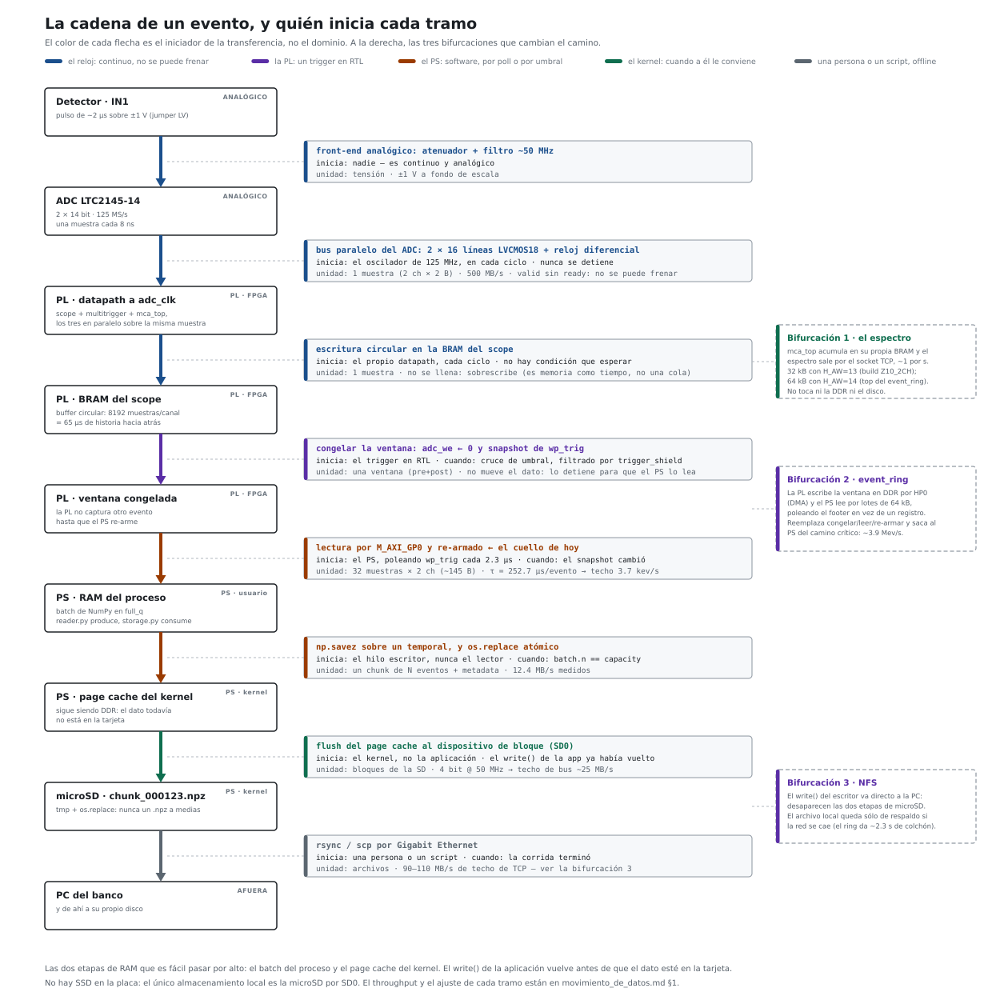

# El movimiento de datos a nivel de plataforma

Qué caminos tiene un dato para ir desde el ADC hasta la PC del banco, cuánto
mueve cada uno, cuánta CPU cuesta y cuánto trabajo es ponerlo a punto. Es el
documento para leer antes de preguntarse "¿por qué el techo es ese?" o "¿me
conviene sacar esto por GP0 o por DDR?".

Hay dos figuras, porque son dos preguntas distintas. La primera es el diagrama
de bloques de la placa con un overlay encima: **abre el bloque del Zynq** —que
en el diagrama oficial es una caja sola— en PL y PS con los módulos de este
proyecto, y **numera cada conexión**. Esos números son las IDs de la tabla de
§1. La segunda (§2) sigue a **un evento** a lo largo de la cadena y dice, tramo
por tramo, **quién inicia la transferencia y cuándo**.



La idea que ordena todo lo demás: **la placa tiene tres salidas de la PL hacia
el PS**, y la diferencia entre ellas no es de porcentajes, es de tres órdenes de
magnitud — y además tienen costos de CPU opuestos.

Documentos hermanos, para no duplicar:

| Documento | Qué contiene |
|---|---|
| [`platform.md`](platform.md) | la placa pieza por pieza: ADC, relojes, puertos AXI, conectores |
| [`TOP/bus_sistema_redpitaya.md`](TOP/bus_sistema_redpitaya.md) | el bus GP0 → `sys_bus` en detalle, y por qué no tiene ráfagas |
| [`patrones_memoria_hw.md`](patrones_memoria_hw.md) | qué desacopla cada buffer y cómo se dimensiona |
| [`API/arquitectura_adquisicion_software.md`](API/arquitectura_adquisicion_software.md) | el presupuesto de latencia del lector, medido fase por fase |
| [`event_ring/diseno_y_register_map.md`](event_ring/diseno_y_register_map.md) | el ring de DDR que reemplaza al K=1 |
| [`event_ring/salida_por_red.md`](event_ring/salida_por_red.md) | la última milla: SD contra red |

---

## 1. La tabla de conexiones

Una fila por círculo de la figura. `CPU` es el costo **en el lazo de
adquisición**, no el costo absoluto; `ajuste` es cuánto trabajo es dejarlo
andando bien.

| # | Conexión | Mecanismo | Throughput | CPU | Ajuste |
|---|---|---|---|---|---|
| **1** | IN1/IN2 → front-end → ADC | atenuador + filtro ~50 MHz, jumper LV/HV | ±1 V a fondo de escala, DC–60 MHz | — | nulo |
| **2** | ADC → PL | 2 × 16 líneas LVCMOS18 + reloj; 1 muestra por ciclo | **500 MB/s** | nulo | nulo |
| **3** | datapath → `mca_top` *(interna a la PL)* | acumulación en BRAM: 8192 bins × 32 b + mapa 2D | entran 500 MB/s, sale el espectro | nulo | medio — son los parámetros del MCA |
| **4** | `mca_top` → PS | **M_AXI_GP0**, 32 bit, sin ráfagas | 17 MB/s de techo · 32 kB por espectro (`H_AW = 13`) | alto mientras dura la lectura | bajo |
| **5** | scope BRAM → PS | **M_AXI_GP0** + freeze/re-arm, K=1 | **0.5 MB/s** (3.7 kev/s) · 7.5 MB/s reescrito en C | **100 %** | bajo de montar, imposible de escalar |
| **6** | `event_ring` → DDR3 | **S_AXI_HP0**, 64 bit @ 125 MHz, DMA | **1 GB/s** de techo · 72 MB/s a 500 kev/s | **nulo** | alto |
| **7** | DDR3 → PS | `mmap` con `O_SYNC`, lotes de 64 kB | **221 MB/s** | medio | medio |
| **8** | PS → microSD | SD0, 4 bit @ 50 MHz | 12.4 MB/s medidos | medio | nulo |
| **9** | PS → Ethernet | GbE: NFS, o socket TCP crudo | 60–90 MB/s (NFS) · 90–110 (TCP) | bajo | medio |
| **10** | E1 `DIO0_P` → PL | entrada digital 3.3 V | — | nulo | bajo |
| **11** | PS → USB-A | USBTMC crudo desde Python | — | bajo | medio |

Y a qué ruta pertenece cada una:

| Ruta | Conexiones | Dónde se reduce el volumen | Estado |
|---|---|---|---|
| **A** — reducir en la PL | 3 → 4 | **en la PL**: el espectro *es* el resultado | **en producción** |
| **B** — GP0 muestra a muestra | 5 | **no se reduce**: salen las muestras crudas | **es el cuello de hoy** |
| **C** — DMA a DDR | 6 → 7 | la PL recorta la ventana; el volumen sale por DMA | RTL y TB listos, Fase 0 en placa |
| salida | 8, 9 | — | SD hoy, red recomendada |
| control | 10 (veto / trigger externo), 11 (Rigol DG4162) | no mueven datos de adquisición | — |

El titular, con los 500 MB/s de la conexión 2 como denominador:

| Ruta | Fracción que sale hacia el PS | A costa de |
|---|---:|---|
| A | ~0.006 % | nada: el histograma ya es el dato final |
| B | ~0.1 % | el 100 % de la CPU, y un techo de 3.7 kev/s |
| C | ~14 % (a 500 kev/s) | complejidad de RTL, no de CPU |

> El camino del DAC (OUT1/OUT2) está cableado pero **apagado**: el ASG se quitó
> del build, así que las salidas quedan en 0 V. Por eso en la figura va en gris
> y sin número.

---

## 2. La cadena de un evento, etapa por etapa

La tabla de §1 mira la plataforma desde arriba. Esta sección hace lo contrario:
sigue a **un solo evento** desde el detector hasta el disco de la PC, y para
cada tramo dice lo que normalmente no se escribe en ningún lado — **quién
inicia la transferencia y cuándo**.



La figura lleva la espina —las nueve etapas, en orden— con **el color de cada
flecha indicando quién inicia la transferencia**, y nada más: los números son
las filas de la tabla de abajo y las `B1`–`B3` son las tres bifurcaciones de
más adelante. El detalle de cada tramo no está dibujado a propósito, por la
misma razón que en §1: dos copias del mismo texto se desincronizan.

### Las nueve etapas

| Etapa | Dominio | Qué es |
|---|---|---|
| Detector · IN1 | analógico | pulso de ~2 µs sobre ±1 V (jumper LV) |
| ADC LTC2145-14 | analógico | 2 × 14 bit · 125 MS/s — una muestra cada 8 ns |
| PL · datapath a `adc_clk` | PL | scope + multitrigger + `mca_top`, los tres en paralelo sobre la misma muestra |
| PL · BRAM del scope | PL | buffer circular: 8192 muestras/canal = 65 µs de historia hacia atrás |
| PL · ventana congelada | PL | la PL no captura otro evento hasta que el PS re-arme |
| PS · RAM del proceso | PS · usuario | batch de NumPy en `full_q`: `reader.py` produce, `storage.py` consume |
| PS · page cache del kernel | PS · kernel | sigue siendo DDR: **el dato todavía no está en la tarjeta** |
| microSD · `chunk_000123.npz` | PS · kernel | `tmp` + `os.replace`: nunca un `.npz` a medias |
| PC del banco | afuera | y de ahí a su propio disco |

### Los ocho tramos

Una fila por número de la figura. La columna «inicia» es la que no se escribe
en ningún lado y la que explica los techos.

| # | Tramo | Inicia · cuándo | Unidad y costo |
|---|---|---|---|
| **1** | front-end analógico: atenuador + filtro ~50 MHz | nadie — es continuo y analógico | tensión · ±1 V a fondo de escala |
| **2** | bus paralelo del ADC: 2 × 16 líneas LVCMOS18 + reloj diferencial | el oscilador de 125 MHz, en cada ciclo · **nunca se detiene** | 1 muestra (2 ch × 2 B) · 500 MB/s · `valid` sin `ready`: **no se puede frenar** |
| **3** | escritura circular en la BRAM del scope | el propio datapath, cada ciclo · no hay condición que esperar | 1 muestra · no se llena: **sobrescribe** (es memoria como tiempo, no una cola) |
| **4** | congelar la ventana: `adc_we ← 0` y snapshot de `wp_trig` | el trigger en RTL · cuando cruza el umbral, filtrado por `trigger_shield` | una ventana (pre+post) · **no mueve el dato: lo detiene** para que el PS lo lea |
| **5** | lectura por `M_AXI_GP0` y re-armado — **el cuello de hoy** | el PS, poleando `wp_trig` cada 2.3 µs · cuando el snapshot cambió | 32 muestras × 2 ch (~145 B) · **τ = 252.7 µs/evento → techo 3.7 kev/s** |
| **6** | `np.savez` sobre un temporal, y `os.replace` atómico | el hilo escritor, nunca el lector · cuando `batch.n == capacity` | un chunk de N eventos + metadata · 12.4 MB/s medidos |
| **7** | flush del page cache al dispositivo de bloque (SD0) | **el kernel, no la aplicación** · el `write()` de la app ya había vuelto | bloques de la SD · 4 bit @ 50 MHz → techo de bus ~25 MB/s |
| **8** | `rsync` / `scp` por Gigabit Ethernet | una persona o un script · cuando la corrida terminó | archivos · 90–110 MB/s de techo de TCP — ver la bifurcación 3 |

Las dos etapas de RAM que es fácil pasar por alto son la 6 y la 7: el batch del
proceso y el page cache del kernel. **El `write()` de la aplicación vuelve antes
de que el dato esté en la tarjeta.** Y no hay SSD en la placa: el único
almacenamiento local es la microSD por SD0.

### Los cinco tipos de iniciador

Es la clasificación que ordena la figura, y la razón por la que el camino tiene
los techos que tiene:

| Inicia | Tramos | Consecuencia |
|---|---|---|
| **el reloj** — continuo, no se puede frenar | detector → ADC → datapath → BRAM | no hay contrapresión posible hacia atrás: lo que no entra **se descarta y se cuenta** |
| **la PL** — un trigger en RTL | congelar la ventana | latencia de nanosegundos y determinista |
| **el PS** — software, por poll o por umbral | leer por GP0 · escribir el chunk | acá está el techo: el PS es parte del camino crítico |
| **el kernel** — cuando a él le conviene | flush del page cache a la SD | el `write()` de la aplicación ya volvió: el dato **todavía no está en la tarjeta** |
| **una persona o un script**, offline | bajar los archivos | no tiene techo de tasa, pero tampoco garantía de cuándo |

### La cadena propuesta, corregida

| Tramo, como estaba planteado | Qué pasa realmente |
|---|---|
| `ADC → FPGA (BRAM)`: continuo | **Correcto**, y es la propiedad que manda todo lo demás: el ADC es un `valid` sin `ready`. Si aguas abajo no hay lugar, se descarta y se cuenta — nunca se frena el ADC. |
| `→ RAM (DDR)` mediante el triggering | **Dos correcciones.** (a) El trigger **no mueve** el dato: lo **congela** (`adc_we ← 0`) para que el buffer circular deje de sobrescribirlo. (b) **Hoy ese tramo no existe**: la BRAM se lee directo al procesador por GP0 y la DDR no participa. El tramo por DDR es el `event_ring` — bifurcación 2, todavía en Fase 0. |
| `→ Processor`: comprobación repetida del bloque de control | **Correcto**: poll de `wp_trig` cada 2.3 µs. Con el ring el poll pasa a ser del **footer en DDR**, no de un registro, y GP0 sale del lazo caliente por completo. |
| `→ RAM`: *"no estoy del todo seguro"* | **Sí, y aparece dos veces.** Primero el `batch` de NumPy en la cola del proceso (`reader.py` → `full_q` → `storage.py`), y después el **page cache del kernel**. Esa segunda es la que sorprende: el `write()` vuelve antes de que el dato toque la tarjeta. |
| `→ SSD` cuando `n_eventos == N` | El umbral es correcto (`batch.n == batch.capacity`), pero **no hay SSD**: el único almacenamiento local es la **microSD** por SD0 a 4 bit/50 MHz. 12.4 MB/s medidos contra ~25 MB/s de techo de bus. |
| `→ Ethernet → Network → PC` | **No es una serie obligatoria después del disco.** Hoy los `chunk_*.npz` se bajan con `rsync` **después** de la corrida. Con NFS (bifurcación 3) el `write()` del escritor va directo a la PC, las dos etapas de SD desaparecen, y el archivo local queda sólo como respaldo si la red se cae. |
| *(falta)* | **El espectro no está en esta cadena.** `mca_top` lo acumula en su propia BRAM y sale por un socket TCP ~1 vez por segundo, sin tocar ni la DDR ni el disco — bifurcación 1. Son dos caminos que conviven, no uno. |

### Las tres bifurcaciones

Son las marcas `B1`, `B2` y `B3` de la figura, puestas en la etapa donde cada una se abre.

| | Qué reemplaza | Qué cambia |
|---|---|---|
| **1 · el espectro** (ruta A) | nada: es un camino paralelo | el dato ya viene reducido de la PL, así que no necesita ni DDR ni archivo |
| **2 · `event_ring`** (ruta C) | congelar → leer por GP0 → re-armar | el PS deja de estar en el camino crítico: de 3.7 kev/s a ~3.9 Mev/s de techo de captura |
| **3 · NFS** | page cache → microSD → `rsync` | el escritor escribe directo sobre la red; el disco local pasa a ser red de contención |

> **Ojo con el tamaño del espectro, que hoy no es único.**
> [`mca_red_pitaya_top.sv`](../rtl/mine/tops/mca_red_pitaya_top.sv) instancia
> `H_AW = 13` (8192 canales, 32 kB) y
> [`event_ring_red_pitaya_top.sv`](../rtl/mine/tops/event_ring_red_pitaya_top.sv)
> instancia `H_AW = 14` (16384, 64 kB). [`APP/flujo_de_datos.md`](APP/flujo_de_datos.md)
> habla de "64 KB por espectro" sin aclarar de cuál de los dos tops. El software
> no lo supone: lo lee del registro `0x008`, que publica `H_AW`. Vale la pena
> decidir si los dos tops deben coincidir.

---

## 3. Conexión 2 — lo que entra: 500 MB/s que no esperan a nadie

El LTC2145-14 entrega **2 canales × 14 bit a 125 MS/s**. En la PL eso son dos
palabras de 16 bit por ciclo de `adc_clk`: **500 MB/s**, una muestra cada 8 ns.

Dos consecuencias que valen para las tres rutas:

- **El reloj de muestreo es el reloj del datapath.** No hay FIFO de entrada ni
  nada que pueda frenar al ADC: es un `valid` sin `ready`
  ([`patrones_memoria_hw.md`](patrones_memoria_hw.md) §6). Si aguas abajo no hay
  lugar, **se descarta y se cuenta**; no se hace contrapresión hacia el ADC.
- **Nada de lo que viene después se acerca a 500 MB/s.** La pregunta de diseño
  no es "cómo muevo 500 MB/s" sino **"dónde reduzco"**. Las tres rutas son tres
  respuestas distintas a esa pregunta.

---

## 4. Ruta A (conexiones 3 y 4) — reducir en la PL

`mca_top` acumula el histograma en BRAM: 8192 bins de 32 bit, más el mapa 2D de
128 × 64. El PS **nunca ve una muestra**; lee el espectro entero cuando quiere.

- **Throughput**: irrelevante como caudal. Son ~32 kB por lectura, y la lectura
  es esporádica (32 kB con el `H_AW = 13` del build de producción; ver la nota
  de §2). El techo de GP0 (17 MB/s desde C) no limita nada acá.
- **CPU**: alto *mientras dura* la lectura — una palabra de 32 bit por
  transacción, sin ráfagas — pero son milisegundos cada varios segundos.
- **Ajuste**: la conexión 4 es `mmap` sobre `/dev/mem` y listo. Lo que sí tiene
  ajuste fino es la conexión 3: `gate_mode`, `q_shift`, `h_shift`. Eso es física
  del instrumento, no movimiento de datos
  ([`mca/figuras/README.md`](mca/figuras/README.md)).

Es la ruta que hace que el MCA funcione a tasas que la Ruta B no soporta: **el
tiempo muerto del PS no existe porque el PS no participa.**

> Pendiente conocido: la colisión de un evento con el pulso de lectura `rd_i`
> descarta ese evento (~0.8 % durante cada lectura de espectro). Se elimina por
> completo con un skid buffer de un registro —
> [`patrones_memoria_hw.md`](patrones_memoria_hw.md) §10.

---

## 5. Ruta B (conexión 5) — muestra por muestra por GP0

Es el camino del multitrigger original: capturar en la BRAM del scope,
**congelar** (`adc_we <= 0`), que el PS lea por GP0, re-armar. De hecho es una
cola de **un solo evento** (K=1).

El presupuesto medido por evento, en Python:

```
  read     172.7 µs      2 × [ 45.6 API + ~40 copia numpy ]
  rearm     38.0 µs      3 escrituras de registro
  book      30.8 µs      4 stores escalares + contadores
  snap      11.2 µs      1 lectura de registro
  ────────────────────
  τ        252.7 µs   →  techo 4.0 kev/s   (medido: 3.7)
```

Dos cosas que este número esconde y que conviene decir juntas:

1. **El cuello no es el bus AXI: es el intérprete.** El overhead por operación
   de Python/NumPy en este A9 a 667 MHz es de **10–50 µs**, y el lector hace una
   decena de operaciones por evento. Reescrito en C, el mismo ciclo baja a
   **19.2 µs** (~52 kev/s), y de esos 19.2 µs **15 son bus**.
2. **GP0 no tiene ráfagas.** Una palabra de 32 bit es una transacción con su
   cruce de dominio de reloj: 2.3 µs desde Python, 0.235 µs desde C. Leer 16 k
   muestras son 16 k transacciones. Ése es el límite duro del camino, y por eso
   ~52 kev/s es casi el piso de GP0+BRAM: para superarlo hay que **cambiar de
   datapath**, no optimizar el software.

> **Salvedad para el informe:** caracterizar esta ruta con un generador
> periódico **sobreestima** la eficiencia frente a una fuente radiactiva. Con
> K=1 y tiempo muerto no paralizable, la eficiencia es `η = 1/⌈n·τ⌉` con un
> estímulo periódico y `η = 1/(1 + n·τ)` con Poisson: a 10 kev/s, 33.3 % contra
> 28.3 %.

---

## 6. Ruta C (conexiones 6 y 7) — DMA a DDR y lectura por lotes

El `event_ring` saca al PS del camino crítico: la PL escribe ventanas de evento
en una región reservada de DDR por **S_AXI_HP0** (64 bit a 125 MHz = **1 GB/s**
de techo de puerto), y el PS lee cuando puede.

| Tramo | Número | Por qué es ese |
|---|---|---|
| captura en la PL | ~256 ns de tiempo muerto (`pre+post`, S=32) | techo ~3.9 Mev/s: **tres órdenes de magnitud** sobre el K=1 |
| conexión **6** (writer → DDR) | 1 GB/s de techo; 72 MB/s reales a 500 kev/s | una palabra de 8 B por ciclo a 125 MHz |
| colchón del ring | 32 MB ≈ 230 k eventos ≈ **2.3 s a 100 kev/s** | región `labuf` prestada del device tree |
| conexión **7** (DDR → PS) | **2.31 µs por slot de 512 B** en lotes de 64 kB ≈ 221 MB/s | `mmap` con `O_SYNC` sobre la región reservada |

Tres detalles que son los que hacen que funcione, y que se pagan como
complejidad de puesta a punto:

- **El footer es el commit.** `{~seq, seq}` al final de cada slot: AXI garantiza
  el orden entre escrituras con el mismo ID, así que si el footer está, todo lo
  anterior está en DDR. Permite poleear **en DDR** en vez de leer un registro
  por GP0 — el bus de registros sale del lazo caliente por completo.
- **Hay que leer por lote, nunca slot por slot.** Un slot por vez cuesta 27.3 µs
  (18 MB/s) y da apenas 1.7× contra la BRAM por GP0: domina el overhead fijo de
  Python. El punto óptimo son lotes de **64 kB** (a 1 MB empieza a perder por
  presión de caché).
- **Los créditos frenan, no descartan.** Sin créditos el writer se bloquea, la
  contrapresión sube hasta la captura, y ahí se descarta el evento **entero** y
  se cuenta por causa (`drop_busy` vs `drop_full`). Descartar a mitad de un slot
  dejaría basura indistinguible de un evento bueno.

El ring se dimensionó contra el peor caso medido del consumidor: **5.3 ms de
stall del GIL** (la firma de `sys.getswitchinterval()`). A 11 kev/s son 58
eventos; 128 slots dejan 10× de margen.

---

## 7. Conexiones 8 y 9 — la última milla

El detalle está en [`event_ring/salida_por_red.md`](event_ring/salida_por_red.md);
acá sólo lo que hace falta para la comparación:

| Salida | Throughput | CPU | Ajuste |
|---|---|---|---|
| **8 · microSD** (SD0, 4 bit @ 50 MHz) | 12.4 MB/s medidos (`savez`); techo de bus ~25 MB/s | medio | nulo |
| **9 · NFS sobre GbE** | 60–90 MB/s | bajo | medio: `wsize=1 MB`, `noatime`, y **`soft,timeo=50`** en vez de `hard` |
| 9 · socket TCP crudo | 90–110 MB/s | el más bajo | hay que escribir el daemon |
| 9 · SSHFS | 20–40 MB/s | **alto** (AES por software: el A9 no lo acelera) | bajo — pero **evitar** |

Dos reglas del lado de la aplicación que no dependen del medio: **nunca escribir
desde el hilo lector**, y **pocos archivos grandes en binario plano** en vez de
muchos chicos con `savez`.

---

## 8. Los cuellos que no son el que uno espera

Vale aislarlos porque son los que más veces se diagnosticaron mal:

| Lo que parece el cuello | Lo que realmente lo es | Cómo se comprobó |
|---|---|---|
| "el bus AXI es lento" | **el intérprete de Python**: 10–50 µs por operación | el mismo lazo en C: 252.7 µs → 19.2 µs |
| "la SD clase 10 da 100 MB/s" | el **controlador SDIO** (4 bit @ 50 MHz), y que "clase 10" son 10 MB/s de escritura | diagnóstico propuesto: repetir el benchmark contra `/dev/shm` |
| "hay que agrandar el buffer" | el **patrón**, no el tamaño: la BRAM del scope siempre estuvo sobrada 512× | pasar de freeze a ring: ×1000 sin cambiar una memoria de tamaño |
| "la DDR no va a dar abasto" | no es el cuello: a 500 kev/s las conexiones 6 y 7 usan **~5 % cada una** de ~1.4 GB/s útiles | cuenta sobre el bus de 16 bit |

---

## 9. De dónde sale cada número

| Número | Fuente |
|---|---|
| 500 MB/s de entrada (conexión 2) | derivado de 2 ch × 2 B × 125 MS/s — [`platform.md`](platform.md) §2.1 |
| 2.3 µs por lectura de registro · 45.6 µs por ventana · 91.2 µs/evento · 11.0 kev/s | medido, `API/bench/bench_reader_budget.py` — [`API/arquitectura_adquisicion_software.md`](API/arquitectura_adquisicion_software.md) Parte 3 |
| τ = 252.7 µs · 3.7 kev/s medidos (conexión 5) | ídem |
| 19.2 µs · ~52 kev/s · 0.235 µs por palabra de 32 b | medido, `API/bench/bench_reader_c.c` — ídem |
| 17 MB/s de techo de GP0 desde C (conexión 4) | derivado: 4 B / 0.235 µs |
| 0.5 MB/s de la ruta B | derivado: 3.7 kev/s × 145 B/evento |
| 1 GB/s del puerto HP (conexión 6) | 8 B por ciclo a 125 MHz — [`event_ring/logica_de_captura_y_axi.md`](event_ring/logica_de_captura_y_axi.md) |
| ~256 ns de tiempo muerto de captura · techo ~3.9 Mev/s | [`patrones_memoria_hw.md`](patrones_memoria_hw.md) §7 |
| 27.3 / 5.8 / **2.31** µs por slot según el lote (conexión 7) | medido en placa (`mmap` con `O_SYNC`) — [`event_ring/diseno_y_register_map.md`](event_ring/diseno_y_register_map.md) |
| 221 MB/s de la lectura por lotes | derivado: 512 B / 2.31 µs |
| 32 MB de `labuf` · 128 slots · 2.3 s a 100 kev/s | [`event_ring/diseno_y_register_map.md`](event_ring/diseno_y_register_map.md) y [`salida_por_red.md`](event_ring/salida_por_red.md) |
| 5.3 ms de stall del GIL | medido — [`API/arquitectura_adquisicion_software.md`](API/arquitectura_adquisicion_software.md) |
| 12.4 MB/s de `savez` (conexión 8) | medido — ídem |
| 10–20 MB/s de SD · 60–110 MB/s por red · ~1.4 GB/s de DDR | [`event_ring/salida_por_red.md`](event_ring/salida_por_red.md) |
| conexiones 10 y 11 (veto por `DIO0_P`, Rigol por USB) | [`platform.md`](platform.md) §4.6 y [`puesta_en_marcha.md`](puesta_en_marcha.md) §0 |

Si un número de acá no coincide con el documento al que apunta, **el que manda
es el documento**.

---

## 10. Regenerar las figuras

```bash
cd prj/MCA/docs/figuras
python3 figuras_movimiento_de_datos.py   # → movimiento_de_datos.svg  (§ overlay)
python3 figuras_cadena_de_un_evento.py   # → cadena_de_un_evento.svg  (§2)
```

El script no tiene dependencias: redibuja el diagrama de bloques de la placa y
escribe el SVG directamente, con paleta clara/oscura por `prefers-color-scheme`.
La figura lleva **sólo la ID y el caudal** de cada conexión; el costo de CPU y
el ajuste viven únicamente en la tabla de §1, para que no haya dos copias de los
mismos números que puedan desincronizarse.
