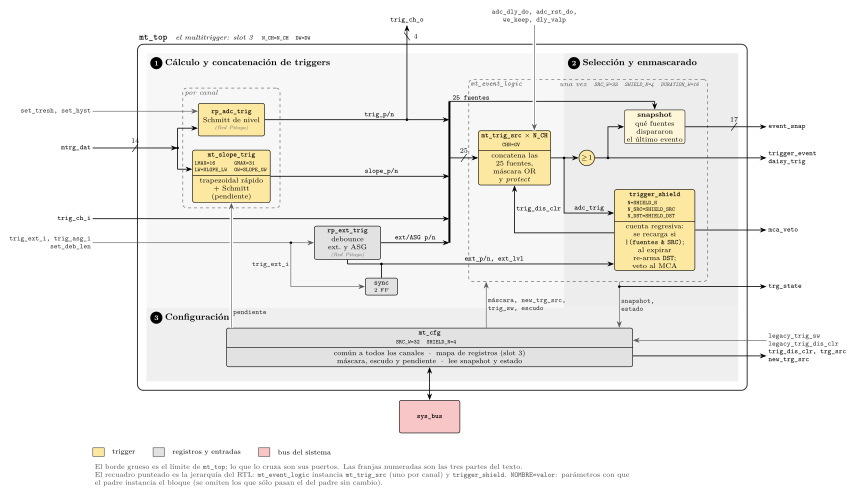
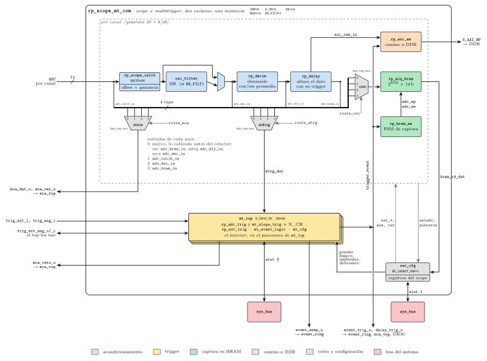

# Mapa de registros — región de MULTITRIGGER

**Base:** `0x4030_0000` (slot 3 del bus de sistema)
**RTL:** [`mt_cfg.sv`](../../modulos/mt/rtl/mt_cfg.sv)
**Top:** [`mt_top.sv`](../../modulos/mt/rtl/mt_top.sv)
**Lógica:** [`mt_event_logic.v`](../../modulos/mt/rtl/mt_event_logic.v) ·
[`mt_trig_src.sv`](../../modulos/mt/rtl/mt_trig_src.sv) ·
[`trigger_shield.sv`](../../modulos/mt/rtl/trigger_shield.sv) ·
[`mt_slope_trig.sv`](../../modulos/mt/rtl/mt_slope_trig.sv)

Antes del refactor estos registros vivían dentro del `casez` de
`mt_rp_scope_cfg` (slot 1), mezclados con los del scope y colgados del
mismo `sys_ack` que las aperturas BRAM — el mismo ack que tenía el bug de
`bram_ack[2]`/`[3]` atado a cero. Al separarlos, el multitrigger deja de
compartir esa ruta.

Contrato del bus: [`../TOP/bus_sistema_redpitaya.md`](../TOP/bus_sistema_redpitaya.md).
Mapa de slots: [`../TOP/register_map_top.md`](../TOP/register_map_top.md).
Coincidencias / anticoincidencias (no implementado, diseño propuesto): [`coincidencias_trabajo_futuro.md`](coincidencias_trabajo_futuro.md).

> En `red_pitaya_top` esta región **no** está en el slot 3 sino en el **7**: ese
> top conserva el ASG y el PID. El registro `SLOTS` (`0x4060_0024`) publica el
> mapa real de cada bitstream.

---

## Panorama

El multitrigger es un módulo, [`mt_top.sv`](../../modulos/mt/rtl/mt_top.sv),
que [`rp_scope_mt_com.sv`](../../modulos/osc/rtl/rp_scope_mt_com.sv) instancia
una vez junto a la cadena del scope. Hay dos figuras: `mt_top` por dentro, con
lo que le entra del scope, y el scope entero con `mt_top` plegado en un bloque.

**`mt_top` por dentro.** El borde grueso de la figura es su límite: todo lo que
va de las muestras y las entradas externas a `trigger_event`. Lo que lo cruza
son sus puertos, dibujados sólo con el nombre para que la figura se lea aislada;
de dónde vienen y adónde van está en la tabla de abajo. Adentro hay tres partes:

1. **Cálculo y concatenación de triggers.** Por canal, los dos disparos que
   salen de la misma muestra: el de nivel (`rp_adc_trig`, del scope original
   de Red Pitaya) y el de pendiente (`mt_slope_trig`, propio). Para todos los
   canales, el externo y el del ASG (`rp_ext_trig`, también de Red Pitaya). Las
   25 fuentes —software, flancos de los cuatro canales, externo, ASG, cadena y
   pendiente— llegan a cada `mt_trig_src`, que las concatena en un vector y
   aplica la máscara OR del canal.
2. **Selección y enmascarado.** El OR de los canales es `trigger_event`, **el
   mismo disparo** para la captura de todos los canales y para afuera. El
   `trigger_shield` cuenta un holdoff desde las fuentes elegidas en
   `SHIELD_SRC`; al expirar re-arma los canales de `SHIELD_DST`, y mientras
   corre vetea al MCA. El *snapshot* guarda qué fuentes dispararon el último
   evento. Todo esto, junto con los `mt_trig_src`, lo instancia
   `mt_event_logic`.
3. **Configuración.** `mt_cfg` es el esclavo del slot 3, común a todos los
   canales.



`rp_adc_trig` y `rp_ext_trig` están dentro de `mt_top` porque son parte del
cálculo de disparos, pero sus archivos no están en `modulos/mt/rtl`: son de
Red Pitaya, y `modulos/mt/extra.f` los trae del repo raíz. El `sync` del nivel
externo es lógica de `mt_top`.

**Puertos de `mt_top`** (conexiones en `rp_scope_mt_com`; los tops de la
Red Pitaya conectan los que salen de él):

| Puerto | Dir. | Ancho | De dónde viene / adónde va |
|---|---|---|---|
| `mtrg_dat_i`, `mtrg_val_i` | entra | 14 y 1 por canal | tap MTRG del `dsp_tap_mux` |
| `set_tresh_i`, `set_hyst_i` | entra | 14 por canal | `osc_cfg` (slot 1): umbral e histéresis del disparo de nivel |
| `set_deb_len_i` | entra | 20 | `osc_cfg`: largo del debounce externo |
| `indep_mode_i` | entra | 4 | `osc_cfg`: sin modo independiente los canales 1-3 siguen al 0 |
| `legacy_trig_sw_i`, `legacy_trig_dis_clr_i` | entra | 4 | `osc_cfg`: offsets `0x004` y `0x094` del slot 1, que usa `librp` |
| `adc_dly_do_i`, `adc_rst_do_i`, `adc_we_keep_i`, `dly_valp_i` | entra | 4 | control de la captura: `rp_bram_sm`, `osc_cfg` y `rp_delay` |
| `trig_ext_i` | entra | 1 | DIO0_P, por el GPIO del `red_pitaya_hk` |
| `trig_asg_i` | entra | 1 | ASG; atado a 0 en este build, que no tiene ASG |
| `trig_ext_asg_o` → `trig_ext_asg_i` | sale y entra | 4 | flancos de `rp_ext_trig`; el top los une para compartirlos entre scopes |
| `trig_ch_i` | entra | 4 | cadena desde los canales 2-3 de otro scope; atado a 0 con dos canales |
| `trig_ch_o` | sale | 4 | flancos de nivel de los canales 0-1 hacia otro scope; sin conectar con dos canales |
| `sys_*` | ambas | — | slot 3, `0x4030_0000` |
| `trigger_event_o` | sale | 1 | `rp_bram_sm` y `rp_axi_sm` de cada canal; sale de `rp_scope_mt_com` como `event_trig_o` (→ `event_ring`) |
| `daisy_trig_o` | sale | 1 | la misma señal; → DIO0 y `trig_i` del `mca_top` |
| `event_snap_o` | sale | 17 | los 17 bits bajos del snapshot (→ `event_ring`); los 25 completos se leen en `SNAPSHOT` |
| `mca_veto_o` | sale | 1 | `veto_i` del `mca_top` |
| `trig_dis_clr_o` | sale | 4 | `rp_bram_sm`: el re-arm también limpia su estado de captura |
| `trg_src_o`, `new_trg_src_o` | sale | 32 y 1 por canal | `rp_delay`: la categoría de la fuente elige el retardo |
| `trg_state_o` | sale | 8 por canal | `osc_cfg` (readback del slot 1); en `mt_cfg` es `0x028` |

**Dentro de `rp_scope_mt_com`.** El mismo `mt_top`, plegado: lo que lo conecta
con el resto es el tap MTRG, la configuración del slot 1, la entrada externa,
el puente legacy y su slot 3; lo que sale es `trigger_event`, el veto y el
snapshot.



Las fuentes son [`figuras/panorama_mt.tex`](figuras/panorama_mt.tex) y
[`figuras/panorama_rp_scope_mt_com.tex`](figuras/panorama_rp_scope_mt_com.tex)
(TikZ): `pdflatex` da el `.pdf` para la tesis y `pdftocairo -svg` el `.svg` de
esta página.

**Por submódulo.** Cada submódulo de `mt_top` tiene su panorama por dentro, con la
misma paleta; está en la §1.1 de su datasheet:

| Submódulo | Panorama | Qué muestra |
|---|---|---|
| [`mt_cfg`](../datasheet/datasheet_mt_cfg.md) | [`panorama_mt_cfg.svg`](figuras/panorama_mt_cfg.svg) | escritura, registros y pulsos, puente legacy, fan-out por `indep_mode`, lectura y ack |
| [`mt_event_logic`](../datasheet/datasheet_mt_event_logic.md) | [`panorama_mt_event_logic.svg`](figuras/panorama_mt_event_logic.svg) | los `mt_trig_src`, el escudo, el OR del evento, el snapshot y la cadena |
| [`mt_trig_src`](../datasheet/datasheet_mt_trig_src.md) | [`panorama_mt_trig_src.svg`](figuras/panorama_mt_trig_src.svg) | las 25 fuentes, la máscara, el *protect* y la realimentación del disparo |
| [`trigger_shield`](../datasheet/datasheet_trigger_shield.md) | [`panorama_trigger_shield.svg`](figuras/panorama_trigger_shield.svg) | el contador de holdoff, el re-arm, el veto y el mux por canal |
| [`mt_slope_trig`](../datasheet/datasheet_mt_slope_trig.md) | [`panorama_mt_slope_trig.svg`](figuras/panorama_mt_slope_trig.svg) | las tres líneas de retardo, el trapezoidal y el Schmitt |

---

## Registros

| Offset | R/W | Campo | Reset | Antes vivía en |
|---|---|---|---|---|
| `0x000` | R | `MAGIC` = `0x4D545247` (`"MTRG"`) | constante | — |
| `0x004` | R | `CAPS` `{HAS_SLOPE[16], SHIELD_N[15:12], SRC_W[11:4], N_CH[3:0]}` | constante | — |
| `0x010` | RW | `SHIELD_CFG` | `0` — escudo apagado | `0x4010_0210` |
| `0x014` | R | `SHIELD_STAT` `{mca_veto[17], active[16], cnt[15:0]}` | `0` | `0x4010_0214` |
| `0x018` | R | `SNAPSHOT` (25 b, sticky; el espejo viejo tiene sólo los 17 bajos) | `0` | `0x4010_0218` |
| `0x01C` | R | `DIS_FLAGS` `{we_keep[7:4], dis_act[3:0]}` | `0` | `0x4010_021C` |
| `0x020` | W | `TRIG_SW` — **bit por canal** | lee `0` | `0x4010_0004` bits `[3:0]` |
| `0x024` | W | `TRIG_DIS_CLR` — bit por canal | lee `0` | `0x4010_0094` |
| `0x028` | R | `TRG_STATE` — máscara activa, 8 b por canal | `0` | `0x4010_0004` |
| `0x040`+4·ch | RW | `OR_MASK` ch0..ch3 | `0` — **no dispara nada**, ni `TRIG_SW` | `0x4010_0240`+4·ch |
| `0x060`+4·ch | RW | `SLOPE_CFG` ch0..ch3 `{en[31], G[12:8], L[4:0]}` | `0` — apagado | — (nuevo) |
| `0x070`+4·ch | RW | `SLOPE_THR` ch0..ch3 `[17:0]` | `0` | — (nuevo) |
| `0x080`+4·ch | RW | `SLOPE_HYST` ch0..ch3 `[17:0]` | `0` | — (nuevo) |

**Reset** es el valor tras cargar el bitstream o un reset de `adc_rstn`
(`mt_cfg.sv`, los bloques `if (!adc_rstn_i)`). El software **no** lo restaura
entre programas: si no se escribe un registro, queda lo que dejó el anterior.
Con todo en reset el multitrigger no hace nada, pero tampoco nada dañino:
`TRIG_SW` también pasa por la máscara (es el bit 0 de `OR_MASK`), así que sin
máscara no hay ni siquiera disparo por software. Ojo con `SLOPE_*`: prender
`en` con `THR = HYST = 0` es la configuración inválida `hyst ≥ thr` (no
re-arma nunca), así que se escriben los umbrales antes que `en`.

### `SHIELD_CFG` (`0x010`)

```
 31            16 15 13 12  11    8 7 6      4 3    0
+---------------+-----+---+-------+-+--------+------+
|     dur       | 000 |mca|  dst  |0|  ext   | src  |
+---------------+-----+---+-------+-+--------+------+
                        ^  canales   lvl n p  canales
```

`src` dispara el holdoff, `dst` es lo que queda inhibido, `dur` la duración en
ciclos de `adc_clk`. Con `dur = 0` el re-arme es inmediato. Los dos campos
crecieron **en sitio** sobre bits que estaban en cero, así que un software que
escribe sólo `src[3:0]`/`dst[11:8]` deja lo nuevo apagado:

| Bit | Campo | Qué es |
|---|---|---|
| `src[3:0]` | `SRC_CH0..3` | disparo de cada canal del scope (como siempre) |
| `src[4]` | `SRC_EXT_P` | entrada externa **DIO0_P**, flanco de subida |
| `src[5]` | `SRC_EXT_N` | flanco de bajada |
| `src[6]` | `SRC_EXT_LVL` | **nivel** de DIO0_P, sincronizado (dos flops en `adc_clk`) |
| `dst[11:8]` | `DST_CH0..3` | canales cuyo `adc_trg_dis` se limpia al expirar (como siempre) |
| `dst[12]` | `DST_MCA` | **veto al MCA**: nivel `mca_veto` hacia `mca_top.veto_i` |

#### El veto al MCA

`mca_veto = DST_MCA & (alguna fuente dispara | holdoff corriendo)`, registrado.
Es un **nivel**, no un pulso de re-arme, y con él el MCA no abre pulsos nuevos,
termina normal el que tenga en curso, y para su reloj de tiempo vivo (el tiempo
va a `vetotime`, `0x0C0` del MCA). Tres usos, del mismo contador:

| Quiero | `src` | `dur` | Resultado |
|---|---|---|---|
| veto de nivel: bloquear mientras DIO0_P esté alta | `SRC_EXT_LVL` | 0 | el veto **es** la línea (latencia ~3 ciclos) |
| ídem con cola | `SRC_EXT_LVL` | K | la línea, más K ciclos después de que baje |
| ventana tras un flanco externo | `SRC_EXT_P` | K | K ciclos desde el flanco |
| bloquear el MCA cuando dispara un canal del scope | `SRC_CH0` | K | K ciclos desde ese disparo |

Con `ext_lvl` la fuente "dispara" cada ciclo que la línea está alta; como cada
disparo recarga el contador, `dur` se comporta como cola. Sin `DST_MCA` el
escudo corre igual (se ve en `active`) pero no veta.

> **Hay un solo shield.** Con `dst = DST_MCA` deja de servir como holdoff
> ch0→ch1 del scope. Si hicieran falta los dos a la vez, es una segunda
> instancia de `trigger_shield`, no más bits.

DIO0_P es la línea `trig_ext` de siempre: entra por el IOBUF que controla
`red_pitaya_hk` (reg `0x10` de dirección, **entrada en reset**). Los flancos
`ext_p/ext_n` son los que ya existían para la máscara OR (bits 9/10); el nivel
se sincroniza aparte en `mt_top` porque `rp_ext_trig` no lo
saca como puerto.

### `OR_MASK` (`0x040` + 4·canal)

Un registro de 32 b por canal, *word-aligned*. La escritura emite el pulso
`new_trg_src` **incluso con `wdata = 0`**, para poder limpiar la máscara
explícitamente. El readback refleja siempre el último write y cubre ch0..ch3
aunque `N_CH < 4`. La máscara activa (8 b bajos) también se lee en `TRG_STATE`.

Bits, definidos en `mt_trig_src.sv`:

| Bit | Símbolo | Bit | Símbolo |
|-----|---------|-----|---------|
| 0 | `BIT_SW`     | 9  | `BIT_EXT_P`    |
| 1 | `BIT_ADC_P0` | 10 | `BIT_EXT_N`    |
| 2 | `BIT_ADC_N0` | 11 | `BIT_ASG_P`    |
| 3 | `BIT_ADC_P1` | 12 | `BIT_ASG_N`    |
| 4 | `BIT_ADC_N1` | 13 | `BIT_TRIG_CH0` |
| 5 | `BIT_ADC_P2` | 14 | `BIT_TRIG_CH1` |
| 6 | `BIT_ADC_N2` | 15 | `BIT_TRIG_CH2` |
| 7 | `BIT_ADC_P3` | 16 | `BIT_TRIG_CH3` |
| 8 | `BIT_ADC_N3` |    |                |

| Bit | Símbolo | Bit | Símbolo |
|-----|---------|-----|---------|
| 17 | `BIT_SLOPE_P0` | 21 | `BIT_SLOPE_N0` |
| 18 | `BIT_SLOPE_P1` | 22 | `BIT_SLOPE_N1` |
| 19 | `BIT_SLOPE_P2` | 23 | `BIT_SLOPE_N2` |
| 20 | `BIT_SLOPE_P3` | 24 | `BIT_SLOPE_N3` |

Los bits 25–31 están reservados. Los 17–24 son el disparo por pendiente y se
configuran con `SLOPE_*` (abajo).

> **El snapshot de `0x018` usa otro orden en sus 17 bits bajos**
> (`p0,p1,p2,p3,n0,n1,…`), no el de esta tabla. Los bits 17–24 coinciden en
> los dos. Es correcto siempre que el empaquetado de
> `trig_snapshot_i` en `mt_trig_src.sv` use ese segundo orden — es una
> trampa conocida, no un error del mapa.

### Disparo por pendiente: `SLOPE_CFG` / `SLOPE_THR` / `SLOPE_HYST`

Un trapezoidal rápido por canal,
`s = Σ_L x[n−i] − Σ_L x[n−L−G−i]`, con un Schmitt simétrico a la salida.
Teoría, elección de umbral, costo y bibliografía en
[`trigger_pendiente.md`](trigger_pendiente.md).

```
SLOPE_CFG (0x060 + 4·ch)
 31  30          13 12    8 7   5 4    0
+---+--------------+-------+-----+------+
|en |      0       |   G   |  0  |  L   |
+---+--------------+-------+-----+------+
```

| Campo | Rango | Nota |
|---|---|---|
| `L` | 1..16 | muestras de cada suma; `0` se toma como 1 y `>16` satura |
| `G` | 0..31 | separación entre sumas |
| `en` | 0/1 | `0` vacía el filtro y no sale ningún pulso |
| `SLOPE_THR` | 0..2¹⁸−1 | umbral sobre `|s|` (`p`: `s ≥ thr`; `n`: `s ≤ −thr`) |
| `SLOPE_HYST` | 0..2¹⁸−1 | re-arma bajo `thr−hyst`; tiene que ser `< thr` |

- **No hay fan-out por `indep_mode`**: son procesamiento de la señal de cada
  canal, como el umbral y la histéresis del disparo de nivel.
- Cambiar `L` o `G`, o pasar por `en=0`, **re-arranca** el filtro. Mientras la
  ventana de `2L+G` muestras no se llena no sale ningún pulso.
- No tienen espejo en el slot 1. Desde Python: `MtRegion.set_slope()`.
- `TRG_STATE` (8 b por canal) no muestra los bits 17–24; usar `OR_MASK` y
  `SNAPSHOT`.

---

## Lo que cambió respecto del mapa viejo

**`TRIG_SW` y `TRIG_DIS_CLR` pasaron a un bit por canal.** Antes eran
byte-por-canal (por eso el driver escribía `0x0101` para ch0+ch1) y el
SW-trigger estaba escondido en los bits `[3:0]` de un registro compartido con el
`trg_state`. El formato viejo **se sigue aceptando** por el puente legacy del
slot 1: `osc_cfg` decodifica `0x004` y `0x094`, y manda el pulso ya decodificado
por canal, que acá se OR-ea con el registro propio. Así `librp` sigue
funcionando.

**`trig_dis_clr` ahora tiene readback.** En el mapa viejo `0x094` era un offset
"reservado" sin lectura.

---

## Una verruga preservada a propósito

`sys_bus_cdc` sostiene `wen` hasta el ack, así que los pulsos de este módulo
—`TRIG_SW`, `TRIG_DIS_CLR`, `new_trg_src`— duran **~5 ciclos, no uno**.

Es el comportamiento que tenía el módulo original y del que depende la lógica
aguas abajo. Convertirlos en estrobos de un ciclo es un cambio deliberado y
aparte: no es algo que deba colarse en una mudanza de registros, donde lo que se
busca es mover código sin cambiar semántica.

(Los registros de configuración —`SHIELD_CFG`, `OR_MASK`— no sufren: la
escritura es idempotente.)

---

## El fan-out por `indep_mode`

Sin modo independiente, **todos los canales siguen al canal 0**. Vale para
`TRIG_SW`, `TRIG_DIS_CLR`, `new_trg_src` y `OR_MASK`. `indep_mode` vive en el
OSC (`0x4010_1014` canónico, `0x4010_0000` bit 5 del byte legacy) y llega acá
por puerto.

No está en el mapa de direcciones —vive entre el banco de registros y las
salidas— y es lo primero que se pierde al mover código de un archivo a otro.
`tb_mt_cfg` lo cubre en las dos ramas.

---

## Testbenches

| Testbench | Qué verifica |
|---|---|
| [`tb_mt_cfg`](../../modulos/mt/sim/tb_mt_cfg.sv) | equivalencia con el mapa viejo registro por registro; puente legacy en las dos vías; fan-out por `indep_mode`; contrato de bus sobre todo el slot |
| [`tb_mt_trig_src`](../../modulos/mt/sim/tb_mt_trig_src.sv) | la OR-mask dispara; latch/clear de `adc_trg_dis`; gating SW por `dly_valp`; fuentes de pendiente (bits 17–24) |
| [`tb_mt_slope_trig`](../../modulos/mt/sim/tb_mt_slope_trig.sv) | el trapezoidal contra un modelo de suma directa; pulsos por escalón; inmunidad a continua y rampas; re-arranque |
| [`tb_trigger_shield`](../../modulos/mt/sim/tb_trigger_shield.sv) | holdoff `src→dst`, `dur=0` vs `dur=K` |
| [`tb_mt_event_logic`](../../modulos/mt/sim/tb_mt_event_logic.sv) | `trigger_event` = OR de canales; latch/reset del snapshot (25 b) |
| [`tb_trig_capture`](../../sim/tb_trig_capture.sv) | el race arm-vs-máscara; ver [`orden_arm_trigger_captura.md`](../osc/orden_arm_trigger_captura.md) |
