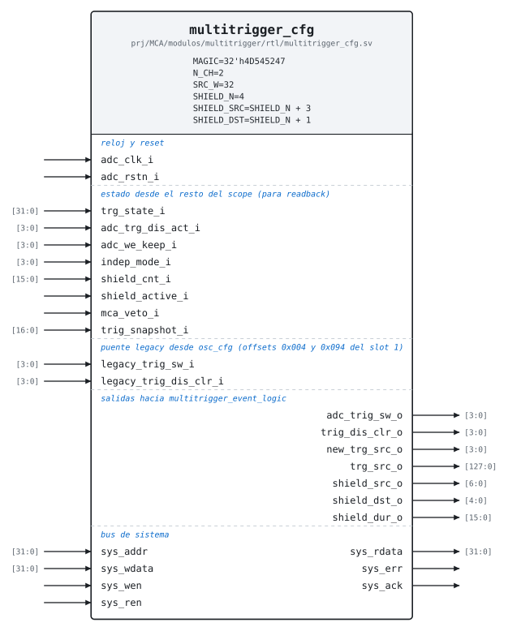

# Datasheet — `multitrigger_cfg`

<!-- Generado por `modulos/mk/datasheet.py`. Lo que está entre las marcas
     AUTO:x y /AUTO:x se REESCRIBE en cada corrida: editar ahí no sirve.
     Todo el resto es prosa a mano y no se toca.
     Regenerar:  make -C modulos/multitrigger/work datasheet              -->

## 1. Función y funcionamiento

### 1.1 Descripción breve

<!-- AUTO:resumen -->
|  |  |
|---|---|
| Módulo RTL | `multitrigger_cfg` |
| Archivo | [`multitrigger_cfg.sv`](../../modulos/multitrigger/rtl/multitrigger_cfg.sv) |
| Parámetros | 6 |
| Puertos | 26 (16 in / 10 out) |




**Cabecera del RTL** (se copia tal cual de [`multitrigger_cfg.sv`](../../modulos/multitrigger/rtl/multitrigger_cfg.sv)):

> multitrigger_cfg — región de MULTITRIGGER: esclavo del bus de sistema
>
> Base 0x4030_0000 (slot 3). Dominio adc_clk; el CDC lo hace el interconnect.
>
> Antes del refactor estos registros vivían dentro del casez de
> multitrigger_rp_scope_cfg (slot 1), mezclados con los del scope y colgados
> del mismo sys_ack que las aperturas BRAM — el mismo ack que tiene el bug
> latente de bram_ack[2]/[3] atado a cero. Al separarlos, el multitrigger deja
> de compartir esa ruta de ack.
>
> EQUIVALENCIA CON EL MAPA VIEJO (todo esto vivía en el slot 1):
>
>   0x210 -> 0x010   SHIELD_CFG
>   0x214 -> 0x014   SHIELD_STAT
>   0x218 -> 0x018   SNAPSHOT
>   0x21C -> 0x01C   DIS_FLAGS
>   0x240 -> 0x040   OR_MASK ch0   (+4 por canal)
>   0x004 -> 0x020   TRIG_SW       (estaba escondido en bits [3:0] del scope)
>   0x094 -> 0x024   TRIG_DIS_CLR  (era un offset "reservado", sin readback)
>
> Los dos últimos los conoce librp, así que además del registro propio se
> aceptan por el puente legacy (legacy_trig_sw_i / legacy_trig_dis_clr_i):
> osc_cfg sigue decodificando 0x004 y 0x094 en el slot 1 y manda acá el pulso
> ya decodificado por canal. Las dos vías se OR-ean.
>
> SEMÁNTICA PRESERVADA TAL CUAL, INCLUIDA UNA VERRUGA. sys_bus_cdc sostiene
> wen hasta el ack, así que los pulsos de abajo (adc_trig_sw, trig_dis_clr,
> new_trg_src) duran ~5 ciclos, no uno. Es el comportamiento que tenía el
> módulo original y del que depende la lógica aguas abajo; convertirlos en
> estrobos de un ciclo es un cambio deliberado y aparte, no algo que deba
> colarse en una mudanza de registros.
<!-- /AUTO:resumen -->

<!-- A mano: qué problema resuelve el bloque, cómo encaja en la cadena y las
     dos o tres decisiones de diseño que explican por qué está hecho así. -->

**Qué hace.** TODO

### 1.2 Interfaces

<!-- AUTO:interfaces -->
#### Parámetros

| Parámetro | Tipo | Default | Para qué |
|---|---|---|---|
| `MAGIC` | `[31:0]` | `32'h4D545247` = `1297371719` | "MTRG" |
| `N_CH` | `integer` | `2` |  |
| `SRC_W` | `integer` | `32` |  |
| `SHIELD_N` | `integer` | `4` |  |
| `SHIELD_SRC` | `integer` | `SHIELD_N + 3` = `7` |  |
| `SHIELD_DST` | `integer` | `SHIELD_N + 1` = `5` |  |


#### Puertos

##### Reloj y reset

| Puerto | Dir | Bits | Dominio |
|---|---|---|---|
| `adc_clk_i` | in | 1 | — |
| `adc_rstn_i` | in | 1 | — |


##### Estado desde el resto del scope (para readback)

| Puerto | Dir | Bits | Dominio | Descripción |
|---|---|---|---|---|
| `trg_state_i` | in | 32 | adc_clk_i | máscara activa, 8 b por canal |
| `adc_trg_dis_act_i` | in | 4 | adc_clk_i |  |
| `adc_we_keep_i` | in | 4 | adc_clk_i |  |
| `indep_mode_i` | in | 4 | adc_clk_i |  |
| `shield_cnt_i` | in | 16 | adc_clk_i |  |
| `shield_active_i` | in | 1 | adc_clk_i |  |
| `mca_veto_i` | in | 1 | adc_clk_i | nivel de veto hacia el MCA |
| `trig_snapshot_i` | in | 17 | adc_clk_i |  |


##### Puente legacy desde osc_cfg (offsets 0x004 y 0x094 del slot 1)

| Puerto | Dir | Bits | Dominio |
|---|---|---|---|
| `legacy_trig_sw_i` | in | 4 | adc_clk_i |
| `legacy_trig_dis_clr_i` | in | 4 | adc_clk_i |


##### Salidas hacia multitrigger_event_logic

| Puerto | Dir | Bits | Dominio |
|---|---|---|---|
| `adc_trig_sw_o` | out | 4 | adc_clk_i |
| `trig_dis_clr_o` | out | 4 | adc_clk_i |
| `new_trg_src_o` | out | 4 | adc_clk_i |
| `trg_src_o` | out | 128 | adc_clk_i |
| `shield_src_o` | out | 7 `[SHIELD_SRC-1:0]` | adc_clk_i |
| `shield_dst_o` | out | 5 `[SHIELD_DST-1:0]` | adc_clk_i |
| `shield_dur_o` | out | 16 | adc_clk_i |


##### Bus de sistema

| Puerto | Dir | Bits | Dominio |
|---|---|---|---|
| `sys_addr` | in | 32 | adc_clk_i |
| `sys_wdata` | in | 32 | adc_clk_i |
| `sys_wen` | in | 1 | adc_clk_i |
| `sys_ren` | in | 1 | adc_clk_i |
| `sys_rdata` | out | 32 | adc_clk_i |
| `sys_err` | out | 1 | adc_clk_i |
| `sys_ack` | out | 1 | adc_clk_i |
<!-- /AUTO:interfaces -->

### 1.3 Mapa de registros

<!-- AUTO:regmap -->
`multitrigger_cfg` es esclavo del bus de sistema (`sys_addr`, `sys_wdata`, `sys_wen`, `sys_ren`, `sys_rdata`, `sys_err`, `sys_ack`). El mapa completo está en:

- [`register_map_multitrigger.md`](register_map_multitrigger.md)
- [`register_map_multitrigger_rp_scope_cfg.md`](register_map_multitrigger_rp_scope_cfg.md)

Contrato del bus: [`../TOP/bus_sistema_redpitaya.md`](../TOP/bus_sistema_redpitaya.md) · Mapa de slots: [`../TOP/register_map_top.md`](../TOP/register_map_top.md)
<!-- /AUTO:regmap -->

### 1.4 Clock domains

<!-- AUTO:clocks -->
| Puerto | Qué es | Polaridad |
|---|---|---|
| `adc_clk_i` | reloj |  |
| `adc_rstn_i` | reset | activo-bajo |


**Un solo dominio.** Todos los puertos de datos y de control son síncronos a `adc_clk_i`: no hay cruce de dominio dentro de este módulo.
<!-- /AUTO:clocks -->

<!-- A mano: si hay más de un reloj, cuál es el cruce, con qué se sincroniza y
     qué se asume de la relación de frecuencias. Si hay uno solo, borrar. -->

### 1.5 Frecuencia máxima de trabajo

<!-- AUTO:timing -->
Sin datos de síntesis todavía. Correr:

```bash
make -C modulos/multitrigger/work syn
make -C modulos/multitrigger/work sweep-all
```

y volver a generar esta página.
<!-- /AUTO:timing -->

<!-- A mano: qué hay en el camino crítico y qué se haría para romperlo si
     hubiera que subir la frecuencia. -->

### 1.6 Waveforms

<!-- A mano. Las ondas salen de los testbenches del módulo:
       make -C modulos/multitrigger/work wave TB=<tb>   # ver en Questa
       make -C modulos/multitrigger/work vcd  TB=<tb>   # VCD exportable
     Para dibujarlas acá, WaveDrom en un bloque ```wavedrom. -->

#### Handshakes

TODO — una onda por protocolo de la interfaz (bus, valid/ack, pulso de
comando) con los ciclos de latencia marcados.

#### Flujo de utilización

TODO — la secuencia completa de uso, de la configuración al dato leído, en el
orden en que la hace el software.

### 1.7 Verificación realizada

<!-- AUTO:verificacion -->
Todo corre en batch y se chequea el `RESULT: PASS` del testbench; las ondas quedan en `work/waves/<tb>.wlf`.

```bash
make -C modulos/multitrigger/work            # los 4 testbenches
make -C modulos/multitrigger/work cov        # + cobertura
make -C modulos/multitrigger/work lint
```

| Testbench | DUT | Es el de este módulo |
|---|---|---|
| [`tb_multitrigger_cfg`](../../modulos/multitrigger/sim/tb_multitrigger_cfg.sv) | `multitrigger_cfg` | sí |
| [`tb_multitrigger_trig_src`](../../modulos/multitrigger/sim/tb_multitrigger_trig_src.sv) | `multitrigger_trig_src` |  |
| [`tb_multitrigger_event_logic`](../../modulos/multitrigger/sim/tb_multitrigger_event_logic.sv) | `multitrigger_event_logic` |  |
| [`tb_trigger_shield`](../../modulos/multitrigger/sim/tb_trigger_shield.sv) | `trigger_shield` |  |


**Assertions** — en `sim/sva/`, enganchadas por `bind` (no tocan el RTL sintetizable).

- [`bind_multitrigger.sv`](../../modulos/multitrigger/sim/sva/bind_multitrigger.sv)
- [`multitrigger_cfg_sva.sv`](../../modulos/multitrigger/sim/sva/multitrigger_cfg_sva.sv)

Plan de verificación, casos cubiertos y deuda: [`multitrigger/sim/VERIFICACION.md`](../../modulos/multitrigger/sim/VERIFICACION.md).
<!-- /AUTO:verificacion -->

#### Esquema de laboratorio

TODO — qué instrumento, cómo se conecta, qué se mide y contra qué se compara.
