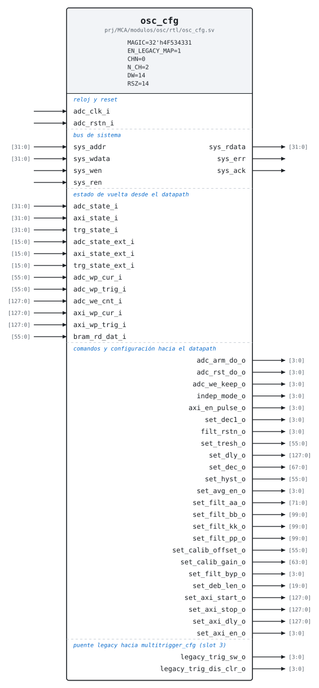

# Datasheet — `osc_cfg`

<!-- Generado por `modulos/mk/datasheet.py`. Lo que está entre las marcas
     AUTO:x y /AUTO:x se REESCRIBE en cada corrida: editar ahí no sirve.
     Todo el resto es prosa a mano y no se toca.
     Regenerar:  make -C modulos/osc/work datasheet              -->

## 1. Función y funcionamiento

### 1.1 Descripción breve

<!-- AUTO:resumen -->
|  |  |
|---|---|
| Módulo RTL | `osc_cfg` |
| Archivo | [`osc_cfg.sv`](../../modulos/osc/rtl/osc_cfg.sv) |
| Parámetros | 6 |
| Puertos | 47 (18 in / 29 out) |
| Parte | `xc7z010clg400-1` |




**Cabecera del RTL** (se copia tal cual de [`osc_cfg.sv`](../../modulos/osc/rtl/osc_cfg.sv)):

> osc_cfg — región de OSC: esclavo del bus de sistema (slot 1, 0x4010_0000)
>
> Sale de multitrigger_rp_scope_cfg, quitándole los registros del multitrigger
> (que se mudaron al slot 3, ver multitrigger_cfg.sv) y reorganizando el mapa.
>
> LOS DOS MAPAS
>
> Este esclavo decodifica DOS rangos de direcciones sobre EL MISMO banco de
> registros físicos. No hay estado duplicado: un solo flop por registro, dos
> decodificadores para alcanzarlo. Escribir por un mapa y leer por el otro
> devuelve el mismo valor, así que no se pueden desincronizar.
>
>   0x00000 - 0x00FFF   mapa LEGACY   offsets históricos de Red Pitaya
>   0x01000 - 0x01FFF   mapa CANÓNICO stride uniforme por canal
>   0x10000 - 0x4FFFF   aperturas BRAM (comunes a los dos mapas)
>
> POR QUÉ EXISTE EL MAPA LEGACY. librp es una librería C cerrada que lee y
> escribe offsets fijos en 0x4010_0000; hay 111 llamadas a la API rp repartidas
> en 14 archivos del software del proyecto (run_acquire, e2e_espectro,
> mca/sources, los benches). Mover los registros sin dejar los offsets viejos
> rompería todo eso de golpe y sin posibilidad de parche del lado Python.
> Con la ventana, la migración del software es incremental.
>
> CÓMO SE SACA. El parámetro EN_LEGACY_MAP la compila fuera. Cuando el software
> esté migrado se pone en 0 y las ramas legacy desaparecen en síntesis; es el
> único lugar donde hay que tocar.
>
> LO QUE EL MAPA LEGACY *NO* CUBRE. Los registros del multitrigger que se
> fueron al slot 3 (0x210, 0x214, 0x218, 0x21C, 0x240-0x24C): librp no los
> conoce, son propios del proyecto, así que no hay compatibilidad que
> preservar — sólo hay que reapuntar multitrigger_utils.py.
>
> Excepción: dos offsets legacy SÍ pertenecen a lógica que se mudó, y librp los
> usa. Se siguen decodificando acá y se mandan al slot 3 ya decodificados por
> canal, por los puertos legacy_trig_sw_o / legacy_trig_dis_clr_o:
>
>   0x004  SW-trigger      (bits [3:0] == 1 del byte del canal)
>   0x094  trig_dis_clr
>
> OJO, DIVERGENCIA PREEXISTENTE. En 0x004 este diseño ya no es el Red Pitaya de
> fábrica: el RTL sólo honra el valor 1 (SW). Un rp_AcqSetTriggerSrc con una
> fuente de flanco escribe 2, 3, ... y se ignora, porque esas fuentes pasaron a
> la OR-mask del multitrigger. La ventana legacy preserva EL COMPORTAMIENTO
> ACTUAL, no el original de Red Pitaya.
>
> ACK DE LATENCIA FIJA — Y EL BUG QUE ESTO ARREGLA
>
> El módulo original sacaba el ack de las aperturas BRAM de bram_ack_i[i], y
> rp_scope_multitrigger_com ata bram_ack[2]/[3] = 0 para los canales no
> construidos: cualquier lectura en 0x4013_0000-0x4014_FFFF no hacía ack NUNCA
> y dejaba el CDC del slot desincronizado (docs/TOP/bus_sistema_redpitaya.md §7.1).
>
> Acá el ack sale de un shift register incondicional, a los 4 ciclos y para
> cualquier dirección. Para los canales que sí existen el timing es IDÉNTICO:
> rp_acq_bram genera bram_ack_o = sys_en retrasado 4 ciclos
> (adc_rval <= {adc_rval[2:0], bram_ack_i}), que es exactamente en_sr[3].
> O sea que se arregla el cuelgue sin cambiar en nada las lecturas buenas.
<!-- /AUTO:resumen -->

<!-- A mano: qué problema resuelve el bloque, cómo encaja en la cadena y las
     dos o tres decisiones de diseño que explican por qué está hecho así. -->

**Qué hace.** TODO

### 1.2 Interfaces

<!-- AUTO:interfaces -->
#### Parámetros

| Parámetro | Tipo | Default | Para qué |
|---|---|---|---|
| `MAGIC` | `[31:0]` | `32'h4F534331` = `1330856753` | "OSC1" |
| `EN_LEGACY_MAP` | `integer` | `1` | 0 = compila fuera el mapa viejo |
| `CHN` | `integer` | `0` |  |
| `N_CH` | `integer` | `2` |  |
| `DW` | `integer` | `14` |  |
| `RSZ` | `integer` | `14` |  |


#### Puertos

##### Reloj y reset

| Puerto | Dir | Bits | Dominio |
|---|---|---|---|
| `adc_clk_i` | in | 1 | — |
| `adc_rstn_i` | in | 1 | — |


##### Bus de sistema

| Puerto | Dir | Bits | Dominio |
|---|---|---|---|
| `sys_addr` | in | 32 | adc_clk_i |
| `sys_wdata` | in | 32 | adc_clk_i |
| `sys_wen` | in | 1 | adc_clk_i |
| `sys_ren` | in | 1 | adc_clk_i |
| `sys_rdata` | out | 32 | adc_clk_i |
| `sys_err` | out | 1 | adc_clk_i |
| `sys_ack` | out | 1 | adc_clk_i |


##### Estado de vuelta desde el datapath

| Puerto | Dir | Bits | Dominio |
|---|---|---|---|
| `adc_state_i` | in | 32 | adc_clk_i |
| `axi_state_i` | in | 32 | adc_clk_i |
| `trg_state_i` | in | 32 | adc_clk_i |
| `adc_state_ext_i` | in | 16 | adc_clk_i |
| `axi_state_ext_i` | in | 16 | adc_clk_i |
| `trg_state_ext_i` | in | 16 | adc_clk_i |
| `adc_wp_cur_i` | in | 56 `[4*RSZ-1: 0]` | adc_clk_i |
| `adc_wp_trig_i` | in | 56 `[4*RSZ-1: 0]` | adc_clk_i |
| `adc_we_cnt_i` | in | 128 | adc_clk_i |
| `axi_wp_cur_i` | in | 128 | adc_clk_i |
| `axi_wp_trig_i` | in | 128 | adc_clk_i |
| `bram_rd_dat_i` | in | 56 `[4*DW -1: 0]` | adc_clk_i |


##### Comandos y configuración hacia el datapath

| Puerto | Dir | Bits | Dominio |
|---|---|---|---|
| `adc_arm_do_o` | out | 4 | adc_clk_i |
| `adc_rst_do_o` | out | 4 | adc_clk_i |
| `adc_we_keep_o` | out | 4 | adc_clk_i |
| `indep_mode_o` | out | 4 | adc_clk_i |
| `axi_en_pulse_o` | out | 4 | adc_clk_i |
| `set_dec1_o` | out | 4 | adc_clk_i |
| `filt_rstn_o` | out | 4 | adc_clk_i |
| `set_tresh_o` | out | 56 `[4*DW -1: 0]` | adc_clk_i |
| `set_dly_o` | out | 128 | adc_clk_i |
| `set_dec_o` | out | 68 | adc_clk_i |
| `set_hyst_o` | out | 56 `[4*DW -1: 0]` | adc_clk_i |
| `set_avg_en_o` | out | 4 | adc_clk_i |
| `set_filt_aa_o` | out | 72 | adc_clk_i |
| `set_filt_bb_o` | out | 100 | adc_clk_i |
| `set_filt_kk_o` | out | 100 | adc_clk_i |
| `set_filt_pp_o` | out | 100 | adc_clk_i |
| `set_calib_offset_o` | out | 56 `[4*DW -1: 0]` | adc_clk_i |
| `set_calib_gain_o` | out | 64 | adc_clk_i |
| `set_filt_byp_o` | out | 4 | adc_clk_i |
| `set_deb_len_o` | out | 20 | adc_clk_i |
| `set_axi_start_o` | out | 128 | adc_clk_i |
| `set_axi_stop_o` | out | 128 | adc_clk_i |
| `set_axi_dly_o` | out | 128 | adc_clk_i |
| `set_axi_en_o` | out | 4 | adc_clk_i |


##### Puente legacy hacia multitrigger_cfg (slot 3)

Pulsos ya decodificados por canal desde los offsets 0x004 y 0x094.

| Puerto | Dir | Bits | Dominio |
|---|---|---|---|
| `legacy_trig_sw_o` | out | 4 | adc_clk_i |
| `legacy_trig_dis_clr_o` | out | 4 | adc_clk_i |
<!-- /AUTO:interfaces -->

### 1.3 Mapa de registros

<!-- AUTO:regmap -->
`osc_cfg` es esclavo del bus de sistema (`sys_addr`, `sys_wdata`, `sys_wen`, `sys_ren`, `sys_rdata`, `sys_err`, `sys_ack`). El mapa completo está en:

- [`register_map_osc.md`](register_map_osc.md)

Contrato del bus: [`../TOP/bus_sistema_redpitaya.md`](../TOP/bus_sistema_redpitaya.md) · Mapa de slots: [`../TOP/register_map_top.md`](../TOP/register_map_top.md)
<!-- /AUTO:regmap -->

### 1.4 Clock domains

<!-- AUTO:clocks -->
| Puerto | Qué es | Polaridad |
|---|---|---|
| `adc_clk_i` | reloj |  |
| `adc_rstn_i` | reset | activo-bajo |


**Un solo dominio.** Todos los puertos de datos y de control son síncronos a `adc_clk_i`: no hay cruce de dominio dentro de este módulo.
<!-- /AUTO:clocks -->

<!-- A mano: si hay más de un reloj, cuál es el cruce, con qué se sincroniza y
     qué se asume de la relación de frecuencias. Si hay uno solo, borrar. -->

### 1.5 Frecuencia máxima de trabajo

<!-- AUTO:timing -->
**Punto de síntesis** — Vivado out-of-context, `xc7z010clg400-1`.

| Métrica | Valor |
|---|---|
| Período de la restricción | 8.00 ns (125.0 MHz) |
| WNS | 1.844 ns |
| Camino crítico | 6.156 ns |
| **Fmax** | **162.4 MHz** |
| Niveles de lógica | 3 |


**Camino crítico**

|  |  |
|---|---|
| startpoint | `set_dec_reg[1]/C` |
| endpoint | `set_dec1_o[1]` |


**Recursos**

| LUT | FF | BRAM | DSP | CARRY | MUXF |
|---|---|---|---|---|---|
| 1992 | 1279 | 0 | 0 | 0 | 1 |


`lut` cuenta **primitivas** LUT, no los _Slice LUTs_ del `report_utilization` (dos LUT5 que comparten O5/O6 ocupan un solo sitio).

_Barrido no corrido_: `make -C modulos/osc/work sweep-all` y regenerar.
<!-- /AUTO:timing -->

<!-- A mano: qué hay en el camino crítico y qué se haría para romperlo si
     hubiera que subir la frecuencia. -->

### 1.6 Waveforms

<!-- A mano. Las ondas salen de los testbenches del módulo:
       make -C modulos/osc/work wave TB=<tb>   # ver en Questa
       make -C modulos/osc/work vcd  TB=<tb>   # VCD exportable
     Para dibujarlas acá, WaveDrom en un bloque ```wavedrom. -->

#### Handshakes

TODO — una onda por protocolo de la interfaz (bus, valid/ack, pulso de
comando) con los ciclos de latencia marcados.

#### Flujo de utilización

TODO — la secuencia completa de uso, de la configuración al dato leído, en el
orden en que la hace el software.

### 1.7 Verificación realizada

<!-- AUTO:verificacion -->
Todo corre en batch y se chequea el `RESULT: PASS` del testbench; las ondas quedan en `work/waves/<tb>.wlf`.

```bash
make -C modulos/osc/work            # los 1 testbenches
make -C modulos/osc/work cov        # + cobertura
make -C modulos/osc/work lint
```

| Testbench | DUT | Es el de este módulo |
|---|---|---|
| [`tb_osc_filter`](../../modulos/osc/sim/tb_osc_filter.sv) | `osc_filter` |  |


**Assertions** — en `sim/sva/`, enganchadas por `bind` (no tocan el RTL sintetizable).

- [`bind_osc.sv`](../../modulos/osc/sim/sva/bind_osc.sv)
- [`osc_cfg_sva.sv`](../../modulos/osc/sim/sva/osc_cfg_sva.sv)

Plan de verificación, casos cubiertos y deuda: [`osc/sim/VERIFICACION.md`](../../modulos/osc/sim/VERIFICACION.md).
<!-- /AUTO:verificacion -->

#### Esquema de laboratorio

TODO — qué instrumento, cómo se conecta, qué se mide y contra qué se compara.
