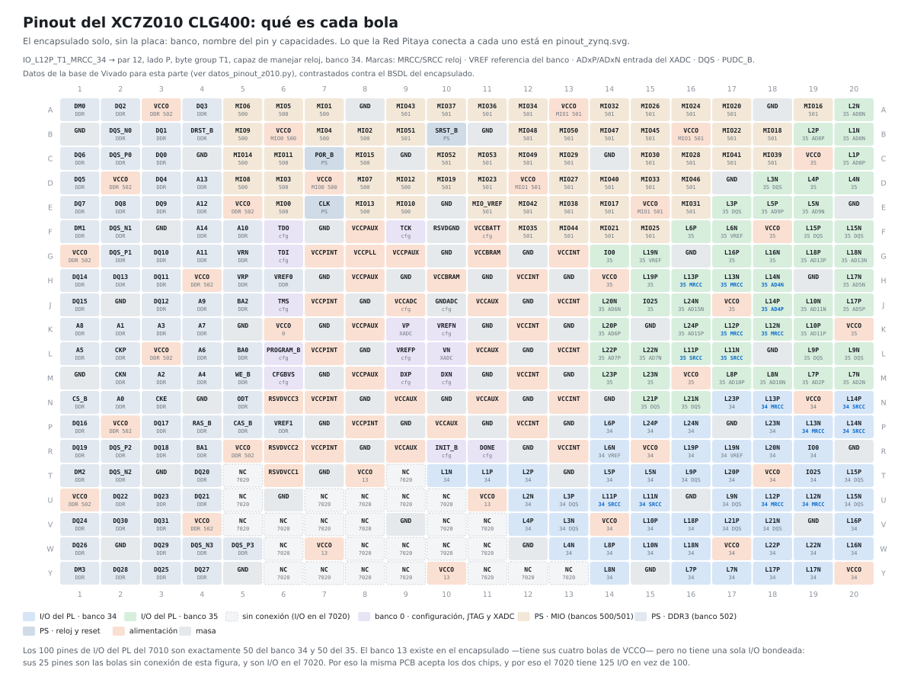
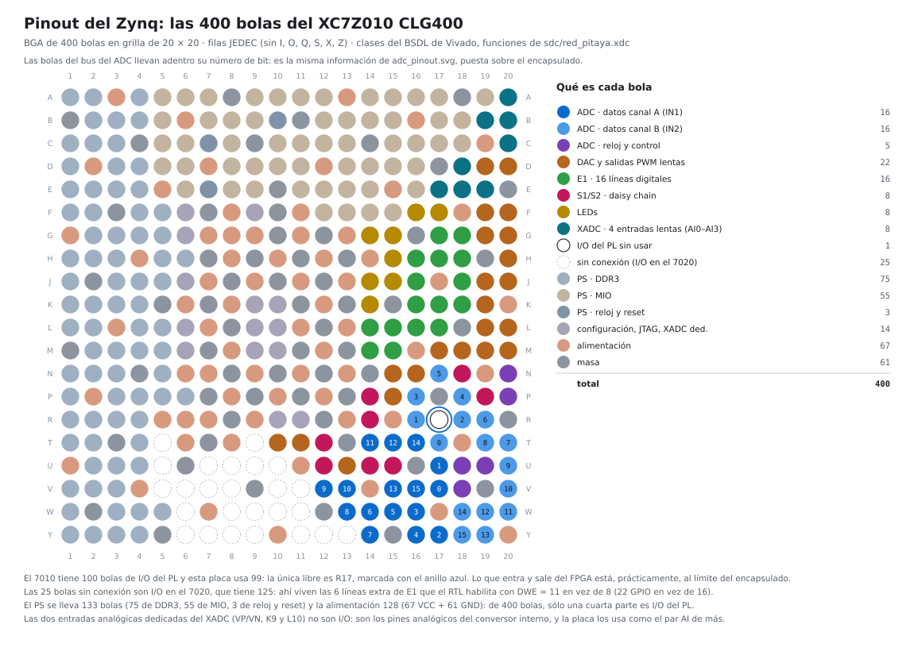

# El pinout del Zynq: qué ofrece el encapsulado y qué usa la Red Pitaya

Las 400 bolas del **XC7Z010 CLG400**, primero como las da el chip —banco,
nombre de pin, pares diferenciales, pines de reloj— y después cruzadas con el
XDC de la placa, pin por pin. Es el documento al que ir cuando la pregunta es
"¿puedo sacar una señal más?", "¿a qué tensión está este pin?" o "¿por qué el
reloj entra por acá?".

Los números no salen de ninguna hoja de datos transcripta a mano. Las 400 bolas
salen de **la propia base de datos de Vivado** para esta parte, y están
contrastadas contra el **BSDL del encapsulado**, que es una fuente
independiente; las funciones salen de **leer los XDC del repo**. Todo lo genera
un script, y si una tabla de acá no coincide con lo que imprime el script, manda
el script.

| Documento | Qué contiene |
|---|---|
| [`platform.md`](platform.md) | la placa entera: qué hay, qué usa el MCA y qué cambiaría en otro modelo |
| [`adc_ltc2145.md`](adc_ltc2145.md) | el ADC y los límites que fija; su §1 tiene el mapa de las 16 líneas por canal |
| [`TOP/bus_sistema_redpitaya.md`](TOP/bus_sistema_redpitaya.md) | lo que pasa del otro lado de los pines: el bus de registros |

---

## 1. El encapsulado, sin la placa

Qué ofrece el chip. Cada celda es una bola, con su nombre de pin y su banco.



### Cómo se lee el nombre de un pin

La convención de Xilinx empaqueta cinco cosas en el nombre:

```
IO_L12P_T1_MRCC_34
   │   │  │  │    └─ banco al que pertenece
   │   │  │  └────── marca especial, si la tiene
   │   │  └───────── byte group dentro del banco (T0..T3)
   │   └──────────── lado P o N del par diferencial
   └──────────────── número de par dentro del banco
```

Las marcas que aparecen en este encapsulado:

| Marca | Qué significa | Por qué importa acá |
|---|---|---|
| **MRCC** | *multi-region clock capable*: el pin puede entrar directo a un MMCM/PLL y manejar reloj en varias regiones | es por donde tiene que entrar un reloj externo |
| **SRCC** | *single-region clock capable*: lo mismo, pero limitado a una región | ídem, con menos alcance |
| **VREF** | la bola puede hacer de referencia de tensión del banco | sólo hace falta con estándares que la necesiten (SSTL, HSTL de un solo extremo); si no, se usa como I/O común |
| **ADxP / ADxN** | el pin tiene camino analógico al **XADC** interno | son los que habilitan las entradas auxiliares lentas |
| **DQS** | pin pensado para el *strobe* de una interfaz de memoria | sin uso acá |
| **PUDC_B** | controla si los I/O tienen pull-up durante la configuración | sin uso acá |
| `IO_0_34`, `IO_25_34` | pines **de un solo extremo**: no tienen par | no pueden llevar una señal diferencial |

### Lo que dice el reparto de las 400 bolas

| Clase | Bolas | |
|---|---|---|
| I/O del PL | **100** | exactamente **50 del banco 34 y 50 del 35** |
| Sin conexión | 25 | son I/O en el 7020, que tiene 125 |
| DDR3 del PS (banco 502) | 75 | |
| MIO del PS (bancos 500/501) | 55 | |
| Reloj y reset del PS | 3 | `PS_CLK`, `PS_POR_B`, `PS_SRST_B` |
| Banco 0: configuración, JTAG y XADC dedicado | 14 | `DONE`, `INIT_B`, `PROGRAM_B`, `CFGBVS`, `TCK/TDI/TDO/TMS`, `VP/VN`, `VREFP/VREFN`, `DXP/DXN` |
| Alimentación | 67 | |
| Masa | 61 | |

Tres lecturas:

- **De 400 bolas, sólo una cuarta parte es I/O del PL.** El PS se lleva 133 y la
  alimentación 128. Un BGA de 400 pines no es un FPGA de 400 pines.
- **El banco 13 existe en el encapsulado pero está vacío en el 7010.** Tiene sus
  cuatro bolas de `VCCO_13` —la placa se las alimenta— y ni una sola I/O
  bondeada: sus 25 pines son justamente las bolas sin conexión. En el 7020 esas
  25 son I/O, y de ahí salen los 100 → 125 y las 6 líneas extra de E1 que el RTL
  habilita con `DWE = 11` en vez de 8. **Es la razón física de que la misma PCB
  acepte los dos chips.**
- **Hay 16 bolas capaces de manejar reloj** (8 pares MRCC/SRCC) y la placa las
  gastó bien: ver §3.

---

## 2. Lo que usa la placa

La misma grilla, pintada por función en vez de por clase:



Y el detalle. Las dos tablas salen de cruzar el pinout con los dos XDC que entran
al build del MCA ([`sdc/red_pitaya.xdc`](../../../sdc/red_pitaya.xdc) y
[`prj/MCA/sdc/red_pitaya.xdc`](../sdc/red_pitaya.xdc)), y las imprime
`python3 figuras/figuras_pinout_pines.py --tabla`.

### Resumen por función

| Puerto | Dirección | Bolas | Banco | IOSTANDARD | Qué es |
|---|---|---|---|---|---|
| `adc_dat_i[0]` | entrada | 16 | 34 | `LVCMOS18` | ADC · datos del canal A (IN1) |
| `adc_dat_i[1]` | entrada | 16 | 34 | `LVCMOS18` | ADC · datos del canal B (IN2) |
| `adc_clk_i` | entrada | 2 | 34 | `DIFF_HSTL_I_18` | ADC · reloj de muestreo |
| `adc_clk_o` | salida | 2 | 34 | `LVCMOS18` | ADC · salida de reloj opcional |
| `adc_cdcs_o` | salida | 1 | 34 | `LVCMOS18` | ADC · clock duty cycle stabilizer |
| `dac_dat_o` | salida | 14 | 35 | `LVCMOS33` | DAC · bus de datos entrelazado |
| `dac_wrt_o` | salida | 1 | 35 | `LVCMOS33` | DAC · estrobo de escritura |
| `dac_sel_o` | salida | 1 | 35 | `LVCMOS33` | DAC · selección de canal |
| `dac_clk_o` | salida | 1 | 35 | `LVCMOS33` | DAC · reloj |
| `dac_rst_o` | salida | 1 | 35 | `LVCMOS33` | DAC · reset |
| `dac_pwm_o` | salida | 4 | 34 | `LVCMOS18` | AO0–AO3 · salidas analógicas lentas |
| `exp_p_io` | bidireccional | 8 | 35 | `LVCMOS33` | E1 · lado P de las 8 líneas digitales |
| `exp_n_io` | bidireccional | 8 | 35 | `LVCMOS33` | E1 · lado N de las 8 líneas digitales |
| `daisy_p_o` | salida | 2 | 34 | `DIFF_HSTL_I_18` | S1/S2 · salida diferencial |
| `daisy_n_o` | salida | 2 | 34 | `DIFF_HSTL_I_18` | S1/S2 · salida diferencial |
| `daisy_p_i` | entrada | 2 | 34 | `DIFF_HSTL_I_18` | S1/S2 · entrada diferencial |
| `daisy_n_i` | entrada | 2 | 34 | `DIFF_HSTL_I_18` | S1/S2 · entrada diferencial |
| `led_o` | salida | 8 | 35 | `LVCMOS33` | LEDs |
| `vinp_i` | entrada | 5 | 0 y 35 | `LVCMOS33` | XADC · entradas analógicas lentas, lado P |
| `vinn_i` | entrada | 5 | 0 y 35 | `LVCMOS33` | XADC · entradas analógicas lentas, lado N |

**99 bolas de I/O del PL** de las 100 que tiene el 7010, más el par dedicado VP/VN del XADC, que no es I/O.

> Quedan afuera 6 asignaciones del XDC del proyecto que caen en bolas **sin bondear en el 7010** (`exp_n_io[10]` → `Y6`, `exp_n_io[8]` → `Y8`, `exp_n_io[9]` → `Y13`, `exp_p_io[10]` → `Y7`, `exp_p_io[8]` → `Y9`, `exp_p_io[9]` → `Y12`): son las líneas extra de E1 del 7020, y en el build Z10 el puerto ni siquiera existe, así que la restricción no aplica a nada.

### Detalle bola por bola

| Bola | Puerto | Banco | Función del pin | IOSTANDARD | Notas |
|---|---|---|---|---|---|
| `V16` | `adc_dat_i[0][15]` | 34 | `IO_L18P_T2_34` | `LVCMOS18` | par con `W16` |
| `T16` | `adc_dat_i[0][14]` | 34 | `IO_L9P_T1_DQS_34` | `LVCMOS18` | par con `U17` |
| `V15` | `adc_dat_i[0][13]` | 34 | `IO_L10P_T1_34` | `LVCMOS18` | par con `W15` |
| `T15` | `adc_dat_i[0][12]` | 34 | `IO_L5N_T0_34` | `LVCMOS18` | par con `T14` |
| `T14` | `adc_dat_i[0][11]` | 34 | `IO_L5P_T0_34` | `LVCMOS18` | par con `T15` |
| `V13` | `adc_dat_i[0][10]` | 34 | `IO_L3N_T0_DQS_34` | `LVCMOS18` | par con `U13` |
| `V12` | `adc_dat_i[0][9]` | 34 | `IO_L4P_T0_34` | `LVCMOS18` | par con `W13` |
| `W13` | `adc_dat_i[0][8]` | 34 | `IO_L4N_T0_34` | `LVCMOS18` | par con `V12` |
| `Y14` | `adc_dat_i[0][7]` | 34 | `IO_L8N_T1_34` | `LVCMOS18` | par con `W14` |
| `W14` | `adc_dat_i[0][6]` | 34 | `IO_L8P_T1_34` | `LVCMOS18` | par con `Y14` |
| `W15` | `adc_dat_i[0][5]` | 34 | `IO_L10N_T1_34` | `LVCMOS18` | par con `V15` |
| `Y16` | `adc_dat_i[0][4]` | 34 | `IO_L7P_T1_34` | `LVCMOS18` | par con `Y17` |
| `W16` | `adc_dat_i[0][3]` | 34 | `IO_L18N_T2_34` | `LVCMOS18` | par con `V16` |
| `Y17` | `adc_dat_i[0][2]` | 34 | `IO_L7N_T1_34` | `LVCMOS18` | par con `Y16` |
| `U17` | `adc_dat_i[0][1]` | 34 | `IO_L9N_T1_DQS_34` | `LVCMOS18` | par con `T16` |
| `V17` | `adc_dat_i[0][0]` | 34 | `IO_L21P_T3_DQS_34` | `LVCMOS18` | par con `V18` |
| `Y18` | `adc_dat_i[1][15]` | 34 | `IO_L17P_T2_34` | `LVCMOS18` | par con `Y19` |
| `W18` | `adc_dat_i[1][14]` | 34 | `IO_L22P_T3_34` | `LVCMOS18` | par con `W19` |
| `Y19` | `adc_dat_i[1][13]` | 34 | `IO_L17N_T2_34` | `LVCMOS18` | par con `Y18` |
| `W19` | `adc_dat_i[1][12]` | 34 | `IO_L22N_T3_34` | `LVCMOS18` | par con `W18` |
| `W20` | `adc_dat_i[1][11]` | 34 | `IO_L16N_T2_34` | `LVCMOS18` | par con `V20` |
| `V20` | `adc_dat_i[1][10]` | 34 | `IO_L16P_T2_34` | `LVCMOS18` | par con `W20` |
| `U20` | `adc_dat_i[1][9]` | 34 | `IO_L15N_T2_DQS_34` | `LVCMOS18` | par con `T20` |
| `T19` | `adc_dat_i[1][8]` | 34 | `IO_25_34` | `LVCMOS18` |  |
| `T20` | `adc_dat_i[1][7]` | 34 | `IO_L15P_T2_DQS_34` | `LVCMOS18` | par con `U20` |
| `R19` | `adc_dat_i[1][6]` | 34 | `IO_0_34` | `LVCMOS18` |  |
| `N17` | `adc_dat_i[1][5]` | 34 | `IO_L23P_T3_34` | `LVCMOS18` | par con `P18` |
| `P18` | `adc_dat_i[1][4]` | 34 | `IO_L23N_T3_34` | `LVCMOS18` | par con `N17` |
| `P16` | `adc_dat_i[1][3]` | 34 | `IO_L24N_T3_34` | `LVCMOS18` | par con `P15` |
| `R18` | `adc_dat_i[1][2]` | 34 | `IO_L20N_T3_34` | `LVCMOS18` | par con `T17` |
| `R16` | `adc_dat_i[1][1]` | 34 | `IO_L19P_T3_34` | `LVCMOS18` | par con `R17` |
| `T17` | `adc_dat_i[1][0]` | 34 | `IO_L20P_T3_34` | `LVCMOS18` | par con `R18` |
| `U18` | `adc_clk_i[1]` | 34 | `IO_L12P_T1_MRCC_34` | `DIFF_HSTL_I_18` | **capaz de manejar reloj**, par con `U19` |
| `U19` | `adc_clk_i[0]` | 34 | `IO_L12N_T1_MRCC_34` | `DIFF_HSTL_I_18` | **capaz de manejar reloj**, par con `U18` |
| `P20` | `adc_clk_o[1]` | 34 | `IO_L14N_T2_SRCC_34` | `LVCMOS18` | **capaz de manejar reloj**, par con `N20` |
| `N20` | `adc_clk_o[0]` | 34 | `IO_L14P_T2_SRCC_34` | `LVCMOS18` | **capaz de manejar reloj**, par con `P20` |
| `V18` | `adc_cdcs_o` | 34 | `IO_L21N_T3_DQS_34` | `LVCMOS18` | par con `V17` |
| `D19` | `dac_dat_o[13]` | 35 | `IO_L4P_T0_35` | `LVCMOS33` | par con `D20` |
| `D20` | `dac_dat_o[12]` | 35 | `IO_L4N_T0_35` | `LVCMOS33` | par con `D19` |
| `F20` | `dac_dat_o[11]` | 35 | `IO_L15N_T2_DQS_AD12N_35` | `LVCMOS33` | par con `F19` |
| `F19` | `dac_dat_o[10]` | 35 | `IO_L15P_T2_DQS_AD12P_35` | `LVCMOS33` | par con `F20` |
| `G20` | `dac_dat_o[9]` | 35 | `IO_L18N_T2_AD13N_35` | `LVCMOS33` | par con `G19` |
| `G19` | `dac_dat_o[8]` | 35 | `IO_L18P_T2_AD13P_35` | `LVCMOS33` | par con `G20` |
| `H20` | `dac_dat_o[7]` | 35 | `IO_L17N_T2_AD5N_35` | `LVCMOS33` | par con `J20` |
| `J20` | `dac_dat_o[6]` | 35 | `IO_L17P_T2_AD5P_35` | `LVCMOS33` | par con `H20` |
| `J19` | `dac_dat_o[5]` | 35 | `IO_L10N_T1_AD11N_35` | `LVCMOS33` | par con `K19` |
| `K19` | `dac_dat_o[4]` | 35 | `IO_L10P_T1_AD11P_35` | `LVCMOS33` | par con `J19` |
| `L20` | `dac_dat_o[3]` | 35 | `IO_L9N_T1_DQS_AD3N_35` | `LVCMOS33` | par con `L19` |
| `L19` | `dac_dat_o[2]` | 35 | `IO_L9P_T1_DQS_AD3P_35` | `LVCMOS33` | par con `L20` |
| `M20` | `dac_dat_o[1]` | 35 | `IO_L7N_T1_AD2N_35` | `LVCMOS33` | par con `M19` |
| `M19` | `dac_dat_o[0]` | 35 | `IO_L7P_T1_AD2P_35` | `LVCMOS33` | par con `M20` |
| `M17` | `dac_wrt_o` | 35 | `IO_L8P_T1_AD10P_35` | `LVCMOS33` | par con `M18` |
| `N16` | `dac_sel_o` | 35 | `IO_L21N_T3_DQS_AD14N_35` | `LVCMOS33` | par con `N15` |
| `M18` | `dac_clk_o` | 35 | `IO_L8N_T1_AD10N_35` | `LVCMOS33` | par con `M17` |
| `N15` | `dac_rst_o` | 35 | `IO_L21P_T3_DQS_AD14P_35` | `LVCMOS33` | par con `N16` |
| `U13` | `dac_pwm_o[3]` | 34 | `IO_L3P_T0_DQS_PUDC_B_34` | `LVCMOS18` | par con `V13` |
| `P15` | `dac_pwm_o[2]` | 34 | `IO_L24P_T3_34` | `LVCMOS18` | par con `P16` |
| `T11` | `dac_pwm_o[1]` | 34 | `IO_L1P_T0_34` | `LVCMOS18` | par con `T10` |
| `T10` | `dac_pwm_o[0]` | 34 | `IO_L1N_T0_34` | `LVCMOS18` | par con `T11` |
| `M14` | `exp_p_io[7]` | 35 | `IO_L23P_T3_35` | `LVCMOS33` | par con `M15` |
| `K16` | `exp_p_io[6]` | 35 | `IO_L24P_T3_AD15P_35` | `LVCMOS33` | par con `J16` |
| `L16` | `exp_p_io[5]` | 35 | `IO_L11P_T1_SRCC_35` | `LVCMOS33` | **capaz de manejar reloj**, par con `L17` |
| `L14` | `exp_p_io[4]` | 35 | `IO_L22P_T3_AD7P_35` | `LVCMOS33` | par con `L15` |
| `K17` | `exp_p_io[3]` | 35 | `IO_L12P_T1_MRCC_35` | `LVCMOS33` | **capaz de manejar reloj**, par con `K18` |
| `J18` | `exp_p_io[2]` | 35 | `IO_L14P_T2_AD4P_SRCC_35` | `LVCMOS33` | **capaz de manejar reloj**, par con `H18` |
| `H16` | `exp_p_io[1]` | 35 | `IO_L13P_T2_MRCC_35` | `LVCMOS33` | **capaz de manejar reloj**, par con `H17` |
| `G17` | `exp_p_io[0]` | 35 | `IO_L16P_T2_35` | `LVCMOS33` | par con `G18` |
| `M15` | `exp_n_io[7]` | 35 | `IO_L23N_T3_35` | `LVCMOS33` | par con `M14` |
| `J16` | `exp_n_io[6]` | 35 | `IO_L24N_T3_AD15N_35` | `LVCMOS33` | par con `K16` |
| `L17` | `exp_n_io[5]` | 35 | `IO_L11N_T1_SRCC_35` | `LVCMOS33` | **capaz de manejar reloj**, par con `L16` |
| `L15` | `exp_n_io[4]` | 35 | `IO_L22N_T3_AD7N_35` | `LVCMOS33` | par con `L14` |
| `K18` | `exp_n_io[3]` | 35 | `IO_L12N_T1_MRCC_35` | `LVCMOS33` | **capaz de manejar reloj**, par con `K17` |
| `H18` | `exp_n_io[2]` | 35 | `IO_L14N_T2_AD4N_SRCC_35` | `LVCMOS33` | **capaz de manejar reloj**, par con `J18` |
| `H17` | `exp_n_io[1]` | 35 | `IO_L13N_T2_MRCC_35` | `LVCMOS33` | **capaz de manejar reloj**, par con `H16` |
| `G18` | `exp_n_io[0]` | 35 | `IO_L16N_T2_35` | `LVCMOS33` | par con `G17` |
| `U14` | `daisy_p_o[1]` | 34 | `IO_L11P_T1_SRCC_34` | `DIFF_HSTL_I_18` | **capaz de manejar reloj**, par con `U15` |
| `T12` | `daisy_p_o[0]` | 34 | `IO_L2P_T0_34` | `DIFF_HSTL_I_18` | par con `U12` |
| `U15` | `daisy_n_o[1]` | 34 | `IO_L11N_T1_SRCC_34` | `DIFF_HSTL_I_18` | **capaz de manejar reloj**, par con `U14` |
| `U12` | `daisy_n_o[0]` | 34 | `IO_L2N_T0_34` | `DIFF_HSTL_I_18` | par con `T12` |
| `N18` | `daisy_p_i[1]` | 34 | `IO_L13P_T2_MRCC_34` | `DIFF_HSTL_I_18` | **capaz de manejar reloj**, par con `P19` |
| `P14` | `daisy_p_i[0]` | 34 | `IO_L6P_T0_34` | `DIFF_HSTL_I_18` | par con `R14` |
| `P19` | `daisy_n_i[1]` | 34 | `IO_L13N_T2_MRCC_34` | `DIFF_HSTL_I_18` | **capaz de manejar reloj**, par con `N18` |
| `R14` | `daisy_n_i[0]` | 34 | `IO_L6N_T0_VREF_34` | `DIFF_HSTL_I_18` | bola VREF del banco, par con `P14` |
| `J14` | `led_o[7]` | 35 | `IO_L20N_T3_AD6N_35` | `LVCMOS33` | par con `K14` |
| `J15` | `led_o[6]` | 35 | `IO_25_35` | `LVCMOS33` |  |
| `G14` | `led_o[5]` | 35 | `IO_0_35` | `LVCMOS33` |  |
| `K14` | `led_o[4]` | 35 | `IO_L20P_T3_AD6P_35` | `LVCMOS33` | par con `J14` |
| `H15` | `led_o[3]` | 35 | `IO_L19P_T3_35` | `LVCMOS33` | par con `G15` |
| `G15` | `led_o[2]` | 35 | `IO_L19N_T3_VREF_35` | `LVCMOS33` | bola VREF del banco, par con `H15` |
| `F17` | `led_o[1]` | 35 | `IO_L6N_T0_VREF_35` | `LVCMOS33` | bola VREF del banco, par con `F16` |
| `F16` | `led_o[0]` | 35 | `IO_L6P_T0_35` | `LVCMOS33` | par con `F17` |
| `K9` | `vinp_i[4]` | 0 | `VP_0` | `LVCMOS33` | par con `L10` |
| `E18` | `vinp_i[3]` | 35 | `IO_L5P_T0_AD9P_35` | `LVCMOS33` | par con `E19` |
| `E17` | `vinp_i[2]` | 35 | `IO_L3P_T0_DQS_AD1P_35` | `LVCMOS33` | par con `D18` |
| `C20` | `vinp_i[1]` | 35 | `IO_L1P_T0_AD0P_35` | `LVCMOS33` | par con `B20` |
| `B19` | `vinp_i[0]` | 35 | `IO_L2P_T0_AD8P_35` | `LVCMOS33` | par con `A20` |
| `L10` | `vinn_i[4]` | 0 | `VN_0` | `LVCMOS33` | par con `K9` |
| `E19` | `vinn_i[3]` | 35 | `IO_L5N_T0_AD9N_35` | `LVCMOS33` | par con `E18` |
| `D18` | `vinn_i[2]` | 35 | `IO_L3N_T0_DQS_AD1N_35` | `LVCMOS33` | par con `E17` |
| `B20` | `vinn_i[1]` | 35 | `IO_L1N_T0_AD0N_35` | `LVCMOS33` | par con `C20` |
| `A20` | `vinn_i[0]` | 35 | `IO_L2N_T0_AD8N_35` | `LVCMOS33` | par con `B19` |

---

## 3. Lo que se aprende del cruce

### 3.1 El banco 34 está a 1.8 V y el 35 a 3.3 V

No está escrito en ningún lado del repo, pero sale solo de la tabla: **todos**
los pines del banco 34 usan `LVCMOS18` o `DIFF_HSTL_I_18`, y **todos** los del
banco 35 usan `LVCMOS33`. Como un banco tiene un solo `VCCO`, eso fija las dos
tensiones:

| Banco | VCCO | Qué vive ahí |
|---|---|---|
| **34** | **1.8 V** | todo lo rápido y de a bordo: el bus del ADC, su reloj, el CDCS, el daisy chain y las salidas PWM |
| **35** | **3.3 V** | todo lo que sale al mundo: el DAC, las 16 líneas de E1, los LEDs y las entradas lentas del XADC |

La consecuencia operativa: **el nivel lógico de un pin nuevo no se elige, lo
decide el banco donde cae**. Una señal de 3.3 V no puede ir a un pin libre del
banco 34, y viceversa.

### 3.2 La única I/O libre es R17 — y es de 1.8 V

De las 100 bolas de I/O del PL, el diseño usa 99. La que queda es **R17**
(`IO_L19N_T3_VREF_34`), en el banco 34, o sea **1.8 V**.

Que sea una bola `VREF` no es la razón de que esté libre: las otras tres bolas
VREF del encapsulado (`R14`, `F17`, `G15`) están usadas como I/O común —
`daisy_n_i[0]` y dos LEDs—. Simplemente sobró ésa.

Lo importante es lo otro: **no hay margen**. Cualquier señal nueva que haya que
sacar o meter al FPGA —un veto más, un PPS, un trigger de salida— tiene que
entrar por R17 a 1.8 V, o sacarle el pin a algo que ya está. Es una restricción
dura de la placa que conviene saber **antes** de diseñar la mejora, no después.

### 3.3 Los relojes están bien puestos

Las 16 bolas capaces de manejar reloj del encapsulado están repartidas en 8
pares, y **la placa los usa a los 8**. Cuatro van donde de verdad hacía falta:

| Par | Tipo | Qué lleva |
|---|---|---|
| `U18` / `U19` | **MRCC** | **el reloj de muestreo del ADC**, del que cuelga la PLL de todo el datapath. Era el que había que usar |
| `N18` / `P19` | **MRCC** | `daisy_p/n_i[1]`: la entrada de reloj desde otra placa, la que tiene su propio `create_clock` de 4 ns en el XDC |
| `N20` / `P20` | SRCC | `adc_clk_o`, la salida de reloj hacia el ADC — cableada pero sin uso en la 125-14 |
| `U14` / `U15` | SRCC | `daisy_p/n_o[1]`, el lado de salida del daisy |

Y los otros cuatro pares son el dato aprovechable: **4 de los 8 pares de E1 caen
en pines capaces de manejar reloj** (`DIO1`, `DIO2`, `DIO3` y `DIO5`, los dos
lados). O sea que **se puede meter un reloj externo al FPGA por el conector de
expansión**, a 3.3 V, sin tocar la placa.

Ojo con la ilusión: eso **no** sirve para muestrear el ADC, porque al ADC lo
maneja el oscilador de la placa directo y ese camino no pasa por el FPGA
([`adc_ltc2145.md`](adc_ltc2145.md) §1). Sirve para lo otro: disciplinar
contadores y timestamps contra una referencia externa, que es la mitad del
problema de [`mca/limites_resolucion_y_deriva.md`](mca/limites_resolucion_y_deriva.md).

### 3.4 Dos líneas del ADC caen en pines de un solo extremo

`adc_dat_i[1][8]` (`T19`, `IO_25_34`) y `adc_dat_i[1][6]` (`R19`, `IO_0_34`) son
los dos únicos pines del bus que **no tienen par diferencial**. Para un bus
LVCMOS no cambia nada —son líneas de un solo extremo igual— pero descarta de
entrada cualquier idea de reusar el bus del ADC para un estándar diferencial sin
rehacer el ruteo.

### 3.5 El XDC del proyecto restringe 6 pines que no existen

[`prj/MCA/sdc/red_pitaya.xdc`](../sdc/red_pitaya.xdc) asigna `exp_p/n_io[8..10]`
a las bolas `Y6`–`Y13`, que en el 7010 **no están bondeadas**. En el build `Z10`
el top tiene `DWE = 8`, así que esos puertos ni siquiera existen y la
restricción no se aplica a nada: es herencia de la variante de 7020. No hace
daño —el `vivado.log` del build vigente no tiene ningún *warning* por esto— pero
conviene saber que está, para no tocarlo creyendo que arregla algo ni asignarle
esas bolas a otra cosa.

---

## 4. Cómo regenerar todo esto

```bash
cd prj/MCA/docs/figuras
python3 figuras_pinout_pines.py          # → pinout_pines.svg (el encapsulado solo)
python3 figuras_pinout_pines.py --tabla  # → las tablas de §2
python3 figuras_pinout_zynq.py           # → pinout_zynq.svg (con los usos)
```

Los datos del encapsulado están en
[`figuras/datos_pinout_z010.py`](figuras/datos_pinout_z010.py), que es un volcado
de la base de datos de Vivado:

```tcl
create_project -in_memory -part xc7z010clg400-1
link_design -part xc7z010clg400-1
foreach p [get_package_pins] {
  # NAME BANK PIN_FUNC IS_GENERAL_PURPOSE IS_CLK_CAPABLE IS_VREF IS_MASTER DIFF_PAIR_PIN
}
```

Para contrastarlo contra una fuente independiente —el BSDL del mismo
encapsulado, que viene con Vivado— hay una verificación incorporada:

```bash
python3 figuras_pinout_zynq.py --bsdl \
  /tools/Xilinx/Vivado/2021.2/data/parts/xilinx/zynq/public/bsdl/xc7z010_clg400.bsd
# verificado: las 400 bolas coinciden
```
