# Figuras de mérito del MCA y del OSC con generación interna — 2026-11-12 a 2026-11-17

Las campañas de este documento son de **generación interna**
([`etapas_de_validacion.md`](etapas_de_validacion.md)): `gen_pulsos` genera los pulsos
dentro de la FPGA, en el lugar del ASG, y el MCA se mide contra lo generado. Se sabe
exacto cuántos pulsos hubo, en qué instante y de qué altura. Es lo que el DG4162 no
deja medir ([`resultados_validacion_hw.md` §20.3](resultados_validacion_hw.md#203-lo-que-el-dg4162-no-deja-medir-y-qué-etapa-lo-cubre)).
En el throughput del osciloscopio (§3.3) el estímulo es otro, el generador de eventos
del `event_ring`, también dentro de la FPGA.

Primero va la medición (§1): cómo conectamos la placa y el canal analógico, que sirven
para los dos módulos. Después va un capítulo por módulo, el MCA (§2) y el osciloscopio
(§3). Cada sección cuenta qué hicimos y qué medimos, en qué figura están los
resultados y qué se ve en ella. Debajo de cada figura va su epígrafe, copiado en
cursiva de `figuras/meritos/<figura>.txt`.

# 1. La medición

## 1.1 Cómo se midió

Corrimos cada prueba en dos modos, con las conexiones de la Fig.
`conexion_IN_OUT_Pitaya`. En el lazo digital (`digital_loop[0] = 1`, en gris en la
figura), la salida del generador entra al MCA sin pasar por el DAC ni por el ADC. Así
medimos la cadena digital sola: lo que se aparta del ideal es del diseño (disparo,
ranuras, publicador), no del ruido ni del front-end.

En el canal analógico apagamos el lazo y conectamos OUT1 a IN1 con el coaxial de la
Fig. `conexion_IN_OUT_Pitaya`, de 10 cm, con IN1 en LV. En IN1 agregamos una T con un
terminador de 50 Ω (§1.2). Este modo suma el DAC, los dos front-ends y el ADC.

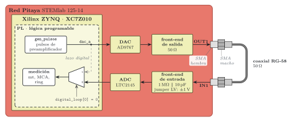

*Generación interna con las interfaces externas. Dentro de la FPGA, `gen_pulsos` escribe los pulsos en `dac_a`, la entrada del DAC que dejó libre el ASG. El DAC (AD9767) y el front-end de salida los llevan a OUT1. Un coaxial RG-58 con SMA macho en las dos puntas los devuelve por IN1, a través de una T con un terminador de 50 Ω que carga la línea, y pasan por el front-end de entrada (jumper en LV, ±1 V) y el ADC (LTC2145) antes de llegar a la cadena de medición. Con `digital_loop[0] = 0` el mux toma el ADC. Con 1 toma `dac_a` directo: es el lazo digital (en gris), la generación interna sin la parte analógica.*

Las amplitudes no las expresamos en tensión sino en **ADU** (*analog-to-digital units*),
el escalón del código de 14 bits: en el lazo digital, el del DAC, que es lo que escribe
`gen_pulsos`; en el canal analógico, el del ADC. Con el jumper en LV (±1 V), 1 ADU son
unos 122 µV nominales. Las posiciones en el histograma (centroides y corrimientos) van
en **canales**.

En las figuras, el lazo digital va con línea llena y marcas llenas, y el canal analógico
a trazos y con marcas huecas.

Las campañas corrieron con el bitstream del MCA cce7b66b, salvo las del osciloscopio, que
usan los del ring: la fidelidad, c1875919, y el throughput, 78e26188 en las etapas A y B
y c1875919 en C y D; el techo de la BRAM, c1875919 (2026-11-19). Las corren
[`run_meritos_pulsos.py`](../software/campanas/run_meritos_pulsos.py),
[`run_fidelidad_osc.py`](../software/campanas/run_fidelidad_osc.py),
[`run_etapas_ring.py`](../software/campanas/run_etapas_ring.py),
[`run_techo_bram.py`](../software/campanas/run_techo_bram.py) y
[`canal_analogico.py`](../software/campanas/canal_analogico.py), y las figuras salen de
[`figuras_meritos.py`](figuras/meritos/figuras_meritos.py). Los datos quedaron en
`software/datos/`, que no se versiona: `meritos_2026-11-14_digital`, `_analogico` y
`_analogico_seguidor`, `fidelidad_2026-11-14_digital` y `_analogico`, y
`meritos2_2026-11-16_digital` (con `_sim`, la misma campaña en la placa simulada) y
`_analogico`, `deriva_2026-11-16_analogico`, `meritos_2026-11-16_analogico_dinamica`,
`dnl_2026-11-17_digital` y `_analogico`, y `ciega_2026-11-17_digital` y `_analogico`; los
del ring, en `placa_etapas_20261112`, `etapas_red_2026-11-17b` y `c`, y
`etapas_sd_largo_2026-11-17`, y los de la BRAM, en `techo_bram_2026-11-19`. La fecha
dentro de los JSON está mal, porque el reloj de la placa está atrasado.

Las campañas también corren sobre la placa simulada, que es `gen_pulsos_model` más
`replica_mca2`. En el lazo digital da lo mismo que la placa en tasa, par, walk y ruido,
y en las seis etapas del 2026-11-16.
En el canal analógico, con el canal medido (`--canal-medido`), reproduce el corrimiento
de la línea con la tasa (§2.5). Los scripts tienen sus tests sin placa en
`campanas/tests/`, con errores inyectados para la fidelidad: pasan los 209, contando los
de la réplica, y uno se saltea si falta `h5py`.

## 1.2 El canal analógico

Para caracterizar el canal analógico, capturamos en la BRAM el mismo estímulo dos veces:
una con el lazo digital, que da lo que sacó el generador, y otra por la salida y la
entrada analógicas, que da lo que llegó al ADC. El generador es determinista y el ASG es
digital, así que las dos capturas coinciden muestra a muestra. Con ese par ajustamos el
canal como un FIR de 48 taps más tres polos lentos, de 400, 1600 y 6400 muestras.

Medimos dos conexiones. La primera es OUT2 → IN2 con un coaxial y la entrada sin carga.
La segunda es la de la Fig. `conexion_IN_OUT_Pitaya`, OUT1 → IN1, con una T y un
terminador de 50 Ω en IN1: es el canal de las campañas.

Los resultados se presentan en la Fig. `canal_analogico`: la respuesta a un escalón en
(a) y la transferencia |H(f)| en (b).

Sin carga, el coaxial queda abierto en la entrada (1 MΩ ∥ 10 pF). La salida tiene unos
4 Ω, lejos de los 50 Ω del cable, así que cada flanco se refleja en las dos puntas. En
(a), el escalón llega a IN2 al doble y alterna entre 2 y 0 cada 2τ ≈ 40 ns, donde τ es
lo que tarda en recorrer el cable. En (b), el cable resuena a un cuarto de onda: ×14 en
f₁ = 12.3 MHz y ×7 en el tercer armónico, 34.7 MHz.

Con la posición del pico estimamos el largo del cable como ℓ = v / (4 f₁), donde v es la
velocidad en el coaxial. Con un RG-58 como el de la Fig. `conexion_IN_OUT_Pitaya`
(v = 0.66 c) da 4.0 m. El tercer armónico da 4.3 m, y la duración de los escalones,
4.0 m: el cable de OUT2 → IN2 mide unos 4 m. Con un RG-316 (v = 0.695 c) serían 4.2 m.

Con 50 Ω, la transferencia queda plana hasta unos 25 MHz y cae 3 dB en 52 MHz. Medimos:

- ganancia 0.95 y offset de IN1 de −49 ADU;
- latencia de 15 muestras (119 ns) y subida de 11 ns;
- piso de 4.7 ADU rms y diafonía a IN2 de −57 dB.

Dos rasgos de este canal explican casi todo lo que el modo analógico agrega en las otras
mediciones:

- **El sobrepico, del 24 %.** Con él, el ADC satura desde unas 6990 ADU de amplitud
  (§2.9), y el polo-cero vuelve a disparar desde unas 3200 (§2.6 y §2.8).
- **Una caída lenta, del 7 % en 3 a 13 µs.** Hace que la base se corra con la tasa
  (§2.2 a §2.5).

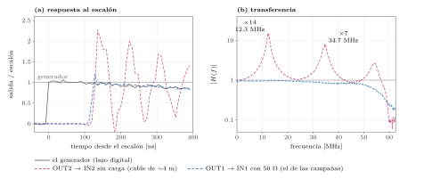

*El canal analógico medido con la BRAM: el mismo estímulo capturado con el lazo digital (el generador) y sin él. (a) Respuesta a un eiscalón de 1727 ADU, normalizada; (b) transferencia |H(f)| por espectros cruzados (Welch).  -Sin carga, el coaxial queda abierto en la entrada y resuena a un cuarto de onda: con OUT2 → IN2, ×14 en 12.3 MHz y ×7 en el tercer armónico (34.7 MHz), y el escalón llega al doble y alterna entre 2 y 0 cada 2τ ≈ 40 ns. De ahí sale el largo de ese cable, unos 4 m. Con 50 Ω en IN1 (una T con terminador) la respuesta queda plana hasta ~25 MHz (−3 dB en 52 MHz), con ganancia 0.95, latencia de 15 muestras y 24 % de sobrepico: es el canal de las campañas analógicas.*

La T tiene que estar bien ajustada. Con una conexión floja, la ganancia cambió entre
corridas con el mismo estímulo: 0.89, 0.70 y 0.73. Por eso, antes de cada campaña
analógica comparamos IN1 en dos corridas iguales. Con la T bien puesta, la diferencia es
la del ruido.

# 2. El MCA

## 2.1 Las pruebas realizadas

Estas pruebas se corrieron en la placa el 2026-11-14. Las seis de la forma a la ventana
ciega, la deriva y la tasa con la base dinámica se corrieron el 2026-11-16, y la DNL y la
ventana ciega se repitieron el 2026-11-17.

| Prueba                       | Estímulo                                                                            | Resultado principal                                                                                                                                                                                                                         | Figura                                                                                                    |
| ---------------------------- | ----------------------------------------------------------------------------------- | ------------------------------------------------------------------------------------------------------------------------------------------------------------------------------------------------------------------------------------------- | --------------------------------------------------------------------------------------------------------- |
| Canal analógico              | el mismo estímulo con el lazo y sin él, capturado en la BRAM                        | con 50 Ω: ganancia 0.95, sobrepico 24 %, −3 dB en 52 MHz, piso 4.7 ADU rms; sin carga, el coaxial de OUT2 → IN2 resuena a un cuarto de onda (×14 en 12.3 MHz): mide unos 4 m                                                                | [`canal_analogico`](#12-el-canal-analógico)                                                               |
| Tasa                         | Poisson de 10 k a 3 M/s, líneas de 500 y 1300 ADU                                   | 3 ranuras y 3 M/s: 1.9 M/s aceptados y 1.2 M/s en su línea; en analógico, la tasa en la línea llega a un máximo de 0.43 a 0.53 M/s                                                                                                          | [`meritos_tasa`, `meritos_tasa_fuentes`](#22-tasa)                                                        |
| Pérdidas por causa           | el de Tasa                                                                          | 1 ranura: domina la falta de ranura (63 % a 3 M/s); 3 ranuras: domina el apilamiento aceptado fuera de la línea (24 %)                                                                                                                      | [`meritos_perdidas`](#23-pérdidas-por-causa)                                                              |
| Error de λ̂                  | el de Tasa                                                                          | a 3 M/s, con 1 y 3 ranuras: ASG −2.4 y −1.7 %; polo-cero −7.7 y −3.7 %; pendiente −29 y −18 %                                                                                                                                               | [`meritos_lambda`](#24-error-de-la-tasa-estimada)                                                         |
| Corrimiento con la tasa      | el de Tasa                                                                          | digital < 1.5 canales; analógico ~9 canales a 400 k/s, aditivo; la réplica con el canal medido lo reproduce con los polos lentos y no sin ellos                                                                                             | [`meritos_corrimiento`, `meritos_corrimiento_canal`](#25-corrimiento-de-las-líneas-y-el-seguidor-de-base) |
| Tasa con seguidor de base    | el de Tasa                                                                          | en analógico, a 400 k/s la línea se corre 6.4 canales (8.7 con base fija) y los pulsos que terminan en su línea pasan del 66 al 75 %; desde 1.5 M/s no cambia nada                                                                          | sin figura ([§2.5](#25-corrimiento-de-las-líneas-y-el-seguidor-de-base))                                  |
| Tasa con base dinámica       | el de Tasa, en analógico                                                            | la base fija corrida con la tasa: a 3 M/s, 299 k/s en su línea con 1 ranura y 772 con 3 (137 y 366 con base fija); con κ = 1 corrige de más: la línea de 1300 ADU sube 11 canales                                                           | [`meritos_base_dinamica`](#la-base-dinámica)                                                              |
| Par                          | pares de 4000 y 2400 ADU a Δt de 2 a 512 ciclos                                     | polo-cero separa desde Δt = 5 y pendiente desde 20; con 3 ranuras, los dos en su línea desde 16 y 20; con 1, desde 192                                                                                                                      | [`meritos_par`](#26-resolución-de-pulsos-dobles)                                                          |
| Histéresis                   | tren periódico de 100/s a 800 k/s, 16 tasas, 5 s cada una                           | sin histéresis (≤ 0.2 canales); con el Rigol daba 10.9 canales                                                                                                                                                                              | [`meritos_histeresis`](#27-histéresis)                                                                    |
| Walk y umbral                | pulsos aislados de 20 a 8000 ADU                                                    | A50: polo-cero 48, pendiente 81 ADU; walk: 1 y 6 ciclos                                                                                                                                                                                     | [`meritos_walk`](#28-umbral-y-walk-del-disparo)                                                           |
| INL del trapecio             | el de Walk y umbral                                                                 | digital < 0.002 % FS; analógico ±0.008 % FS hasta 3200 ADU y +0.66 % en 8000                                                                                                                                                                | [`meritos_inl`](#29-linealidad-integral-del-trapecio)                                                     |
| Resolución contra el ruido   | línea de 1500 ADU, `ruido_sh` de 8 a 0                                              | ganancia de ruido 0.18, 0.24 y 0.48 (k = 64, 32, 8); piso σ₀ de 1.3 a 2.3 ADU en analógico                                                                                                                                                  | [`meritos_ruido`](#210-resolución-contra-el-ruido)                                                        |
| Forma                        | una sola forma, k de 8 a 512; línea de 1500 ADU, Poisson de 30 k a 1 M/s            | ε = e^(−ρ) en todas las tasas; FWHM/ε² mínima con k = 128, 64, 32 y 16 a 30 k, 100 k, 300 k y 1 M/s (ρ de 0.09 a 0.40); en analógico la FWHM crece con k y con la tasa, y el óptimo baja a k = 64 a 8 (ρ de 0.04 a 0.22)                    | [`meritos_forma`](#211-forma-óptima-del-trapecio-contra-la-tasa)                                          |
| Cortes contra el apilamiento | líneas de 500 y 1300 ADU, Poisson de 100 k a 1 M/s, polo-cero y pendiente           | sólo `t_subida` limpia el fondo: a 1 M/s con polo-cero, de 2.5 a 0.012 % (ε de 79 a 45 %); solape y Δt al anterior sólo bajan ε; en analógico el fondo (4.7 % a 100 k/s) es de pulsos que el canal saca de su línea, y ningún corte lo saca | [`meritos_apilamiento`](#212-cortes-contra-el-apilamiento)                                                |
| DNL                          | alturas uniformes de 500 a 5615 ADU (pasos de 5), 12.5 M pulsos                     | el MCA no agrega DNL: trapecio 1.76 % y pico 2.03 % contra 1.80 y 2.02 % de Poisson; en analógico, el pico (densidad de códigos) da 3.4 % contra 2.2 %, y un código de cada dos es 3 % más ancho                                            | [`meritos_dnl`](#213-no-linealidad-diferencial)                                                           |
| PSD                          | pulsos de τ = 200 y 250 muestras, de 50 a 4000 ADU                                  | FOM proporcional a la amplitud; separadas (FOM = 1.27) desde unos 95 ADU; en analógico, desde unos 170 ADU                                                                                                                                  | [`meritos_psd`](#214-separación-de-formas-por-psd)                                                        |
| Polo-cero                    | pares de 4000 y 2400 ADU con Δt de 100 a 400, ΔM de −10 a +10 %                     | el error de A2 se anula en ΔM = +0.03 a +0.06 %; la pendiente baja como e^(−Δt/τ); en analógico hay que sobrecompensar cada vez más con Δt (−2, −4 y −8 %), y la réplica con el canal medido lo reproduce                                   | [`meritos_polo_cero`](#215-ajuste-del-polo-cero)                                                          |
| Ventana ciega                | pares de 4000 y 2400 ADU con Δt de 2 a 512, subida 0 y 2                            | `t_subida` ve el apilado desde Δt = 2 con subida 0 y desde 5 con subida 2; hasta Δt = 96 rechaza también pares que el banco separa, y el ancho inverso rechaza A2 hasta 512                                                                 | [`meritos_ventana_ciega`](#216-ventana-ciega-de-los-cortes-por-forma)                                     |
| Deriva                       | líneas de 1500 y 4000 ADU alternadas, un punto por minuto durante 2 h, en analógico | ganancia: recorre 210 ppm, −40 ppm/h y −144 ppm/°C (r = −0.65, en 1 °C); de minuto a minuto las líneas saltan 15 veces el error estadístico                                                                                                 | [`meritos_deriva`](#217-deriva)                                                                           |

Probamos tres fuentes de disparo. El ASG dispara con cada pulso generado sin mirar la
señal, y sirve de referencia; las otras dos son el polo-cero y la pendiente. El resto de
la configuración, la misma en todas las pruebas salvo que se diga otra cosa, está en
[Configuración por defecto](#configuración-por-defecto).

En el canal analógico, como base fija del MCA usamos el offset medido de IN1, y con el
disparo del ASG corrimos las ventanas del banco dentro de la compuerta lo que tarda el
canal.

Un evento es **aceptado** si el MCA lo publica en el histograma (contador `accepted`).
Con el discriminador prendido, `accepted` cuenta también los que el discriminador
rechaza después, porque el RTL lo cuenta en el publicador: al histograma llegan
`accepted − rej_discr`.
Un evento aceptado está **en su línea** si su amplitud (`F_TRAP`) cae a ±2 % del
centroide de su línea de referencia, medida antes con pulsos aislados en el mismo modo:
el criterio no cambia entre digital y analógico. La tasa de esos eventos es la **tasa en
la línea**, la que llega al pico del espectro.

En las figuras del MCA, el color distingue la fuente de disparo: azul el ASG, naranja el
polo-cero y verde la pendiente. Donde la variable es el número de ranuras, el color es
una rampa de un solo tono.

### Configuración por defecto

Una parte de la configuración está fija en la síntesis del bitstream del MCA (cce7b66b,
[`mca_red_pitaya_top.sv`](../rtl/mine/tops/mca_red_pitaya_top.sv)): cambiarla pide
volver a sintetizar.

| Parámetro                     | Valor                                                         |
| ----------------------------- | ------------------------------------------------------------- |
| ADC y DAC                     | 14 bits, 125 MS/s (8 ns por muestra)                          |
| Espectro 1D                   | 8192 canales (`H_AW` = 13), contadores de 32 bits que saturan |
| Mapa 2D                       | 128 × 64 canales (amplitud × forma)                           |
| Ranuras de medición           | 3 (`N_ACC`)                                                   |
| Formas del banco de trapecios | 3 (`N_FORMAS`)                                                |
| Publicador                    | uno, 18 ciclos por evento (los divisores de forma)            |

La otra parte la escribe `run_meritos_pulsos.py` en los registros antes de cada corrida
(`mca_de` y `disparo_de`). Es la misma en todas las pruebas, salvo donde se dice:

| Bloque | Parámetro | Valor |
|---|---|---|
| Generador | caída del pulso | τ = 250 muestras (2 µs; `decae` = 65274) |
| | subida | 0 (escalón) |
| | ruido blanco sumado | σ = 2.3 ADU (`ruido_sh` = 6) |
| | separación mínima entre pulsos | 2 ciclos (`dt_min`) |
| Disparo | ASG | con cada pulso generado; re-arma en 3 ciclos |
| | polo-cero | k = 2, m = 1, la M del generador; umbral 391 y re-armado 195 en su salida (50 ADU de amplitud) |
| | pendiente | L = 8, G = 4; umbral 600, re-armado 300 |
| Ventana | `pre_dly` | ASG 3 (0 en analógico), polo-cero 16, pendiente 11 |
| | compuerta | 112 muestras (128 con el ASG en analógico) |
| Banco de trapecios | formas (k, m) y ventana de lectura | (64, 48) y 16 muestras; (32, 24) y 8; (8, 8) y 2 |
| | constante polo-cero | M = 249.1 muestras (`trap_mq` = 3986), común a las tres formas |
| Ranuras | en uso (`n_acc`) | 3; la tasa también con 1 y 2, y el par con 1 |
| Base | fija | 0 ADU en el lazo digital; −49 ADU en analógico (el offset de IN1) |
| Histograma 1D | feature y escala | `F_TRAP`, sin zoom; sin ventana de amplitud ni discriminador |
| Líneas | referencia y criterio | centroide de pulsos aislados en el mismo modo; ±2 % |

Las excepciones son la histéresis (§2.7), que usa la configuración de la campaña del
Rigol, y la resolución contra el ruido (§2.10), que corre cada forma del banco sola.

## 2.2 Tasa

Para medir la tasa de eventos, hicimos un barrido de la tasa de entrada de 10 k/s a
3 M/s. Los arribos son de Poisson, con dos líneas de 500 y 1300 ADU (60/40) y
τ = 2 µs. En cada punto contamos los eventos que acepta el MCA y los que caen en su línea. Repetimos el
barrido con 1, 2 y 3 ranuras y con cada fuente de disparo. El generador da la tasa de
entrada exacta, así que un MCA sin pérdidas daría la diagonal.

Los resultados con el ASG y de 1 a 3 ranuras se presentan en la Fig. `meritos_tasa`.
Con 3 ranuras y 3 M/s de entrada, el MCA acepta 1.9 M/s y registra 1.2 M/s en su línea.
La diferencia entre los dos es casi toda apilamiento (§2.3).

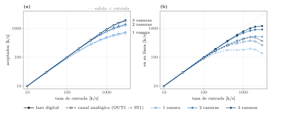

*Tasa de eventos del MCA con `gen_pulsos` (Poisson, líneas de 500 y 1300 ADU, disparo por el ASG, trapecio). (a) Eventos aceptados por segundo y (b) eventos en su línea (a ±2 % del centroide de su línea de referencia) por segundo, contra la tasa de entrada, con 1, 2 y 3 ranuras. Línea llena: lazo digital; a trazos: canal analógico OUT1 → IN1 con 50 Ω. Con 3 ranuras y 3 M/s de entrada el MCA acepta 1.9 M/s y registra 1.2 M/s en su línea. En el canal analógico los aceptados casi no cambian, pero los eventos en su línea caen porque, con base fija, la línea se corre con la tasa.*

Los resultados con cada fuente y 3 ranuras se presentan en la Fig.
`meritos_tasa_fuentes`. A 3 M/s, el MCA acepta 1.92 M/s con el ASG, 1.89 con el
polo-cero y 1.77 con la pendiente.

- **El polo-cero da la misma tasa en la línea que el ASG** (1.23 y 1.21 M/s). No dispara
  con el 9.5 % de los pulsos, contra el 2.4 % del ASG, pero casi todos los que pierde son
  apilados que de todos modos habrían quedado fuera de su línea.
- **La pendiente es paralizable.** Su tasa en la línea llega a 0.97 M/s con 2 M/s de
  entrada y baja a 0.78 con 3 M/s, porque pierde los pulsos apilados que el banco habría
  separado.
- **En el canal analógico los aceptados casi no cambian, pero la tasa en la línea cae.**
  Con las tres fuentes llega a su máximo con 1.5 M/s de entrada, entre 0.43 y 0.53 M/s.
  Con base fija, la línea se corre con la tasa (§2.5).

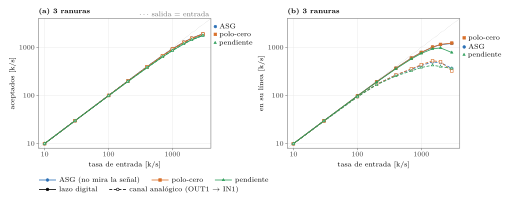

*Tasa de eventos con cada fuente de disparo (Poisson, líneas de 500 y 1300 ADU, trapecio, 3 ranuras). (a) Eventos aceptados y (b) eventos en su línea (a ±2 % del centroide de su línea de referencia) por segundo, contra la tasa de entrada. Línea llena: lazo digital; a trazos: canal analógico OUT1 → IN1 con 50 Ω. A 3 M/s de entrada el MCA acepta 1.92 M/s con el ASG, 1.89 con el polo-cero y 1.77 con la pendiente. En su línea, el polo-cero iguala al ASG (1.23 y 1.21 M/s; las dos curvas se superponen). La pendiente llega a 0.97 M/s con 2 M/s de entrada y baja a 0.78 con 3 M/s: el disparo pierde los pulsos apilados que el banco habría separado. En el canal analógico, las tres fuentes tienen la tasa en la línea máxima con 1.5 M/s de entrada (entre 0.43 y 0.53 M/s), porque con base fija la línea se corre con la tasa.*

## 2.3 Pérdidas por causa

En el mismo barrido de tasa leímos los contadores de pérdidas del MCA. Cada pulso
generado termina en uno de cinco destinos, y cada uno tiene su contador:

- sin disparo;
- sin ranura libre;
- perdido en el publicador;
- aceptado fuera de su línea;
- aceptado en su línea.

Los resultados se presentan en la Fig. `meritos_perdidas`, como franjas apiladas que
suman todos los pulsos generados. Hay una columna por fuente y una fila por número de
ranuras. Con 1 ranura domina la falta de ranura: el 63 % de los pulsos a 3 M/s con el
ASG. Con 3 ranuras esa pérdida baja al 21 %, y la principal pasa a ser el apilamiento
aceptado fuera de la línea, con el 24 %. Es lo que tiene que rechazar el discriminador
por forma, que miden las pruebas de apilamiento y de ventana ciega (todavía sin placa).

La franja sin disparo es la del propio disparo, y separa las fuentes: a 3 M/s pierde el
2.4 % de los pulsos con el ASG, el 9.5 % con el polo-cero y el 31 % con la pendiente. En
el canal analógico, la fracción de pulsos que terminan en su línea (línea a trazos) cae
mucho antes que en el lazo digital.

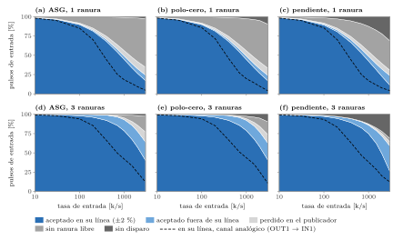

*Destino de cada pulso de entrada en el lazo digital (Poisson, líneas de 500 y 1300 ADU, trapecio), contra la tasa de entrada, para cada fuente de disparo, con 1 y con 3 ranuras. Las cinco franjas suman todos los pulsos generados, porque cada pérdida tiene su contador: sin disparo; sin ranura libre (el disparo llegó con todas las ranuras ocupadas); perdido en el publicador; aceptado fuera de ±2 % de su línea; aceptado en su línea. La línea a trazos es la fracción de los pulsos que terminan en su línea en el canal analógico OUT1 → IN1. Con 1 ranura domina la falta de ranura: 63 % a 3 M/s con el ASG. Con 3 ranuras esa pérdida baja al 21 %, y la principal pasa a ser el apilamiento, que el MCA acepta fuera de la línea (24 %). Sin disparo, a 3 M/s, queda el 2.4 % de los pulsos con el ASG, el 9.5 % con el polo-cero y el 31 % con la pendiente. En el canal analógico esa fracción cae mucho antes, porque con base fija la línea se corre con la tasa.*

## 2.4 Error de la tasa estimada

Con el mismo barrido comparamos la tasa de entrada que estima el MCA con la tasa exacta
del generador. El estimador divide todos los disparos fuera del veto por el tiempo en que
el disparo podía responder:

$$\hat\lambda = f_s\,\frac{\texttt{cnt\_cross} - \texttt{cnt\_lost\_veto}}{T_\text{gen} - \texttt{vetotime} - \texttt{t\_rearm}}$$

con f_s = 125 MHz y los tiempos en ciclos:

- `cnt_cross`: todos los disparos (flancos de `trig_i`), hayan encontrado una ranura
  libre o no. No son las cuentas del histograma (`cnt_accepted`): incluye también los
  disparos sin ranura libre y los perdidos en el publicador.
- `cnt_lost_veto`: los disparos bajo veto.
- T_gen: el tiempo real mientras corre el generador, del arranque al último pulso. El MCA
  corre desde antes y hasta después, y ese tiempo no entra. Sin el generador, es
  `realtime`.
- `vetotime`: los ciclos bajo veto.
- `t_rearm`: los ciclos con alguna ranura libre en que el disparo espera re-armarse.

En estas pruebas no hay veto, así que `cnt_lost_veto` y `vetotime` valen cero. El
denominador no es el tiempo vivo. Por el teselado de los relojes
([`register_map_mca.md`](mca/register_map_mca.md#el-teselado)),

$$\texttt{realtime} = \texttt{vetotime} + \texttt{t\_win} + \texttt{t\_div} + \texttt{t\_rearm} + \texttt{livetime},$$

así que el denominador es `livetime` + `t_win` + `t_div`: incluye el tiempo sin ranura
libre (`t_win`, todas midiendo; `t_div`, alguna esperando al publicador), porque los
disparos de ese tiempo también están en `cnt_cross`. `livetime` es sólo el tiempo con
una ranura libre y el disparo armado.

Los resultados se presentan en la Fig. `meritos_lambda`, como error relativo en %, con
1 ranura en (a) y 3 ranuras en (b).

A 3 M/s, en el lazo digital:

| Fuente | Pulsos sin disparo | Error de λ̂, 1 ranura | Error de λ̂, 3 ranuras | t_rearm / T_gen, 1 ranura | t_rearm / T_gen, 3 ranuras |
|---|---|---|---|---|---|
| ASG | 2.4 % | −2.4 % | −1.7 % | 0.0 % | 0.7 % |
| polo-cero | 9.5 % | −7.7 % | −3.7 % | 2.0 % | 6.1 % |
| pendiente | 31 % | −29 % | −18 % | 2.4 % | 15.7 % |

El ASG sólo pierde los pulsos que llegan a menos de 3 ciclos del anterior. La pendiente es
paralizable, y es la que más pierde.

Con 1 ranura, λ̂ queda casi tan abajo como la fracción de pulsos sin disparo. Con 3
ranuras el error baja, y lo que baja es casi lo que crece t_rearm. La diferencia sale de
que t_rearm sólo cuenta cuando hay una ranura libre. Con 1 ranura, ocupada cerca del 73 %
del tiempo, casi todo el re-armado del disparo queda detrás de la ranura. λ̂ corrige
entonces el tiempo muerto del disparo sólo en parte, y más cuantas más ranuras hay.

En el canal analógico, con 3 ranuras, λ̂ del polo-cero queda 5.1 % arriba a 3 M/s. No es
una medida correcta, sino dos errores que se compensan: los disparos de más sobre el
sobrepico y los pulsos perdidos.

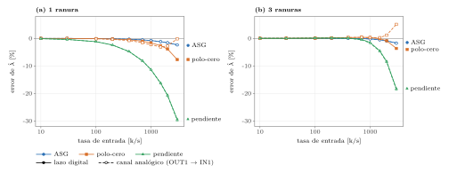

*Error de la tasa estimada por el MCA, λ̂ = f_s · (cnt_cross − cnt_lost_veto) / (T_gen − vetotime − t_rearm), contra la tasa de entrada exacta del generador (Poisson, líneas de 500 y 1300 ADU), con (a) 1 ranura y (b) 3 ranuras. Línea llena: lazo digital; a trazos: canal analógico OUT1 → IN1 con 50 Ω. El ASG sólo pierde los pulsos que llegan a menos de 3 ciclos del anterior (el 2.4 % a 3 M/s), y λ̂ queda 2.4 % abajo con 1 ranura y 1.7 % con 3. El polo-cero pierde el 9.5 %, y λ̂ queda 7.7 % y 3.7 % abajo. El disparo por pendiente es paralizable: a 3 M/s pierde el 31 % de los pulsos, y λ̂ queda 29 % abajo con 1 ranura y 18 % con 3. La diferencia entre 1 y 3 ranuras sale de t_rearm, que sólo cuenta cuando hay una ranura libre. Con 1 ranura, ocupada cerca del 73 % del tiempo, el re-armado del disparo queda casi entero detrás de la ranura: con la pendiente, t_rearm es el 2.4 % del tiempo, contra el 15.7 % con 3 ranuras. En el canal analógico, el polo-cero vuelve a disparar sobre el sobrepico, y esos disparos de más compensan los perdidos: con 3 ranuras, λ̂ queda 5.1 % arriba a 3 M/s.*

## 2.5 Corrimiento de las líneas y el seguidor de base

En el barrido de tasa medimos también el centroide de cada línea, con la base fija. Los
resultados se presentan en la Fig. `meritos_corrimiento`, con una curva por línea. En el
lazo digital las líneas no se mueven: menos de 1.5 canales. En el canal analógico las dos
bajan casi lo mismo hasta 700 k/s, unos 9 canales a 400 k/s.
Estas desviaciones se explican por el apilamiento sobre las colas negativas que deja la
caída lenta del canal: la base baja con la tasa, y el trapecio con polo-cero pasa ese
error a la amplitud en (k + m)/τ. Arriba de ~1 M/s la base sigue bajando, pero el
corrimiento de la línea de 500 ADU deja de crecer: con vecinos más cerca, el banco mide
cada vez más pulsos con formas cortas, que pasan menos error de base a la amplitud. La
de 1300 ADU sigue bajando porque la línea se ensancha. Lo desarrollamos en «De dónde
sale el corrimiento».

Un error de ganancia separaría las dos curvas, en proporción a la altura de cada línea.
Como se corren lo mismo, el corrimiento es aditivo: es un error de base. Es la causa de
que la tasa en la línea caiga en §2.2 y §2.3.

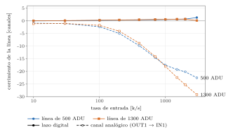

*Corrimiento del centroide de cada línea contra la tasa de entrada (trapecio, ASG, 3 ranuras, base fija). En el lazo digital las líneas no se mueven (menos de 1.5 canales). En el canal analógico bajan casi lo mismo las dos hasta 700 k/s, unos 9 canales a 400 k/s: el corrimiento es aditivo, de la base, por la caída lenta de la salida cargada con 50 Ω (7 % en 3 a 13 µs) acumulada sobre el apilamiento.*

### De dónde sale el corrimiento

El corrimiento sale de tres cosas que se suman: la caída lenta del canal, la base fija del
MCA y el polo-cero del trapecio.

1. **La caída lenta deja una cola negativa detrás de cada pulso.** Además del FIR, el
   canal tiene tres polos lentos (§1.2). La respuesta a un escalón cae un 7.3 % después
   del flanco: un 2.4 % con 3.2 µs y un 4.5 % con 12.8 µs (el polo de 51 µs aporta un
   0.3 %). En un pulso eso es una cola negativa que dura de 3 a 13 µs, con un área del
   7.3 % de la del pulso.
2. **Las colas se apilan y bajan la base.** A una tasa n, cada pulso llega sobre las colas
   de los anteriores. En promedio, la base cae el 7.3 % del nivel medio del tren,
   n·⟨A⟩·τ: unas 45 ADU a 400 k/s y 340 a 3 M/s. En el lazo digital no hay cola
   lenta, y la base vuelve a cero después de cada pulso.
3. **El trapecio con polo-cero pasa el error de base a la amplitud.** El MCA resta una base
   fija, la medida a tasa cero. La recursión de Jordanov integra la diferencia, y un error
   de base Δb aparece en la amplitud como (l/τ)·Δb, donde l = k + m es el largo de la
   forma y τ = 250 muestras. Como no depende de la amplitud del pulso, las dos líneas se
   corren lo mismo.

El factor l/τ depende de la forma que elige el banco, y el banco elige una más corta
cuando el pulso tiene vecinos cerca:

| Forma | l = k + m | l/τ | Fracción de la base que pasa a la amplitud, en la réplica [canales/ADU] |
|---|---|---|---|
| k = 64 | 112 | 0.45 | 0.41 |
| k = 32 | 56 | 0.22 | 0.21 |
| k = 8 | 16 | 0.06 | 0.06 |

Para comprobarlo, repetimos la etapa de tasa en la placa simulada con el canal medido
(`CanalMedido`, de [`canal_analogico.py`](../software/campanas/canal_analogico.py)): el
FIR y los polos lentos ajustados a una captura de la BRAM, con el ruido del piso. La
repetimos también con el mismo canal ajustado sin los polos lentos. En la corrida con los
polos medimos, además, cada punto sobre la misma traza sin la parte lenta del canal: la
diferencia de `F_TRAP`, evento por evento, es lo que la caída lenta le hace a cada
amplitud. La comprobación la corre
[`sim_corrimiento_canal.py`](../software/campanas/sim_corrimiento_canal.py), en unos 90 s,
y deja los datos en `software/datos/sim_corrimiento_canal`.

Los resultados se presentan en la Fig. `meritos_corrimiento_canal`, con la línea de
500 ADU en (a), la de 1300 ADU en (b) y la forma que elige el banco en (c). Con los polos
lentos, la réplica reproduce la forma de las curvas de la placa: el corrimiento crece
hasta ~1 M/s, y desde ahí la línea de 500 ADU se aplana y la de 1300 ADU sigue bajando.
Sin los polos lentos, la línea se corre menos de 1 canal en todo el barrido, como en el
lazo digital. La caída lenta alcanza para explicar el corrimiento.

En (c) se ve cómo el banco cambia de forma con la tasa. A 10 k/s, el 98 % de los eventos
de las líneas usa la forma de k = 64; a 400 k/s, el 60 %; a 1 M/s, el 29 %, y a 3 M/s,
el 2 %. La de k = 8 pasa del 2 al 77 %. Hasta ~1 M/s el corrimiento crece con la base.
Desde ahí, aunque la base siga bajando, cada vez más eventos usan formas cortas, que
dejan pasar menos error, y el corrimiento se aplana. Además, cada forma deja la línea en
otro lugar, así que la línea se ensancha. El centroide dentro de ±15 % de la línea abarca
más canales para la línea de 1300 ADU que para la de 500, y por eso las dos curvas se
separan arriba de 1.5 M/s.

La diferencia evento por evento, contra la base lenta en el disparo, da la fracción de la
base que pasa a la amplitud con cada forma, la de la tabla de arriba: 0.41, 0.21 y 0.06
canales por ADU, la misma a todas las tasas y cerca de l/τ (en estas líneas, un canal
son 1.03 ADU de IN1).

La réplica se corre más que la placa: 1.34 veces a 400 k/s (−12.5 contra −9.3 canales,
el promedio de las dos líneas) y 1.23 veces a 1 M/s (−21.9 contra −17.8). Además, a
10 k/s la placa ya está 1 canal abajo y la réplica no. No lo investigamos. Los polos
lentos salen de una sola captura de 65 µs (8192 muestras), que dura apenas 1.3 veces el
polo más lento (51 µs), así que la caída lenta queda poco determinada.

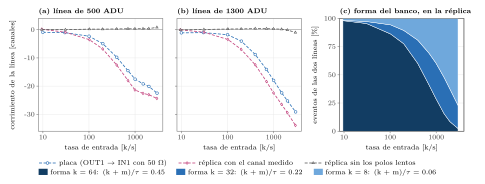

*Corrimiento del centroide de cada línea contra la tasa de entrada en el canal analógico (Poisson, ASG, 3 ranuras, trapecio, base fija), en la placa y en la placa simulada con el canal medido: el FIR de 48 taps y los tres polos lentos ajustados a una captura de la BRAM, con el ruido del piso, con los polos lentos y sin ellos. (a) Línea de 500 ADU; (b) línea de 1300 ADU; (c) fracción de los eventos de las dos líneas que mide cada forma del banco, en la réplica con los polos lentos. Sin los polos lentos la línea se corre menos de 1 canal. Con ellos, la réplica reproduce la forma de las curvas de la placa, con 1.34 veces su corrimiento a 400 k/s (−12.5 contra −9.3 canales) y 1.23 veces a 1 M/s. El corrimiento se aplana porque el banco pasa a las formas cortas, que llevan a la amplitud una fracción menor del error de base, (k + m)/τ: a 10 k/s el 98 % de los eventos usa la forma de k = 64, y a 3 M/s el 77 % usa la de k = 8.*

### El seguidor de base

Para ver si el seguidor de base lo compensa, repetimos el barrido en analógico con el
seguidor en lugar de la base fija (`bl_k` 12, `bl_holdoff` 1000). Lo compensa sólo en
parte:

- a 400 k/s, la línea se corre 6.4 canales, contra 8.7 con la base fija, y los pulsos
  que terminan en su línea pasan del 66 al 75 %;
- desde 1.5 M/s no cambia nada.

El seguidor sólo mide la base después de 1000 muestras (8 µs) sin ventanas abiertas. A
400 k/s, con un hueco medio de 2.5 µs, eso pasa en un 2 % de los huecos. Además, en esos
huecos las colas ya se recuperaron en parte, y la base que mide es menos negativa que la
que ven los pulsos. Desde 1.5 M/s no queda casi ningún hueco así.

Lo corregiría compensar los polos lentos antes del MCA, como el polo-cero compensa τ, o
una base que no dependa de los huecos. Probamos lo segundo: la base dinámica.

### La base dinámica

La base dinámica corre la base fija del MCA mientras mide, con la ley de
[`base_dinamica.py`](../software/API/base_dinamica.py). Cada 0.25 s estima la tasa λ̂
con los contadores y la amplitud media ⟨A⟩ con el histograma, y escribe la base fija
corrida en

Δb = κ · caída · (λ̂/f_s) · ⟨A⟩ · τ,

el nivel medio del tren por la caída lenta del canal: lo que baja la base según el punto 2
de arriba. Usamos la caída de la medición rápida del canal al empezar la corrida (−8.2 %),
la τ del polo-cero y κ = 1. Con la ley repetimos en analógico el barrido de tasa, para
compararlo con la base fija y con el seguidor.

Los resultados se presentan en la Fig. `meritos_base_dinamica`. Hasta 400 k/s la base
dinámica da lo mismo que el seguidor. Por encima rinde mucho más:

| Entrada | Ranuras | Base fija [k/s] | Seguidor [k/s] | Base dinámica [k/s] | Lazo digital [k/s] |
| --- | --- | --- | --- | --- | --- |
| 1 M/s | 1 | 182 | 216 | 266 | 446 |
| 2 M/s | 1 | 183 | 174 | 309 | 529 |
| 3 M/s | 1 | 137 | 132 | 299 | 514 |
| 1 M/s | 3 | 419 | 471 | 554 | 786 |
| 3 M/s | 3 | 366 | 349 | 772 | 1208 |

La ley corre la base hasta Δb = −380 ADU a 3 M/s. λ̂ no cambia con la base, porque sale de
los contadores.

Con κ = 1 la ley corrige de más. La línea de 1300 ADU, que con la base fija baja hasta 29
canales, con la base dinámica sube hasta 11. Queda dentro de la tolerancia de ±2 % (24
canales), y por eso los pulsos vuelven a su línea, pero el espectro queda corrido. Con
estos corrimientos, la corrección justa estaría con κ de 0.5 (400 k/s) a 0.7 (3 M/s). Va
en el mismo sentido que la réplica, que se corre 1.2 a 1.3 veces más que la placa. Falta
calibrar κ.

La ley lee el histograma en vuelo, y eso le cuesta eventos al MCA. En `mca_hist`, la
lectura del bus tiene prioridad sobre el incremento, y el evento de ese ciclo va a
`cnt_dropped` sin pasar por `cnt_cross` ni por el espectro. Una lectura son 8192 ciclos,
así que se pierden unos 5 eventos por corrida a 10 k/s y hasta 354 a 3 M/s (0.02 %). El
chequeo de las identidades los descuenta: son la diferencia entre `cross` y open +
lost_active + dropped + lost_veto, y tienen que ser los mismos que le faltan al espectro.

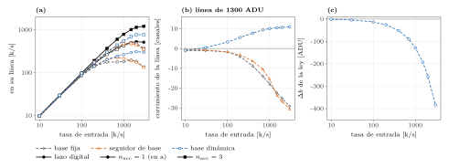

*La base dinámica en el canal analógico, contra la base fija y el seguidor de base (Poisson de 10 k a 3 M/s, líneas de 500 y 1300 ADU, disparo del ASG, trapecio). La ley corre la base fija mientras el MCA mide, cada 0.25 s, en Δb = κ · caída · (λ̂/f_s) · ⟨A⟩ · τ, con λ̂ de los contadores, ⟨A⟩ del histograma, la caída de la medición rápida del canal (−8.2 %) y κ = 1. (a) La tasa en su línea con 1 y 3 ranuras, con el lazo digital de referencia: hasta 400 k/s la base dinámica da lo mismo que el seguidor, y por encima casi duplica la base fija (a 3 M/s, de 137 a 299 k/s con 1 ranura y de 366 a 772 k/s con 3). (b) El corrimiento de la línea de 1300 ADU (3 ranuras): con la base fija y con el seguidor baja hasta 29 y 31 canales; con la base dinámica sube hasta 11, porque con κ = 1 la ley corrige de más. (c) El Δb que aplica la ley, hasta −380 ADU a 3 M/s.*

## 2.6 Resolución de pulsos dobles

Para medir la resolución de pulsos dobles, generamos pares de dos pulsos: A1, el primero,
de 4000 ADU, y A2, el segundo, de 2400 ADU, que llega Δt ciclos después, sobre la cola de
A1. Barrimos Δt de 2 a 512 ciclos de 8 ns, con 2000 pares por
punto. En cada punto contamos los disparos por par y los pares en los que el trapecio
mide los dos pulsos en su línea, con 3 ranuras y con 1.

Los resultados se presentan en la Fig. `meritos_par`. En el lazo digital, el polo-cero
separa los disparos desde Δt = 5 (40 ns) y la pendiente desde 20 (160 ns). Con 3
ranuras, los dos pulsos caen en su línea desde Δt = 16 con el polo-cero y desde 20 con
la pendiente. Así aparecen dos resoluciones: la del disparo y la de la amplitud, que el
banco recién alcanza en 128 ns.

Con 1 ranura, los dos pulsos caen en su línea recién desde Δt = 192. La resolución la
fija la ranura: el segundo pulso tiene que esperar a que se libere.

En el canal analógico, la pendiente se comporta igual. El polo-cero, en cambio, vuelve a
disparar sobre el sobrepico del 24 %, con hasta 3.8 disparos por par, y casi nunca deja
los dos pulsos en su línea. Con este canal, el disparo por polo-cero no resuelve pares.

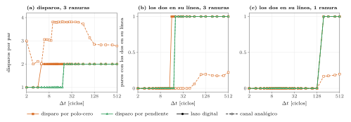

*Resolución de pulsos dobles: pares de 4000 y 2400 ADU separados Δt ciclos de 8 ns, 2000 pares por punto. (a) Disparos por par; (b) fracción de pares en que el trapecio mide los dos pulsos en su línea (±2 %) con 3 ranuras y (c) con 1. En el lazo digital el polo-cero separa los disparos desde Δt = 5 y la pendiente desde 20; con 3 ranuras los dos pulsos caen en su línea desde 16 (polo-cero) y 20 (pendiente), con 1 ranura recién desde 192. En el canal analógico la pendiente se comporta igual, pero el polo-cero vuelve a disparar sobre el sobrepico del canal (hasta 3.8 disparos por par) y casi nunca deja los dos pulsos en su línea.*

## 2.7 Histéresis

Con el Rigol, el centroide de una línea difería 10.9 canales entre la ida y la vuelta de
un barrido de tasa
([`resultados_validacion_hw.md` §19.2–19.4](resultados_validacion_hw.md#194-la-histéresis-no-es-el-seguidor-de-base--mi-hipótesis-refutada)).
Para ver si era del MCA, repetimos esa campaña con `gen_pulsos`:

- un tren periódico a 16 tasas, de 100/s a 800 k/s y de vuelta, 5 s por punto;
- una línea de 2000 ADU con τ = 25 muestras;
- la misma configuración del MCA: 1 ranura, compuerta 384, disparo por pendiente y el
  pico.

La corrimos con base fija y con el seguidor de base.

Los resultados se presentan en la Fig. `meritos_histeresis`, con marcas llenas a la ida
y huecas a la vuelta. La ida y la vuelta coinciden: la mayor diferencia es de 0.2
canales, en el canal analógico. Con la tasa, el centroide se corre a lo sumo 2.5 canales
de 1000 (0.25 %).

La histéresis del Rigol no es del MCA. El canal analógico incluye el front-end de IN1 y
el ADC, y tampoco la muestra, así que apunta al DG4162.

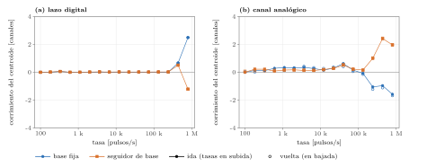

*Centroide de una línea de 2000 ADU (τ = 25 muestras, disparo por pendiente, pico) a lo largo de una rampa de 16 tasas periódicas, de 100/s a 800 k/s y de vuelta, 5 s por punto, con base fija y con el seguidor de base; marcas llenas a la ida y huecas a la vuelta. La ida y la vuelta coinciden: no hay histéresis (a lo sumo 0.2 canales, en el canal analógico). Con la tasa, el centroide se corre a lo sumo 2.5 canales de 1000 (0.25 %).*

La placa simulada daba una segunda línea en ~73 canales desde 436 k/s, que la placa no
tiene. La causa más probable es un error de la réplica, que ya se arregló: las features
se calculaban mal desde el disparo 8192. Falta volver a correr la simulada para
confirmarlo.

## 2.8 Umbral y walk del disparo

Para medir el umbral y el walk de cada fuente de disparo, barrimos la amplitud de pulsos
aislados de 20 a 8000 ADU, con 400 pulsos por punto y un ruido de 2.3 ADU. En
cada punto medimos tres cosas:

- la fracción de pulsos que disparan;
- el retardo del disparo, a partir de `t_subida`, referido al de un pulso grande;
- los disparos por pulso.

Los resultados se presentan en la Fig. `meritos_walk`. La curva S del panel (a) da el
umbral efectivo. El polo-cero dispara la mitad de los pulsos en 48 ADU y la
pendiente en 81. En el canal analógico, 51 y 82: el canal casi no mueve el umbral.

El panel (b) es el walk. El polo-cero se atrasa 1 ciclo (8 ns) con los pulsos chicos y
la pendiente 6 ciclos (48 ns). En el canal analógico, 2 y 6.9 ciclos. El walk no afecta
la amplitud medida: las tres fuentes dan la misma INL (§2.9).

En el panel (c), el ASG dispara una vez siempre, porque no mira la señal. En el canal
analógico, el polo-cero vuelve a disparar sobre el sobrepico desde unas 3200 ADU,
como en los pares (§2.6). A 5000 y 8000 ADU, todos los eventos del trapecio caen en
el canal 0.

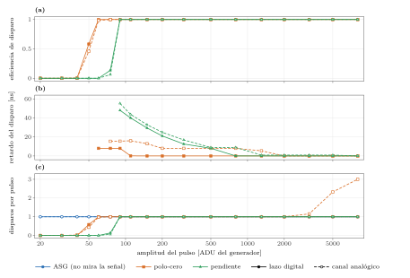

*El disparo contra la amplitud de un pulso aislado (400 pulsos por punto, ruido de 2.3 ADU). (a) Fracción de pulsos que disparan: el polo-cero dispara la mitad en 48 ADU y la pendiente en 81 (51 y 82 en el canal analógico). (b) Retardo del disparo respecto del de un pulso grande (el walk): 1 ciclo (8 ns) el polo-cero y 6 ciclos (48 ns) la pendiente; 2 y 6.9 ciclos en el canal analógico. (c) Disparos por pulso: el ASG no mira la señal y dispara una vez siempre; en el canal analógico el polo-cero vuelve a disparar sobre el sobrepico desde unas 3200 ADU, y a 5000 y 8000 todos los eventos del trapecio caen en el canal 0.*

## 2.9 Linealidad integral del trapecio

Con los mismos pulsos aislados medimos la línea del trapecio en cada amplitud. Ajustamos
una recta entre 200 y 3200 ADU, donde nada satura, y calculamos el residuo en % del
fondo de escala (8191 ADU).

Los resultados se presentan en la Fig. `meritos_inl`. En el lazo digital, el residuo es
menor que 0.002 % FS (0.16 ADU) en todo el rango. Es la aritmética del trapecio, y
las tres fuentes dan lo mismo.

En el canal analógico, el residuo es de ±0.008 % FS hasta 3200 ADU, −0.07 % en 5000 y
+0.66 % en 8000. Desde unas 6990 ADU (franja gris), el sobrepico del canal pasa el
fondo de escala del ADC. El polo-cero no tiene línea desde 5000 ADU, porque vuelve a
disparar sobre el sobrepico.

El número a citar es el de la figura. El resumen de la campaña da 0.3 % FS porque ajusta
la recta con todos los puntos, y lo arrastra el de 8000, que satura.

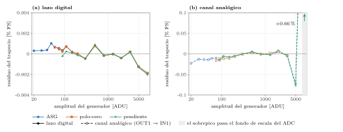

*No linealidad integral del trapecio, con cada fuente de disparo: el residuo de la línea de pulsos aislados (400 por amplitud) contra una recta ajustada entre 200 y 3200 ADU, en % del fondo de escala (8191 ADU). (a) Lazo digital: menos de 0.002 % FS (0.16 ADU) en todo el rango. Es la aritmética del trapecio, y las tres fuentes dan lo mismo. (b) Canal analógico OUT1 → IN1 con 50 Ω: ±0.008 % FS hasta 3200 ADU, −0.07 % en 5000 y +0.66 % en 8000. Desde unas 6990 ADU (franja gris), el sobrepico del canal (24 %) pasa el fondo de escala del ADC. El polo-cero no tiene línea desde 5000 ADU, porque vuelve a disparar sobre el sobrepico. Una recta por todos los puntos, como la del resumen de la campaña, da 0.3 % FS, porque la arrastra el punto de 8000.*

Con el Rigol, la INL del conjunto daba 1.13 % FS
([`resultados_validacion_hw.md` §13.4](resultados_validacion_hw.md#134-linealidad-la-inl-es-sistemática-y-es-del-conjunto)).
Que el canal de la placa dé ±0.008 % FS apunta a que esa INL era casi toda del DG4162.
Para confirmarlo, falta comparar en el mismo rango de amplitudes.

## 2.10 Resolución contra el ruido

Para medir la resolución de cada estimador, hicimos un barrido de la varianza del ruido
blanco que suma `gen_pulsos`, de 0 a 148 ADU de σ (`ruido_sh` de 8 a 0). La línea es
de 1500 ADU, con 4000 pulsos por punto. Usamos el disparo del ASG, que no depende del
ruido.

En cada punto medimos el σ y la FWHM de la línea, con el pico y con cada trapecio del
banco solo. Cada punto se corrió dos veces: con el histograma entero, para encontrar la
línea, y con el zoom que la abre en la mayor cantidad de canales. Sobre los puntos
ajustamos σ² = (g·σ_ruido)² + σ₀², donde g es la ganancia de ruido del estimador y σ₀ su
piso.

Los resultados se presentan en la Fig. `meritos_ruido`, con los dos ejes logarítmicos. A
la derecha domina el ruido inyectado y cada curva corre paralela a la diagonal; a la
izquierda se aplana en el piso. La tabla da el ajuste y, con el ruido de las demás
pruebas (σ_ruido = 2.3 ADU, `ruido_sh` = 6), el σ y la FWHM medidos sobre la línea. Todo
en ADU; la FWHM también en % de los 1500 ADU de la línea.

| Estimador | g | σ₀ digital | σ₀ analógico | σ digital | σ analógico | FWHM digital | FWHM analógica |
|---|---|---|---|---|---|---|---|
| trapecio k = 64 | 0.18 | 0.06 | 1.41 | 0.42 | 1.46 | 1.0 (0.07 %) | 3.5 (0.24 %) |
| trapecio k = 32 | 0.24 | 0.08 | 1.31 | 0.56 | 1.43 | 1.3 (0.09 %) | 3.4 (0.23 %) |
| trapecio k = 8 | 0.48 | 0.13 | 2.33 | 1.11 | 2.57 | 2.6 (0.17 %) | 6.3 (0.42 %) |
| pico (sin ajuste; σ₀ = σ sin ruido inyectado) | — | 0 | 4.32 | 2.30 | 4.58 | 5.9 (0.39 %) | 10.8 (0.72 %) |

La ganancia de ruido sale del filtro. Normalizado por su ganancia, el trapecio pesa la
entrada con ≈ +1/k en las k muestras después del pie del pulso, ≈ −1/k en las k de antes
y ≈ 1/τ en el medio
([`separacion_trapezoidal.md` §9](mca/separacion_trapezoidal.md#k-es-la-perilla-entre-las-dos)).
La amplitud es entonces la diferencia de dos promedios de k muestras. Con ruido blanco de
σ por muestra, cada promedio tiene varianza σ²/k, y la diferencia, 2σ²/k:

$$g = \frac{\sigma_{\hat A}}{\sigma_\text{ruido}} \approx \sqrt{\frac{2}{k}}$$

Da 0.50, 0.25 y 0.18 para k = 8, 32 y 64. El filtro exacto de la placa,
H(z) = 16(1 + M)(1 − a_M z⁻¹) B_k(z) B_l(z), con el promedio de la ventana de lectura de
la meseta (2, 8 y 16 muestras), da 0.48, 0.24 y 0.17; medimos 0.48, 0.24 y 0.18. La
ventana baja g un 3 a 4 %, y el término 1/τ la sube un 2 % con k = 64.

g es la misma en los dos modos. El trapecio sólo deja pasar el ruido por debajo de unos
f_s/k (16 MHz con k = 8, 2 MHz con k = 64), y ahí el canal es plano: el ruido del
generador pasa con la misma ganancia que la señal.

El piso σ₀ es lo que agrega el canal:

- en el lazo digital es cuantización, menos de 0.15 ADU;
- en el canal analógico es el ruido de IN1 (4.7 ADU rms: el ADC, los front-ends y la
  salida), que lo lleva a 1.3–2.3 ADU.

Si el ruido de IN1 fuera blanco, σ₀ sería g por esos 4.7 ADU (4.96 en ADU del
generador): 2.4, 1.2 y 0.86 para k = 8, 32 y 64. Con k = 8 es lo que medimos (2.33), pero
con k = 64 medimos 1.41: el piso tiene componentes de baja frecuencia, que alargar el
promedio no reduce, como ya se vio en [`ruido_del_sistema.md`](ruido_del_sistema.md). El
pico no es lineal y va sin ajuste: en el canal analógico toma el sobrepico, y su piso es
de 4.3 ADU.

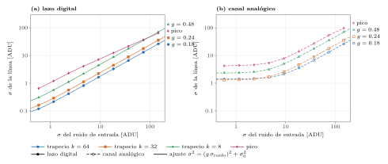

*Resolución de cada estimador contra el ruido blanco que suma `gen_pulsos` (línea de 1500 ADU, disparo por el ASG, 4000 pulsos por punto): σ de la línea, en ADU, contra el σ del ruido de entrada. Las curvas son el ajuste σ² = (g·σ_ruido)² + σ₀². La ganancia de ruido g baja con la subida k del trapecio como √(2/k), porque el trapecio es la diferencia de dos promedios de k muestras (0.48, 0.24 y 0.18 para k = 8, 32 y 64) y es la misma en los dos modos; el canal analógico agrega el piso σ₀ del ADC y la salida (1.4 ADU con k = 64). El pico no es lineal y va sin ajuste: en el canal analógico toma el sobrepico y su piso es de 4.3 ADU.*

## 2.11 Forma óptima del trapecio contra la tasa

Para buscar la forma óptima con cada tasa, dejamos una sola forma en el banco y barrimos
su subida k de 8 a 512 muestras, con m ≈ 3k/4. En cada forma generamos una línea de
1500 ADU con ruido σ = 9.2 ADU y Poisson de 30 k a 1 M/s, con el disparo del ASG. En cada
punto medimos la FWHM de la línea y la eficiencia ε, los eventos en su línea sobre los
pulsos generados, y las comparamos con la ocupación ρ = n·L/f_s: la tasa por el tramo de
señal L que usa la forma, en segundos.

Los resultados se presentan en la Fig. `meritos_forma`. La FWHM no depende de la tasa: la
de cada tasa es la de los pulsos aislados. Baja con k hasta k ≈ τ = 250 y después no,
porque el término 1/τ del polo-cero pesa todo el largo de la forma y suma ruido. La
eficiencia, en cambio, depende sólo de ρ: todas las tasas caen sobre e^(−ρ), la fracción
de pulsos sin otro dentro de su tramo.

La figura de mérito FWHM/ε² junta las dos y tiene un mínimo en cada tasa: k = 128 a
30 k/s, 64 a 100 k/s, 32 a 300 k/s y 16 a 1 M/s, con ρ entre 0.09 y 0.40. La teoría da
ρ = 1/4 si la FWHM baja como L^(−1/2)
([`parametros_de_merito.md` §8](mca/parametros_de_merito.md)). A 300 k/s el mínimo cae
ahí (0.23); a tasa baja, por debajo, porque la FWHM ya no baja con k. De las formas del
banco, k = 64 y 32 son las óptimas de 100 k/s y 300 k/s; a 1 M/s el óptimo es k = 16,
entre las dos más cortas del banco.

En el canal analógico la FWHM se comporta de otra manera. En los pulsos aislados baja hasta
k = 64 (0.35 %) y después sube (0.91 % con k = 512). Con la tasa crece mucho más: con
k = 64, 0.40 % a 30 k/s y 1.03 % a 100 k/s. Es el corrimiento de la base de §2.5: la
caída lenta corre la base de cada pulso según los anteriores, y una forma larga pasa más de
ese error a la amplitud (l/τ). La eficiencia, en cambio, es la misma que en el lazo
digital: la línea se ensancha pero no pierde eventos. El mínimo de FWHM/ε² baja a k = 64 a
30 k/s, 16 a 100 k/s y 8 a 300 k/s y 1 M/s, con ρ de 0.04 a 0.22. En el canal analógico
conviene la forma más corta.

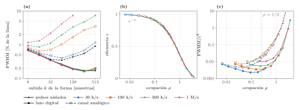

*Una sola forma del trapecio contra la ocupación, en el lazo digital y en el canal analógico: k de 8 a 512 muestras (m ≈ 3k/4), línea de 1500 ADU con ruido σ = 9.2 ADU, disparo del ASG y Poisson de 30 k a 1 M/s. (a) FWHM de la línea. En el lazo digital la de cada tasa casi coincide con la de los pulsos aislados, porque la tasa no ensancha la línea, y desde k ≈ τ = 250 deja de bajar, porque el término 1/τ del polo-cero suma ruido en todo el largo de la forma. En el canal analógico sube desde k = 64 aun en los aislados, y con la tasa crece mucho más: la caída lenta corre la base de cada pulso según los anteriores, y una forma larga pasa más de ese error a la amplitud. (b) Eficiencia ε (eventos de la línea sobre pulsos generados) contra la ocupación ρ = n·L/f_s, con L el tramo de señal que usa la forma: todas las tasas, en los dos modos, caen sobre e^(−ρ), la fracción de pulsos sin otro dentro de ese tramo. (c) FWHM/ε², la figura de mérito que junta las dos. En el lazo digital el mínimo está en k = 128 a 30 k/s, 64 a 100 k/s, 32 a 300 k/s y 16 a 1 M/s, con ρ entre 0.09 y 0.40, alrededor del ρ = 1/4 que da la teoría; a tasa baja queda por debajo porque la FWHM ya no baja con k. En el canal analógico el mínimo baja a k = 64 a 30 k/s, 16 a 100 k/s y 8 a 300 k/s y 1 M/s, con ρ de 0.04 a 0.22.*

## 2.12 Cortes contra el apilamiento

Para comparar los cortes que el discriminador puede hacer contra el apilamiento,
generamos Poisson de 100 k, 300 k y 1 M/s con las líneas de 500 y 1300 ADU, con 3
ranuras y disparo por polo-cero o por pendiente. Cada punto corre con el discriminador
sobre una feature: el solape (`F_SOLAPE` = 0), el Δt al disparo anterior (de 50 a 800
ciclos), y `t_subida` y el ancho inverso dentro del intervalo central de los pulsos
aislados (del 50 al 99.9 %). Medimos ε y el fondo: la fracción del espectro fuera de las
líneas, que es el continuo de apilamiento.

Los resultados se presentan en la Fig. `meritos_apilamiento`. El único corte que limpia
el fondo es el de `t_subida`. A 1 M/s, con el polo-cero, lo baja de 2.5 a 0.012 %, y ε
pasa de 79 a 45 %; con la pendiente, de 12.9 a 1.2 %, y ε de 75 a 26 %. A 100 k/s el
costo es chico: ε pasa de 98 a 89 % con el polo-cero, y el fondo queda por debajo de
0.01 %.

El solape y el Δt al anterior no bajan el fondo, sólo ε. El apilamiento que llega al
espectro es el de los pulsos que el disparo no separó, y esos no tienen solape ni un
disparo anterior cerca. Lo que esos cortes sacan son pulsos que el banco con 3 ranuras ya
medía bien. El ancho inverso baja ε mucho más que el fondo, y a 1 M/s lo empeora: deja
ε por debajo de 3 % con el polo-cero, y el fondo sube de 2.5 a 3.4 %. La cola del pulso
anterior (τ = 250 muestras) saca el ancho inverso del intervalo de los aislados, tanto en
el apilamiento como en los pulsos sanos.

En el canal analógico el fondo sin corte es mucho mayor: 4.7 % a 100 k/s con el
polo-cero, contra 0.24 % en el lazo digital, y 47 % a 1 M/s, contra 2.5 %. El corte por
`t_subida`, con sus intervalos medidos en el mismo canal, casi no lo toca: 4.5 % a
100 k/s. No es apilamiento, que `t_subida` saca: son pulsos de subida normal que el canal
saca de su línea, como en §2.11. Sólo lo baja el ancho inverso más angosto (0.22 % a
100 k/s), a costa de dejar ε en 27 %.

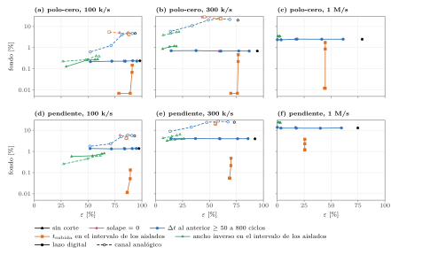

*Cortes contra el apilamiento, en el lazo digital y en el canal analógico: Poisson de 100 k, 300 k y 1 M/s con las líneas de 500 y 1300 ADU, 3 ranuras, disparo por polo-cero (a–c) y por pendiente (d–f). Cada punto es una corrida con el discriminador sobre una feature; ε son los eventos en su línea sobre los pulsos generados y el fondo, la fracción del espectro fuera de las líneas. Los intervalos de t_subida y del ancho inverso son los centrales del 50 al 99.9 % de los pulsos aislados, medidos en cada modo. En el lazo digital sólo el corte por t_subida limpia el fondo: a 1 M/s, con el polo-cero lo baja de 2.5 a 0.012 % y ε de 79 a 45 %; con la pendiente, de 12.9 a 1.2 %, y ε de 75 a 26 %. El solape y el Δt al anterior sólo bajan ε: el apilamiento que llega al espectro es el que el disparo no separó, y ese no tiene solape ni un disparo anterior cerca. El ancho inverso baja ε mucho más que el fondo, y a 1 M/s lo empeora: con colas de τ = 250 muestras, la del pulso anterior lo saca del intervalo de los aislados. En el canal analógico el fondo es mucho mayor (4.7 % a 100 k/s con el polo-cero, sin corte) y el corte por t_subida casi no lo toca (4.5 %): no es apilamiento, son pulsos de subida normal que el canal saca de su línea. Los puntos del borde inferior tienen fondo menor que 0.01 %.*

## 2.13 No linealidad diferencial

Para medir la DNL, generamos alturas uniformes con la tabla de 1024 del generador sorteada,
y ruido σ = 18.5 ADU por muestra como dither. Para que no haya apilamiento, usamos pulsos de
τ = 50 muestras cada 300 ciclos, con 12.5 M pulsos en 6 tandas. Histogramamos el trapecio y
el pico, este último con un canal por ADU, y calculamos la DNL contra un polinomio de grado
3 ajustado sobre la meseta. El polinomio saca la tendencia lenta, que es INL; en el lazo
digital da lo mismo que la media (de grado 0 a 8, el rms cambia en el tercer decimal).

La primera corrida, de 500 a 6000 ADU, dio más que la estadística: el trapecio 3.3 % rms
contra 1.9 % de Poisson, y el pico 2.7 % contra 2.1 %. Encontramos dos causas, las dos del
estímulo:

1. **La tabla redondeada.** La tabla redondea sus 1024 alturas a enteros: de 500 a 6000
   van en pasos de 5 y 6 ADU, así que la densidad de entrada no es pareja. Después del
   promedio del trapecio, el dither queda en σ ≈ 4.6 ADU, y eso no alcanza para borrar los
   pasos. La DNL del trapecio sale periódica, y se presenta en la Fig. `meritos_dnl` junto
   con la que se calcula desde la tabla: la sigue, con correlación 0.69. El pico no la ve,
   porque su dither es el ruido de una muestra.
2. **Tandas repetidas.** De las 6 tandas, la 2 y la 3 dieron histogramas idénticos, y la 4
   y la 5 también. `gen_pulsos` saca las semillas de la amplitud y del ruido de
   `(SEMILLA ^ K) | 1`, que fuerza el bit 0, así que las semillas 2k y 2k+1 dan el mismo
   estímulo. Con dos tandas repetidas la varianza de cada canal sube 10/6, como un
   χ²/canal de 1.67, y eso explica el exceso del pico. Ahora las tandas usan semillas de a
   2.

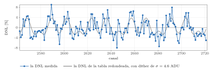

*La DNL que deja la tabla del generador, en la primera corrida: lazo digital, alturas uniformes de 500 a 6000 ADU, τ = 50 muestras cada 300 ciclos, ruido σ = 18.5 ADU por muestra como dither y 12.5 M pulsos. Son 160 canales del trapecio, con DNL = h/ĥ − 1 y ĥ un polinomio de grado 3 ajustado sobre la meseta. Las 1024 alturas de la tabla, redondeadas a enteros, van en pasos de 5 y 6 ADU, en un patrón que se repite cada 8 alturas (34 canales). Después del promedio del trapecio el dither queda en σ ≈ 4.6 ADU, que no alcanza para borrar los pasos. La línea es la DNL calculada desde la tabla con ese dither: sigue a la medida, con correlación 0.69. Con pasos iguales de 5 ADU el patrón desaparece.*

Repetimos la etapa de 500 a 5615 ADU, con pasos de 5, y con semillas distintas, en el lazo
digital y en el canal analógico. En la tabla van las dos corridas. La columna de pares e
impares es el rms de la DNL plegada con período 2, que con esta estadística tendría que dar
0.04 %.

| Espectro                  | Tabla                                | Cuentas por canal | DNL rms | Poisson | χ²/canal | Máximo | Pares e impares |
| ------------------------- | ------------------------------------ | ----------------- | ------- | ------- | -------- | ------ | --------------- |
| Trapecio, lazo digital    | pasos de 5 y 6 ADU, tandas repetidas | 2878              | 3.28 %  | 1.86 %  | 3.10     | 10.3 % | —               |
| Pico, lazo digital        | pasos de 5 y 6 ADU, tandas repetidas | 2273              | 2.65 %  | 2.10 %  | 1.60     | 9.8 %  | —               |
| Trapecio, lazo digital    | pasos de 5 ADU                       | 3095              | 1.76 %  | 1.80 %  | 0.96     | 6.6 %  | 0.00 %          |
| Pico, lazo digital        | pasos de 5 ADU                       | 2445              | 2.03 %  | 2.02 %  | 1.01     | 8.2 %  | 0.01 %          |
| Trapecio, canal analógico | pasos de 5 ADU                       | 3258              | 1.76 %  | 1.75 %  | 1.01     | 5.8 %  | 0.01 %          |
| Pico, canal analógico     | pasos de 5 ADU                       | 2113              | 3.41 %  | 2.18 %  | 2.46     | 15.0 % | 1.53 %          |

En el lazo digital, con la tabla de pasos iguales, el trapecio y el pico quedan en la
estadística: χ²/canal de 0.96 y 1.01. El MCA no agrega DNL. El máximo, de 6.6 y 8.2 %, es
el que se espera de unos 4000 canales con ese ruido.

En el canal analógico el trapecio también queda en la estadística. El pico, en cambio, es
una prueba de densidad de códigos y da 3.41 % contra 2.18 %. Tiene dos estructuras:

- **Pares e impares.** Un código de cada dos es 3 % más ancho que el otro (±1.5 %).
- **Zonas anchas.** Hay zonas de decenas de canales de hasta 15 %, en los mismos lugares
  en las dos corridas: correlación 0.94 en bloques de 64 canales.

Esta prueba mide el DAC y el ADC juntos, y no las separa. El trapecio no las ve, porque
promedia muchas muestras de cada pulso, con códigos distintos.

## 2.14 Separación de formas por PSD

Para medir cuánto separa la PSD (Q_cola/Q) dos formas parecidas, generamos pulsos
aislados con τ = 200 y 250 muestras, de 50 a 4000 ADU, con ruido σ = 9.2 ADU y el
disparo del ASG. Q_cola es la carga desde la muestra 32 de la compuerta. En cada amplitud
medimos los dos espectros de PSD y la figura de mérito FOM, la distancia entre los
centroides sobre la suma de las FWHM.

Los resultados se presentan en la Fig. `meritos_psd`. La FOM crece proporcional a la
amplitud, de 0.65 en 50 ADU a 52.5 en 4000, porque el ancho de cada PSD es el ruido
sobre la carga. Las dos formas quedan separadas (FOM = 1.27, los centroides a 6σ) desde
unos 95 ADU.

En el canal analógico la FOM es unas 0.55 veces la digital en todas las amplitudes, y las
formas quedan separadas desde unos 170 ADU. No es el ruido: arriba de 1000 ADU el ancho de
cada PSD es el mismo que en el lazo digital. El canal corre las dos PSD de 0.86–0.88 a
0.91–0.93 y las acerca: la distancia entre centroides baja de 0.016 a 0.009. La respuesta
del canal, con su sobrepico y su caída lenta, se suma a las dos formas y achica la
diferencia entre sus colas.

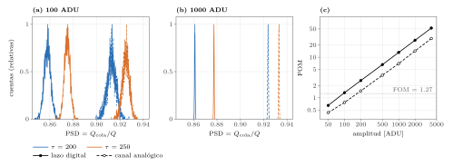

*Separación de dos formas por PSD = Q_cola/Q, en el lazo digital y en el canal analógico: pulsos aislados con τ = 200 y 250 muestras, de 50 a 4000 ADU, ruido σ = 9.2 ADU, Q_cola desde la muestra 32 de la compuerta, disparo del ASG y 4000 pulsos por punto. (a) y (b) Los espectros de PSD a 100 y 1000 ADU, de a 4 canales. (c) La figura de mérito FOM = (distancia entre centroides)/(FWHM₁ + FWHM₂): crece proporcional a la amplitud, porque el ancho de cada PSD es el ruido sobre la carga. En el lazo digital pasa FOM = 1.27, los dos centroides a 6σ, en unos 95 ADU. El canal analógico corre las dos PSD a 0.91–0.93 y las acerca: con el mismo ancho, la distancia entre centroides baja de 0.016 a 0.009, la FOM es 0.55 veces la digital y pasa 1.27 en unos 170 ADU.*

## 2.15 Ajuste del polo-cero

Para ver cuánto importa la M del polo-cero del trapecio, generamos pares de A1 = 4000 y
A2 = 2400 ADU (§2.6) separados Δt = 100, 200 y 400 ciclos, con τ = 250 muestras, y
corrimos la M del trapecio ΔM entre −10 y +10 % de la del generador (M = 249.1,
`trap_mq` = 3986). A2 cae sobre la cola de A1: si la M no la cancela, esa cola entra en
su amplitud. Medimos el error de las dos amplitudes contra los pulsos aislados.

Los resultados se presentan en la Fig. `meritos_polo_cero`. El error de A2 se anula en
ΔM = +0.03 a +0.06 %. La M que calcula `gen_pulsos_mq` para el generador es la que
cancela su cola. El error de A1, que no tiene nada debajo, no se mueve.

La pendiente cerca de ΔM = 0 es de 0.51, 0.34 y 0.15 % de error por % de ΔM con Δt =
100, 200 y 400. Baja como e^(−Δt/τ), como la cola de A1 debajo de A2. La curva no es
recta: con ΔM < 0 el error crece más rápido que con ΔM > 0. Por eso una recta por todos
los puntos ponía el cero en +0.27 %, como daba antes el resumen de `analizar_polo_cero`;
ahora el cero se interpola entre los dos puntos que lo encierran.

En el canal analógico no hay una M que anule el error en todos los Δt. Con ΔM = 0, A2
sale baja: 0.4, 1.3 y 1.3 % con Δt = 100, 200 y 400. La caída lenta del canal deja debajo
de A2 una cola negativa (§2.5). Para compensarla hay que sobrecompensar el polo-cero, con
una M menor que la del generador. Con M menor, el polo-cero cancela de más la cola τ de A1
y deja debajo de A2 un resto positivo, proporcional a ΔM y a lo que queda de esa cola,
A1·e^(−Δt/τ). Ese resto puede cancelar la cola del canal, pero las dos tienen otra forma:
la de τ cae con 250 muestras, y la del canal dura de 3 a 13 µs (400 a 1600 muestras).
Cuanto más lejos cae A2, menos cola τ queda para compensar, y más hay que correr M.

Para ver cuánto, corrimos la misma etapa en la placa simulada con el canal medido (§2.5),
con los polos lentos y sin ellos, y extendimos Δt hasta 1600 con ΔM hasta −30 %. Los datos
quedaron en `software/datos/sim_polo_cero_canal`. Los resultados se presentan en la Fig.
`meritos_polo_cero` (c) y (d).

| Δt [ciclos] | ΔM que anula el error, placa | Réplica con los polos lentos | Réplica sin los polos lentos |
| --- | --- | --- | --- |
| 100 | −2.1 % | −2.9 % | +0.4 % |
| 200 | −3.8 % | −3.4 % | +0.04 % |
| 400 | −8.4 % | −5.3 % | +0.07 % |
| 800 | — | −15 % | — |

Sin los polos lentos, la réplica da el cero del lazo digital: la caída lenta es toda la
causa. Con ellos, reproduce el signo y el orden de magnitud, no el valor; los polos lentos
salen de una sola captura de 65 µs y quedan poco determinados (§2.5). En la réplica, el
error con ΔM = 0 crece hasta Δt ≈ 200 (−1.2 %) y después baja despacio: −0.8 % en 400,
−0.4 % en 800 y −0.14 % en 1600. En 1600 la cola τ ya no existe (e^(−1600/250) = 0.2 %)
y ninguna M lo corrige: la pendiente es 0. En Δt = 50 tampoco: ahí el error casi no
depende de M (pendiente −0.003), probablemente porque el banco mide A2 con la forma más
corta.

Una M única sólo reparte el error. Con ΔM = −4 %, en la placa, el error de A2 queda en
+0.4, 0 y −0.7 % con Δt = 100, 200 y 400, contra −0.4, −1.3 y −1.3 % con ΔM = 0. Lo que
lo anula es lo mismo que en §2.5: compensar los polos lentos antes del trapecio.

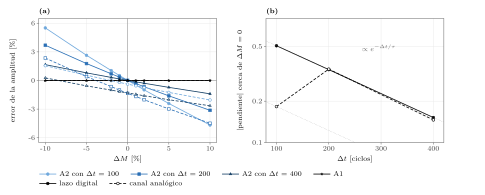

*Ajuste del polo-cero del trapecio, en el lazo digital y en el canal analógico: pares de A1 = 4000 y A2 = 2400 ADU con τ = 250 muestras, separados Δt = 100, 200 y 400 ciclos, 1000 pares por punto, disparo por polo-cero y la M del trapecio corrida ΔM entre −10 y +10 % de la del generador (M = 249.1, `trap_mq` = 3986). (a) El error de la amplitud de A2, que cae sobre la cola de A1, contra ΔM; el de A1 no se mueve. En el lazo digital el error se anula en ΔM = +0.03 a +0.06 %: la M que calcula `gen_pulsos_mq` es la que cancela la cola del generador. La curva no es recta: con ΔM < 0 el error crece más rápido que con ΔM > 0. En el canal analógico, con ΔM = 0, A2 sale de 0.4 a 1.3 % baja. (b) La pendiente cerca de ΔM = 0: en el lazo digital baja como e^(−Δt/τ), como la cola de A1 debajo de A2. (c) El ΔM que anula el error de A2 en el canal analógico, en la placa y en la placa simulada con el canal medido, con los polos lentos y sin ellos: hay que sobrecompensar el polo-cero, cada vez más con Δt (−2 a −8 % en la placa, −15 % en 800 en la réplica), porque la cola τ que compensa cae con 250 muestras y la del canal dura de 400 a 1600. Sin los polos lentos el cero vuelve al del lazo digital. (d) El error de A2 con ΔM = 0: la cola lenta del canal debajo de A2, que en la réplica llega a −1.2 % en Δt ≈ 200 y sigue en −0.14 % en 1600, donde ya no queda cola τ y ninguna M la corrige.*

## 2.16 Ventana ciega de los cortes por forma

Para medir desde qué separación ven el apilamiento los cortes por forma, generamos pares
de 4000 y 2400 ADU separados Δt de 2 a 512 ciclos, con disparo por polo-cero y por
pendiente. Los pulsos tienen subida 0, un escalón, o 2, unas 9 muestras de 10 a 90 %. En
cada Δt contamos los disparos por par, los eventos aceptados fuera de las dos líneas (el
apilado que llega al espectro) y los que quedan en su línea, sin corte y con los cortes por
`t_subida` y por ancho inverso en el intervalo del 90 % de los aislados. El 2026-11-16 el
barrido llegó a Δt = 48, todavía dentro de la compuerta; el 2026-11-17 lo extendimos hasta
512.

Los resultados se presentan en la Fig. `meritos_ventana_ciega`. Mientras el disparo da
uno por par, el apilado entra al espectro siempre que no haya corte. Con subida 0, el
corte por `t_subida` lo saca desde Δt = 2, y el de ancho inverso desde 5 con el
polo-cero y desde 8 con la pendiente. Con subida 2, el de `t_subida` deja pasar parte
hasta Δt = 4 (el 90 % de los pares en Δt = 2 y el 6 % en 4).

Con subida 2 aparece algo más. Los dos disparos llegan desde Δt = 24 (polo-cero) y 28
(pendiente), pero sin corte los dos eventos siguen fuera de su línea hasta Δt = 40, y en
48 sólo A1 vuelve a la suya. Desde 64 los dos están en su línea. El banco no los marca: les
asigna una forma y los mide mal. Con subida 0, en cambio, el banco marca los dos eventos
(van al canal 0, fuera del apilado) mientras no le alcanza la separación, y desde Δt = 16
con el polo-cero y 20 con la pendiente los dos caen en su línea, como en la resolución de
pares (§2.6).

Los cortes cuestan pares que el banco sí separa:

- Con subida 0, el de `t_subida` deja en su línea uno solo de los dos pulsos hasta
  Δt = 96, porque el otro le alarga la subida medida, y desde 128 los deja a los dos.
- Con subida 2, el de `t_subida` no deja ninguno hasta 96. Desde 128 deja una fracción
  que sube del 50 % al 95 % en 512.
- El de ancho inverso rechaza A2 en todo el barrido, hasta 512: A2 cae sobre la cola de A1
  (τ = 250 muestras), que le cambia el cociente pico/Q.

Estos cortes sirven contra el apilamiento que el disparo no separa, pero cuestan los pares
que el banco sí separa, hasta unas 2τ con el ancho inverso.

En el canal analógico, con la pendiente y con subida 2, todo pasa casi igual que en el lazo
digital. Con el polo-cero y subida 0 no: el disparo da 3 o 4 por par en lugar de 1 o 2. El
pulso sube en una muestra, y el sobrepico del canal (23 %) vuelve a disparar el polo-cero.
El disparo de más hace que el banco marque A1, y A1 se pierde en todo el barrido; desde
Δt = 192 sólo A2 queda en su línea.

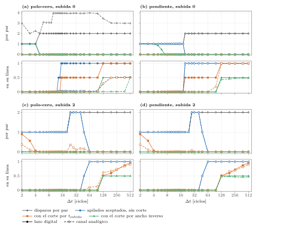

*Ventana ciega de los cortes por forma, en el lazo digital y en el canal analógico: pares de 4000 y 2400 ADU separados Δt de 2 a 512 ciclos, 1000 pares por punto, disparo por polo-cero (a, c) y por pendiente (b, d), con pulsos de subida 0, un escalón (a, b), y 2, unas 9 muestras de 10 a 90 % (c, d). En cada panel, arriba, por par: los disparos, en gris, y los eventos aceptados fuera de las dos líneas, el apilado que llega al espectro, sin corte (azul) y con los cortes por t_subida (naranja) y por ancho inverso (verde) en el intervalo del 90 % de los aislados; abajo, la fracción de los dos pulsos que queda en su línea. Mientras hay un solo disparo, sin corte el apilado entra siempre. Con subida 0, el corte por t_subida lo saca desde Δt = 2, y el de ancho inverso desde 5 (polo-cero) y 8 (pendiente); con subida 2, el de t_subida deja pasar parte hasta Δt = 4. Ningún corte es gratis dentro de la compuerta. Con subida 0, el de t_subida deja en su línea uno solo de los dos pulsos hasta Δt = 96, y desde 128 los dos; con subida 2 no deja ninguno hasta 96, y desde 128 una fracción que sube del 50 al 95 % en 512. El de ancho inverso rechaza A2, que cae sobre la cola de A1, hasta 512. En el canal analógico, el polo-cero con subida 0 dispara 3 o 4 veces por par, porque el sobrepico del canal lo vuelve a disparar, y A1 se pierde en todo el barrido.*

## 2.17 Deriva

La deriva es cuánto se mueve con el tiempo, a tasa fija, la conversión de amplitud a
canal. La ganancia y el offset de la cadena analógica (el DAC, los front-ends y el ADC, con
sus referencias de tensión) cambian lentamente, sobre todo con la temperatura, y el mismo
pulso cae en otro canal. No es el corrimiento con la tasa de §2.5, que depende de la
actividad y no del tiempo. Durante una corrida, la deriva ensancha la línea en cuadratura
con su ancho propio. Para que la FWHM no crezca más de 5 %, el centroide tiene que quedarse
dentro de 0.32 FWHM ([`limites_resolucion_y_deriva.md` §6](mca/limites_resolucion_y_deriva.md)).
Con la FWHM de los pulsos aislados en el canal analógico, 0.35 % (k = 64, §2.11), eso son
0.11 %, unas 1100 ppm. Los MCA comerciales la especifican en ppm/°C, y la corrigen con un
estabilizador de espectro: un lazo lento que mantiene un pico de referencia en su canal,
con una ganancia fina y un offset antes del histograma.

Para medir la deriva del canal analógico, alternamos líneas de 1500 y 4000 ADU cada 3000
ciclos, sin apilamiento, y medimos un punto por minuto durante 2 h, con 83 332 pulsos por
punto. En cada punto leímos la temperatura del Zynq (XADC). Con las dos líneas separamos
la deriva en offset y ganancia.

Los resultados se presentan en la Fig. `meritos_deriva`. En 2 h la ganancia recorre
210 ppm, con una pendiente de −40 ppm/h. Las líneas recorren 0.8 ADU (la de 1500) y 1.1 ADU
(la de 4000), y el offset 0.6 ADU. De un minuto al siguiente las líneas saltan unas
0.12 ADU, 15 veces el error estadístico de cada punto (0.008 ADU): el canal tiene una
fluctuación lenta que la estadística no explica.

La temperatura fue de 41.8 a 42.7 °C, salvo el primer punto, a 43.2 °C. Contra ella la
ganancia da −144 ppm/°C, con r = −0.65. Con un rango de 1 °C, es una indicación más que una
medida: haría falta variar la temperatura a propósito para separar la temperatura del
tiempo.

Las 210 ppm de las 2 h quedan dentro de la tolerancia de 1100 ppm. Con −144 ppm/°C, se
llegaría a ella con unos 8 °C. Los comerciales especifican menos de 50, menos de 35 y ±10 ppm/°C
(DSPEC, Lynx y Amptek). Un estabilizador corregiría la parte lenta, como las −40 ppm/h,
pero no los saltos de minuto a minuto, más rápidos que su constante de tiempo.

En esta medición la deriva es la del DAC y la del ADC juntas. En una medición con detector
el DAC no está, y entra la deriva del detector. Por eso, estabilizar con `gen_pulsos` como
pulser corregiría también la deriva del DAC, que la medición real no tiene. Para separarlas
hace falta medir el DAC por otro lado, o estabilizar con una línea de la fuente.

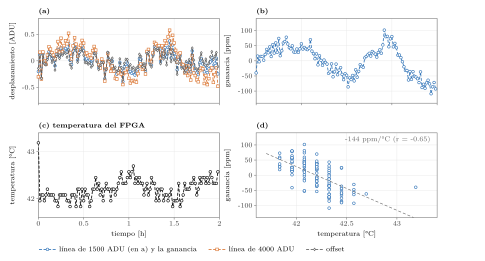

*Deriva del canal analógico en 2 h: líneas de 1500 y 4000 ADU alternadas cada 3000 ciclos, 83 332 pulsos por punto, un punto por minuto, y la temperatura del Zynq (XADC). Todo respecto de la media de las 2 h, en ADU de entrada. (a) El desplazamiento de las dos líneas y del offset: recorren 0.8, 1.1 y 0.6 ADU, y de un minuto al siguiente saltan unas 0.12 ADU, 15 veces el error estadístico de cada punto (0.008 ADU). (b) La ganancia: recorre 210 ppm, con una pendiente de −40 ppm/h. (c) La temperatura, de 41.8 a 42.7 °C salvo el primer punto, a 43.2 °C. (d) La ganancia contra la temperatura: −144 ppm/°C con r = −0.65, en poco más de 1 °C.*

# 3. El osciloscopio

## 3.1 Las pruebas realizadas

La fidelidad se corrió en la placa el 2026-11-14. El throughput junta el barrido de tasa
del MCA (§2.2) con las campañas del ring del 2026-11-12 y del 2026-11-17, y el de la
BRAM se corrió el 2026-11-19.

| Prueba                        | Estímulo                                                                                                                                                                                                           | Resultado principal                                                                                                                                                                                                                                                                                               | Figura                                                             |
| ----------------------------- | ------------------------------------------------------------------------------------------------------------------------------------------------------------------------------------------------------------------ | ----------------------------------------------------------------------------------------------------------------------------------------------------------------------------------------------------------------------------------------------------------------------------------------------------------------- | ------------------------------------------------------------------ |
| Fidelidad del OSC, digital    | ring con disparo del ASG y 4 casos de BRAM                                                                                                                                                                         | FIEL: 1.45 M muestras del ring y las 4 BRAM sin diferencias; `DROP_BUSY` = modelo                                                                                                                                                                                                                                 | sin figura ([§3.2](#32-fidelidad-del-osciloscopio))                |
| Fidelidad del OSC, analógica  | el de Fidelidad del OSC, digital                                                                                                                                                                                   | FIEL: 0 de 1.45 M muestras del ring y 0 de 32 000 de la BRAM pasan el umbral                                                                                                                                                                                                                                      | [`fidelidad_analogica`](#32-fidelidad-del-osciloscopio)            |
| Throughput de los dos caminos | el de Tasa para el MCA; para el osciloscopio, disparos aleatorios del generador del ring de 10 k a 3 M/s, ventanas de 32 a 1024 muestras; para la BRAM, `gen_pulsos` periódico y de Poisson con el disparo del ASG | a 3 M/s de entrada, el MCA registra 1.9 M/s; con 8 + 24 muestras, el osciloscopio pone 1.2 M/s en la DDR, y a la PC llegan 304 k/s y a la SD 87 k/s; con 32 + 992, 49, 8.2 y 3.7 k/s; por la BRAM, con 8 + 24 muestras, 49 k/s con el lector de C y 4.3 k/s con librp desde Python, y con 32 + 992, 2.0 y 1.0 k/s | [`throughput_caminos`](#33-throughput-de-los-dos-caminos-de-datos) |

## 3.2 Fidelidad del osciloscopio

Para verificar que el osciloscopio captura sin errores, capturamos las señales del
generador con el ring, con el disparo del ASG, y con 4 casos de la BRAM. Después
comparamos cada muestra con la que se tenía que capturar.

En el lazo digital la comparación es bit a bit contra `gen_pulsos_model`. La captura fue
FIEL:

- las 1.45 M muestras del ring;
- los 4 casos de la BRAM;
- las marcas de tiempo del ring, contra los pulsos generados;
- `DROP_BUSY`, contra 2·S + 3.

En el canal analógico hay ruido, así que no se puede comparar bit a bit. Comparamos IN1
contra el modelo del canal, ajustado con otra captura (§1.2). Una muestra es un error de
captura si su residuo pasa un umbral.

Los resultados se presentan en la Fig. `fidelidad_analogica`: una ventana de 3 µs de IN1
con el modelo en (a), y el residuo con el umbral en (b). En toda la campaña, ninguna
muestra pasa el umbral: 0 de 1.45 M en el ring y 0 de 32 000 en la BRAM. El residuo es
de 6 a 11 ADU rms, contra 4.7 del piso, y de 27 en el caso que satura.

El umbral fija la sensibilidad:

- una palabra corrida en +300 o una ventana del ring corrida se detectan;
- un corrimiento sobre la parte lenta de la señal no se detecta; la sensibilidad es de
  unas 60 ADU.

Los tests de `test_fidelidad_osc.py` inyectan esos errores en capturas simuladas.

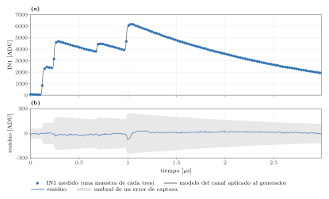

*Fidelidad de la captura en el canal analógico. (a) Una ventana de 3 µs de IN1 (el caso Poisson de la BRAM) y el modelo del canal aplicado a lo que sacó el generador; (b) el residuo y el umbral de un error de captura: el mayor entre 8 desvíos robustos del residuo y 6 del piso, más el 3 % de la señal (el front-end comprime ~1 % cerca del fondo de escala). El modelo es un FIR de 48 taps más tres polos lentos, ajustados con otra captura. En toda la campaña ninguna muestra pasa el umbral: 0 de 1.45 M en el ring y 0 de 32 000 en la BRAM. El residuo es de 6 a 11 ADU rms (27 en el caso que satura), contra 4.7 del piso.*

## 3.3 Throughput de los dos caminos de datos

Los dos caminos de datos registran un evento de manera distinta. El MCA lo mide en la FPGA
y suma una cuenta en el espectro. El osciloscopio guarda su forma, una ventana de muestras
de los dos canales, que el `event_ring` escribe en la DDR y el software lleva después a un
archivo. Para compararlos, medimos cuántos eventos por segundo registra cada uno contra la
tasa de entrada.

Para el MCA usamos el barrido de tasa de §2.2, con 3 ranuras y el disparo del ASG, en el
lazo digital. Para el osciloscopio usamos las campañas de
[`run_etapas_ring.py`](../software/campanas/run_etapas_ring.py), con el generador de
eventos del ring ([`event_ring/generador.md`](event_ring/generador.md)): disparos
aleatorios de 10 k a 3 M/s, con al menos 2 ciclos entre uno y otro, como los de
`gen_pulsos`. En cada slot, en lugar de la señal, el generador escribe un patrón que dice
qué disparo es. Cada etapa lleva las formas a otro destino:

- **A**: el `event_ring` las escribe en la DDR, y el lector sólo devuelve los créditos;
- **B**: el lector de C las copia y las verifica en la placa;
- **D**: la placa las manda a la PC por la red, y la PC las guarda
  ([`salida_por_red.md`](event_ring/salida_por_red.md));
- **C**: la sesión de Python las guarda en la SD de la placa, con el `sync` del final
  contado.

El ring absorbe ráfagas, así que un punto corto puede no perder nada aunque el destino sea
más lento que la entrada. Por eso, de B, C y D tomamos lo que pasa con el ring lleno, el
techo de la etapa. Lo que la red y la SD sostienen a una tasa dada es lo que pasa la
captura (A), hasta ese techo; al lector del ring (B) lo medimos también contra la tasa.

Para el camino original del osciloscopio, la BRAM, medimos el lector solo, como en la
etapa B, con [`run_techo_bram.py`](../software/campanas/run_techo_bram.py): `gen_pulsos`
por el lazo digital y el disparo del ASG. En la BRAM cabe un evento por vez: el PS lee
la ventana y re-arma el disparo antes del siguiente. Lo medimos con los dos lectores: el
lazo de C de libmca y el original, librp desde Python, el de `BramSource` antes de
libmca 0.11.0. Para el techo usamos un tren periódico de 3.9 M/s, que deja siempre un
disparo esperando al re-armar, en las mismas ventanas del ring; para la curva contra la
tasa, Poisson de 0.3 k a 3 M/s con 8 + 24 muestras.

Los resultados se presentan en la Fig. `throughput_caminos`: contra la tasa de entrada, con
ventanas de 8 + 24 muestras, en (a), y el techo de cada etapa contra el largo de la ventana
en (b). La línea llena es un camino de datos, y la punteada, un límite.
A 3 M/s de entrada:

| Camino       | Destino                      | 8 + 24 muestras | 32 + 992 muestras |
| ------------ | ---------------------------- | --------------- | ----------------- |
| MCA          | el espectro                  | 1.9 M/s         | —                 |
| Osciloscopio | la DDR (A)                   | 1.2 M/s         | 49 k/s            |
|              | el lector de C (B)           | 439 k/s         | 23 k/s            |
|              | la PC por la red (D)         | 304 k/s         | 8.2 k/s           |
|              | la SD (C)                    | 87 k/s          | 3.7 k/s           |
|              | la BRAM + lector de C        | 49 k/s          | 2.0 k/s           |
|              | la BRAM + librp desde Python | 4.3 k/s         | 1.0 k/s           |

- **La captura pierde desde tasas bajas.** Su tiempo muerto es de 2·S + 3 ciclos por
  evento, con S las muestras de la ventana (536 ns con 32), y no es paralizable
  (`DROP_BUSY`). A 100 k/s ya pierde el 5 % de los eventos; el MCA con 3 ranuras, el
  0.1 %.
- **Lo que llega a un archivo lo fija el destino, no la FPGA.** Con 32 muestras, a la PC
  llegan 304 k/s (49 MB/s, casi lo que da TCP solo), y en algunos puntos 202 k/s; a la SD,
  87 k/s (14 MB/s).
- **Por la BRAM, el límite es el software desde el primer evento.** Mientras el PS lee y
  re-arma, el disparo está ciego: con 32 muestras, 20.5 µs por evento con el lector de C
  y 232 µs con librp desde Python. Con 100 k/s de entrada el lector de C lee 34 k/s, y
  con 10 k/s librp desde Python lee 3.4 k/s. Sus techos, 49 y 4.3 k/s, quedan 6 y 70
  veces debajo de lo que llega a la PC por el ring con la misma ventana. Con ventanas
  largas manda la lectura palabra a palabra por el bus: con 1024 muestras, 511 µs con C
  y 983 µs con librp, 2.0 y 1.0 k/s, menos de lo que el ring guarda en la SD.
- **Con ventanas largas, cada destino baja como su ancho de banda sobre los bytes por
  evento**, 32 + 4S: con 1024 muestras llegan 8.2 k/s a la PC (34 MB/s) y 3.7 k/s a la SD
  (15 MB/s). La DDR baja con el tiempo muerto de la captura: el writer queda entre un 20 y
  un 24 % abajo de 2·S + 3.
- **El MCA no guarda muestras.** Con 3 M/s de entrada registra 1.9 M/s: 6 veces lo que
  llega a la PC con la ventana más corta del osciloscopio, y 230 veces con la más larga.

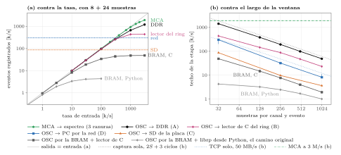

*Eventos registrados por segundo en los dos caminos de datos, medidos en la placa con generación interna: el MCA, que acumula el espectro en la FPGA (`gen_pulsos`, Poisson, disparo por el ASG, lazo digital, 3 ranuras), y el osciloscopio, que guarda las formas por el `event_ring` (generador del ring, disparos aleatorios) o, en el camino original, por la BRAM (`gen_pulsos` y el disparo del ASG). Las etapas del ring son los destinos de las formas: la DDR (A), el lector de C del ring, que copia y verifica cada evento (B), la PC por la red (D) y la SD de la placa con el `sync` contado (C). De la BRAM se mide el lector solo: el lazo de C de libmca y el original, librp desde Python. Línea llena: los caminos de datos, medidos; punteada: los límites (en (a), el techo de la red y el de la SD; en (b), la captura sola y TCP solo). (a) Contra la tasa de entrada, con ventanas de 8 + 24 muestras. El lector de C del ring lee todo lo que captura el ring hasta 300 k/s de entrada, y se queda en 439 k/s. Los techos de la red y de la SD, medidos con el ring lleno, son las líneas horizontales (la de la red es la mediana de esos puntos, que van de 202 a 308 k/s): cada uno sostiene lo que pasa la captura (A) hasta su techo. A 3 M/s de entrada el MCA registra 1.9 M/s, la captura pone 1.2 M/s en la DDR, el lector del ring lee 439 k/s y a la PC llegan 0.3 M/s; a la SD, 87 k/s. Por la BRAM, el lector de C lee 34 k/s con 100 k/s de entrada y llega a 49 k/s; librp desde Python, 3.4 k/s con 10 k/s, y llega a 4.4 k/s. (b) El techo de cada etapa, lo que pasa cuando la entrada le sobra, contra el largo de la ventana: la captura pierde por su tiempo muerto de 2S + 3 ciclos, el writer queda un poco abajo, y la red y la SD bajan como el ancho de banda sobre los bytes por evento (32 + 4S). La BRAM baja con la lectura palabra a palabra por el bus: con 1024 muestras, 2.0 k/s con C y 1.0 k/s con Python. El MCA no guarda muestras: su referencia es lo que acepta a 3 M/s de entrada.*

# 4. Lo que falta

En la placa:

1. Calibrar el κ de la base dinámica, que con κ = 1 corrige de más (§2.5): la línea de
   1300 ADU queda 11 canales arriba. Por estos datos, κ estaría entre 0.5 y 0.7.
2. Separar el DAC del ADC en la DNL analógica del pico (§2.13). Por ejemplo, repetir con
   otra base del generador, que corre los códigos del DAC y no los del ADC.
3. Repetir la deriva con la temperatura variando a propósito (§2.17), y separar la del
   DAC de la del ADC (por ejemplo, con un nivel fijo en OUT1 y un multímetro). Es lo que
   hace falta para decidir cómo estabilizar el espectro.
4. Medir lo que sostiene cada destino del osciloscopio con puntos largos a cada tasa
   (§3.3). Hoy la curva sale de dos mediciones separadas: la captura y el techo de cada
   etapa con el ring lleno.

En el software:

- Volver a correr la histéresis simulada, para confirmar que el arreglo de la réplica
  explica la línea en ~73 canales (§2.7).
- Que `analizar_walk` deje afuera las amplitudes que saturan el ADC, para que el
  resumen dé la INL de §2.9 y no 0.3 % FS.
- Una prueba que falta escribir: la latencia del disparo del ADC contra el del ASG en la
  fidelidad.

Del diseño, para decidir:

- Las semillas de `gen_pulsos`: `(SEMILLA ^ K) | 1` junta 2k y 2k+1 en el mismo estímulo
  (§2.13). La campaña ya usa semillas de a 2; el RTL podría usar las 32 bits, por ejemplo
  `{(SEMILLA ^ K)[30:0], 1'b1}`.
- El polo-cero con subida 0 en el canal analógico se vuelve a disparar con el sobrepico
  (§2.16).
